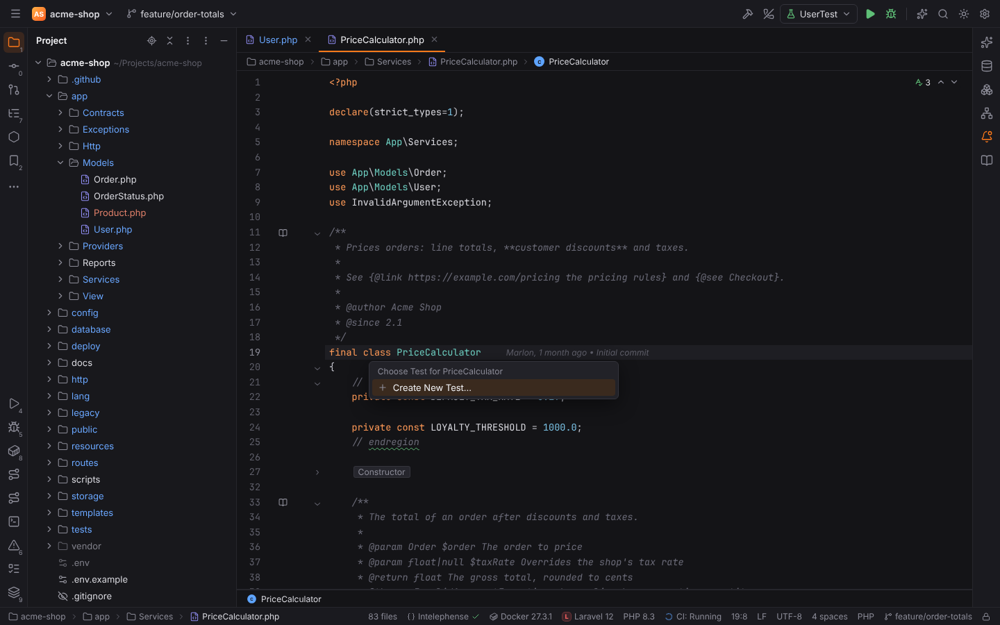
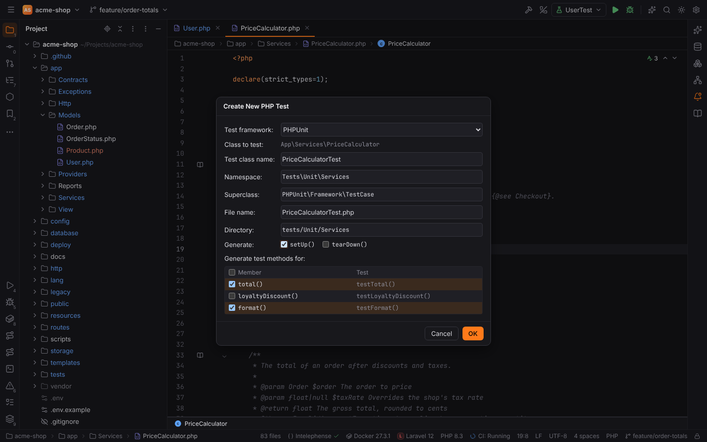
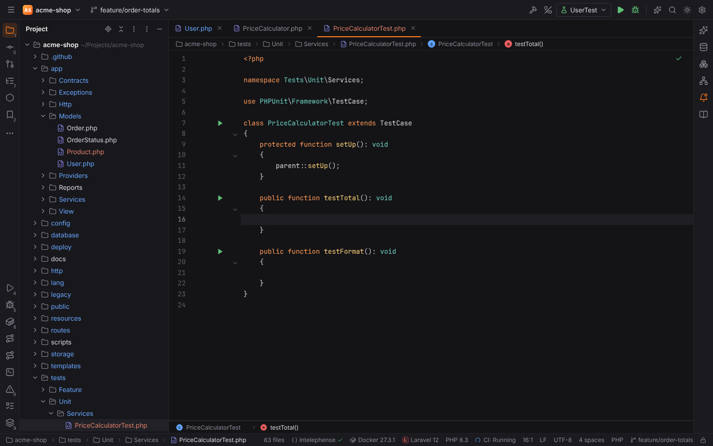
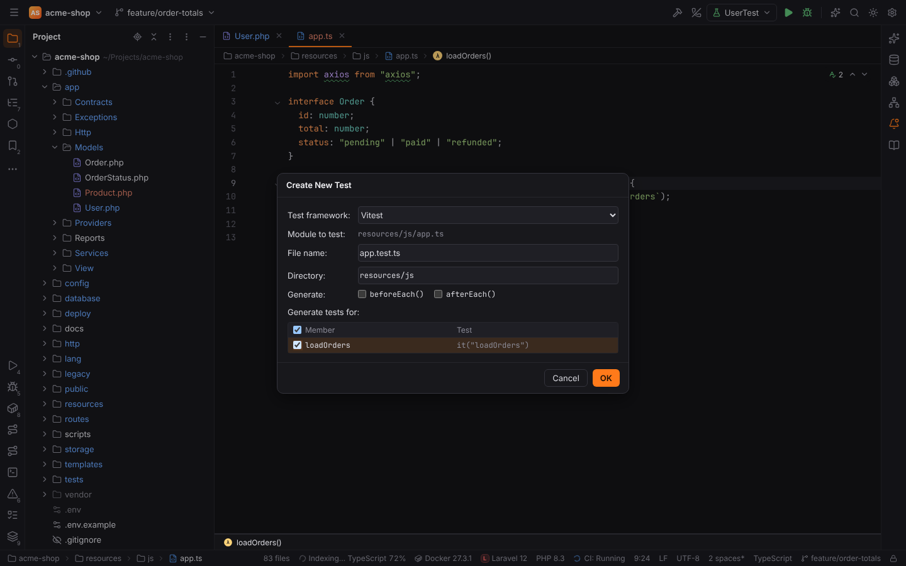

# Go to Test and Create Test

**Navigate | Test** (`Ctrl+Shift+T`, macOS `Cmd+Shift+T`, action id `GotoTest`) jumps between
a class, component or module and its tests, like PHPStorm:

- From a class or module it goes to its tests; from a test it goes to the tested class or
  module (**Test Subject**).
- One result opens directly.
- Several results open the chooser **Choose Test for Order (2 found)**, best match first: the
  test whose folders mirror the class's (`app/Models/Order.php` →
  `tests/Unit/Models/OrderTest.php`) comes before `tests/Feature/OrderTest.php`.
- Without a test the chooser **Choose Test for Order** only offers **Create New Test...**,
  which is also the first row whenever tests exist.



| From | To |
| --- | --- |
| PHP class `Order.php` | `OrderTest.php` (PHPUnit or Pest), anywhere in the project |
| PHP test `OrderTest.php` | `Order.php` outside the test folders |
| `Button.vue`, `format.ts`, `api.js`, … | `Button.spec.ts`, `format.test.ts`, `__tests__/api.test.js`, `tests/…/format.test.ts` |
| JS/TS test | the module or component with the same name |

Tests are found in Rust next to the project's files, so remote projects are searched on their
host.

## Create New Test

**Create New Test...** opens **Create New PHP Test** for PHP classes and **Create New Test**
for JavaScript, TypeScript, Vue and Svelte files. All fields start with the values PHPStorm
would suggest and can be changed:



| Field | PHP | JavaScript / TypeScript |
| --- | --- | --- |
| Test framework | PHPUnit; Pest first when composer.json requires `pestphp/pest` or `tests/Pest.php` exists | Vitest or Jest from package.json (`vitest`, `jest`) or `vitest.config.*` / `jest.config.*` |
| Class / Module to test | the class's fully qualified name | the file |
| Test class name | `<Class>Test` (PHPUnit) | — |
| Namespace | from composer.json's `autoload-dev` PSR-4 rules; typing a namespace moves the directory along | — |
| Superclass | the project's `Tests\TestCase` when it exists, Symfony's `WebTestCase` for controllers, otherwise `PHPUnit\Framework\TestCase`; the list offers the others | — |
| File name | `<Class>Test.php` (follows the class name until edited) | `<name>.test.ts` or `<name>.spec.ts` like the project's existing tests |
| Directory | see below | next to the subject, in `__tests__` or in `tests/`, like the project's existing tests |
| Generate | `setUp()` / `tearDown()` (Pest: `beforeEach()` / `afterEach()`) | `beforeEach()` / `afterEach()` |
| Generate test methods for | the class's public methods (no magic methods) → `testShip()`, Pest `test('ship')` | the module's exports → `it("format")` |

Where PHP tests go:

| Project | Class | Test |
| --- | --- | --- |
| Laravel (`tests/Unit`, `tests/Feature`) | `app/Models/Order.php` | `tests/Unit/Models/OrderTest.php`, namespace `Tests\Unit\Models` |
| Laravel | `app/Http/Controllers/OrderController.php` (also `Livewire`, `Console`) | `tests/Feature/Http/Controllers/OrderControllerTest.php`, superclass `Tests\TestCase` |
| Symfony (`App\Tests\` → `tests/`) | `src/Service/Mailer.php` | `tests/Service/MailerTest.php`, namespace `App\Tests\Service` |
| Without `autoload-dev` | `src/Billing/Invoice.php` | `tests/Billing/InvoiceTest.php`, namespace `Tests\Billing` |

Laravel's Unit tests extend `PHPUnit\Framework\TestCase` like the skeleton's, unless the
project's Unit tests already use `Tests\TestCase`.

**OK** creates the file (never replacing an existing one), opens it with the caret in the
first test, and shows it in the Project tool window. The new test gets its green run icons in
the gutter like every other test.



The JavaScript / TypeScript dialog:



A generated PHPUnit test:

```php
<?php

namespace Tests\Unit\Models;

use PHPUnit\Framework\TestCase;

class OrderTest extends TestCase
{
    protected function setUp(): void
    {
        parent::setUp();
    }

    public function testShip(): void
    {

    }
}
```

A Vitest test imports the selected exports from the subject:

```ts
import { describe, expect, it } from "vitest";
import { format } from "./format";

describe("format", () => {
  it("format", () => {
    expect(format).toBeDefined();
  });
});
```

Jest tests use Jest's globals and need no import.

## See also

- [File Structure, Navigation Bar and Related Symbol](navigation-bar-and-file-structure.md#related-symbol):
  Related Symbol (`Ctrl+Alt+Home`) also lists a file's tests among its views, routes and
  migrations.
- [File and code templates](file-templates.md): the PSR-4 rules behind the namespace and
  directory fields.
