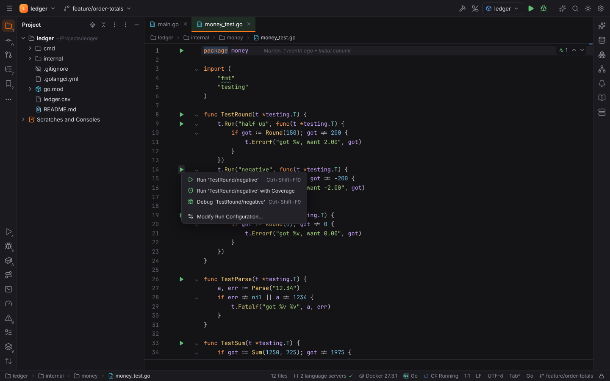
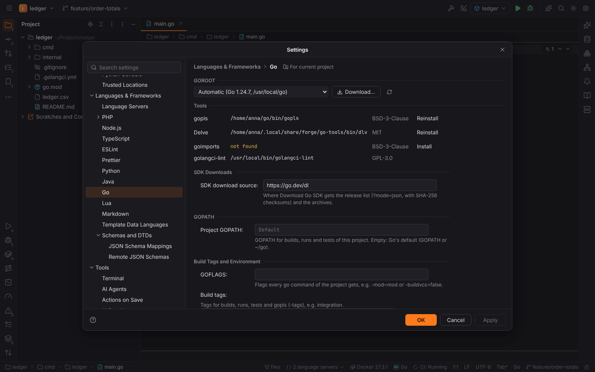
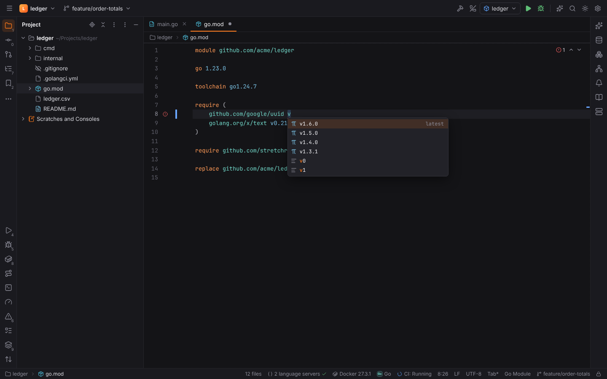
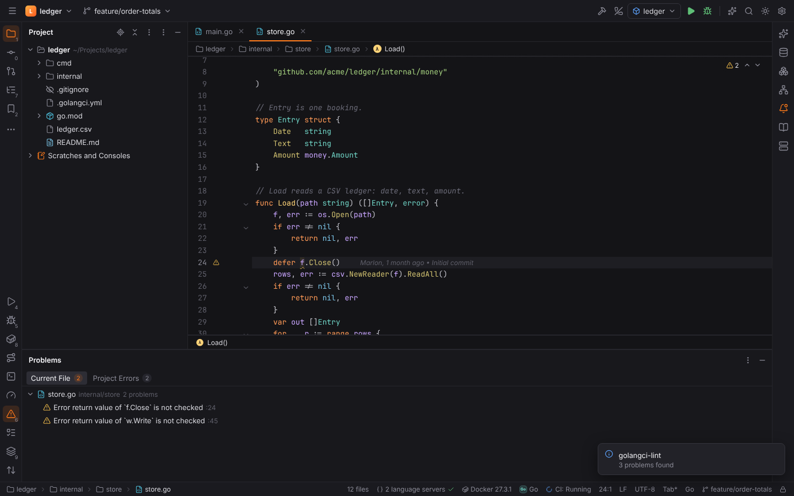
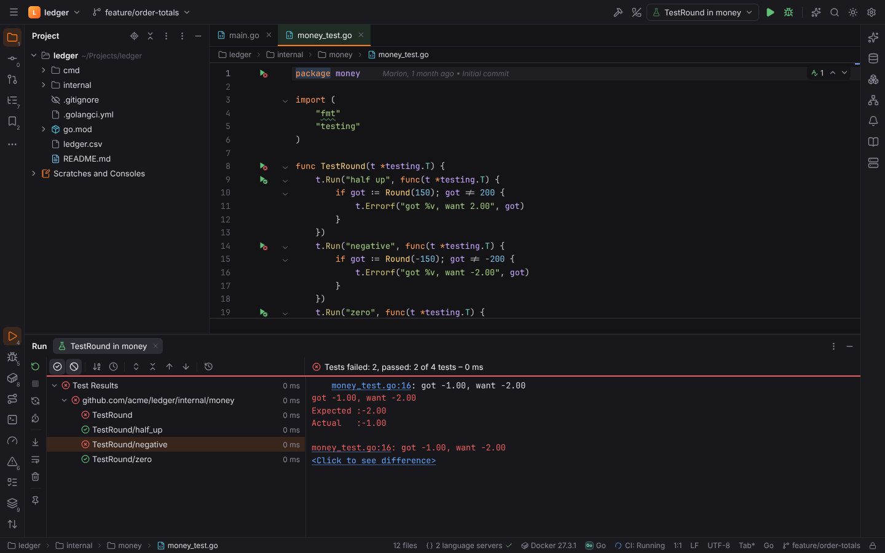
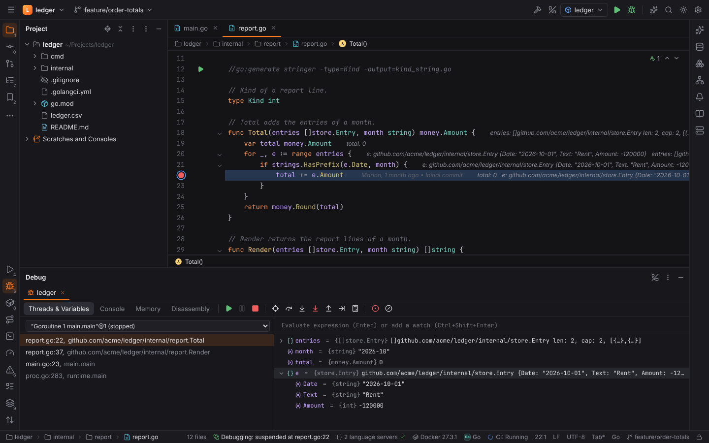
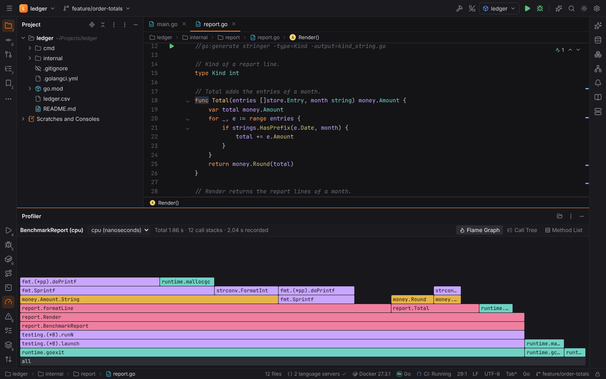
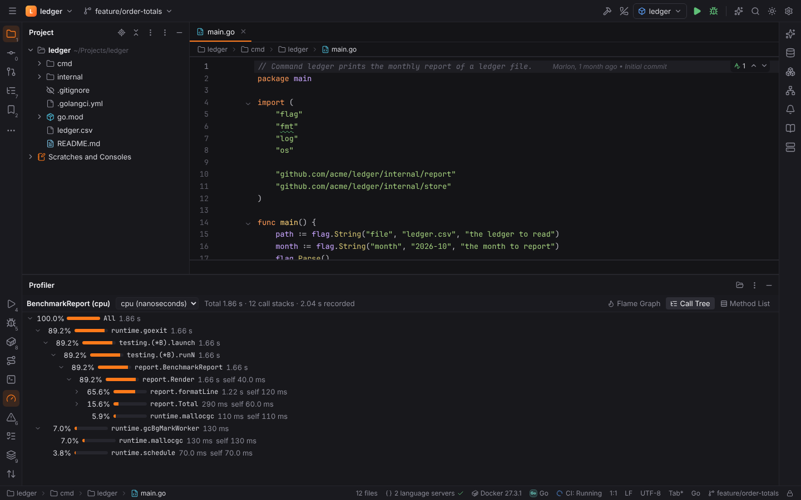

# GoForge (Go)

**GoForge** brings GoLand's Go support to Forge. Its plugin **Go** (`forge.go`) is active in
[Go projects](../getting-started/project-detection.md): a `go.mod` or `go.work` in the root
or one folder below, Go files in the root, or two or more `.go` files in a folder.

- Highlighting of `.go` files comes from CodeMirror's Go grammar; completion, navigation,
  hover, rename and diagnostics come from **gopls** (BSD-3-Clause), started like every other
  [language server](language-servers.md).
- Everything else — SDK detection and downloads, `go.mod` analysis, test discovery, command
  lines, lint reports, debugging and profiles — is computed in Rust (`packs/goforge/*`).

## Go SDK (GOROOT) and GOPATH

**Settings | Languages & Frameworks | Go** shows the project's SDK, the Go tools and the Go
settings in one page.

- **GOROOT**: *Automatic* uses the newest SDK Forge finds without running anything: the `go`
  on the `PATH`, `GOROOT`, `/usr/local/go`, `/usr/lib/go`, `/usr/lib/golang`, `/opt/go`,
  Snap, Homebrew (`/opt/homebrew/opt/go/libexec`, `/usr/local/opt/go/libexec`, Linuxbrew),
  `C:\Program Files\Go`, `%LOCALAPPDATA%\Programs\Go`, SDKs of `golang.org/dl` (`~/sdk/go1.x`),
  `~/go/go1.x` and Forge's own downloads. The version comes from the SDK's `VERSION` file.
  Choose another SDK in the list; the choice (`go.goroot`) is stored with the project.
- **Download…** lists the stable releases of `go.dev/dl` (`?mode=json`, which names the SHA-256
  of every archive) for this platform. After you agree, Forge downloads the archive, checks
  its SHA-256, unpacks it into `<data dir>/forge/go-sdks/go<version>` and makes it the
  project's GOROOT. **SDK download source** (`go.sdk.downloadSource`) points at a mirror.
  When a Go project opens and no SDK is found, a balloon offers the download.
- **Project GOPATH** (`go.gopath`), **GOFLAGS** (`go.goflags`), **Build tags**
  (`go.buildTags`) and **Environment** (`go.environment`, `KEY=VALUE` entries such as
  `GOPRIVATE` or `CGO_ENABLED=0`) apply to every build, run, test, `go generate`, `go vet` and
  debug session of the project.

### Go tools

The page lists the tools GoForge uses, where they were found (the path in the settings,
Forge's tools folder, `GOBIN`, `GOPATH/bin`, the SDK's `bin`, `PATH`) and their licence:

| Tool | Used for | Install |
| --- | --- | --- |
| gopls | the language server | `go install golang.org/x/tools/gopls@v0.23.0` (Go 1.25+) or `@v0.20.0` |
| Delve (`dlv`) | debugging | `go install github.com/go-delve/delve/cmd/dlv@v1.27.2` (Go 1.25+) or `@v1.25.2` |
| goimports | Reformat Code with goimports | `go install golang.org/x/tools/cmd/goimports@v0.30.0` |
| golangci-lint | the golangci-lint annotator | not installed by Forge (GPL-3.0): install it from golangci-lint.run |

**Install** runs the `go install` line with your Go toolchain in the Run tool window
(`GOBIN` = `<data dir>/forge/go-tools/bin`, `GOTOOLCHAIN=auto`), so modules come from your
module proxy and are verified by the Go checksum database. The versions are pinned per SDK
version because Delve only debugs the Go versions it supports.

## go.mod and go.work

`go.mod`, `go.work` and `go.sum` have their own file types (**Go Module**, **Go Workspace**,
**Go Checksums**) with highlighting of directives, module paths, versions and comments.

- Problems are reported while you type: unknown directives, malformed `require`, `replace`
  and `exclude` lines, invalid versions (`v1.2.3`, pseudo-versions and `+incompatible` are
  valid), invalid `go` versions, a missing `module` statement, a missing `)`.
- **Completion** (`Ctrl+Space`): directives at the start of a line; module paths from the
  file's requirements and the module cache (`$GOMODCACHE/cache/download`); versions of a
  module from the module proxy (the first entry of `GOPROXY`, `proxy.golang.org` by default),
  newest first with the latest release marked, cached for 12 hours in
  `<cache dir>/forge/go-proxy` and answered from the cache when the proxy is offline; `go`
  versions of the installed SDKs. **Look up module versions on the module proxy**
  (`go.modules.proxyLookups`) turns the lookups off.
- Actions (Find Action, `Ctrl+Shift+A`): **Sync Dependencies (go mod tidy)**, **Download
  Dependencies (go mod download)** and **Add Dependency…** (`go get module[@version]`). They
  run in the module's folder and show their output in the Run tool window.

## Formatting and annotators

- **Reformat Code** (`Ctrl+Alt+L`) and "Reformat code" on save use **gofmt** by default;
  `go.formatter` switches to **goimports** (also fixes imports), **gopls** or nothing.
- **go vet** runs for the saved file's package after every save (`go.vet.onSave`) and on
  demand (**Run go vet**); its JSON report (`go vet -json`) becomes problems in the editor and
  the Problems tool window.
- **golangci-lint** uses the project's `.golangci.yml` (v1 and v2 are both supported):
  **Run golangci-lint** checks the whole project, `go.golangciLint.onSave` checks the saved
  file's package. Its JSON report becomes problems with the linter as the code.

go vet and golangci-lint build the code (and golangci-lint may load plugins), so they run only
in [trusted projects](project-trust.md).

## go generate

Every `//go:generate` directive gets a ▶ icon in the gutter: it runs `go generate -run` for
exactly that directive in the file's module. **Run go generate for File** runs all
directives of the open file.

## Go Build

The **Go Build** run configuration builds a package (`./cmd/ledger` or an import path of a
project module), a directory or files:

| Field | Meaning |
| --- | --- |
| Run kind | Package, Directory or File |
| Run after build | on: `go run …` with the program arguments; off: `go build -o <output>` |
| Output directory or file | `-o` of `go build` |
| Build tags | added to the project's build tags (`-tags`) |
| Go tool arguments | more flags, e.g. `-race -trimpath` |
| Program arguments | the program's own arguments |

The command runs in the package's module folder unless the configuration sets a working
directory. Debug (`Shift+F9`) starts the same configuration under Delve.

## Go Test

**Go Test** configurations run `go test -json` and show the results in the test tree; a
failing test's `file_test.go:16:` line becomes its message, expected / actual values and a
link.

- **Gutter icons** appear on the `package` clause (all tests of the package), every
  `func TestXxx(t *testing.T)`, `BenchmarkXxx`, `FuzzXxx` and `ExampleXxx`, and on subtests
  and sub-benchmarks started with a literal name (`t.Run("half up", …)`, any depth). After a
  run they show the last result. Subtest names follow `go test`: spaces become `_`.
- **Scopes**: all packages (`./...`), a directory (with or without sub folders), a file (its
  top-level tests), one test or subtest (`-run '^TestRound$/^half_up$'`), or a name pattern.
- **Run**: Tests, **Benchmarks** (`-run '^$' -bench … -benchmem`, optional benchmark time) or
  **Fuzzing** (`-fuzz`, one fuzz test of one package, **Fuzz time** defaulting to
  `go.test.fuzztime`, 10s).
- **Count**, **Build tags**, **Go tool arguments** (`-race -v`) and program arguments (`-args`).
- **Run with Coverage** adds `-coverprofile`; the profile shows in the
  [Coverage tool window](coverage.md) and the editor gutter.
- **Rerun Failed Tests** runs the failed top-level tests in their packages
  (`-run '^(TestRound|TestParse)$'`).
- Modules in sub folders run with `go -C <module>`; import paths in the results and coverage
  are mapped to project files.

## Debugging with Delve

Debug (`Shift+F9`) on a Go Build or Go Test configuration starts **Delve** (`dlv dap`, MIT) on
the shared [debugger](debugging.md): breakpoints, conditions, logpoints, stepping, goroutines
as threads, variables, watches and evaluation, memory and disassembly views. If Delve is
missing, Forge offers to install it with your Go toolchain.

- Go Build sessions use Delve's `debug` mode, Go Test sessions its `test` mode for one
  package (fuzz tests run their seed corpus). The program is built into the system temp
  folder, never into the project.
- **Attach to Process…** (`Ctrl+Alt+F5`) lists local processes; choose **Go (Delve)** to
  attach (`mode: local`). **Debug Core Dump…** opens a core file of a Go program.
- **Go Remote** configurations connect to a Delve server started with
  `dlv debug --headless --listen=:2345 --accept-multiclient` (Delve 1.20 or newer), e.g. in a
  container; **Project folder on the remote side** maps breakpoints (`substitutePath`).

Launching programs is refused in Safe Mode; attaching is allowed.

## Profiler

The **Profiler** tool window (shared with [PyForge's cProfile snapshots](python.md#profiler);
a project that uses both shows a **cProfile** and a **pprof** tab) shows pprof profiles: a
**Flame Graph** (callers below their
callees; click a frame to zoom, double-click to open its source), the **Call Tree** with total
and self values, and the **Method List** (flat and cumulative values, like `pprof -top`). The
sample type (CPU time, allocations, in-use memory, contentions, …) is chosen on top.

- Set **Profile** of a Go Test configuration to CPU, Memory, Blocking or Mutex: the run writes
  `-cpuprofile` (…) into `<cache dir>/forge/go-profiles` and the Profiler opens it when the
  run ends. **Profile Test with CPU Profiler** / **Memory Profiler** run the test or
  benchmark at the caret that way.
- **Open Profile (pprof)…** opens any profile file (`go test -cpuprofile`, `runtime/pprof`,
  `net/http/pprof` downloads), gzip compressed or not; the folder icon in the Profiler's
  header does the same.

## Settings

| Setting | Default | Meaning |
| --- | --- | --- |
| `go.goroot` | (automatic) | the project's SDK folder |
| `go.sdk.downloadSource` | `https://go.dev/dl` | where Download Go SDK gets releases |
| `go.gopath` | (Go's default) | GOPATH of the project's go commands |
| `go.goflags` |  | GOFLAGS of the project's go commands |
| `go.buildTags` | `[]` | build tags of builds, runs and tests |
| `go.environment` | `[]` | `KEY=VALUE` variables of the project's go commands |
| `go.formatter` | `gofmt` | `gofmt`, `goimports`, `lsp` or `none` |
| `go.goimports.path` |  | goimports executable |
| `go.vet.onSave` | `true` | run go vet for the saved file's package |
| `go.golangciLint.onSave` | `false` | run golangci-lint for the saved file's package |
| `go.golangciLint.path` |  | golangci-lint executable |
| `go.delve.path` |  | dlv executable |
| `go.test.fuzztime` | `10s` | default `-fuzztime` |
| `go.modules.proxyLookups` | `true` | module versions from the module proxy |

gopls has its own settings in Settings | Language Servers (`langservers.servers.gopls.*`).

## Browser mode

`pnpm dev` with `?project=go` opens the `ledger` demo module (a money package with tests,
subtests, a benchmark, a fuzz test and an example; a report package with a `//go:generate`
directive; a store for golangci-lint to find). The mocks run the Rust crates as WebAssembly;
test runs, the Delve session and the profile are simulated.
