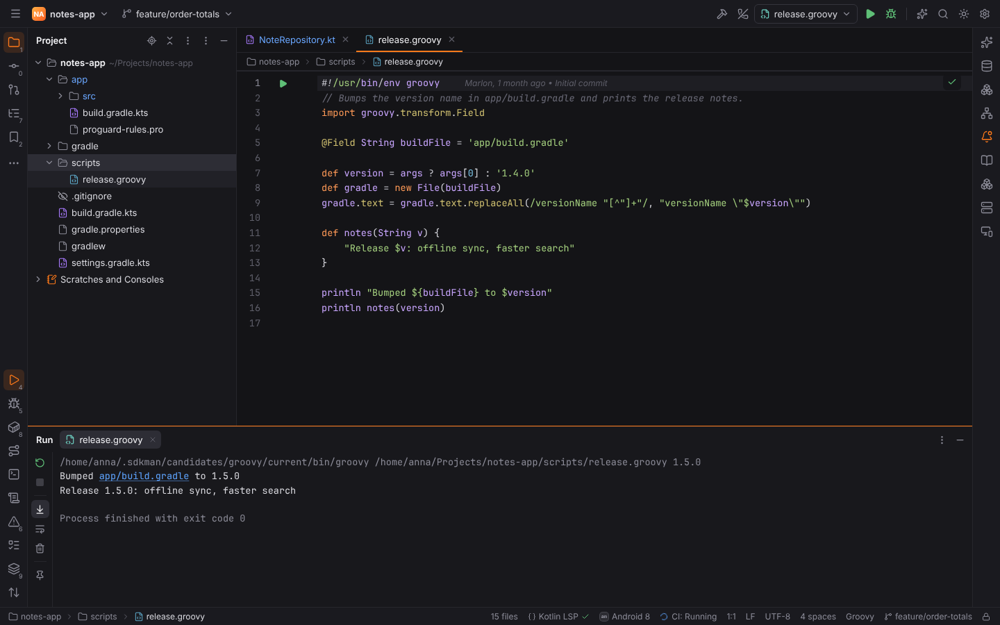
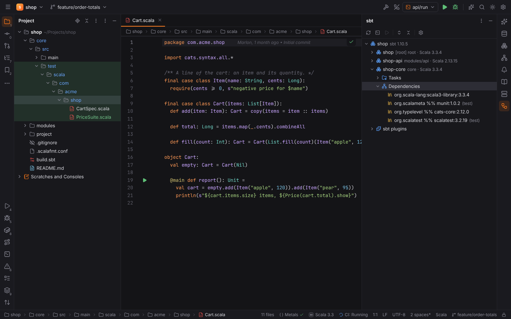
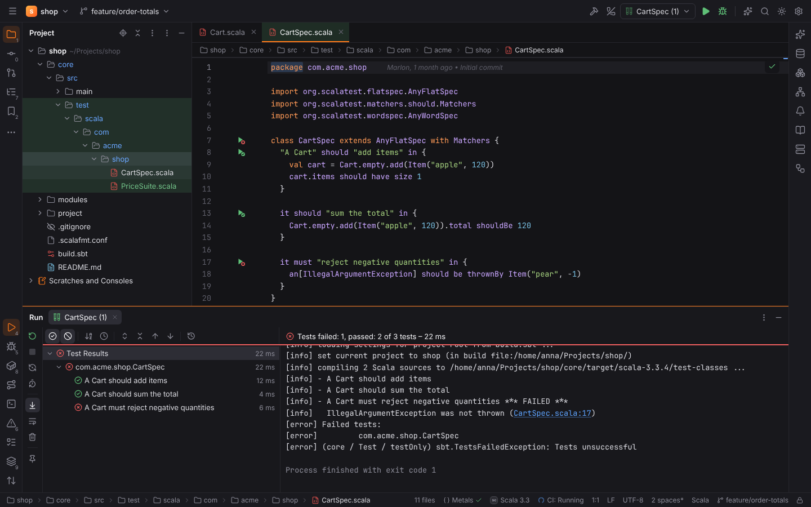

# Groovy and Scala

Groovy and Scala are JavaForge's JVM extras, in the style of IntelliJ IDEA's Groovy and Scala
plugins. They build on [JavaForge](java.md): JDKs, Gradle and Maven, the run configurations and
the shared [test runner](testing.md). Each is its own plugin in Settings | Plugins
(**Groovy**, `forge.groovy`; **Scala**, `forge.scala`; both in the JavaForge pack) and
activates only in projects that use the language (see
[project detection](../getting-started/project-detection.md)).

## Groovy

### Editing

`*.groovy`, `*.gvy` and `*.gy` files (and `Jenkinsfile`) are highlighted as Groovy; Gradle build
scripts (`*.gradle`) are too, but they belong to the Gradle DSL support of
[JavaForge](java.md#editing-build-scripts), not to the Groovy plugin. A project is a
Groovy project when it has Groovy sources (`*.groovy` files, a `src/main/groovy` or
`src/test/groovy` tree) or a Gradle build that applies the `groovy` plugin (or a Maven build
with GMavenPlus). There is no Groovy language server: highlighting, the Run gutter and Spock
discovery come from Forge's own scanner.

### Groovy source sets

The [Gradle tool window](java.md#gradle-tool-window) shows a **Source Sets** node per
project: `main` and `test` with their `java`, `groovy` (with the `groovy` plugin), `kotlin`,
`scala` and `resources` folders. Before a sync they follow the conventions of the applied
plugins; **Reload All Gradle Projects** replaces them with Gradle's own `sourceSets` (custom
ones such as `integrationTest` included).

### Running scripts

A Groovy file with top-level statements is a script and gets a green ▶ on its first line; a
class with a `static void main(String[] args)` (or `static main(args)`) gets one on `main`.
**Run** creates a temporary **Groovy Script** configuration; `Ctrl+Shift+F10` (Run Context
Configuration) does the same from the editor.

Scripts run with **groovy** from a Groovy SDK, or **through Gradle**:

- **groovy**: the launcher of **Groovy SDK** in Settings | Languages & Frameworks | Groovy (a
  Groovy folder, its `bin` folder or the launcher), else `GROOVY_HOME`, SDKMAN!'s current Groovy
  (`~/.sdkman/candidates/groovy/current`, or `SDKMAN_DIR`), else `groovy` on the `PATH`. VM
  options go to `JAVA_OPTS`; `JAVA_HOME` is the configuration's or the project JDK.
- **Gradle**: when the build applies the `groovy` plugin, an init script in Forge's cache folder
  adds a `forgeRunGroovy` task that runs `groovy.ui.GroovyMain` with the main source set's class
  path, so the script sees the project's classes, its Groovy version and its dependencies. No
  Groovy SDK is needed.

**Run Groovy scripts with** (project setting) chooses: *Gradle when the build applies the groovy
plugin, else groovy* (the default), *groovy* or *Gradle*; a configuration's **Run with** field
overrides it. Gradle build scripts are not run as scripts. Both ways run project code, so
[Safe Mode](project-trust.md) refuses them.



### Spock

Spock specifications (classes extending `spock.lang.Specification`, or a project base spec in
a file that imports Spock) get test gutter icons on the class and on every feature method
(`def "adds items"()`, or a method with Spock blocks such as `given:` / `when:` / `then:` /
`expect:`); fixture methods (`setup`, `cleanup`, `setupSpec`, `cleanupSpec`) are not features.
A build that depends on `org.spockframework` reports the Spock framework.

The **Spock** configuration type runs everything, a package, a specification, one feature or a
list of features through Gradle (`cleanTest test --tests 'com.acme.CartSpec.adds items'`) or
Maven Surefire, like [JUnit](java.md#tests): Spock 2 runs on the JUnit Platform. Results come
from the JUnit XML reports of the build and point at `src/test/groovy/…`; Rerun Failed Tests
and Run with Coverage (JaCoCo) work as for Java.

## Scala

### Editing and project detection

`*.scala`, `*.sc` and `*.sbt` files are highlighted as Scala. A project is a Scala project when
it has an sbt build (`build.sbt`, or `project/build.properties` with `sbt.version`), Scala
sources (`*.scala`, a `src/main/scala` tree) or a Gradle build with the `scala` plugin. ScalaTest
and MUnit in `build.sbt` report their frameworks.



### Metals

Code intelligence comes from [Metals](https://scalameta.org/metals/) (Apache-2.0) through
Forge's shared language server client: completion, navigation, hover, diagnostics, rename and
code actions in `.scala`, `.sc` and `.sbt` files. Forge looks for Metals in this order: the
**Metals** setting (Settings | Languages & Frameworks | Scala), the version Forge installed,
`metals` on the `PATH`. It starts it with the project JDK as `JAVA_HOME` and the sbt launcher
in the `metals.sbtScript` setting.

Forge never downloads Metals by itself. When a Scala project opens without it, a balloon offers
**Install**: Forge runs your [Coursier](https://get-coursier.io) (`cs`, or **Coursier (cs)** in
the settings) as

```sh
cs bootstrap --java-opt -Xss4m --java-opt -Xms100m org.scalameta:metals_2.13:1.5.3 \
  -o <data dir>/forge/langservers/metals/1.5.3/metals -f
```

which installs the pinned Metals **1.5.3** from Maven Central (Coursier verifies the
artifacts' checksums) into Forge's data directory, never into the project. **Install Metals
(Scala Language Server)** in Find Action does the same; **Install Metals** (Ask, Never) turns the
offer off. Without Coursier, install it from get-coursier.io or put `metals` on the `PATH`
(`cs install metals`). Metals imports the build with Bloop or sbt, which runs the build
definition: it does not start in [Safe Mode](project-trust.md) and runs for local projects.

### The sbt tool window

The **sbt** tool window (right stripe) shows the build like IntelliJ IDEA's: the root project
with the sbt version, every project with its folder and Scala version, and per project
**Tasks** (compile, test, run, console, package, clean, update, doc, publishLocal, reload),
**Dependencies** (`org.typelevel %% cats-core:2.12.0`, with their configuration such as
`(test)`) and **Projects** (`dependsOn` and aggregated projects), plus the build's sbt plugins
from `project/plugins.sbt`. Double-click a task to run it (`core/test`); the toolbar runs the
selected task, opens the **sbt shell**, expands or collapses the tree and opens the settings.

Before an import the tree comes from the files: projects defined with `project`,
`project.in(file("…"))` or `project in file("…")`, `name`, `scalaVersion` (also
`ThisBuild / scalaVersion` and `val`s), `libraryDependencies` (also from setting sequences such
as `commonSettings`), `dependsOn` and `aggregate`. **Reload sbt Project** (the toolbar, or
Find Action) asks sbt itself:

```sh
sbt -batch -no-colors projects "show scalaVersion" "show baseDirectory" "show libraryDependencies"
```

and shows the projects, folders, Scala versions and resolved dependency lists it prints. The
result is cached in Forge's cache directory. sbt runs the build definition, so the import is
refused in [Safe Mode](project-trust.md); **Reload the sbt project when it opens** (project
setting, off by default) imports automatically in trusted projects. The sbt launcher is the
**sbt launcher** setting, SDKMAN!'s current sbt or `sbt` on the `PATH`; **VM parameters**
(`-Xmx2g`) are passed as `-J` options.

### sbt Task configurations and the sbt shell

The **sbt Task** configuration type runs sbt tasks: one per line or separated by `;`
(`clean; test`, `~compile`, `runMain com.acme.Main 8080`), scoped to a **Project** when set
(`api/run`). Without tasks it opens the **sbt shell** in the Run tool window, where you type
sbt commands (**Open sbt Shell** in Find Action and the tool window's toolbar). `main`
methods, `App` objects and Scala 3 `@main` methods get a ▶ in the gutter that runs them with
`runMain` in their project.

### ScalaTest and MUnit

ScalaTest suites (FunSuite, FlatSpec with `it should`, WordSpec `when` / `should` clauses,
FunSpec `describe` / `it`, FreeSpec `-` clauses, PropSpec) and MUnit suites (`munit.FunSuite`,
`CatsEffectSuite`, `ScalaCheckSuite`) get test gutter icons on the suite and on every test or
clause. The **ScalaTest** and **MUnit** configuration types run everything, a package, a suite,
one test or a list of suites through sbt `testOnly`:

| Scope | sbt command |
| --- | --- |
| Suite | `core/testOnly com.acme.shop.CartSpec` |
| ScalaTest test | `core/testOnly com.acme.shop.CartSpec -- -z "A Cart should add items"` |
| MUnit test | `core/testOnly com.acme.shop.PriceSuite -- "*formats euros"` |

The project comes from the test file's folder. Results come from the JUnit XML reports sbt
writes to `target/test-reports` (of the project's folder); test names keep their spaces and
locations point at `src/test/scala/…`. Rerun Failed Tests reruns the failed suites.



## Settings

| Setting | Key | Default |
| --- | --- | --- |
| Groovy SDK | `groovy.sdk.path` | empty (GROOVY_HOME, SDKMAN!, PATH) |
| Run Groovy scripts with | `groovy.run.runner` (project) | `auto` |
| Metals | `scala.metals.path` | empty (Forge's install, PATH) |
| Install Metals | `scala.metals.autoInstall` | `ask` |
| Coursier (cs) | `scala.coursier.path` | empty (PATH) |
| sbt launcher | `scala.sbt.path` | empty (SDKMAN!, PATH) |
| VM parameters | `scala.sbt.vmOptions` (project) | empty |
| Reload the sbt project when it opens | `scala.sbt.importOnOpen` (project) | off |

## Not yet

Groovy has no language server or debugger yet (scripts run, they do not stop at breakpoints),
and Scala debugging through Metals' debug adapter is not wired up. sbt runs one process per
configuration (no persistent sbt server shared between runs).
