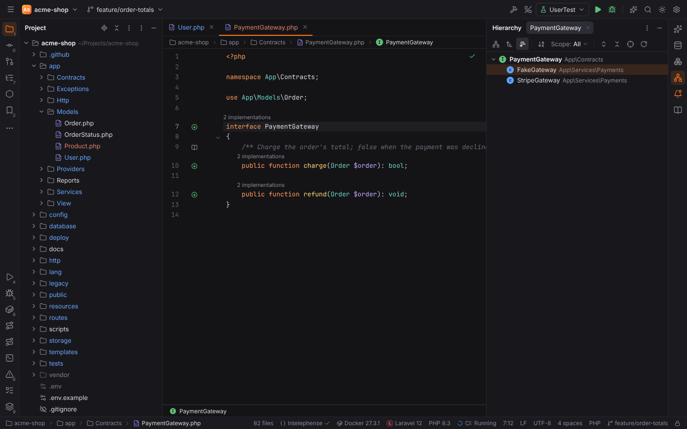
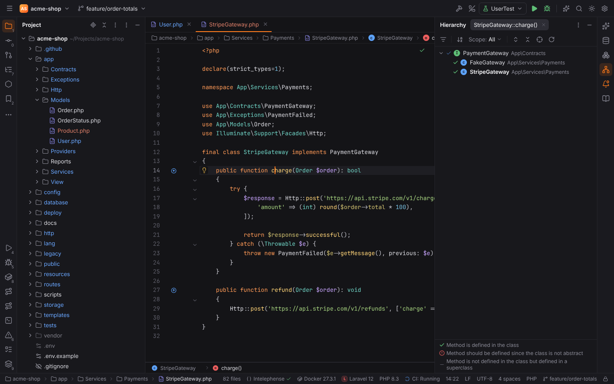
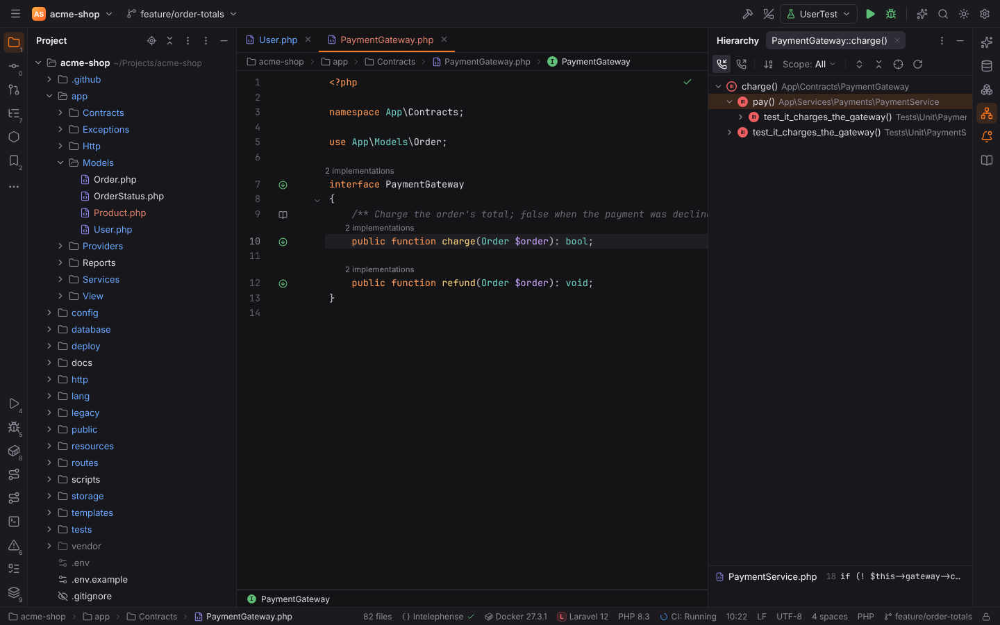
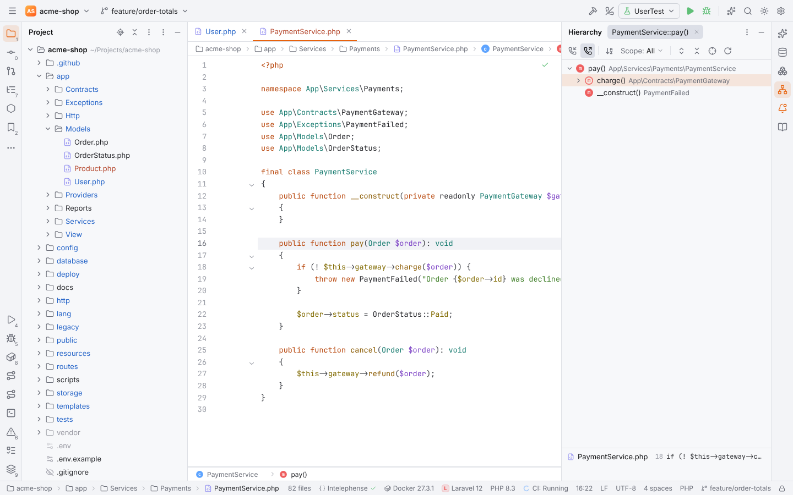
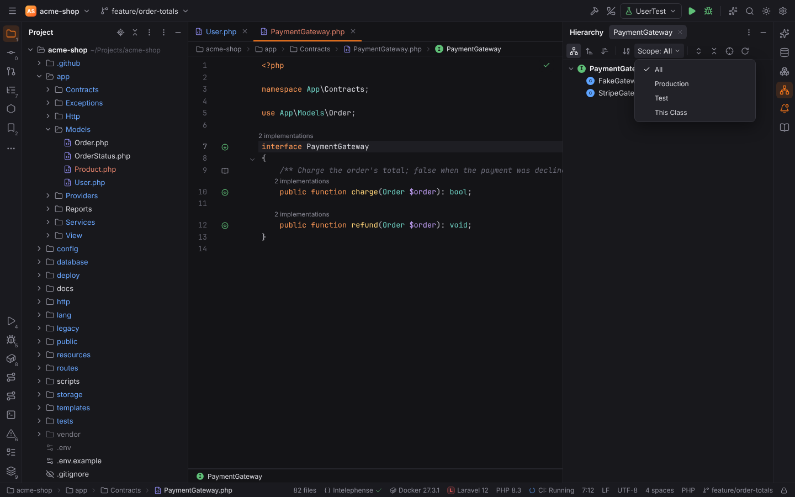

# Type, Method and Call Hierarchy

PHPStorm's three hierarchies, with the same shortcuts, toolbar and wording. Put the caret on a
class, a method or a function and press the shortcut; the result opens in the **Hierarchy**
tool window on the right (one tab per run; a new run of the same symbol replaces its tab).

| Action | Windows / Linux | macOS | Menu |
| --- | --- | --- | --- |
| Type Hierarchy | `Ctrl+H` | `Ctrl+H` | Navigate \| Type Hierarchy |
| Method Hierarchy | `Ctrl+Shift+H` | `Cmd+Shift+H` | Navigate \| Method Hierarchy |
| Call Hierarchy | `Ctrl+Alt+H` | `Ctrl+Alt+H` | Navigate \| Call Hierarchy |
| Hierarchy tool window | — | — | View \| Tool Windows \| Hierarchy |

All of them can be rebound in Settings | Keymap (action ids `TypeHierarchy`,
`MethodHierarchy`, `CallHierarchy`, `ActivateHierarchyToolWindow`).

## Type Hierarchy

Opens for the class, interface, trait or enum at the caret (a name in the code, or the class
the caret is in). The toolbar switches between PHPStorm's three views:

- **Class Hierarchy**: the chain of parent classes down to the class, then everything that
  extends it. For an interface or trait this is the list of its subtypes.
- **Supertypes Hierarchy**: the class at the top, its parent class, interfaces and traits
  below it, recursively.
- **Subtypes Hierarchy**: every class extending or implementing it, and every class using a
  trait.

The class the hierarchy was opened for is shown in bold. Icons tell classes, abstract
classes, interfaces, traits and enums apart.

## Method Hierarchy

Opens for the method at the caret (its declaration, a call that Forge can resolve, or the
method the caret is in). The tree shows the classes below the topmost declaration of the
method, each with PHPStorm's mark:

| Mark | Meaning |
| --- | --- |
| ✓ (green) | Method is defined in the class |
| ✓ (blue) | Method is declared abstract in the class, or in an interface |
| ! (red) | Method should be defined since the class is not abstract |
| − | Method is not defined in the class but defined in a superclass (or a used trait) |

**Hide Classes Where Method Is Not Implemented** (the filter button) leaves only the classes
that define the method, and the classes on the way to them. Method Hierarchy is available for
PHP files.

## Call Hierarchy

Opens for the method or function at the caret and shows its callers. **Caller Methods
Hierarchy** and **Callee Methods Hierarchy** switch between the functions that call it and
the functions it calls. Each level is loaded when you expand a node, so large call graphs stay
fast; a function that calls itself further up is marked and not expanded again. Calls from
outside any function (a route file, a script) show the file.

The list below the tree shows the call sites of the selected node, with the line number and
the source line; click one to open it. Several calls from the same method are one node with
"(2 usages)".

## Toolbar

| Button | What it does |
| --- | --- |
| Sort Alphabetically | Sorts every level by name; otherwise the order is the sources' (superclass before interfaces, files in project order) |
| Scope: All / Production / Test / This Class | **Production** hides test code and library code, **Test** shows only test code (`tests/`, `__tests__/`, `*Test.php`, `*.spec.ts`), **This Class** only the class itself (Type and Method Hierarchy) or the calls inside its class (Call Hierarchy). Parents of a match stay visible so the tree keeps its shape |
| Expand All / Collapse All | Expands or collapses the tree (Call Hierarchy: only the levels already loaded) |
| Autoscroll to Source | Opens the selected node in the editor while you move through the tree |
| Refresh | Computes the hierarchy again for the same place, keeping the view options |

In the tree, `Up` / `Down` select, `Right` / `Left` expand and collapse, `Enter` or `F4` and a
double click open the declaration.

## Where the data comes from

- **Language servers** first: their `typeHierarchy` and `callHierarchy` requests (for example
  the TypeScript server for JavaScript and TypeScript, Intelephense Premium for PHP).
- **Forge's PHP index** for PHP files: classes, interfaces, traits and enums of the project
  with their parents (vendor classes are resolved through Composer's PSR-4 autoloading when
  vendor packages are indexed as libraries), method declarations and calls. It works without
  any language server and fills in what a server leaves out (traits, abstract classes). When
  both answer, the results are merged.

Remote projects work the same way: the PHP index runs on the remote host next to the files.
