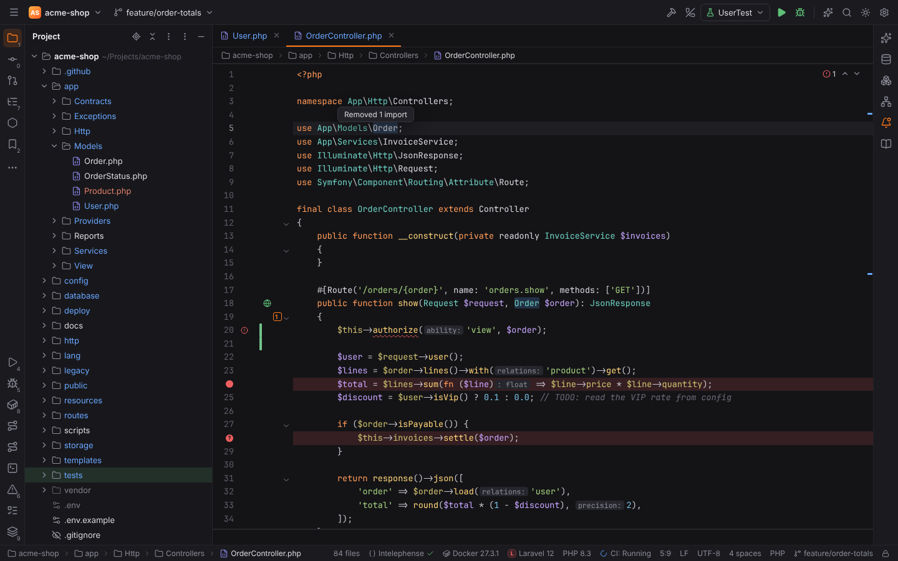
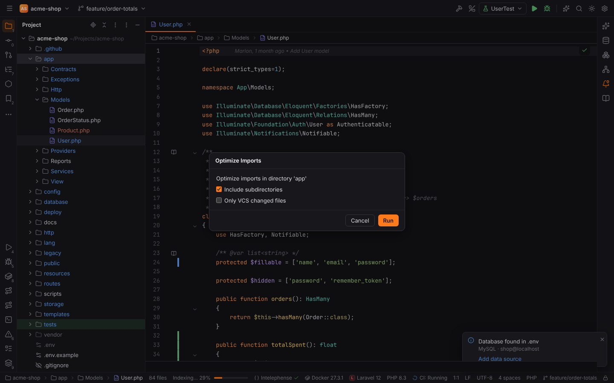
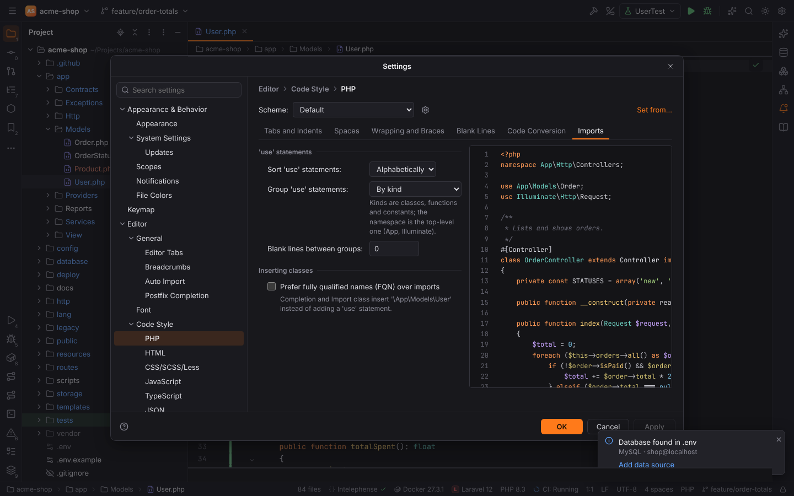
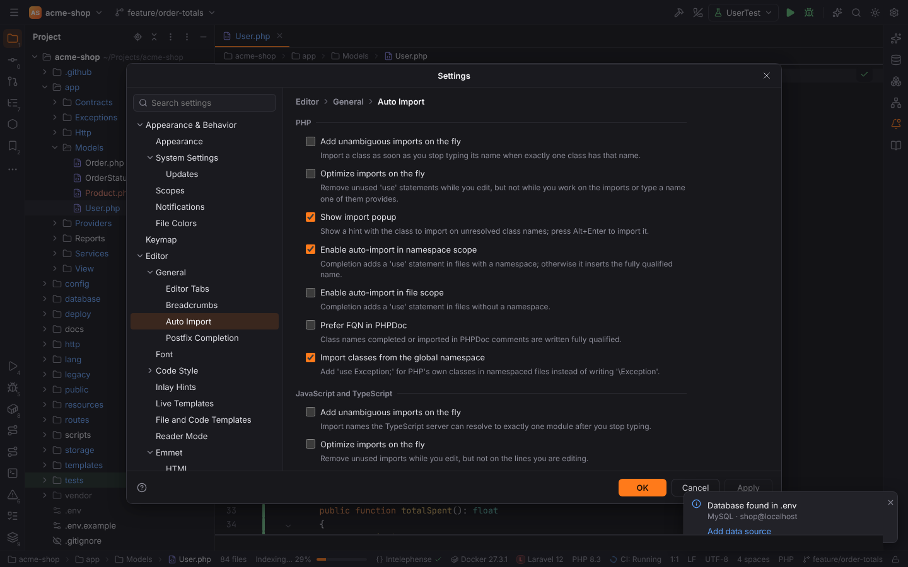
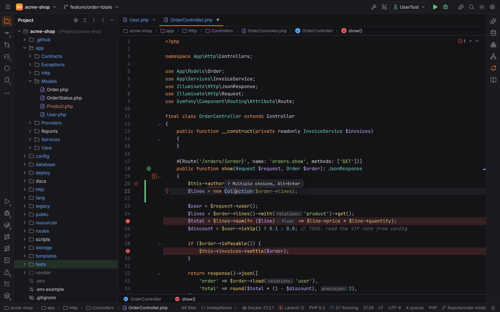
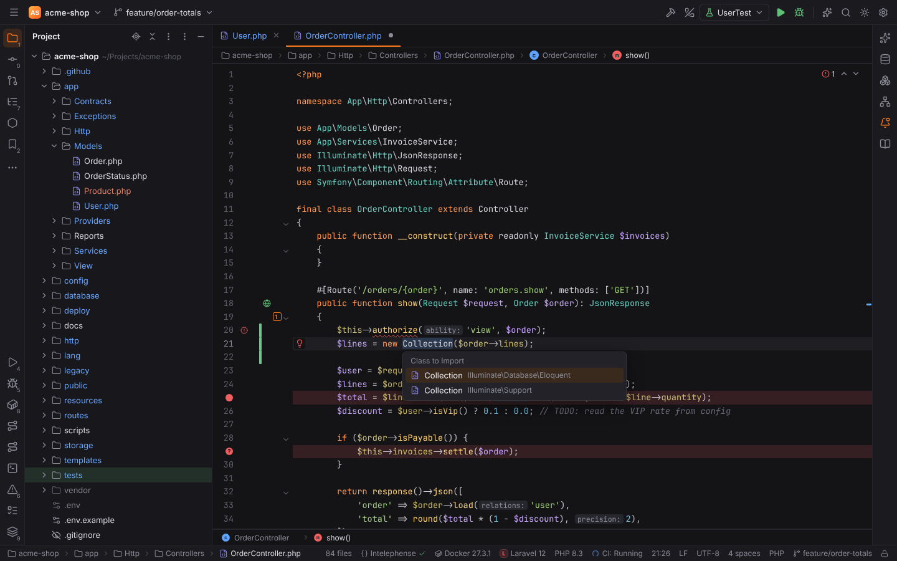

# Optimize Imports and Auto Import

Forge keeps `use` statements and `import` declarations tidy like PHPStorm: **Optimize
Imports** removes unused ones and sorts the rest, and **Auto Import** adds them while you
write code. PHP imports are Forge's own (they follow the PHP code style's **Imports** tab);
JavaScript, TypeScript and Vue imports come from the TypeScript language server.

## Optimize Imports

**Code | Optimize Imports** (`Ctrl+Alt+O`, also in the editor's context menu) works on the
file in the editor:

- **PHP**: removes the `use` statements nothing in the file refers to (code, attributes,
  PHPDoc types and annotations such as `@ORM\Column` count) and arranges the rest as the
  code style says. Group uses (`use A\{B, C};`) become single statements. Files with syntax
  errors are left alone.
- **JavaScript, TypeScript, Vue**: the TypeScript server's "Organize Imports" (removes unused
  imports, sorts and merges them).

A hint above the caret says what happened: "Removed 2 imports, rearranged imports" or
"Imports are already optimized". The change is one undo step.

### Folders and the whole project

In the Project view, select folders or files and press `Ctrl+Alt+O`, or right-click and
choose **Optimize Imports…**. The **Optimize Imports** dialog shows what is optimized and
offers:

- **Include subdirectories**: also the files in subfolders (on by default).
- **Only VCS changed files**: only the files Git reports as changed or new.

**Run** optimizes every PHP, JavaScript, TypeScript and Vue file (Blade templates, minified
files, `vendor` and `node_modules` are skipped), applies the changes as one undoable step
(open editors included) and reports "Optimized imports in 3 files: removed 5 imports".

On save, **Settings | Tools | Actions on Save | Optimize imports** does the same for PHP
files, see [Actions on Save](actions-on-save.md).

## PHP code style: Imports

Settings | Editor | Code Style | PHP | **Imports** decides how Optimize Imports, Auto Import,
Actions on Save and every refactoring that adds imports (Import class, completion, Create
from usage, Move, Copy, Extract Interface, Pull Members Up) write `use` statements:

| Option | Values |
| --- | --- |
| Sort 'use' statements | **Alphabetically** (default), **By length** (shorter statements first), **Don't sort** (new imports go last) |
| Group 'use' statements | **By kind** (classes, then functions, then constants; default), **By kind and namespace** (also by the top-level namespace: `App`, `Illuminate`; global classes first), **Don't group** |
| Blank lines between groups | 0 (default) to 3 |
| Prefer fully qualified names (FQN) over imports | Completion and Import class write `\App\Models\User` instead of adding a `use` statement |

New imports are inserted in their group and in sort order among the existing ones; existing
imports are never reordered except by Optimize Imports.

## Auto Import settings

Settings | Editor | General | **Auto Import**:

### PHP

| Option | Default | What it does |
| --- | --- | --- |
| Add unambiguous imports on the fly | off | After you stop typing, unresolved class names with exactly one candidate class get their `use` statement. The name you are still typing is left alone. |
| Optimize imports on the fly | off | Removes unused `use` statements while you edit, but not while the caret or your last edit is in the `use` block, and not an import whose name you are just typing (`Us` keeps `use App\Models\User;`). |
| Show import popup | on | The blue hint `? App\Models\User Alt+Enter` on an unresolved class name (`? Multiple choices… Alt+Enter` when several classes match). |
| Enable auto-import in namespace scope | on | Completing a class in a file with a namespace adds its `use` statement; off: the fully qualified name is inserted. |
| Enable auto-import in file scope | off | The same for files without a namespace. |
| Prefer FQN in PHPDoc | off | Classes completed or imported inside PHPDoc comments are written fully qualified. |
| Import classes from the global namespace | on | `use Exception;` for PHP's own classes in namespaced files; off: `\Exception`. |

A class with the same short name as an existing import or a class of the file is always
written fully qualified.

### JavaScript and TypeScript

| Option | Default | What it does |
| --- | --- | --- |
| Add unambiguous imports on the fly | off | The TypeScript server's "add missing imports" after you stop typing, unless it would change the caret's line or the lines you just edited. |
| Optimize imports on the fly | off | The TypeScript server's "remove unused imports", with the same restriction. |
| Show import popup | on | `? Name from "module" Alt+Enter` on a name TypeScript cannot find; `Alt+Enter` lists the "Add import from" fixes. |
| Use paths relative to | Shortest path | How new import paths are written: shortest, project root (or `tsconfig` path mapping), current file, or module (non-relative). |
| Use type imports in TypeScript | off | `import type { … }` when only types are imported. |

Completion also adds the import of a completed name (the server's import edit), in PHP with
Forge's own rules above.

## Import class and the import popup

On an unresolved class name, **Alt+Enter** offers **Import class**. The candidates come from
the PHP index (project and `vendor` packages, also ones that are not indexed yet) and PHP's own
classes. With one candidate the import is added right away; with several, the **Class to
Import** chooser lists them with their namespaces.

While the import popup is shown, `Alt+Enter` imports its class directly (or opens the
chooser).

## Remote projects

Everything works in [remote projects](remote-development.md): the PHP index that finds the
candidates runs on the remote host, and folders are read and written there.
