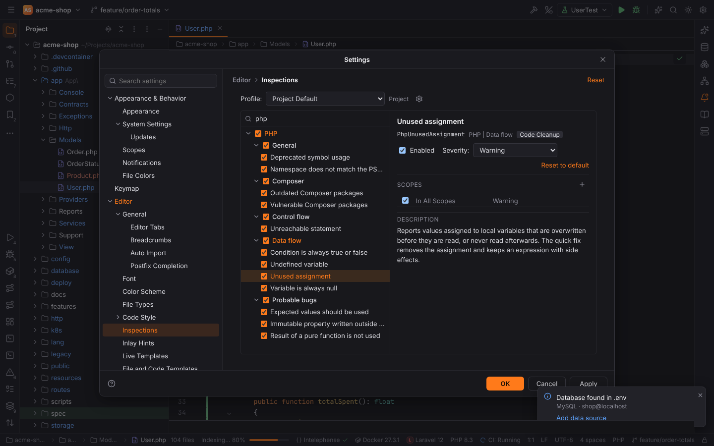
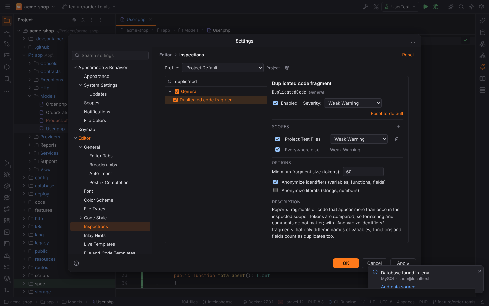
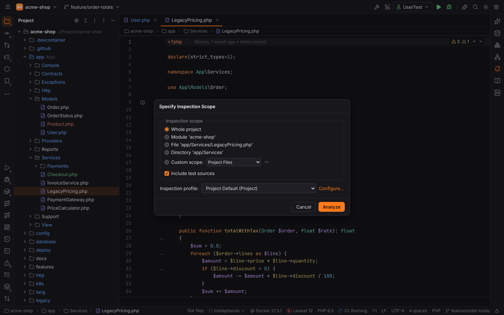
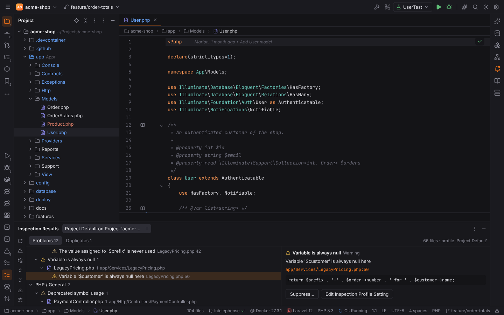
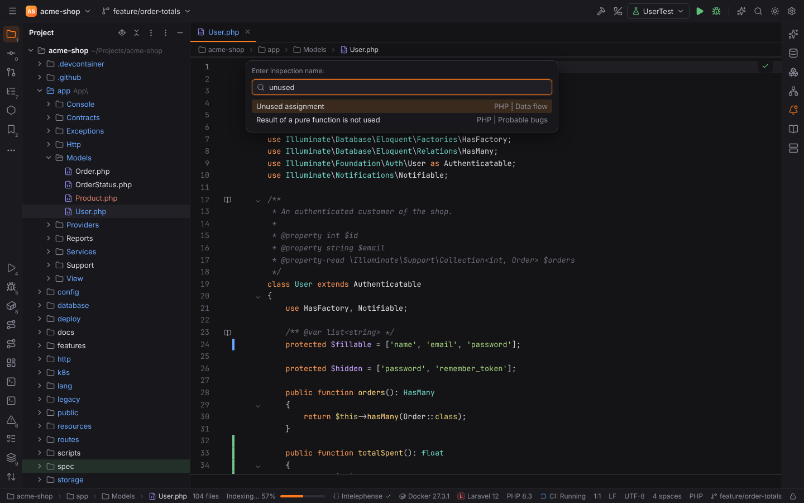
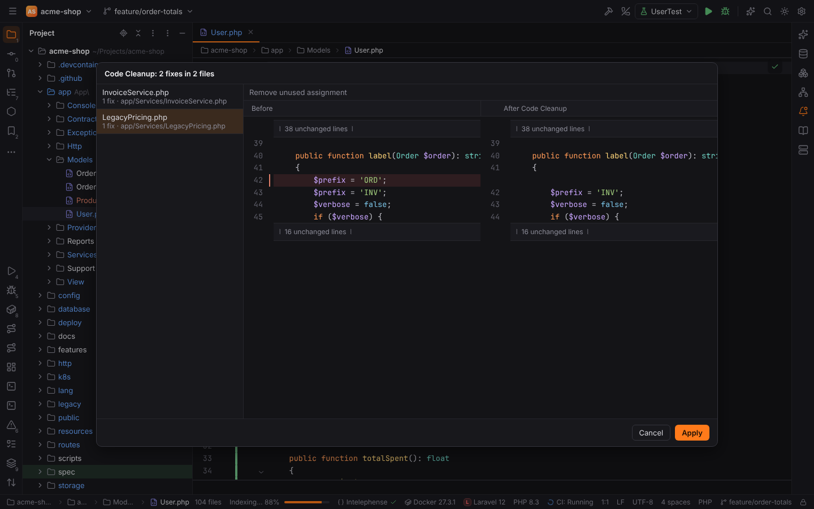
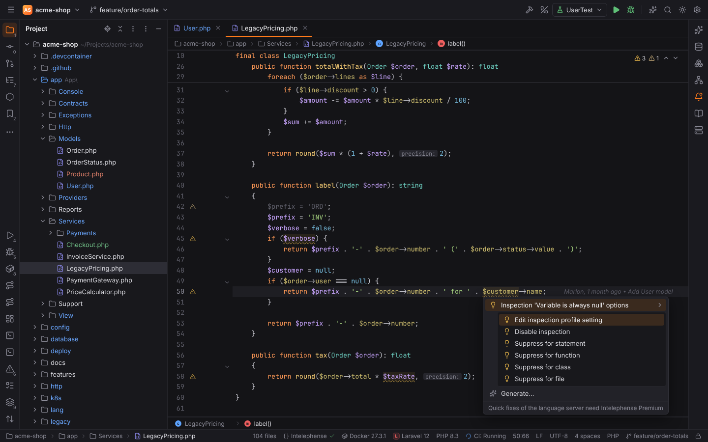
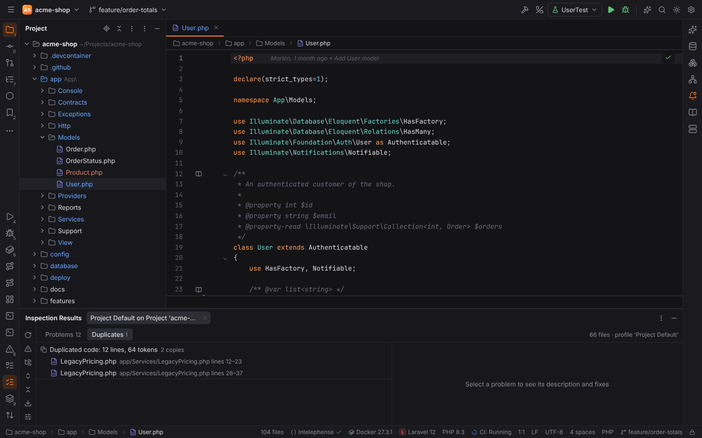

# Inspections

Every problem Forge highlights belongs to an **inspection**: Forge's own checks (the PHP index
inspections, PHP data flow, duplicated code, requirements, Spring Boot properties, spelling)
as well as the problems of language servers and external tools (Clippy, go vet,
golangci-lint, ktlint, detekt, Composer, CMake builds). Like in PHPStorm, an **inspection
profile** decides which inspections run, how severe their problems are, and where.

## Settings | Editor | Inspections



- **Profile**: the profile the project uses. **Project Default** is stored in the project
  (`.forge/inspectionProfiles/Project_Default.xml`, written once it differs from the
  defaults), **Default** in your user settings. Copies are stored where you put them.
- **⚙ menu**: **Duplicate…**, **Copy to Project…** / **Copy to IDE…**, **Rename…**,
  **Delete**, **Restore Defaults**, **Export** (PHPStorm's inspection profile XML or Forge
  JSON), **Import Profile…** (both formats, so PHPStorm profiles work) and **Add Custom
  Severity…**.
- **The tree** groups the inspections by language and group (PHP | Data flow, Rust |
  External tools, …). The search field filters by name, id, group and description. The
  checkboxes switch single inspections or whole groups on and off; changed inspections are
  shown in the accent color.
- **The selected inspection**: its id (the name suppression comments use), **Enabled**,
  **Severity**, **Scopes**, **Options** and the description. **Reset to default** forgets the
  profile's changes for it.

### Severities

**Error**, **Warning**, **Weak Warning**, **Server Problem**, **Typo** and **Info**, plus
custom severities (⚙ | Add Custom Severity…) that the editor highlights like one of the
built-in ones. Problems of external tools (Clippy, golangci-lint, language servers, …) keep the
level the tool reports (**As reported by the tool**) until you choose a severity.

### Scope-specific settings



**Scopes | +** adds a [scope](scopes-and-file-colors.md) (a named scope or a predefined one
such as Project Test Files) with its own checkbox and severity. The first scope that contains
a file wins; the last row, **Everywhere else**, is the inspection's own setting. Turning an
inspection off for tests while keeping it everywhere else is one row.

### What the profile does in the editor

The profile applies to every problem the editor and the Problems tool window show, whatever
reported it: a disabled inspection's problems disappear, severities follow the profile, and
suppression comments (below) hide problems right away.

## Inspect Code

**Code | Inspect Code…** opens **Specify Inspection Scope**:



- **Whole project**, **Module**, **File** (the current editor), **Directory** (the current
  file's folder) or a **Custom scope**; **Include test sources**.
- **Inspection profile** and **Configure…** to edit it.

**Analyze** runs every enabled inspection over the scope in the backend (where the project
lives, also for remote projects). The status bar shows the progress with a **Cancel** button.
**Code | Analyze Code | Inspect Current File** (`Alt+Shift+I`) inspects the current file
without the dialog.

> **Note:** inspections whose problems come from a running language server or tool
> (language server problems, Clippy, ktlint, spelling, requirements, …) run in the editor
> only; Inspect Code runs Forge's own inspections and duplicated code.

## Inspection Results



Every run opens a tab in the **Inspection Results** tool window (View | Tool Windows |
Inspection Results):

- The problems are grouped by inspection group, inspection and file. The toolbar adds
  **Group by Severity** and **Group by Directory**, **Expand All** / **Collapse All**,
  **Rerun**, **Export** (HTML or XML) and **Edit Settings**.
- Double-click (or `Enter`) opens the problem in the editor.
- The right pane shows the selected problem with its **quick fixes** (applied to the file,
  which must not have changed since the run), **Suppress…** (statement, function, class or
  file) and **Edit Inspection Profile Setting**. Fixed problems are struck through until the
  next run.
- **Duplicates** lists the duplicate groups of the run.

## Run Inspection by Name

**Code | Run Inspection by Name…** (`Ctrl+Alt+Shift+I`, macOS `Cmd+Alt+Shift+I`) picks one
inspection by name, then asks for the scope and runs only that inspection.



## Code Cleanup

**Code | Code Cleanup…** asks for a scope, applies every *safe* quick fix of the inspections
marked **Code Cleanup** in the profile (for example removing unused assignments) and shows a
preview with a diff per file. **Apply** writes the files; files that changed since the
preview are left alone.



## Suppressing problems

`Alt+Enter` on a problem lists **Inspection '…' options** with **Edit inspection profile
setting**, **Disable inspection** and **Suppress for statement / function / class / file**:



Forge writes PHPStorm's comments, so suppressions work in both IDEs:

| Language | Comment |
| --- | --- |
| PHP | `/** @noinspection PhpUnusedAssignment */` (or a line `@noinspection Id` in the doc comment of a function or class) |
| JavaScript, TypeScript | `// noinspection JSUnusedLocalSymbols` |
| Python | `# noinspection PyUnusedLocal` |
| Other languages | the language's line comment: `// noinspection Id`, `# noinspection Id`, `-- noinspection Id`, `<!-- noinspection Id -->` |

- A comment **before a statement** suppresses the listed inspections in that statement; a
  function or class declaration counts as one statement with its body.
- A comment **at the top of the file** followed by an empty line (in PHP also on the
  `<?php` line) suppresses them in the whole file.
- A comment **after code on the same line** suppresses them on that line.
- Several ids are separated by commas; `ALL` suppresses every inspection; PHPStorm's ids with
  the `Inspection` suffix work too.

## Duplicated code

The **Duplicated code fragment** inspection (General) compares the tokens of the inspected
files, so formatting and comments do not matter. Its options:

- **Minimum fragment size (tokens)**, 60 by default;
- **Anonymize identifiers**: fragments that differ only in variable, function and field
  names are duplicates too (on by default);
- **Anonymize literals**: string and number values do not matter either.



**Code | Analyze Code | Locate Duplicates…** runs only this inspection over a scope. Each copy
is reported with links to the other copies, and the **Duplicates** view of Inspection Results
lists the groups.

## PHP data flow

Forge follows the values of local variables through PHP functions (branches are merged, loops
forget what they assign) and reports:

| Inspection | Example |
| --- | --- |
| **Variable is always null** | `$customer = null; … $customer->name` |
| **Undefined variable** | a variable read in a function before any path assigned it |
| **Condition is always true or false** | `if (false)`, `if (1 === 2)`, `$debug = false; if ($debug)` (not `while (true)`) |
| **Unused assignment** | `$prefix = 'ORD'; $prefix = 'INV';`, or a value never read again; the quick fix removes it (keeping a call with side effects) |

The analysis stays quiet where it cannot be sure: functions using `$$name`, `extract()`,
`compact()`, `get_defined_vars()`, `eval` or `include` are skipped, variables shared by
reference (`&$x`, `global`, `static`, `use (&$x)`) are not tracked, and a variable passed to a
call may be written by it.

## Command-line inspector

The `forge` binary inspects a project without a window, for CI:

```sh
forge inspect <project> <profile.xml|profile name> <output dir> [-format xml|json|html] [-d <directory>] [-fail-on <severity>] [-v0|-v1|-v2]
```

| Argument | Meaning |
| --- | --- |
| `<project>` | the project folder |
| `<profile.xml\|name>` | an inspection profile file (PHPStorm XML or Forge JSON, e.g. `.forge/inspectionProfiles/Project_Default.xml`) or the name of a profile (`Project Default`, `Default`, a copy) |
| `<output dir>` | where the results go: one XML file per inspection plus `.descriptions.xml` (PHPStorm's format, default), `inspections.json` (`-format json`) or `index.html` (`-format html`) |
| `-d <directory>` | inspect only this folder of the project |
| `-fail-on <severity>` | exit with code 1 when a problem of this severity or worse was found (`ERROR`, `WARNING`, `WEAK WARNING`, …) |
| `-v0` / `-v1` / `-v2` | quiet, normal (default), verbose |

It builds the PHP index, runs the profile's inspections that work without the IDE (the PHP
inspections, PHP data flow, duplicated code) and exits with 0, 1 (`-fail-on`) or 2 (wrong
arguments, a project or profile that cannot be found). Example for a CI job:

```sh
forge inspect . "Project Default" build/inspections -format xml -fail-on ERROR
```

> **Note:** on Windows the release build is a GUI application: it writes the results and
> sets the exit code (`start /wait forge.exe inspect …` waits for it), but prints nothing to
> the console.
