# JavaForge

**JavaForge** (plugin `forge.java`) brings Java to Forge in the style of IntelliJ IDEA. It
activates in [Java projects](../getting-started/project-detection.md): a `pom.xml`, a Gradle
build (`build.gradle`, `build.gradle.kts`, `settings.gradle`, `settings.gradle.kts`), `*.java`
files in a folder or a `src/main/java` / `src/test/java` tree. Maven and Gradle are reported as
the project's tools.

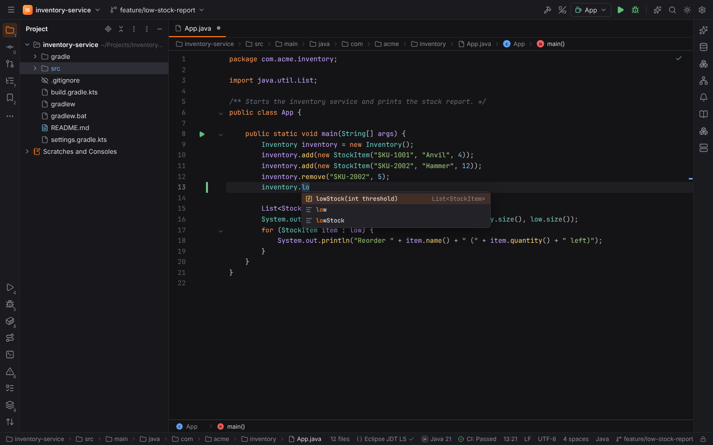

## Eclipse JDT Language Server

Code intelligence comes from [Eclipse JDT LS](https://github.com/eclipse-jdtls/eclipse.jdt.ls)
(EPL-2.0) through Forge's shared language server client: completion, Go to Declaration and
Implementation, Find Usages, hover with Javadoc, parameter info, diagnostics in the editor and
the Problems tool window, Rename, quick fixes and code actions (`Alt+Enter`), Optimize Imports
(`Ctrl+Alt+O`) and Reformat Code (`Ctrl+Alt+L`).

JDT LS is never bundled with Forge. When a Java project opens without it, a balloon offers
**Install**, **Not now** and **Don't ask again** (setting **Install Eclipse JDT LS**: Ask,
Always, Never). Install downloads, with your consent:

- the newest JDT LS milestone (or snapshot, see **Release channel**) from
  `download.eclipse.org/jdtls`, checked against the `.sha256` file published next to it, into
  `<data dir>/forge/langservers/jdtls/<version>`;
- Microsoft's [java-debug](https://github.com/microsoft/java-debug) plugin (EPL-1.0) from
  Maven Central, checked against the repository's checksum, into
  `<data dir>/forge/langservers/java-debug`.

Progress shows in the status bar. **Install Eclipse JDT Language Server** in Find Action
(`Ctrl+Shift+A`) installs or updates both at any time.

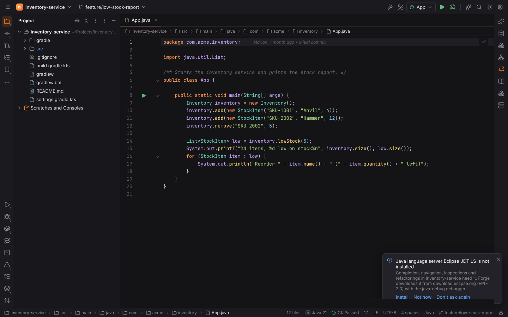

Forge starts JDT LS itself, like the official `jdtls` launcher: with a JDK that it can run on
(Java 21 for 2024–2025 builds; newer builds need Java 25, which Forge reads from the bundles of
the installation), the installation read-only, and its OSGi configuration and the workspace data
in the user cache directory (`<cache dir>/forge/jdtls`), never inside the project. Every
detected JDK is announced to JDT LS as a runtime, the project JDK as the default.

While JDT LS imports a Maven or Gradle build, the status bar shows its progress ("Importing
Gradle project(s) 45%"). After editing a build file, run **Reload All Maven and Gradle Projects**
(Find Action, the main menu's Build menu or the Gradle / Maven tool window) to re-import it.

Settings | Languages & Frameworks | **Java** shows the installed versions and the JDK JDT LS runs
on, and has these options:

| Setting | |
| --- | --- |
| Install Eclipse JDT LS | Ask, Always or Never when a Java project opens without it |
| JDT LS installation | Use your own unpacked JDT LS (a folder with `plugins/` and `config_*`) |
| JDK for the language server | The JDK that runs JDT LS; empty: the project JDK when it is new enough, else the newest that is |
| VM options | `-Xmx1G` by default |
| Release channel | Milestones or snapshots |
| Download site | `https://download.eclipse.org/jdtls` |
| Hot code replace | Automatically, on request or never (see [Debugging](#debugging)) |
| java-debug repository | `https://repo1.maven.org/maven2` |

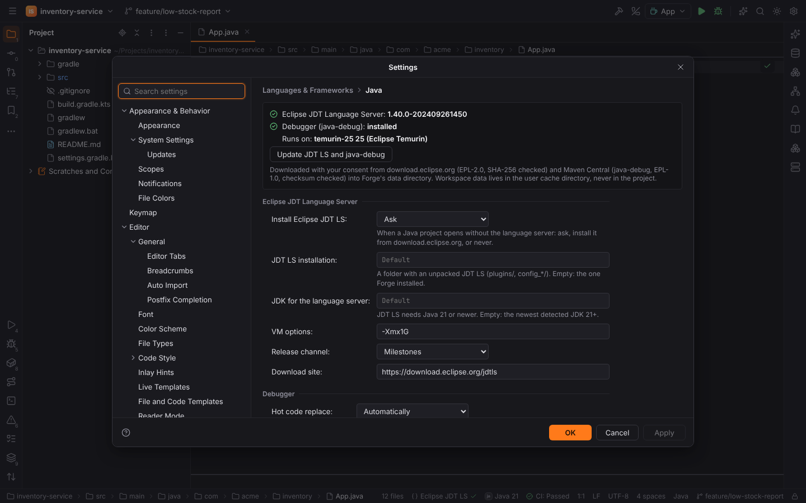

JDT LS imports and builds projects, which runs code of the project (Gradle build scripts,
annotation processors), so it does not start in [Safe Mode](project-trust.md). It runs for local
projects; remote projects do not start it yet.

Minecraft server and proxy plugins (Paper, Spigot, Velocity, …) and Fabric / NeoForge mods have their own project
wizard, descriptor support and Run Paper Server configuration: see
[Minecraft plugins](minecraft.md).

## JDKs

Settings | Build, Execution, Deployment | **JDKs** combines IntelliJ's SDK list and Project
settings:

- **Project JDK**: the JDK the project builds and runs with (empty: the newest). Runs of Maven
  and Gradle get it as `JAVA_HOME`.
- **Language level**: the Java release of the sources; empty means the build's (toolchain,
  `maven.compiler.release`) or the project JDK's.
- The JDK list: every JDK Forge detects, with its name (`temurin-21`), home, version, vendor and
  where it was found. Detection reads each JDK's `release` file and looks at `JAVA_HOME`, `java`
  on `PATH`, `/usr/lib/jvm` and `/usr/java` (Linux), `/Library/Java/JavaVirtualMachines` and
  `~/Library/Java/JavaVirtualMachines` (macOS), `Program Files` and the registry (Windows),
  SDKMAN! (`~/.sdkman/candidates/java`), asdf, jabba, Gradle toolchains (`~/.gradle/jdks`),
  IntelliJ's `~/.jdks` and Forge's own downloads. A JRE without `javac` is not listed.
- **+** adds a JDK from disk, **Detect Again** rescans.

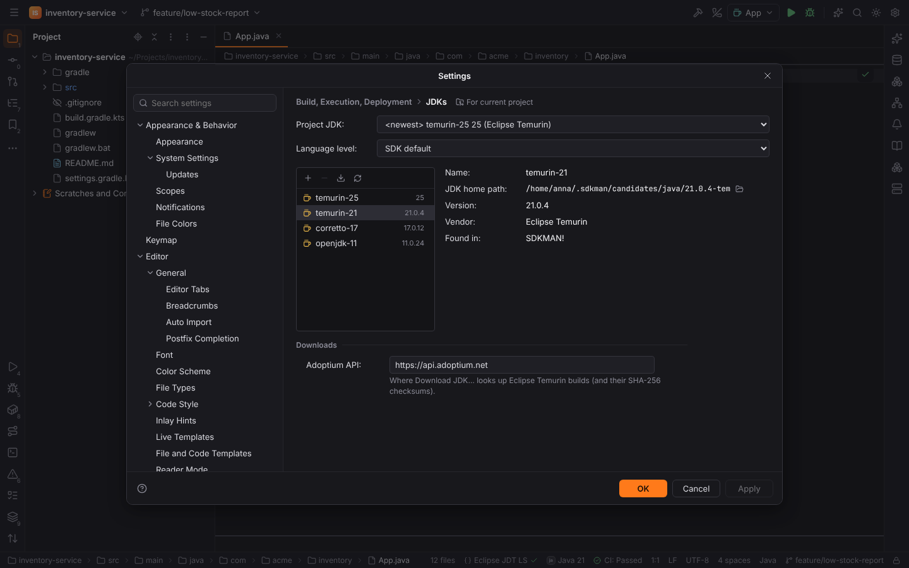

**Download JDK…** (the download button, or Find Action) downloads Eclipse Temurin from the
[Adoptium API](https://api.adoptium.net) (setting **Adoptium API**): pick a version (LTS releases
are marked), and Forge downloads the build for your platform, checks it against the SHA-256 the
API publishes and unpacks it into `<data dir>/forge/jdks/<release>`.

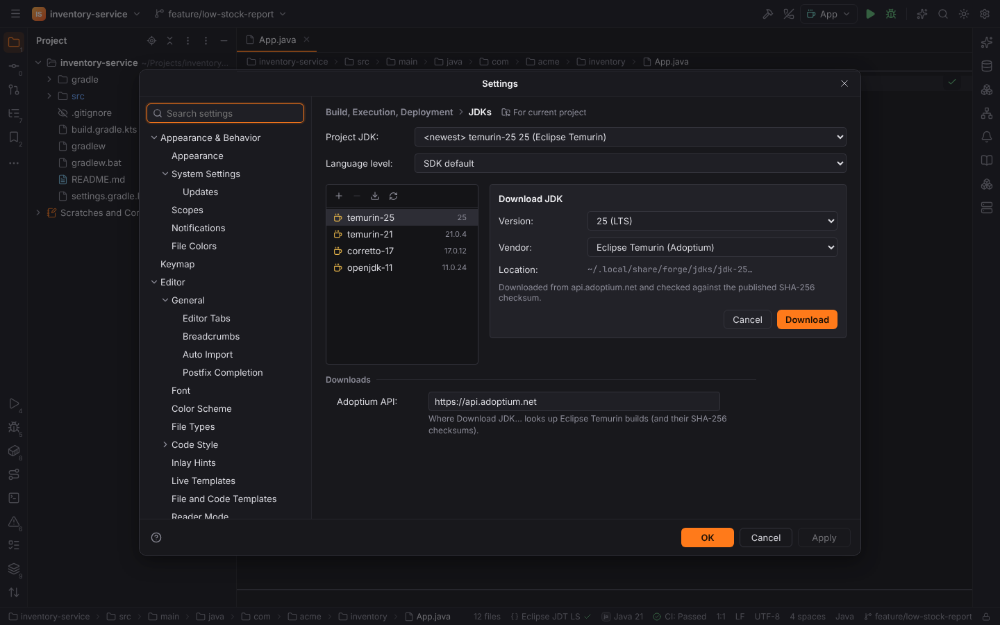

## Maven and Gradle

Forge reads the build in the project root: the tool (with both a `pom.xml` and a Gradle build,
setting **Build tool of projects with both**), the wrapper (`mvnw`, `gradlew`) and its Gradle
version, the Kotlin or Groovy DSL, modules (`include` in `settings.gradle(.kts)`, `<modules>` in
`pom.xml`), JaCoCo, the `application` plugin and its main class, Spring Boot, custom tasks and
the Java release.

- **Build Project** (`Ctrl+F9`) compiles main and test sources through the build tool
  (Gradle `classes testClasses`, Maven `test-compile`), or through Eclipse JDT LS with
  **Build and run using: IntelliJ IDEA**.
- **Reload All Maven and Gradle Projects** (the tool windows' ⟳, Build menu) syncs: the build
  tool reports tasks and resolved dependencies, then JDT LS re-imports the build files.
  Gradle and Maven run the project's build scripts and plugins, so
  [Safe Mode](project-trust.md) refuses a sync until you trust the project.

### Gradle tool window

The **Gradle** tool window (right stripe) shows the root project and its subprojects with:

- **Tasks** grouped like `gradle tasks --all` (application, build, build setup, documentation,
  help, verification, other). Double-click or ▶ runs one as a temporary Gradle configuration
  (`:app:test` in a subproject).
- **Dependencies** per configuration (`compileClasspath`, `runtimeClasspath`,
  `testCompileClasspath`, `testRuntimeClasspath`, `annotationProcessor`) as resolved trees:
  `1.0 → 1.2` where conflict resolution picked another version, `(*)` for dependencies listed
  above, unresolved ones in red. Before the first sync the tool window lists the dependencies
  the build file declares.
- **Source Sets**: `main`, `test` and other source sets with their `java`, `groovy`, `kotlin`,
  `scala` and `resources` folders (the applied plugins' conventions before a sync, Gradle's
  `sourceSets` after it; see [Groovy and Scala](groovy-scala.md#groovy-source-sets)). The Maven
  tool window shows the conventional folders too (GMavenPlus adds `groovy`).
- **Run Configurations**: the project's Gradle configurations.

The toolbar: **Reload All Gradle Projects**, **Execute Gradle Task…** (a command line with
completion of every task, `clean :app:test --info`), **Run**, **Expand All** / **Collapse
All**, **Toggle Offline Mode** (`--offline` for syncs and runs), **Show Dependencies** and
**Gradle Settings**.

A sync runs Gradle with a small init script (`forge-model.gradle`, written to the user cache
directory) whose `forgeModel` task writes the projects, tasks, source sets and dependency trees as JSON
(`--no-configuration-cache`). The result is cached in `<cache>/forge/javaforge/sync`, never in
the project, so the tool window shows it again after a restart.

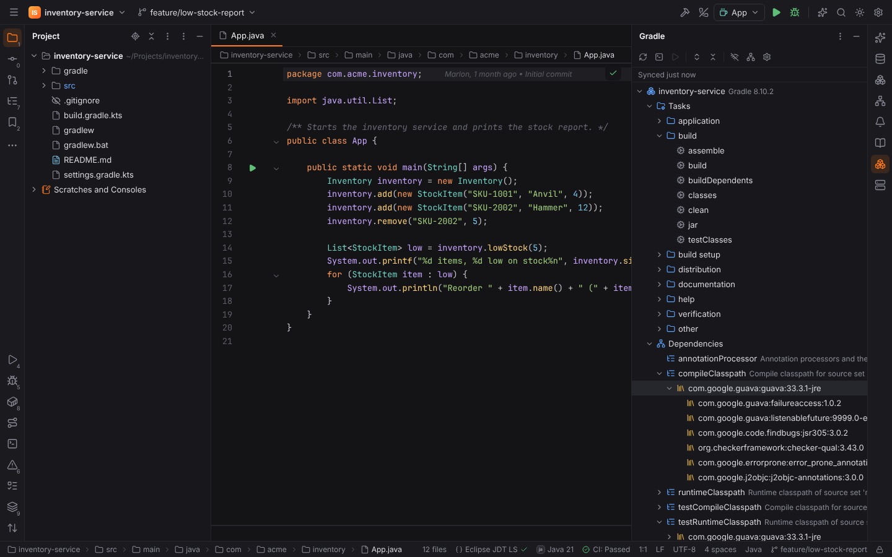

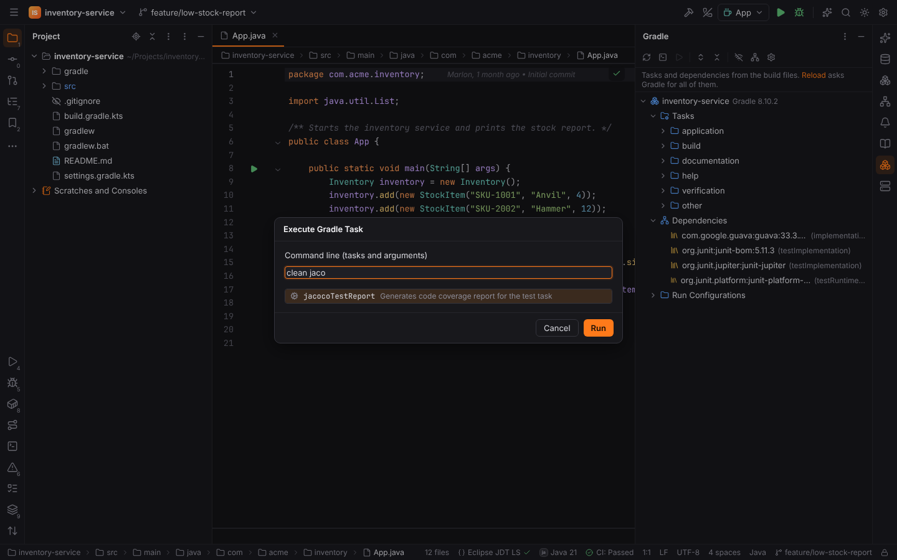

### Maven tool window

The **Maven** tool window shows **Profiles** with checkboxes (`activeByDefault` profiles start
checked; unchecking one deactivates it with `!id`), then the project and its modules with
**Lifecycle** (clean … deploy), **Plugins** (the default lifecycle plugins and those in
`<build><plugins>`, each with its goals, `jacoco:report`) and **Dependencies** (the tree of
`mvn dependency:tree` with scopes after a sync, the declared ones before).

The toolbar: **Reload All Maven Projects**, **Execute Maven Goal…**, **Run Maven Build**,
**Toggle Offline Mode** (`-o`), **Toggle 'Skip Tests' Mode** (`-DskipTests`; test runs ignore
it), **Expand All** / **Collapse All**, **Show Dependencies** and **Maven Settings**. The
selected profiles (`-Pdev,!prod`) apply to every Maven run.

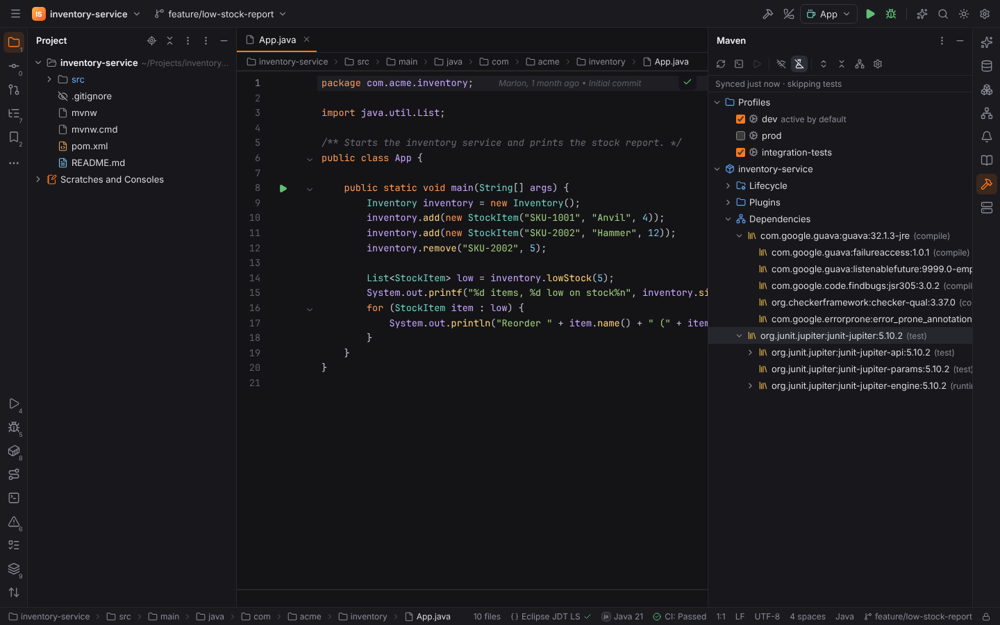

### Gradle settings and the wrapper

Settings | Build, Execution, Deployment | Build Tools | Gradle:

| Setting | |
| --- | --- |
| **Use Gradle from** | `'gradle-wrapper.properties' file` (the wrapper, default), **Specified location** (**Gradle home**: a Gradle installation or its `bin/gradle`) or **Local installation** (`gradle` on the `PATH`). |
| **Gradle JVM** | The JDK Gradle syncs, builds and runs with (empty: the project JDK). |
| **Offline work** | `--offline`. |
| **Build and run using** | **Gradle** (default): Build Project runs `classes testClasses`, Application configurations run through Gradle (`forgeRun`, a `JavaExec` task of the init script `forge-run.gradle`, with the main class, arguments, VM options and the source set's runtime class path and toolchain). **IntelliJ IDEA**: JDT LS compiles, Forge runs `java` with the class path java-debug resolves. |
| **Run tests using** | **Gradle** (default) or **IntelliJ IDEA**: JUnit tests run on the JUnit Platform Console Launcher (`junit-platform-console-standalone.jar`: the **JUnit Platform Console Launcher** setting, else the newest in `~/.m2` or Gradle's cache) with JDT LS's class path; TestNG and Run with Coverage always use Gradle. |

The page shows the project's **Gradle wrapper**: the version and distribution from
`gradle/wrapper/gradle-wrapper.properties` and its `distributionSha256Sum`. **Verify** compares
the checksum with the one Gradle publishes on services.gradle.org (the wrapper refuses a
download whose checksum does not match). **Update Wrapper** (also the action *Update Gradle
Wrapper…*) points `distributionUrl` at the newest release, or the version you enter, and writes
the published SHA-256 sum as `distributionSha256Sum`; it edits the properties file only, so it
runs no project code. The new Gradle is downloaded by the wrapper on its next run.

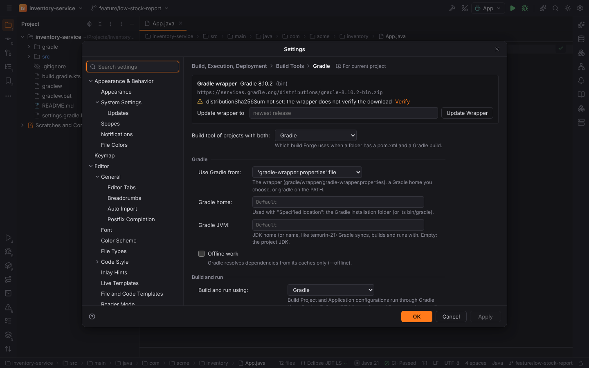

Maven's page has **Use the Maven wrapper**, **Maven home path**, **Work offline**, **Skip
tests** and **Download sources of dependencies**.

### Editing build scripts

`build.gradle.kts` (Kotlin DSL) and `build.gradle` (Groovy DSL) are highlighted as Kotlin and
Groovy. Completion knows the common blocks and functions of the block the caret is in, with
insert texts in the script's DSL (`implementation("…")` / `implementation '…'`):

- top level: `plugins`, `dependencies`, `repositories`, `java`, `application`, `jacoco`,
  `tasks`, `group`, `version`, `sourceSets`, `configurations`, `buildscript`, `allprojects`,
  `subprojects`, `testing`; settings scripts: `rootProject.name`, `include`, `includeBuild`,
  `pluginManagement`, `dependencyResolutionManagement`;
- `plugins` (core plugins, `id(…) version …`, `kotlin(…)`, plugin ids in `id("…")`),
  `dependencies` (`implementation`, `api`, `compileOnly`, `runtimeOnly`, `annotationProcessor`,
  `testImplementation`, … and `platform`, `project`, `files`, `testFixtures`), `repositories`,
  `java { toolchain { languageVersion, vendor } }`, `application { mainClass }`, `jacoco`,
  `tasks.register<Type>("name")`, `named`, `withType`, `test { useJUnitPlatform() … }`,
  `jacocoTestReport { reports { … } }`, `jar { manifest { … } }`;
- members after `tasks.`, `JavaLanguageVersion.`, `JvmVendorSpec.`, `JavaVersion.`.

In a dependency string (`implementation("guav")`) and in `<groupId>`, `<artifactId>` and
`<version>` of `pom.xml`, completion offers coordinates and versions from **Maven Central**
(newest first; typing `:` after the group or artifact moves on to artifacts and versions).
Answers are cached in `<cache>/forge/maven-central`; offline, the cache and a few well-known
artifacts answer.

**A newer version is available**: declared versions older than the newest release of the same
variant (Guava's `-jre` stays `-jre`; pre-releases only replace pre-releases) get a weak
warning and a gutter icon; **Alt+Enter → Change to …** (or a click on the icon) writes the new
version, in `pom.xml` into the property that holds it (`${guava.version}`).

Settings | Build, Execution, Deployment | Build Tools: **Search Maven Central** turns the lookups
off; **Search API** and **Repository** point them at a mirror.

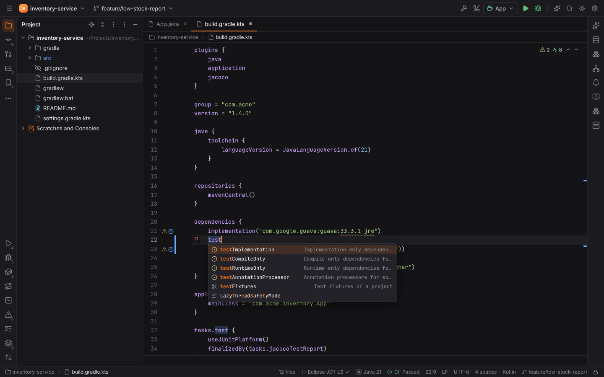

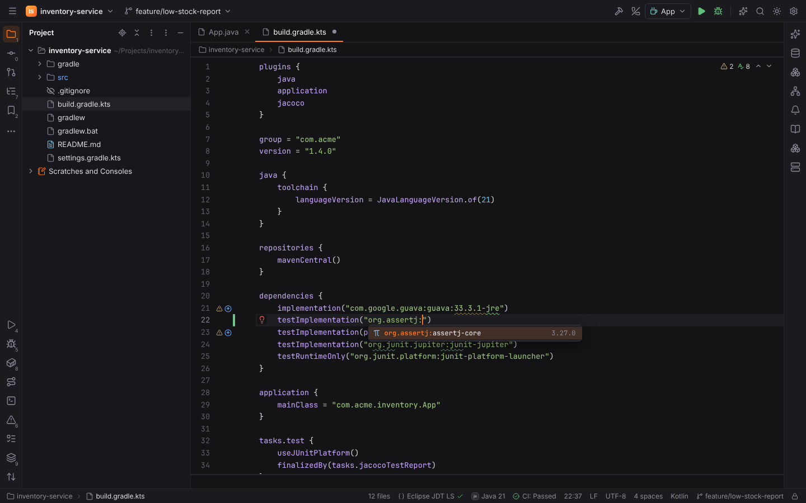

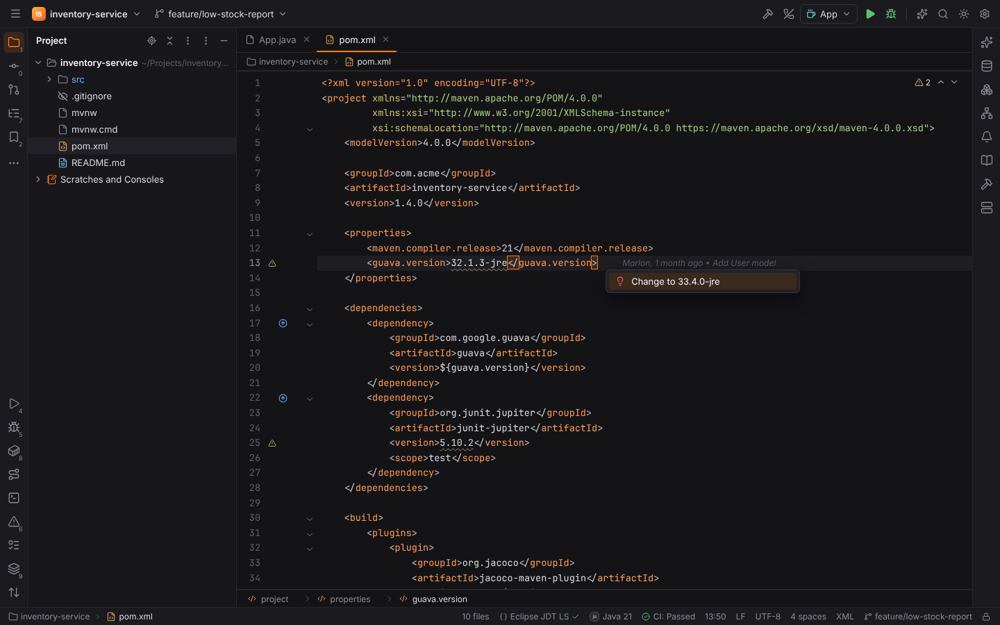

## Run configurations

| Type | |
| --- | --- |
| **Application** | Runs a main class with the configuration's JDK (empty: the project JDK), VM options, program arguments, environment and working directory. In Gradle projects it runs through Gradle by default (**Build and run using**, see [Gradle settings](#gradle-settings-and-the-wrapper)). Otherwise the class path comes from the build through JDT LS (java-debug resolves it after JDT LS compiled the project); without JDT LS it is the module's build output (`build/classes/java/main`, `target/classes`). **Class path** and **Java module** (`-m module/class`) override it. |
| **Gradle** | Runs tasks (`clean build`), optionally in a module (`:app:build`). |
| **Maven** | Runs goals (`clean install -DskipTests`), optionally in a module (`-pl app -am`). |
| **JUnit**, **TestNG** | Runs all tests, a package, a class, a method or a list of tests through the build tool; see [Tests](#tests). |
| **Remote JVM Debug** | Attaches the debugger to a JVM started with `-agentlib:jdwp=transport=dt_socket,server=y,suspend=n,address=*:5005`. |

Spring Boot applications have their own **Spring Boot** configuration type with profiles and
override properties, see [Spring Boot and Jakarta EE](spring.md#spring-boot-run-configuration).

A green ▶ in the gutter next to a `main` method (`public static void main(String[] args)`, and
Java 25's instance `void main()` and compact source files) offers Run, Debug and Modify Run
Configuration; `Ctrl+Shift+F10` runs the class at the caret.

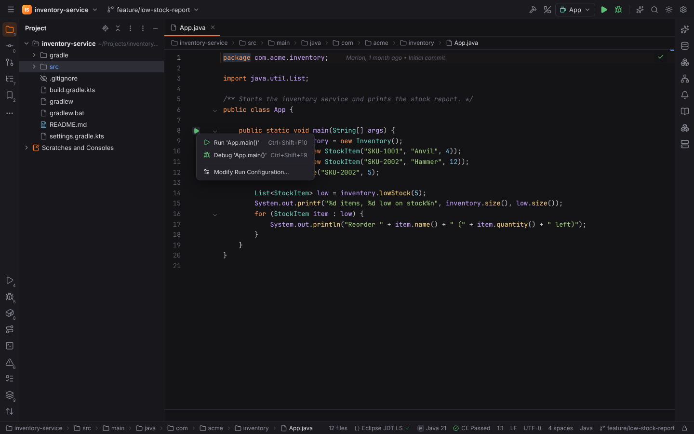

## Tests

JUnit 5 (`@Test`, `@ParameterizedTest`, `@RepeatedTest`, `@TestFactory`, `@TestTemplate`,
`@Nested` classes), JUnit 4 (`@Test`), JUnit 3 (`TestCase` subclasses with `test*` methods) and
TestNG (method and class level `@Test`) get gutter icons on their classes and methods, chosen by
the file's imports. They run on the [shared test runner](testing.md) through the build tool, as
IntelliJ delegates to Gradle and Maven:

- Gradle: `cleanTest test --tests 'com.acme.CartTest.adds'` (so up-to-date tests run again);
- Maven Surefire: `test -Dtest='com.acme.CartTest#adds' -Dsurefire.failIfNoSpecifiedTests=false`.

The results come from the JUnit XML reports the build writes (`build/test-results/test`,
`target/surefire-reports`), which Forge empties before the run. The tree links tests and stack
traces to their sources; **Rerun Failed Tests** runs the failed ones only.

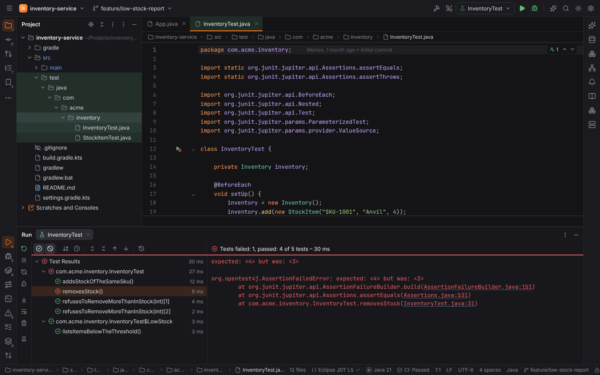

**Run with Coverage** works when the build configures JaCoCo: Gradle runs `jacocoTestReport`
(enable its XML report: `reports { xml.required = true }`), Maven runs
`org.jacoco:jacoco-maven-plugin:report` (with `prepare-agent` bound in the build). Forge reads
`build/reports/jacoco/test/jacocoTestReport.xml` or `target/site/jacoco/jacoco.xml` into the
[Coverage](coverage.md) tool window and the editor gutter.

## Debugging

Debug (`Shift+F9`) on an Application, Gradle (`run` and friends), JUnit or TestNG configuration
starts the JVM with a JDWP agent that waits for the debugger (Application: a free port;
Gradle: `--debug-jvm` on port 5005; Maven Surefire: `-Dmaven.surefire.debug`), and attaches
java-debug as soon as the JVM listens. java-debug runs inside JDT LS and serves the Debug
Adapter Protocol, so the [Debug tool window](debugging.md) works as for every other language:
threads, frames, variables with expandable objects, watches, Evaluate Expression, breakpoints
with conditions and logpoints, exception breakpoints (caught and uncaught) and inline values.

**Remote JVM Debug** attaches to a JVM on another machine or in a container at `host:port`.

**Hot code replace**: with **Automatically** (the default), java-debug reloads changed classes
into the running JVM after JDT LS rebuilt them on save.

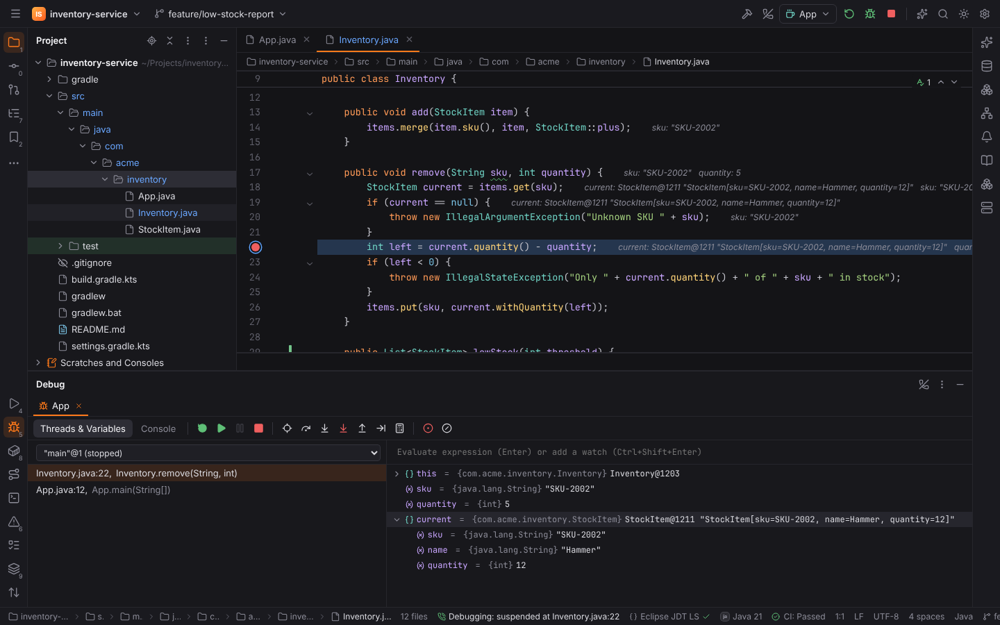

## Browser mode

`pnpm dev` with `?project=java` opens the demo Gradle service `inventory-service`
(`?project=java&jdtls=missing` starts without JDT LS to try the install offer;
`?project=java&build=maven` builds it with Maven, with profiles). Syncs, Update Wrapper and
Maven Central answer from recorded data; nothing runs or goes to the network.
