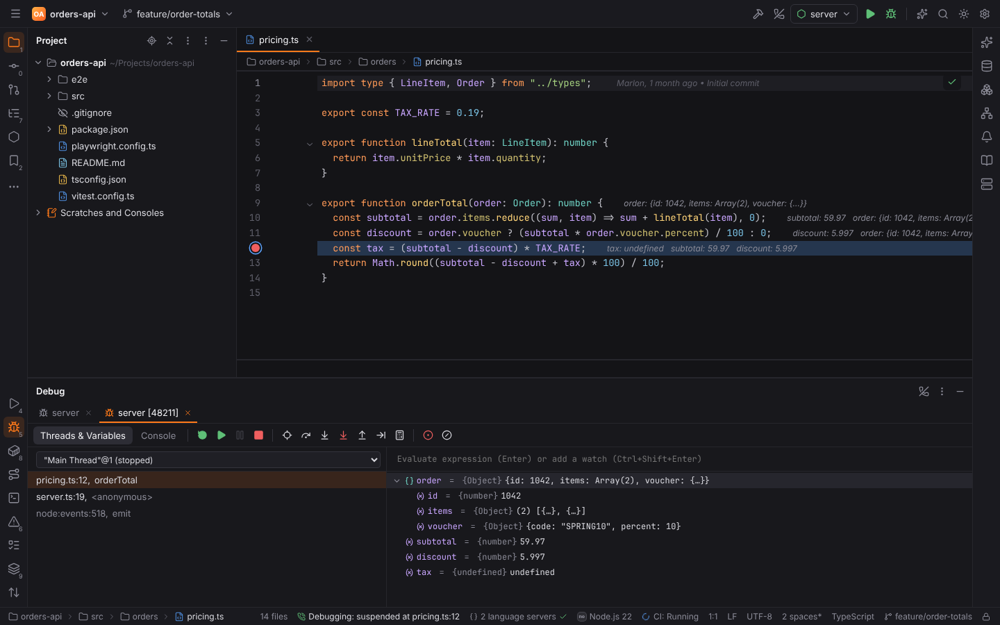
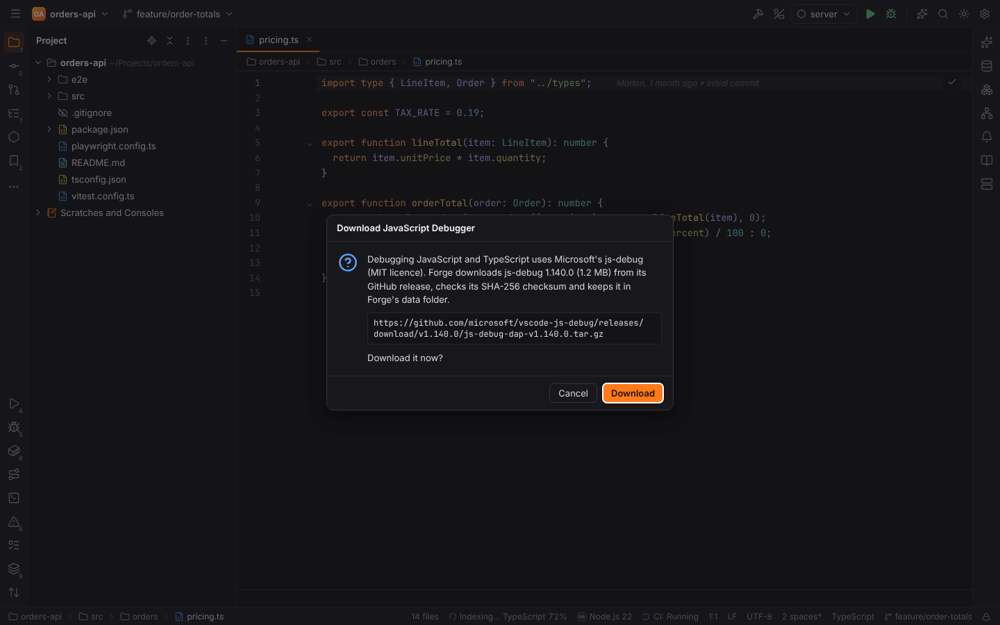
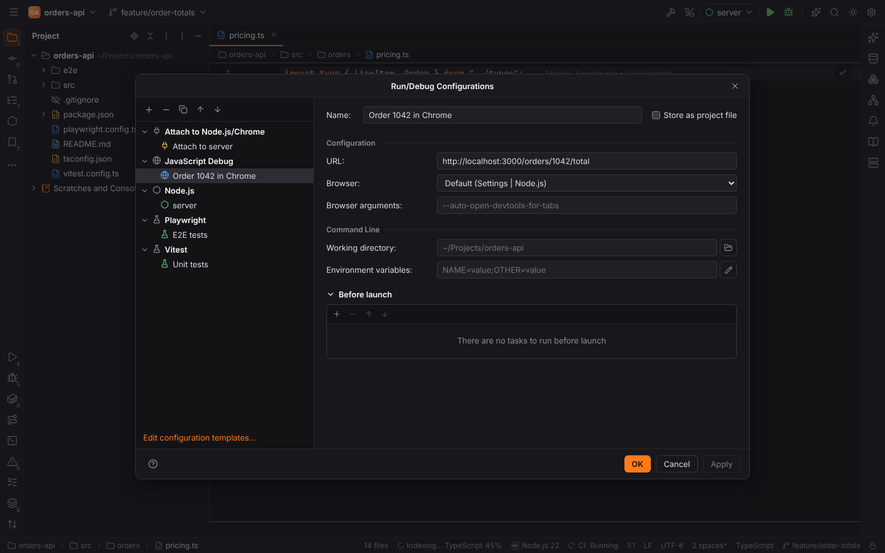
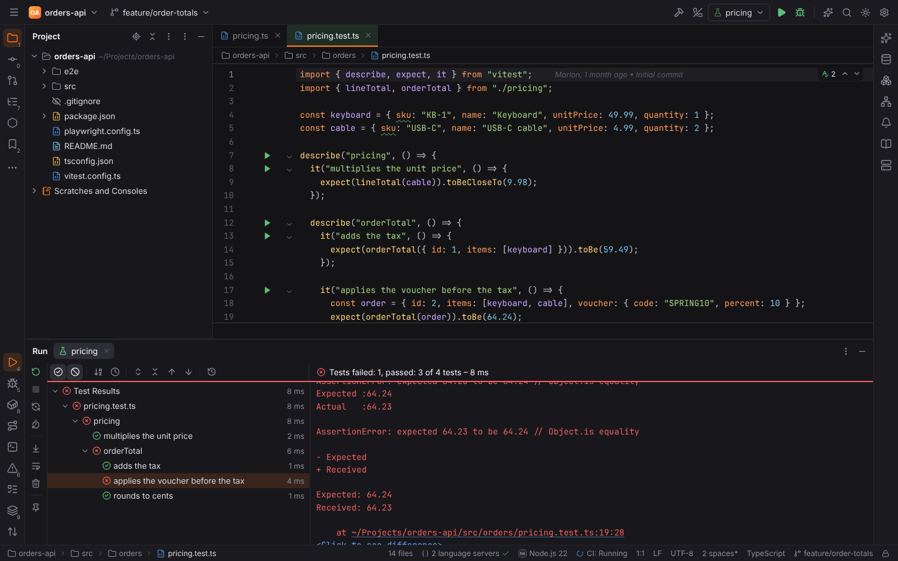
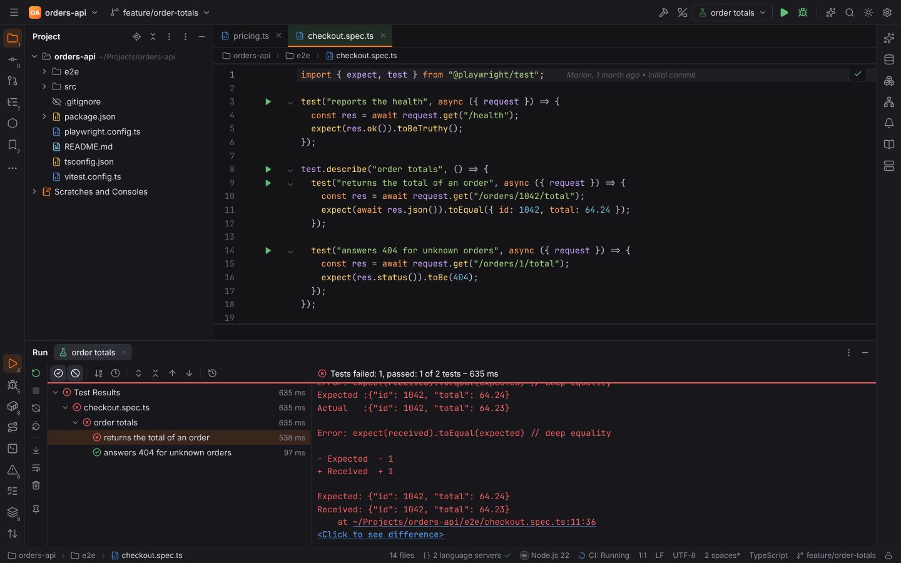

# JavaScript debugging and testing

Two WebForge plugins bring WebStorm's JavaScript run, debug and test support to Forge. Both
are active in projects with a `package.json` (Settings | Plugins):

| Plugin | Id | What it adds |
| --- | --- | --- |
| JavaScript Debugger | `forge.js-debugger` | the **Node.js**, **JavaScript Debug** and **Attach to Node.js/Chrome** run configurations, and Debug of Node.js programs, npm scripts, tests and browser pages with js-debug |
| JavaScript Test Runners | `forge.js-testing` | **Jest**, **Vitest**, **Mocha**, **Playwright**, **Cypress** and **Node.js Test Runner** (`node --test`) on the shared [test runner](testing.md) |

## The debugger: js-debug

Forge debugs JavaScript with Microsoft's **js-debug**, the debugger of VS Code (MIT licence),
over the Debug Adapter Protocol. It is not bundled with Forge. The first time you debug a
JavaScript configuration, Forge asks to download it:

- Forge downloads one pinned release (`js-debug-dap-v1.140.0.tar.gz`) from the GitHub
  releases of `microsoft/vscode-js-debug`, checks its SHA-256 checksum and unpacks it into
  `<data dir>/forge/debug-adapters/js-debug/<version>`. A download with another checksum is
  discarded.
- js-debug runs on Node.js 18 or newer: the **Node interpreter** of Settings | Languages &
  Frameworks | Node.js, else `node` on the `PATH`, else the Node.js Forge downloads from
  nodejs.org for its language servers (also SHA-256 checked).
- **Run | Download JavaScript Debugger (js-debug)** (Find Action) downloads it ahead of time.
- To use a js-debug you unpacked yourself, set **js-debug folder** (the folder with
  `src/dapDebugServer.js`) in Settings | Languages & Frameworks | Node.js.

Each debug session starts js-debug's DAP server. js-debug runs the program in a **child
session** (it asks for it with the `startDebugging` request); the Debug tool window shows the
launcher and the program as two tabs, `server` and `server [48211]`, and the program's tab
stops at breakpoints. Child processes of the program (workers, test runners that fork) get
their own tabs too.

### Breakpoints in TypeScript

Breakpoints, stepping and the stack work in the files you write: TypeScript, JSX, Vue single
file components and bundled code are mapped through **source maps** by js-debug. Compile with
source maps (`"sourceMap": true` in `tsconfig.json`, Vite and webpack create them in
development) or run TypeScript directly with a loader such as `tsx` (`--import tsx` in the
configuration's Node options). Conditions, hit counts and logpoints work as for every
debugger (see [Debugging](debugging.md)).

**Do not step into** (Settings | Node.js) lists scripts the debugger steps over, separated by
`;`; the default skips Node.js' own modules (`<node_internals>/**`).

## Run configurations

| Type | Run | Debug |
| --- | --- | --- |
| **Node.js** | `node [Node options] <file> [Application parameters]` in the Run tool window | the same under js-debug |
| **JavaScript Debug** | opens the URL in the browser | launches Chrome, Edge or Chromium with a separate profile under js-debug; breakpoints in the page's sources |
| **Attach to Node.js/Chrome** | (Debug only) | attaches to `host:port`: Node.js started with `--inspect` (port 9229) or a browser started with `--remote-debugging-port` (9222) |
| **npm** | the script | the script under js-debug (`npm run <script>` with the debugger attached to every Node.js process it starts) |

- **Node.js**: *JavaScript file*, *Interpreter* (default: the project's Node interpreter),
  *Interpreter options* (Node options such as `--import tsx`), *Application parameters*,
  working directory and environment variables.
- **JavaScript Debug**: *URL*, *Browser* (the default of Settings | Node.js | Browser for
  JavaScript Debug: Auto, Google Chrome, Microsoft Edge or Chromium; or a path to a browser)
  and *Browser arguments*. Forge looks for the browsers at their usual install paths and on
  the `PATH`.
- **Attach to Node.js/Chrome**: *Attach to* (Node.js, Chrome, Edge), *Host*, *Port* and
  *Remote root* (the project's folder inside a container, for path mapping).
- **Run | Attach to Process…** lists local processes; picking a Node.js process attaches
  js-debug to it (Node.js opens its inspector on request).
- The ▶ icons next to scripts in `package.json` and the npm tool window offer **Debug** as
  well. Without js-debug (you declined the download, or the plugin is disabled), Debug of an
  npm script falls back to Node's inspector through `NODE_OPTIONS` (*Node options when
  debugging scripts*, default `--inspect`).

Launching a program runs project code and is refused in [Safe Mode](project-trust.md);
attaching is not.

## Test runners

| Runner | Detected by | Results from | Coverage |
| --- | --- | --- | --- |
| **Jest** | `jest` in `package.json`, `jest.config.*` | Jest's JSON report (`--json --outputFile`) | `--coverage`, LCOV |
| **Vitest** | `vitest` in `package.json`, `vitest.config.*`, `vitest.workspace.*` | the JSON reporter (`--reporter=json --outputFile.json`) | `--coverage.enabled`, LCOV (needs `@vitest/coverage-v8` or `-istanbul`) |
| **Mocha** | `mocha` in `package.json`, `.mocharc.*` | the TAP reporter | through **c8** (`node_modules/c8`), LCOV |
| **Playwright** | `@playwright/test` in `package.json`, `playwright.config.*` | the JSON reporter (`PLAYWRIGHT_JSON_OUTPUT_NAME`) | — |
| **Cypress** | `cypress` in `package.json`, `cypress.config.*` | `cypress run --reporter junit` | — |
| **Node.js Test Runner** | `node --test` in a `package.json` script | TAP (`--test-reporter=tap`) | Node's LCOV reporter (`--experimental-test-coverage`) |

- **Gutter icons** on `describe` / `context` / `suite`, `it` / `test` / `specify` (with
  `.only`, `.skip`, `.each`, `test.describe` and the other modifiers) whose name is a string.
  The nesting follows the calls, so a test's full name is the names of its `describe` blocks
  and its own. Each icon offers **Run**, **Run with Coverage** (Jest, Vitest, Mocha,
  `node --test`), **Debug** and **Modify Run Configuration…**; after a run it shows the test's
  result.
- **Which runner a file belongs to**: the runner the project uses (detected from
  `package.json` and config files). Files that import `vitest`, `@jest/globals`, `mocha` or
  `node:test` belong to that runner, files that import `@playwright/test` (or lie in `e2e/`)
  to Playwright, and `*.cy.*` files and the `cypress/` folder to Cypress.
- **Scopes**: all tests, a directory, a file, a test or `describe` block (`-t` / `--grep` /
  `--test-name-pattern` with the full name), or a name pattern.
- **Run configurations** of each runner add *Node interpreter*, *Node options*, the runner's
  *package* (default `node_modules/<runner>`, for monorepos) and its *Configuration file*.
  The runner's CLI script runs with Node.js (`node node_modules/jest/bin/jest.js …`), so no
  `npx` or shell shim is involved.
- **Rerun Failed Tests** runs the failed tests again by name, limited to their files (Cypress,
  which cannot filter names without `@cypress/grep`, reruns the failed spec files).
- **Debug** runs the same command under js-debug with the runner in one process and without
  timeouts (Jest `--runInBand`, Vitest `--no-file-parallelism`, Playwright `--workers=1`,
  Mocha `--no-timeouts`). Cypress tests run in the browser Cypress drives; debug them with
  **Open Cypress** and the browser's DevTools.
- **Tools | Show Playwright Report** opens the HTML report (`playwright show-report`), **Tools
  | Open Cypress** starts the Cypress app (`cypress open`).

See [Testing](testing.md) for the test tree, Click to see difference, Test History and
auto-test, and [Code coverage](coverage.md) for the Coverage tool window.

## Settings

Settings | Languages & Frameworks | Node.js:

| Setting | Key | Default |
| --- | --- | --- |
| Node interpreter | `web.node.interpreter` | empty: `node` on the `PATH`, else Forge's Node.js |
| js-debug folder | `web.jsDebug.path` | empty: the version Forge downloads |
| Browser for JavaScript Debug | `web.jsDebug.browser` | `auto` |
| Do not step into | `web.jsDebug.skipFiles` | `<node_internals>/**` |
| Node options when debugging scripts (without js-debug) | `web.npm.debugArguments` | `--inspect` |

## For developers

The debugger lives in [`webforge-js-debug`](../developer/crates/webforge-js-debug.md) (the
pinned release, the `pwa-node` / `pwa-chrome` / `pwa-msedge` adapters registered with
[`forge-dap`](../developer/crates/forge-dap.md), browser detection and the launch requests of
the run configurations), the test runners in
[`webforge-js-testing`](../developer/crates/webforge-js-testing.md), which wraps the runners'
`[[contributions.testFrameworks]]` entries of WebForge's manifest.
