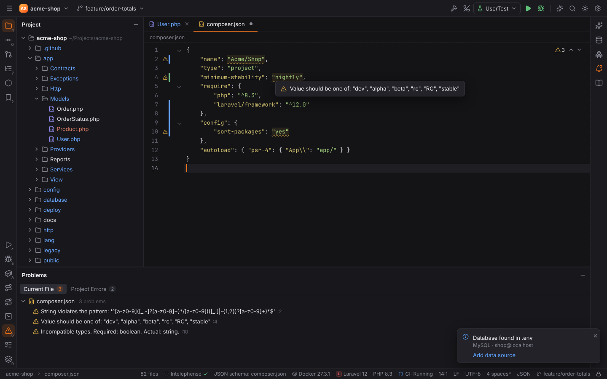
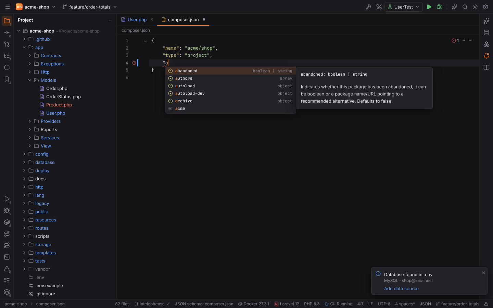
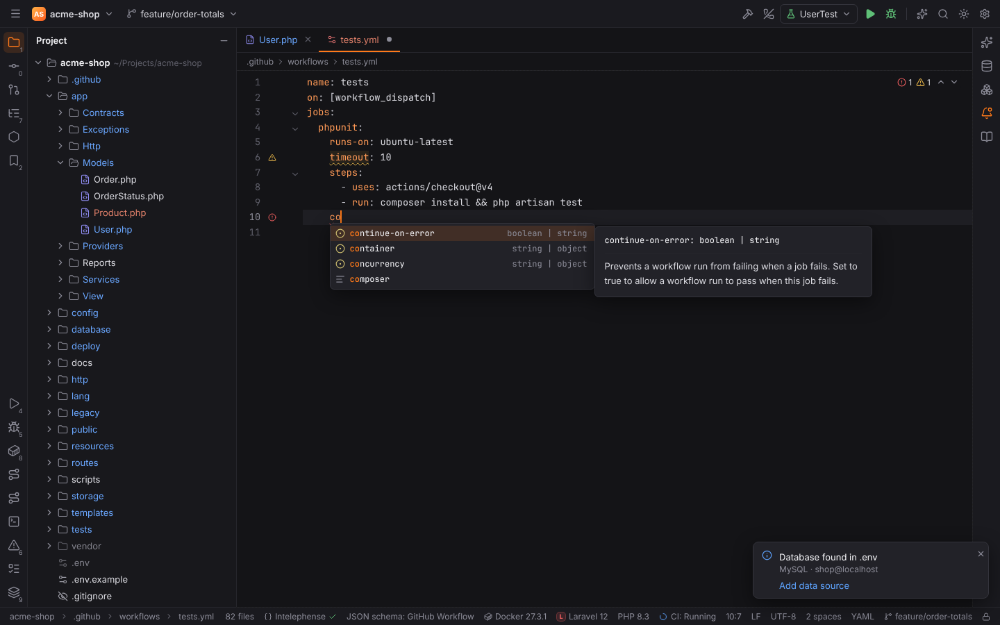
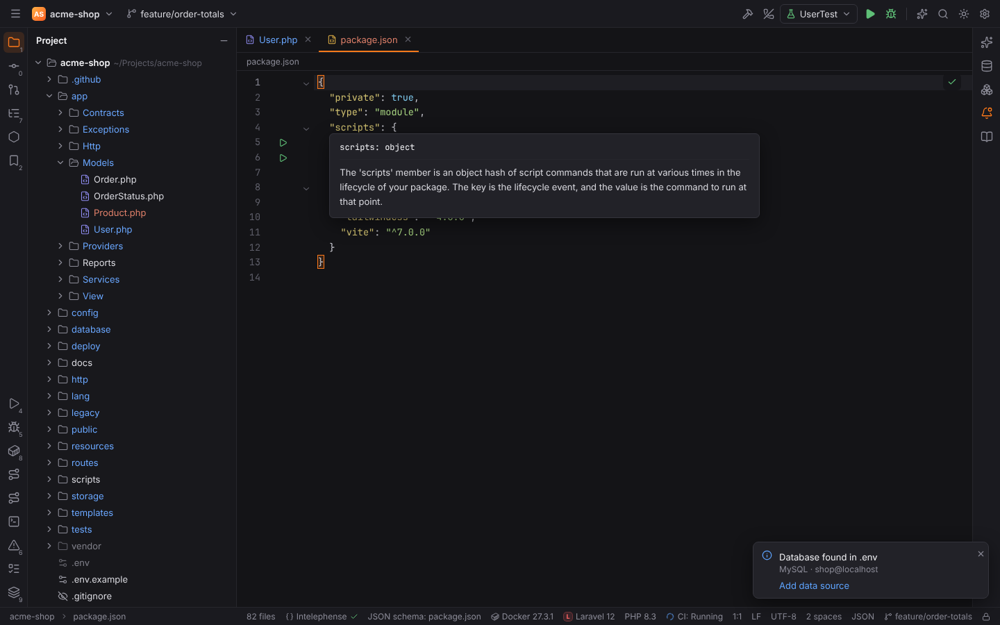
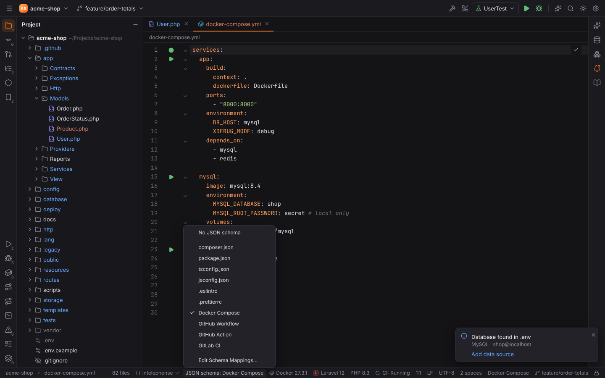
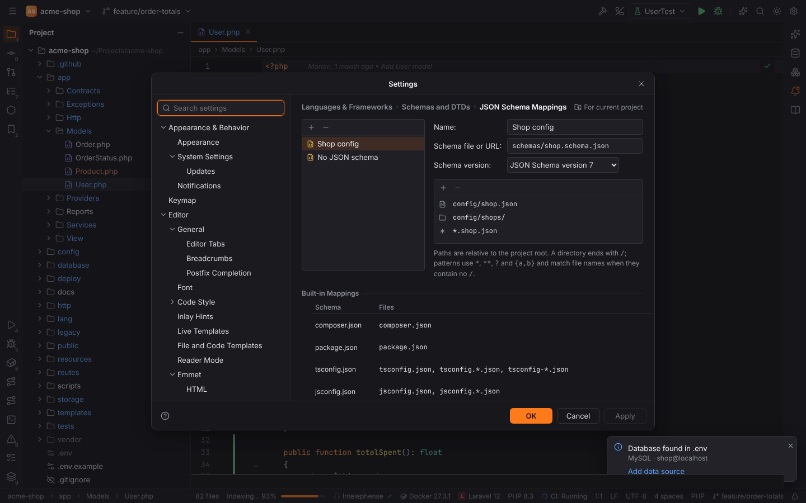

# JSON Schema

Forge checks JSON and YAML files against a [JSON Schema](https://json-schema.org), like
PHPStorm: properties a file must have, the types and values it allows, and the documentation
of every key. Configuration files such as `composer.json`, `package.json`, Compose files and CI
pipelines work out of the box; for your own formats you map a schema to the files.

Everything is computed in Rust (`crates/forge-jsonschema`); the desktop app and browser mode
behave the same, and remote projects read their schema files through the remote host. No
language server is needed.

## Which files

- **JSON**, JSON with comments (`.jsonc`, `tsconfig.json`, `.eslintrc`) and JSON5 (unquoted
  keys, single quotes, trailing commas).
- **YAML**, including several documents in one file (`---`), anchors, aliases and `<<` merge keys.
  Values with a custom tag (GitLab's `!reference [...]`, Compose's `!reset`) are not judged.

## Problems

The **Compliance with JSON schema** inspection reports problems as warnings (yellow); syntax
errors stay red. They appear as you type, in the gutter, the scrollbar and the
[Problems](editor.md#problems) tool window (`Alt+6`). The messages are PHPStorm's:

| Message | When |
| --- | --- |
| Missing required property 'name' / Missing required properties 'a', 'b' | `required`; shown on the object's key (or its `{`) |
| Incompatible types. Required: string. Actual: integer. | `type` (several types: "Required one of: …") |
| Property 'x' is not allowed | `additionalProperties: false`, `unevaluatedProperties: false`, `propertyNames`, a `false` property schema |
| Value should be one of: "dev", "alpha", "beta" | `enum` and `const` |
| String violates the pattern: '…' | `pattern` (or the schema's `patternErrorMessage`) |
| String is shorter than 2 / longer than 10 | `minLength`, `maxLength` |
| Less than a minimum 1 / Greater than an exclusive maximum 10 / Is not multiple of 5 | `minimum`, `maximum`, `exclusiveMinimum`, `exclusiveMaximum`, `multipleOf` |
| Array is shorter than 1 / longer than 3, Item is not unique, Additional items are not allowed | `minItems`, `maxItems`, `uniqueItems`, `items` / `prefixItems` / `additionalItems` |
| Array does not contain an item that matches the 'contains' schema | `contains`, `minContains`, `maxContains` |
| Number of properties is less than 1 / greater than 5 | `minProperties`, `maxProperties` |
| Dependency is violated: property 'b' must be specified, since 'a' is specified | `dependencies`, `dependentRequired` |
| Validates to more than one variant / Validates against 'not' schema | `oneOf`, `not` |
| String violates the format 'email' | `format`: `date-time`, `date`, `time`, `email`, `ipv4`, `ipv6`, `uuid`, `uri` |
| Property 'x' is deprecated: … | `deprecated: true` or `deprecationMessage` — a weak warning, struck through in completion |

When none of the `anyOf`/`oneOf` alternatives matches, Forge reports the problems of the
closest one, or one merged message when they differ only in type or value.

The schema engine understands JSON Schema draft 4, 6, 7, 2019-09 and 2020-12: `$ref` (to the
same file, other files and URLs), `$defs` / `definitions`, `$id`, `$anchor`, `allOf`, `anyOf`,
`oneOf`, `not`, `if` / `then` / `else`, `dependentSchemas`, `patternProperties` and the
keywords above. `$dynamicRef` and `$recursiveRef` are followed like `$ref`.

## Completion

`Ctrl+Space` (or just typing) offers what the schema allows at the caret:

- **Property names**, required ones first and in bold, with their type and documentation.
  Choosing one writes the key, the colon and a value template: `"name": "|"` for strings,
  `{}` / `[]` for objects and arrays, the schema's `default`, and a comma when another property
  follows. In YAML it writes `key: `, or `key:` with the next line indented for objects and
  `- ` for lists. Properties already in the object are not offered again.
- **Values**: `enum` values (with `enumDescriptions` / `markdownEnumDescriptions`), `const`,
  `true` / `false`, `null`, the `default`, `examples`, and `{}` / `[]` in JSON. After choosing a
  property whose value has choices, the popup opens again for the value.

`anyOf` / `oneOf` alternatives and `if` / `then` / `else` are narrowed to the ones that fit
what the file already contains (for example a `type` discriminator). Docker Compose and Symfony
service files keep their own key completion and hover docs; their schema still validates them.

## Documentation and navigation

- **Hover** over a key shows its `title` and `markdownDescription` (or `description`); hovering
  an enum value shows the description of that value.
- **Go to Declaration** (`Ctrl+B`, `Ctrl+Click`) on a key opens the schema where the property
  is declared. Bundled and downloaded schemas open read-only, with a banner saying where they
  come from; a schema in the project opens as a normal file.

## Which schema a file uses

Forge picks the first match:

1. **Your mappings** (see below) — they win over everything else.
2. **The file's own schema**: `"$schema": "…"` at the top level of a JSON file, a `$schema:` key
   or the `# yaml-language-server: $schema=…` modeline in YAML. A relative path is resolved
   against the file's folder; a URL needs [remote schemas](#remote-schemas).
3. **Built-in mappings**, with schemas bundled with Forge:

   | Schema | Files |
   | --- | --- |
   | composer.json | `composer.json` |
   | package.json | `package.json` |
   | tsconfig.json | `tsconfig.json`, `tsconfig.*.json`, `tsconfig-*.json` |
   | jsconfig.json | `jsconfig.json`, `jsconfig.*.json` |
   | .eslintrc | `.eslintrc`, `.eslintrc.json`, `.eslintrc.yml`, `.eslintrc.yaml` |
   | .prettierrc | `.prettierrc`, `.prettierrc.json`, `.prettierrc.json5`, `.prettierrc.yml`, `.prettierrc.yaml` |
   | Docker Compose | `docker-compose.yml`, `docker-compose.*.yml`, `compose.yml`, `compose.*.yml` (and `.yaml`) |
   | GitHub Workflow | `.github/workflows/*.yml`, `*.yaml` |
   | GitHub Action | `action.yml`, `action.yaml` |
   | GitLab CI | `.gitlab-ci.yml`, `*.gitlab-ci.yml` (and `.yaml`) |
   | Minecraft plugin descriptors | `plugin.yml`, `paper-plugin.yml`, `velocity-plugin.json`, `bungee.yml` in `src/main/resources` (schemas written for Forge, see [Minecraft plugins](minecraft.md)) |
| Unity assembly definitions | `*.asmdef` and `*.asmref` (schemas written for Forge, see [Unity and Godot](unity-godot.md#unity-file-types)) |

4. **The SchemaStore catalog** (schemastore.org), when remote schemas and the catalog are on:
   hundreds of other well-known files such as `renovate.json`, `.babelrc` or Helm charts.

### Status bar

The status bar shows the schema of the active JSON or YAML file — `JSON schema: composer.json`,
or `No JSON schema`. A warning sign means the schema could not be loaded (the tooltip says why,
for example that downloads are off). Click it to pick another schema for the file: a built-in
one, one of your mappings or **No JSON schema**. The choice is saved as a mapping of the project;
**Edit Schema Mappings…** opens the settings.

## JSON Schema Mappings

**Settings | Languages & Frameworks | Schemas and DTDs | JSON Schema Mappings** (`Ctrl+Alt+S`)
lists your mappings on the left. For each one:

- **Name** — shown in the status bar.
- **Schema file or URL** — a path relative to the project root (`schemas/app.schema.json`), an
  absolute path on this machine, or a URL. Leave it empty to turn schemas off for the files.
- **Schema version** — Automatic (from the schema's `$schema`) or JSON Schema version 4, 6, 7,
  2019-09 or 2020-12. The version decides where the drafts disagree (`items` as a list,
  boolean `exclusiveMinimum`).
- **Files** — `+` adds a file (`config/app.json`), a directory (`config/`, every file below
  it) or a file path pattern (`*.app.json`, `config/**/*.yml`, `*.{yml,yaml}`). A pattern without
  `/` matches the file name in any folder.

Mappings are project settings (`jsonSchema.mappings` in `.forge/settings.toml`). The built-in
mappings are listed below them.

## Remote schemas

**Settings | Languages & Frameworks | Schemas and DTDs | Remote JSON Schemas**:

- **Allow downloading JSON schemas from remote sources** (`jsonSchema.remote.enabled`, off by
  default). Schemas named by a URL — in `$schema`, a mapping or a `$ref` to another server — are
  downloaded only when this is on. Built-in schemas never need a download.
- **Use schemastore.org JSON Schema catalog** (`jsonSchema.remote.schemaStore`, on): look up
  files without another schema in the catalog.

Downloads are cached in `<cache dir>/forge/json-schemas/` (see
[file locations](../reference/file-locations.md)), never in the project, and refreshed once a
day; offline, the cached copy is used. A schema that cannot be downloaded is retried after five
minutes; until then its `$ref`s accept anything.

## Language servers

The JSON and YAML language servers validate with schemas too. While one of them runs for a
file, Forge leaves problems, completion and hover of that file to the server, so nothing is
reported twice; the status bar still shows the schema Forge would use.
