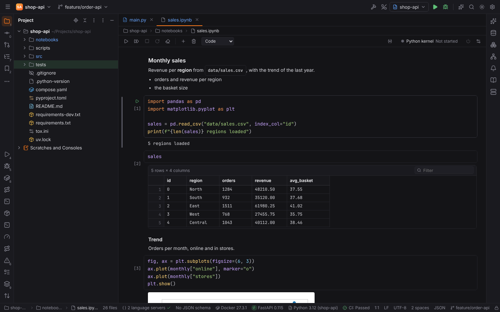
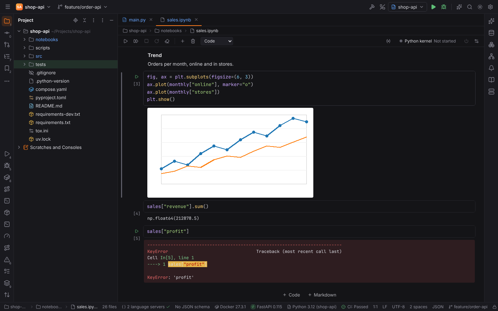
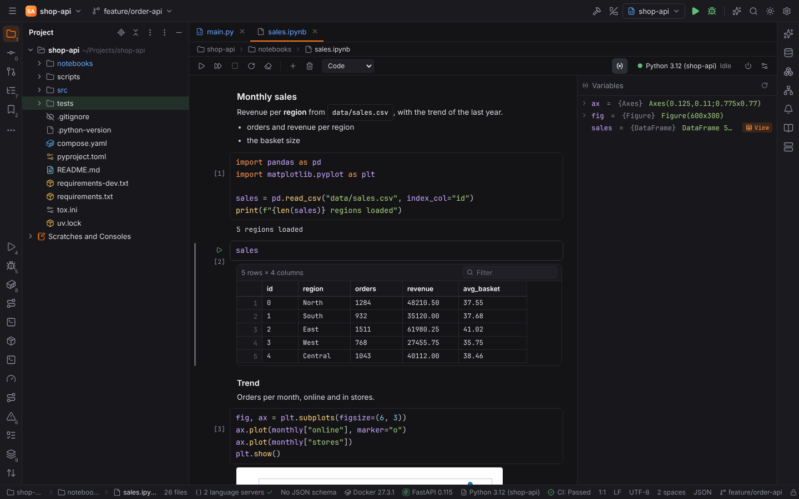
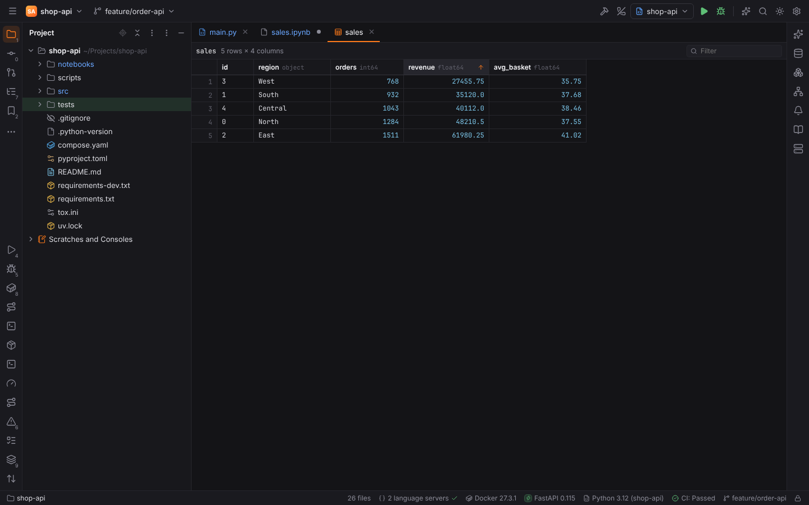
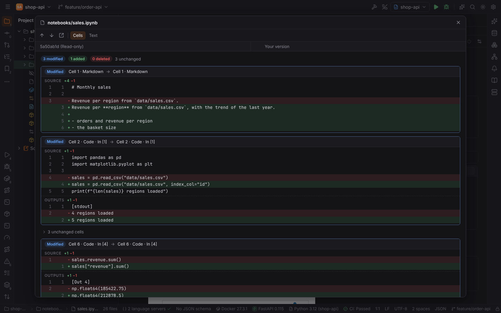

# Jupyter notebooks

`.ipynb` files open in the notebook editor, the way PyCharm shows them: cells with their
outputs, a toolbar to run them and a kernel that keeps the variables between runs. The
plugin **Jupyter** (`forge.jupyter`, pack PyForge) is on in every project; switch it off in
Settings | Plugins to open notebooks as JSON text again.

Opening, editing, diffing and viewing notebooks never runs anything. Running a cell starts a
kernel, which runs the notebook's code with the project's interpreter, so it is refused in
[Safe Mode](project-trust.md) until you trust the project.

## The notebook editor

- **Cells**: code cells are editors with Python highlighting, bracket matching and the
  editor's color scheme; Markdown cells show their rendered text (double-click or `Enter` to
  edit them); raw cells are plain text. The gutter shows the run button and the execution
  count: `[3]` after a run, `[*]` while the cell runs or waits for the kernel.
- **Toolbar**: Run Cell and Select Below, Run All Cells, Interrupt Kernel, Restart Kernel,
  Clear All Outputs, Add Code Cell, Delete Cell and the cell type (Code, Markdown, Raw); on the
  right Show Variables, the kernel with its state (Not started, Starting…, Idle, Busy,
  Disconnected) and Shut Down Kernel.
- **Save** (`Ctrl+S`) writes the `.ipynb` file. Forge keeps everything it did not change:
  cell ids, metadata, the order of the keys, texts stored as one string or as a list of lines,
  the file's indent and its final line break. A notebook written by Jupyter and saved
  unchanged by Forge is byte for byte the same file, so Git shows only real changes.
- Language intelligence inside cells is limited to highlighting and editing helpers; the
  Python language servers do not analyse notebook cells yet.

### Command mode and edit mode

Like Jupyter, the editor has two modes. In **edit mode** a cell's editor has the focus (the
cell's frame is orange) and keys type text. `Escape` switches to **command mode**: a cell is
selected and single keys act on cells. Click a cell's gutter to select it, click into its
text to edit it.

| Action | Mode | Windows / Linux | macOS |
| --- | --- | --- | --- |
| Run Cell and Select Below | both | `Shift+Enter` | `Shift+Enter` |
| Run Cell | both | `Ctrl+Enter` | `Cmd+Enter` |
| Run Cell and Insert Below | both | `Alt+Enter` | `Opt+Enter` |
| Run All Cells | both | `Ctrl+Alt+Shift+Enter` | `Cmd+Opt+Shift+Enter` |
| Enter Command Mode | edit | `Escape` | `Escape` |
| Enter Edit Mode | command | `Enter` | `Enter` |
| Insert Cell Above / Below | command | `A` / `B` | `A` / `B` |
| Delete Cell | command | `D D` | `D D` |
| Change Cell Type to Code / Markdown / Raw | command | `Y` / `M` / `R` | `Y` / `M` / `R` |
| Select Cell Above / Below | command | `Up` or `K` / `Down` or `J` | same |
| Move Cell Up / Down | command | `Ctrl+Shift+Up` / `Ctrl+Shift+Down` | `Cmd+Shift+Up` / `Cmd+Shift+Down` |
| Interrupt Kernel | command | `I I` | `I I` |
| Restart Kernel | command | `0 0` | `0 0` |

All of them are keymap actions (group **Jupyter**): rebind them in Settings | Keymap, find them
with Find Action (`Ctrl+Shift+A`). The notebook shortcuts win over editor actions with the same
keys only inside notebooks; `Shift+Enter` still starts a new line in every other editor.

## Outputs

| Output | How it is shown |
| --- | --- |
| `stdout` / `stderr` streams, `text/plain` results | console text with ANSI colors; `\r` progress bars overwrite their line; file references in tracebacks open the file |
| Errors | the traceback with its colors on an error background |
| Images (`image/png`, `image/jpeg`, `image/gif`, `image/webp`) | the image at its size (the output's `width`/`height` metadata are honoured) |
| `image/svg+xml` | the image after removing scripts, event handlers, `foreignObject` and external references |
| `text/html` | sanitized HTML (no scripts, event handlers, frames, forms or remote resources) in a sandboxed frame that cannot run scripts or load anything |
| `application/json` | a collapsible JSON tree |
| `text/markdown` | rendered Markdown |
| pandas DataFrames (`text/html` of a DataFrame, `application/vnd.dataresource+json`) | a DataFrame table, see below |

Outputs taller than 400 pixels scroll (`jupyter.outputs.limitHeight`). While a cell runs its
outputs stream in; `clear_output(wait=True)` and updated displays (`display_id`) work as in
Jupyter. Interactive widgets (ipywidgets) and JavaScript outputs are not supported; their
plain-text fallback is shown.

## DataFrame tables

DataFrame outputs become the same data grid as the database and CSV editors: the index
columns, the column types when known, sorting by a click on a column header (numbers sort as
numbers; again for descending, a third time for the original order), a **Filter** (rows that
contain the text in any cell; `column: text` filters one column) and pages of
`jupyter.dataframe.pageSize` rows (default 50). The bar shows the frame's size, for example
`1000 rows × 5 columns`, also when pandas printed only part of it.

## Kernels

The first cell you run starts the kernel:

- **In the project's interpreter** (default): Forge starts `ipykernel` with the interpreter
  from the status bar (Settings | Project | Python Interpreter) in the notebook's folder and
  talks to it over ZeroMQ, signing every message with a key of its own (HMAC-SHA256). When the
  interpreter has no `ipykernel`, Forge asks to install it with the environment's package
  manager (pip, uv, Poetry or Pipenv; the output appears in the Run tool window).
  `jupyter.kernel.installWithoutAsking` skips the question.
- **On a Jupyter server**: set Settings | Languages & Frameworks | Jupyter | Jupyter server
  URL (`jupyter.server.url`), for example `http://localhost:8888`, to run kernels on a running
  JupyterLab, Notebook 7 or `jupyter server`. A pasted URL with `?token=…` works; the token
  is moved to the OS keychain and never stored in settings. Enter a token below the URL and
  click **Test Connection** to check it; **Forget Token** removes it. Kernels of Docker, SSH and
  WSL interpreters and of remote projects need a server that runs next to them.

Interrupt Kernel stops the running cell (`KeyboardInterrupt`); cells queued behind a failed
cell are skipped, like in Jupyter. Restart Kernel starts a fresh kernel and forgets every
variable. Closing the notebook shuts its kernel down (`jupyter.kernel.shutdownOnClose`).

## Variables

**Show Variables** opens the Variables view of the kernel next to the cells, like the Python
Console's: every variable with its type and value, expandable for lists, dicts and objects. It
refreshes after each cell. DataFrames, Series and NumPy arrays have **View**, which opens
**View as DataFrame**: the variable's rows (up to 10,000) in an editor tab with the same table,
sorting, filter and pages.

## Notebook diffs

Diffs of `.ipynb` files (Commit, Show Diff, Git history, Local History, Compare Files) compare
the notebooks **cell by cell** instead of as JSON: added, deleted and modified cells, with the
source and the outputs of a changed cell in separate line diffs, and notes when only the cell
type, the execution count or the metadata changed. Runs of unchanged cells are folded. Cells are
paired by their ids (nbformat 4.5); notebooks without ids are aligned by their sources. Images
are compared by size and a short hash. **Text** in the diff toolbar switches to the JSON diff,
for example to revert single lines; `jupyter.diff.view` chooses what opens first.

## Settings

Settings | Languages & Frameworks | Jupyter:

| Setting | Key | Default |
| --- | --- | --- |
| Jupyter server URL (project) | `jupyter.server.url` | empty: start kernels in the project's interpreter |
| Install ipykernel without asking | `jupyter.kernel.installWithoutAsking` | off |
| Shut down the kernel when the notebook is closed | `jupyter.kernel.shutdownOnClose` | on |
| Scroll long outputs | `jupyter.outputs.limitHeight` | on |
| DataFrame rows per page | `jupyter.dataframe.pageSize` | 50 |
| Show notebook diffs | `jupyter.diff.view` | Cell by cell |

## Files Forge writes

- The kernel's connection file (ports and signing key, readable only by you) in
  `<cache dir>/forge/jupyter/`, deleted when the kernel stops.
- Server tokens in the OS keychain (service `forge-jupyter`).
- Nothing in the project except the notebooks you save.
