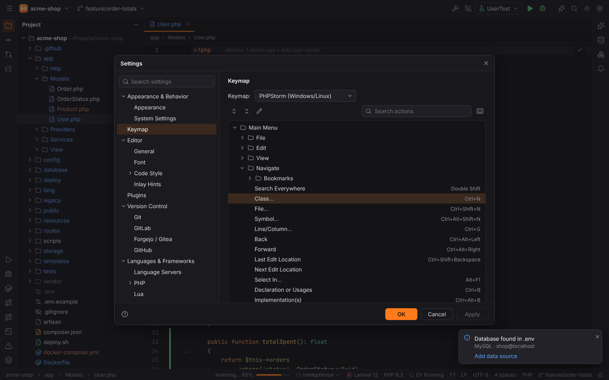
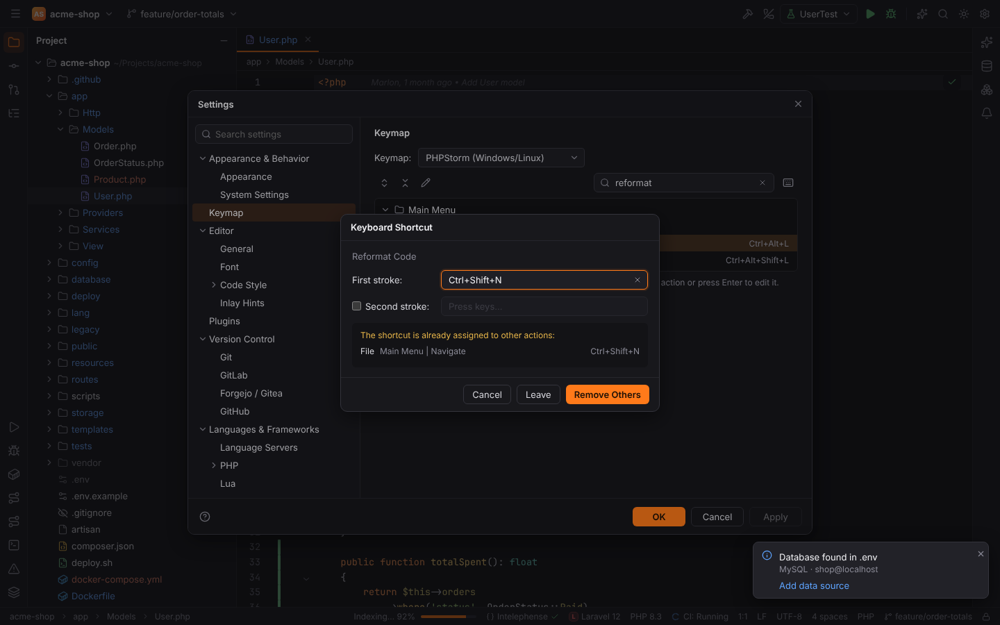
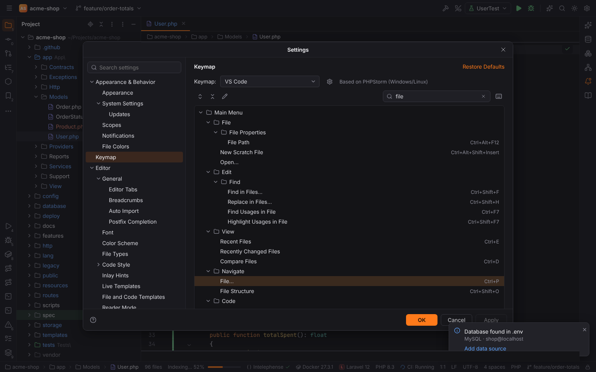
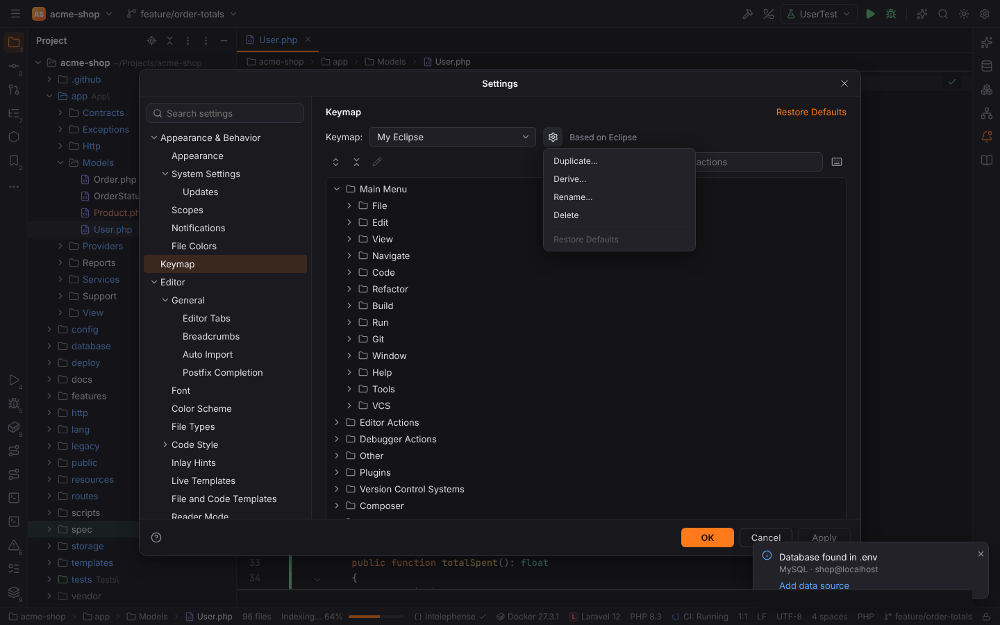
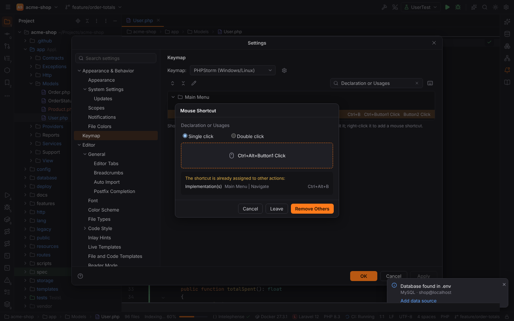

# Keymap

Forge ships **PHPStorm's default keymaps** 1:1, for Windows/Linux and for macOS, keyed by
PHPStorm's action ids, plus PHPStorm's keymaps for people coming from **VS Code**, **Eclipse**,
**Sublime Text** and **Emacs**. Shortcuts you know from PHPStorm work the same, and actions that Forge has
not implemented yet stay bound and show "*Action* is not available yet" instead of doing
something unexpected.

The complete list with both platforms is in the [keymap reference](../reference/keymap.md); the
[shortcut pages](shortcuts/index.md) explain them by topic and the
[reference card](shortcuts/reference-card.md) fits on one page.

## The most important shortcuts

| Action | Windows/Linux | macOS |
| --- | --- | --- |
| Search Everywhere | `Double Shift` | `Double Shift` |
| Find Action | `Ctrl+Shift+A` | `Cmd+Shift+A` |
| Go to Class / File / Symbol | `Ctrl+N` / `Ctrl+Shift+N` / `Ctrl+Alt+Shift+N` | `Cmd+O` / `Cmd+Shift+O` / `Cmd+Alt+O` |
| Recent Files | `Ctrl+E` | `Cmd+E` |
| Go to Declaration | `Ctrl+B`, `Ctrl+Click` | `Cmd+B`, `Cmd+Click` |
| Quick Documentation | `Ctrl+Q` | `F1`, `Ctrl+J` |
| Generate | `Alt+Insert` | `Cmd+N` |
| Reformat Code | `Ctrl+Alt+L` | `Cmd+Alt+L` |
| Settings | `Ctrl+Alt+S` | `Cmd+,` |
| Commit | `Ctrl+K` | `Cmd+K` |
| Run / Debug | `Shift+F10` / `Shift+F9` | `Ctrl+R` / `Ctrl+D` |
| Project / Terminal tool window | `Alt+1` / `Alt+F12` | `Cmd+1` / `Alt+F12` |
| New Scratch File | `Ctrl+Alt+Shift+Insert` | `Cmd+Shift+N` |
| Run Command (Command Line Tools Console) | `Ctrl+Shift+X` | `Cmd+Shift+X` |

## Settings | Keymap

- **Keymap** (`keymap.active`): *PHPStorm (Windows/Linux)*, *PHPStorm (macOS)*, the
  [other keymaps](#other-keymaps) and [your own keymaps](#your-own-keymaps). Until you pick one,
  Forge uses the PHPStorm keymap of your platform (`auto`). You can use a macOS keymap on Linux
  and vice versa. A derived keymap shows **Based on** with its parent.
- The **gear** next to it: **Duplicate…**, **Derive…**, **Rename…** and **Delete** (your own
  keymaps only) and **Restore Defaults**.
- The tree groups actions like PHPStorm: Main Menu (File, Edit, View, Navigate, Code,
  Refactor, Run, Git, Window, …), Editor Actions, Debugger Actions, Other and Plugins.
  Changed actions are highlighted.
- **Search actions** filters by name; **Find Actions by Shortcut** (the keyboard icon) filters
  by pressing the keys.

### Changing a shortcut

Select an action and press `Enter`, double-click it or use **Edit Shortcuts**:

- **Add Keyboard Shortcut** opens a dialog: press the keys (**First stroke**), optionally a
  **Second stroke** for a chord such as `Ctrl+K Ctrl+C`. The dialog lists conflicts ("The
  shortcut is already assigned to other actions") before you confirm; **Remove Others** takes
  the shortcut away from them.
- **Add Mouse Shortcut** opens the **Mouse Shortcut** dialog: choose **Single click** or
  **Double click**, then click in the pad with the mouse button and modifier keys to use, or
  turn the wheel while holding a modifier. See [mouse shortcuts](#mouse-shortcuts).
- **Remove *shortcut*** removes one shortcut.
- **Reset Shortcuts** restores the defaults of the action; the page can also reset all changes.

Changes are stored in the settings as you make them, so they live in `settings.toml` and not
in browser storage: `keymap.overrides.default` / `keymap.overrides.macOS` for the PHPStorm
keymaps, `keymap.overrides.bundled` for the other bundled keymaps (one entry per action: the
action id followed by its shortcuts, separated by tabs) and `keymap.custom` for your own
keymaps. Changes to a bundled keymap belong to that keymap only: switching to another keymap
does not carry them over.

> **Note:** importing PHPStorm keymap files (`.xml`) is not available yet.

## Other keymaps

Like PHPStorm, Forge bundles keymaps for the shortcuts of other editors. Each one is derived
from a PHPStorm keymap: it changes the shortcuts the other editor is known for and keeps
PHPStorm's for everything else, and shortcuts the editor uses for something else are taken away
from the PHPStorm actions so nothing fires twice.

| Keymap | Based on | Examples |
| --- | --- | --- |
| VS Code | PHPStorm (Windows/Linux) | `Ctrl+Shift+P` Find Action, `Ctrl+P` Go to File, `F2` Rename, `Ctrl+D` next occurrence, `F12` declaration, `Ctrl+K` chords |
| VS Code (macOS) | PHPStorm (macOS) | `Cmd+Shift+P`, `Cmd+P`, `Cmd+D`, `F12` |
| Eclipse | PHPStorm (Windows/Linux) | `Ctrl+Shift+R` Go to File, `Ctrl+Shift+T` Go to Class, `Ctrl+1` quick fix, `F3` declaration, `Ctrl+D` delete line |
| Eclipse (macOS) | PHPStorm (macOS) | `Cmd+Shift+R`, `Cmd+Shift+T`, `Cmd+1`, `F3`, `Cmd+D` |
| Sublime Text | PHPStorm (Windows/Linux) | `Ctrl+P` Go to File, `Ctrl+Shift+P` Find Action, `Ctrl+R` file structure, `Ctrl+D` next occurrence |
| Sublime Text (macOS) | PHPStorm (macOS) | `Cmd+P`, `Cmd+Shift+P`, `Cmd+R`, `Cmd+D` |
| Emacs | PHPStorm (Windows/Linux) | `Ctrl+X Ctrl+S` save, `Ctrl+X Ctrl+F` open, `Ctrl+S` find, `Alt+X` Find Action, `Ctrl+X 2` / `Ctrl+X 3` split |

Caret movement and text editing keys (`Ctrl+A`, `Ctrl+F`, … in Emacs) belong to the editor
itself and keep their usual meaning in every keymap; for modal editing use
[Vim emulation](vim-emulation.md).

## Your own keymaps

The gear next to the keymap selector makes keymaps of your own (listed under **Custom**):

- **Duplicate…** copies the selected keymap with all its shortcuts, including your changes.
- **Derive…** makes a keymap that follows the selected one and keeps only the shortcuts you
  change in it; later changes to its parent show up in it too.
- **Rename…** and **Delete** work on your own keymaps. Deleting a keymap selects its parent;
  keymaps derived from it keep their shortcuts.

## Mouse shortcuts

Actions can have mouse shortcuts, written like PHPStorm's:

| Notation | Meaning |
| --- | --- |
| `Ctrl+Button1 Click` | `Ctrl` and a click with the left button (`Button2`: middle, `Button3`: right, `Button4`/`Button5`: back and forward) |
| `Alt+Button1 Double Click` | a double click |
| `Ctrl+Wheel Up`, `Shift+Wheel Down` | turning the wheel while holding modifiers |

The PHPStorm keymaps bind **Declaration or Usages** to `Ctrl+Button1 Click` (macOS
`Cmd+Button1 Click`) and `Button2 Click` (middle click), and **Implementation(s)** to
`Ctrl+Alt+Button1 Click`. In the editor they act on the clicked symbol; rebinding them in the
keymap changes what the click does. Plain left clicks, double clicks, right clicks and plain
wheel turns cannot be bound, so selecting text, context menus and scrolling keep working.
Mouse shortcuts are ignored in text fields and the terminal.

## How shortcuts are written

| Notation | Meaning |
| --- | --- |
| `Ctrl+Shift+A` | keys pressed together |
| `Ctrl+K Ctrl+C` | a chord: the first stroke, then the second |
| `Double Shift` | press `Shift` twice quickly |
| `Ctrl+Button1 Click` | a [mouse shortcut](#mouse-shortcuts) |
| `Cmd`, `Opt`/`Alt` | macOS modifiers |

Shortcuts use the physical key position, so they work with any keyboard layout (on a German
keyboard `Ctrl+Z` is the key labelled Z).

## Focus contexts

The same keys can mean different things depending on what has focus: the **editor**, a text
**input**, a **tool window** (for example `Alt+Insert` adds a row in a database grid but opens
Generate in the editor), or the **terminal**. In the terminal, plain `Ctrl`+letter,
`Alt`+letter and `Escape` go to the shell; function keys, `Alt`+digit, `Ctrl+Shift` and
`Ctrl+Alt` combinations still reach the IDE.

## Plugin actions

Plugins add their own actions under **Plugins** (and some under Main Menu), for example:

| Action | Default shortcut |
| --- | --- |
| Command Line Tool Support: Run Command… | `Ctrl+Shift+X` (macOS `Cmd+Shift+X`) |
| Terminal: New Terminal Tab | `Ctrl+Shift+T` (macOS `Cmd+T`), in the terminal |
| Database: Execute | `Ctrl+Enter` (macOS `Cmd+Enter`), in a console |
| Database: Submit / Add Row / Delete Rows / Revert Selected | `Ctrl+Enter` / `Alt+Insert` / `Ctrl+Y` / `Ctrl+Alt+Z` in a data grid |
| Database: Jump to Query Console… | `Ctrl+Shift+F10` in the Database tool window |
| Code With Me: Code With Me (popup) / Make Everyone Follow You / Follow single user | `Ctrl+Shift+Y` / `Ctrl+Shift+O` / `Ctrl+Alt+Shift+Y` (the same keys on macOS), with PHPStorm's action ids (see [Code With Me](code-with-me.md)) |
| Symfony: Run Console Command…, Symfony Routes | none |
| Doctrine Entities, npm tool window, Reload npm Scripts | none |

All of them can be rebound like PHPStorm actions. Their default shortcuts are PHPStorm's; a
bundled keymap that uses the same keys for another action keeps them for that action, so the
plugin action has no default there (in VS Code `Ctrl+Shift+O` is File Structure, in Eclipse
Optimize Imports, not Make Everyone Follow You).
