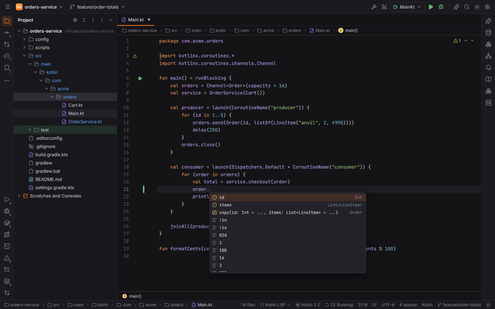
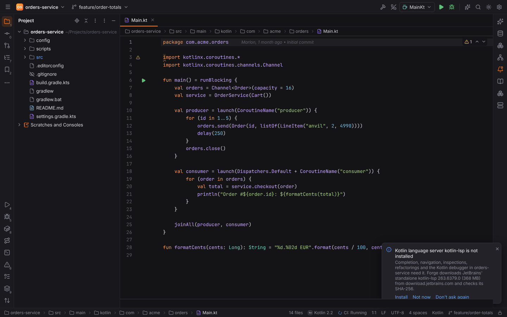
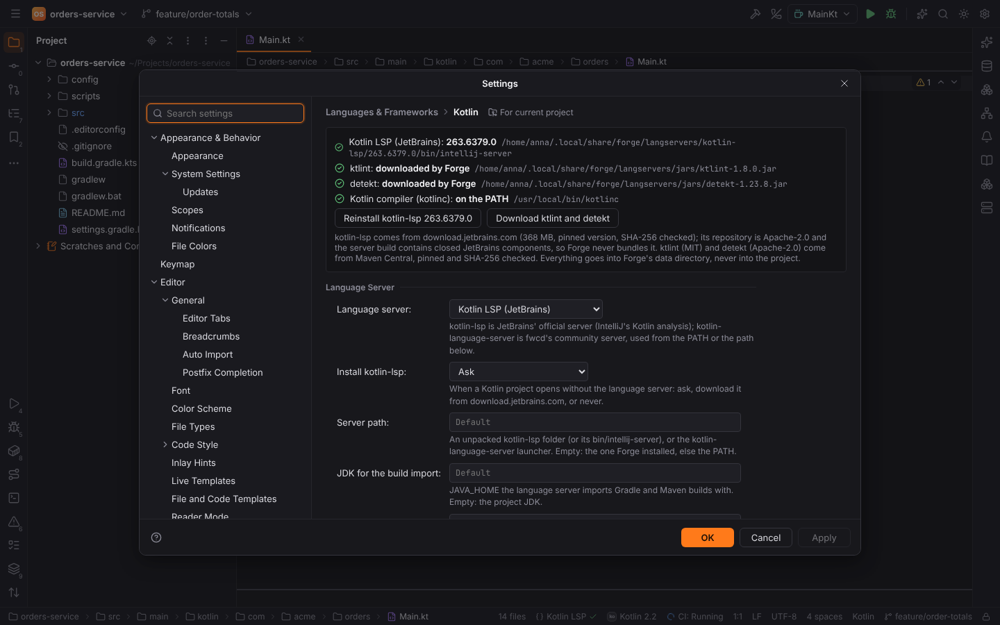
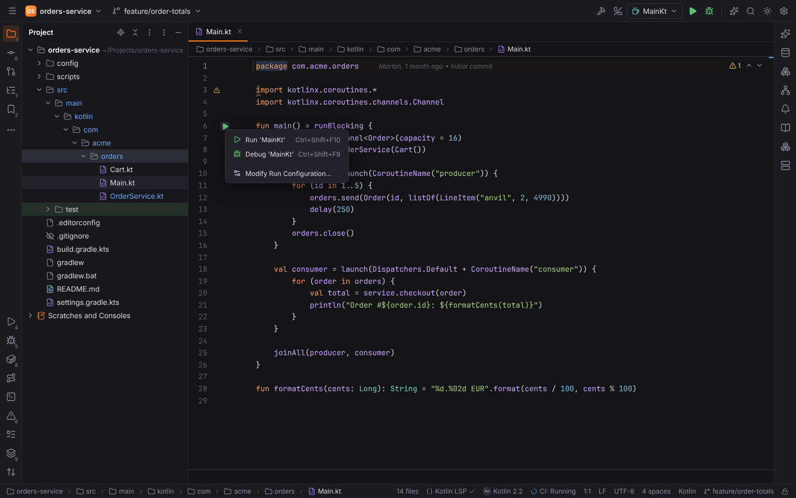
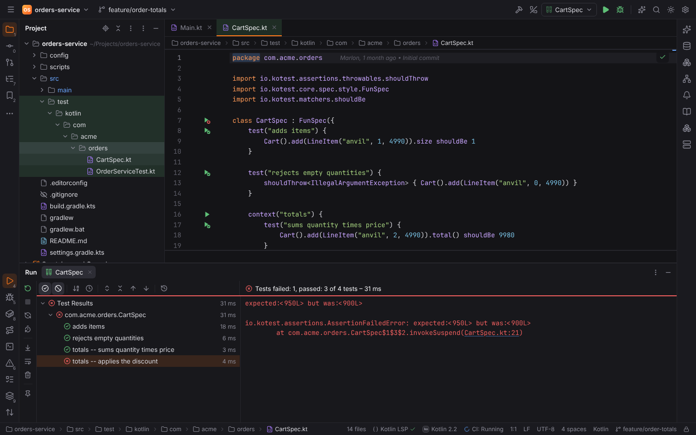
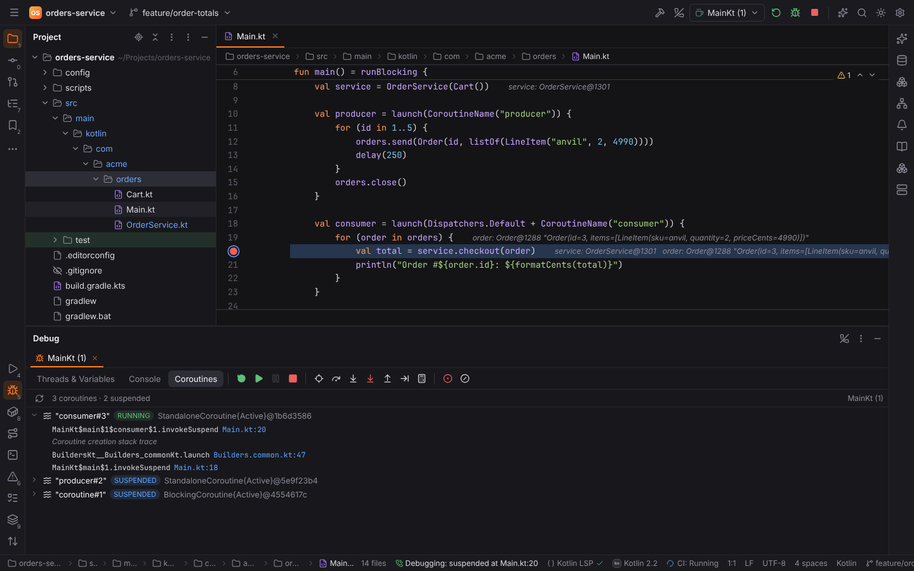
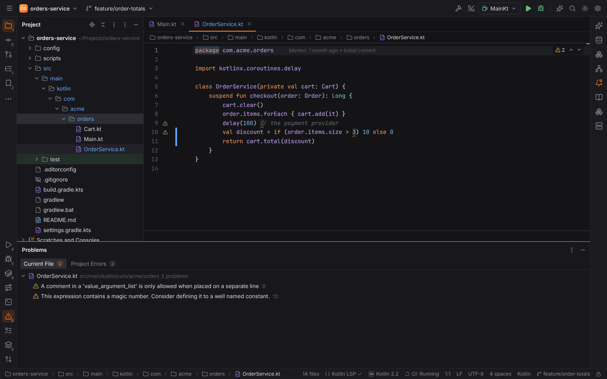

# KotlinForge

**KotlinForge** (plugin `forge.kotlin`) brings Kotlin/JVM to Forge in the style of IntelliJ
IDEA. It builds on [JavaForge](java.md) (JDKs, Maven and Gradle, the run and test machinery) and
activates in [Kotlin projects](../getting-started/project-detection.md): `*.kt` files in a
folder, a `src/main/kotlin` / `src/test/kotlin` tree, Kotlin scripts (`*.kts` other than Gradle
build scripts), or a build that applies the Kotlin plugin (`kotlin("jvm")`,
`org.jetbrains.kotlin.*`, `kotlin-maven-plugin`). A build that depends on `io.kotest` reports the
Kotest framework.

## Editing

`*.kt` and `*.kts` files are highlighted as Kotlin and get Kotlin file icons. **File | New** has
a Kotlin submenu with **Class**, **File**, **Interface**, **Object**, **Enum Class** and
**Script** (`*.main.kts`); the `package` line comes from the folder below its source root
(`src/main/kotlin/com/acme/orders` → `com.acme.orders`). The templates are editable in Settings
| Editor | File and Code Templates.

## Language server

Code intelligence comes from JetBrains' [kotlin-lsp](https://github.com/Kotlin/kotlin-lsp)
through Forge's shared language server client: completion, Go to Declaration, Find Usages,
hover, diagnostics in the editor and the Problems tool window (kotlin-lsp only answers
diagnostic *requests*, LSP 3.17's pull model, which Forge uses for it), Rename, quick fixes and
code actions (`Alt+Enter`), Optimize Imports and Reformat Code (`Ctrl+Alt+L`). The server
imports the Gradle or Maven build itself.

kotlin-lsp is never bundled with Forge: its repository is Apache-2.0, but the server build
contains closed JetBrains components. When a Kotlin project opens without it, a balloon offers
**Install**, **Not now** and **Don't ask again** (setting **Install kotlin-lsp**: Ask, Always,
Never). Install downloads, with your consent, the standalone kotlin-lsp **263.6379.0** for your
platform from `download.jetbrains.com` (about 360 MB, the links of the project's
`RELEASES.md`), checks it against the SHA-256 pinned in Forge (the checksums JetBrains
publishes next to the archives) and unpacks it into
`<data dir>/forge/langservers/kotlin-lsp/<version>`. Progress shows in the status bar;
**Install Kotlin Language Server (kotlin-lsp)** in Find Action (`Ctrl+Shift+A`) does the same.

Forge starts `bin/intellij-server --stdio` with its bundled runtime. The JDK of the build import
is the project JDK (Settings | Build, Execution, Deployment | JDKs), or **JDK for the build
import**, passed as `JAVA_HOME`; **JVM options** go to the server's JVM (`IJ_JAVA_OPTIONS`).

As an alternative, **Language server** can be fwcd's
[kotlin-language-server](https://github.com/fwcd/kotlin-language-server) (MIT), used from the
`PATH` or **Server path**, with the same `JAVA_HOME`.

Gradle build scripts (`*.gradle.kts`) are not sent to the Kotlin server; they belong to the
Gradle DSL support. Both servers import builds, which runs project code, so they do not start
in [Safe Mode](project-trust.md); they run for local projects.

Settings | Languages & Frameworks | **Kotlin** shows the server, ktlint, detekt and `kotlinc` as
found, with Install buttons:

| Setting | |
| --- | --- |
| Language server | Kotlin LSP (JetBrains) or Kotlin Language Server (fwcd) |
| Install kotlin-lsp | Ask, Always or Never when a Kotlin project opens without it |
| Server path | An unpacked kotlin-lsp folder (or its `bin/intellij-server`), or the kotlin-language-server launcher |
| JDK for the build import | `JAVA_HOME` of the server; empty: the project JDK |
| JVM options | Options of the server's JVM, e.g. `-Xmx4g` |
| Run Kotlin applications with | The project's build (Gradle, else Maven), else `kotlinc`; or one of them |
| Kotlin compiler | The `kotlinc` of a Kotlin compiler (its `kotlin` runs scripts); empty: the `PATH` |
| Debugger | Kotlin (kotlin-lsp) or Java (java-debug) |
| Check files with ktlint, ktlint, Reformat Code with, Run ktlint format on save | See [ktlint and detekt](#ktlint-and-detekt) |
| Check the project with detekt, detekt, Configuration file | See [ktlint and detekt](#ktlint-and-detekt) |
| Maven repository for ktlint and detekt | `https://repo1.maven.org/maven2` |

## Run configurations

A green ▶ next to a `main` function offers Run, Debug and Modify Run Configuration;
`Ctrl+Shift+F10` runs the file at the caret. A top-level `fun main()` or
`fun main(args: Array<String>)` (also `suspend`) runs as the file's class (`Main.kt` →
`MainKt`, or the name of `@file:JvmName`); a `@JvmStatic fun main` in an `object` or a companion
object runs as that class.

Kotlin applications use JavaForge's **Application** configuration (main class `MainKt`). Kotlin
programs need the Kotlin standard library on the class path, so they run through the build
(setting **Run Kotlin applications with**, or the configuration's `runner` option):

- **Gradle**: Forge adds a `forgeRunKotlin` task (a `JavaExec` over the module's runtime class
  path, for any main class) with an init script kept in Forge's cache directory, and runs
  `gradlew --init-script <cache>/forge/kotlin/run.init.gradle :module:forgeRunKotlin
  -Pforge.mainClass=…`. Program arguments and VM options are passed through.
- **Maven**: `mvn compile exec:java -Dexec.mainClass=…` (VM options in `MAVEN_OPTS`).
- **kotlinc**, without a build: `kotlinc <file> -include-runtime -d <temp>/app.jar`, then
  `java -cp app.jar MainKt`.

**Kotlin Script** configurations run a `*.kts` / `*.main.kts` file with `kotlin` (or
`kotlinc -script`), with JVM options (`-J…`) and script arguments; scripts get the ▶ on their
first line. Gradle build scripts are never run as scripts.

Every run goes through the Run tool window and is refused in [Safe Mode](project-trust.md).

## Tests

Tests in Kotlin files get gutter icons and run on the [shared test runner](testing.md) through
Gradle or Maven, with the build's JUnit XML reports:

- **JUnit 5** (and `kotlin.test`), JUnit 4 and TestNG: `@Test`, `@ParameterizedTest`,
  `@RepeatedTest`, `@TestFactory`, `@Nested inner class`, with backtick names
  (``fun `adds items to the cart`()``). They use JavaForge's **JUnit** / **TestNG**
  configurations with Kotlin source roots (`src/test/kotlin`), so results, stack traces and
  coverage link to the `.kt` files.
- **Kotest** ([Apache-2.0](https://github.com/kotest/kotest)): **FunSpec** (`test`, `context`),
  **StringSpec** (`"name" { }`), **DescribeSpec** (`describe`, `context`, `it`) and
  **BehaviorSpec** (`given`, `when`, `and`, `then`), declared in the constructor lambda or in
  `init { }`, also with `.config(…)` and the disabled `x…` variants. Forge reads the specs from
  source; the spec and every test or container get a gutter icon. A spec runs with Gradle's
  `--tests <spec>`; a single test adds Kotest's filter (`kotest_filter_specs`,
  `kotest_filter_tests` with the test path, `totals -- applies the discount`). **Rerun Failed
  Tests** runs the failed specs again.

The **Kotest** configuration type runs all specs, a package, a spec, a test or a list of specs.
**Run with Coverage** reads JaCoCo's report as for Java.

## Debugging

Debug (`Shift+F9`) on a Kotlin application, a Kotest or Kotlin JUnit configuration, or Remote
JVM Debug in a Kotlin project uses **kotlin-lsp's debugger**: Forge asks kotlin-lsp to start its
Debug Adapter Protocol server (`start_debug_server`), starts the JVM with a JDWP agent that
waits for the debugger (a free port, or Gradle's `--debug-jvm` port 5005 for tests), and
attaches once the JVM listens. kotlin-lsp maps the bytecode back to Kotlin lines (including the
SMAP of inline functions), so breakpoints in `.kt` files bind, and the [Debug tool
window](debugging.md) shows threads, frames, variables, watches and Evaluate Expression as for
every language.

With **Debugger** set to java-debug, Kotlin runs are debugged by JavaForge's java-debug
instead. java-debug resolves line breakpoints with Eclipse's Java parser, so in that mode only
breakpoints in Java files bind.

### Coroutines

While a Kotlin program is suspended, the Debug tool window has a **Coroutines** tab, like
IntelliJ IDEA's Coroutines view: every coroutine with its name and id, state (running,
suspended, created), job and dispatcher, its stack and its creation stack; clicking a frame
opens the source. Forge evaluates the dump of kotlinx-coroutines' debug probes in the selected
frame (`DebugProbes.dumpCoroutines`, or `DebugProbesImpl.dumpCoroutinesInfo()` for evaluators
that only take Java expressions) and parses it in Rust. The probes must be installed in the
program: add `kotlinx-coroutines-debug` to the dependencies and call `DebugProbes.install()` at
startup (or start the JVM with the library as `-javaagent`); otherwise the tab explains this.

## ktlint and detekt

[ktlint](https://pinterest.github.io/ktlint/) (MIT) and [detekt](https://detekt.dev)
(Apache-2.0) run as external tools:

- found in the settings (an executable or a `*-all.jar`), on the `PATH`, or downloaded by Forge
  (**Download ktlint and detekt**: ktlint 1.8.0 and detekt 1.23.8 from Maven Central, pinned
  SHA-256, into `<data dir>/forge/langservers/jars`, run with the project JDK's `java -jar`);
- without a detekt CLI, **Run detekt on the Project** uses the project's detekt Gradle plugin
  (`gradlew detekt`, in trusted projects) and reads `build/reports/detekt/detekt.sarif`.

ktlint checks a Kotlin file when it opens and after every save, on the editor text (`--stdin`,
with the project's `.editorconfig`). detekt checks the saved file and, with **Run detekt on the
Project** (Find Action or the Code menu), the whole project, with `config/detekt/detekt.yml` and
its baseline when they exist (setting **Configuration file**). Their findings (ktlint's JSON and
Checkstyle reports, detekt's SARIF and Checkstyle reports, parsed in Rust) show in the editor
and the Problems tool window, with the rule as the problem's code.

**Reformat Code with** ktlint makes `Ctrl+Alt+L` run `ktlint --format`; **Format File with
ktlint** does it once, and **Run ktlint format on save** after every `Ctrl+S`.

## Browser mode

`pnpm dev` with `?project=kotlin` opens the demo Gradle service `orders-service` (coroutines, a
Kotest spec, JUnit 5 tests, a Kotlin script); `?project=kotlin&kotlin-lsp=missing` starts
without kotlin-lsp to try the download offer.
