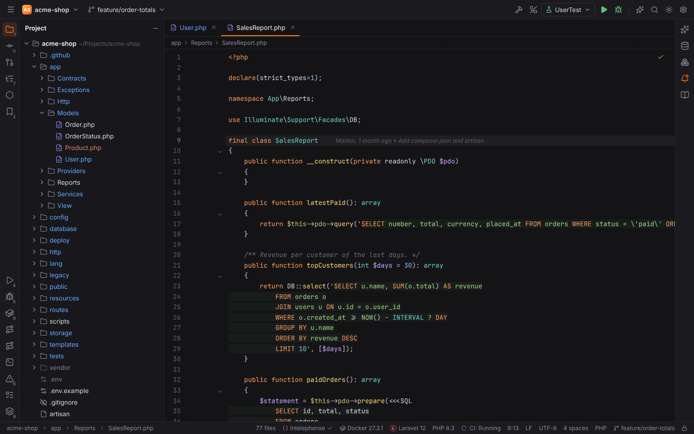
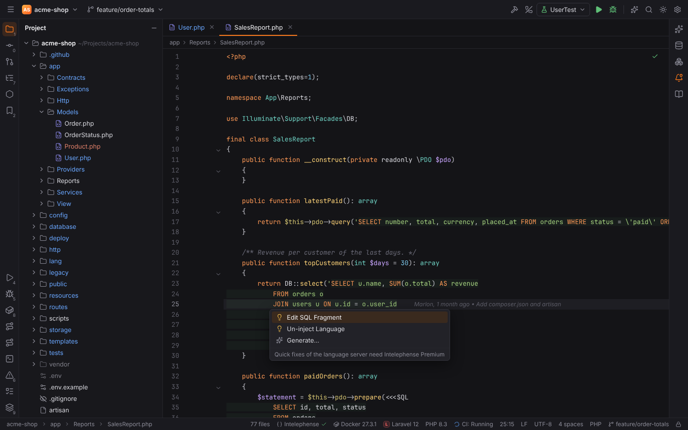
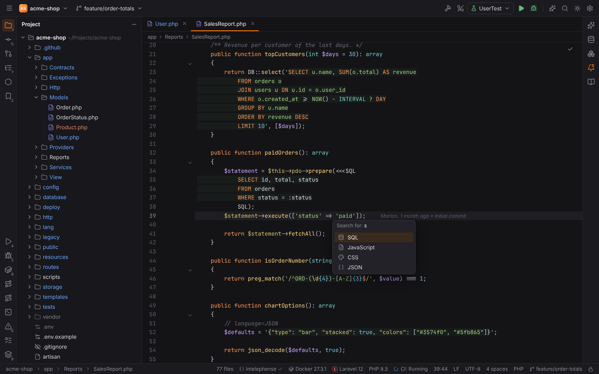
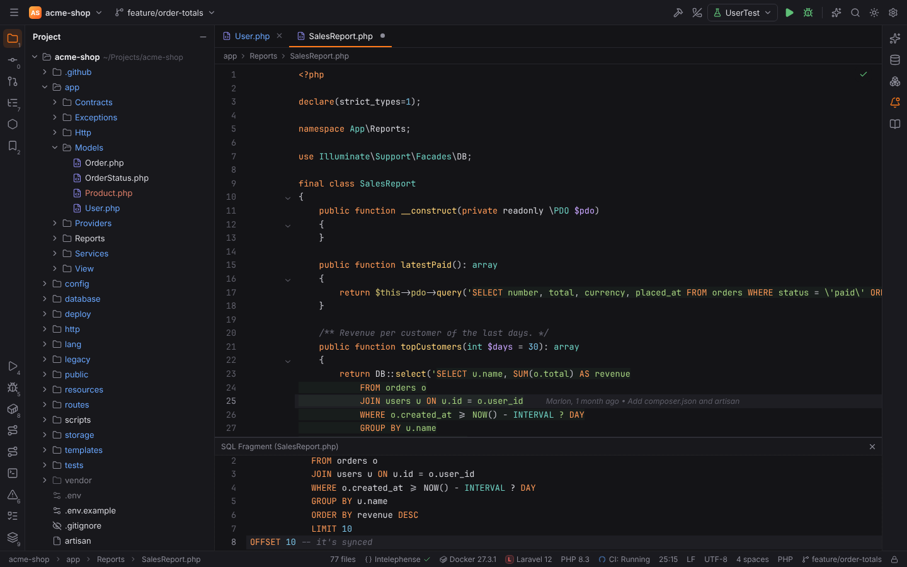
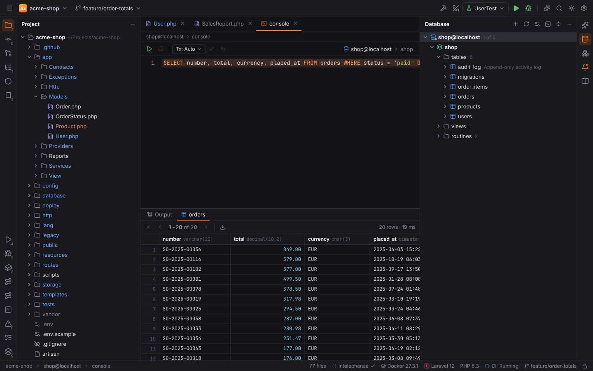
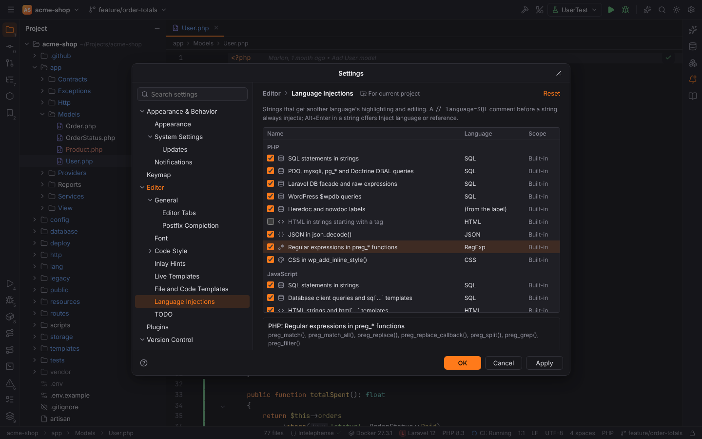

# Language injections

Like PHPStorm's IntelliLang, Forge treats the text of some string literals as code in another
language: SQL in a `PDO::query()` call, a regular expression in `preg_match()`, JSON in
`json_decode()`, HTML in a string that starts with a tag. The injected text gets that
language's highlighting on a light green background, and the language's actions: edit it in
its own editor, run SQL in a query console.



Injections work in PHP files (not Blade templates) and in JavaScript and TypeScript files
(`.js`, `.mjs`, `.cjs`, `.jsx`, `.ts`, `.mts`, `.cts`, `.tsx`). Where a language is injected
is decided in Rust (`crates/forge-injections`), so the desktop app and browser mode behave the
same; the highlighting itself follows every keystroke.

## Where languages are injected

In this order, the first that applies wins:

1. **A `language=` comment** before the string: `// language=SQL`, `/* language=JSON */`,
   `# language=HTML`, or `@lang` in a doc comment (`/** @lang SQL */`). The comment applies to
   the first string after it in the same statement, also when other code stands between them:

   ```php
   // language=JSON
   $defaults = '{"type": "bar", "stacked": true}';

   $html = render(/* language=HTML */ '<b>' . e($name) . '</b>');
   ```

   Language names are not case-sensitive. Besides the names in the list below, `MySQL`,
   `PostgreSQL`, `SQLite`, `JS`, `Regex` and a few more are understood. A comment always
   injects, also when the matching rule is turned off.
2. **A heredoc or nowdoc label** that names a language: `<<<SQL`, `<<<'JSON'`, `<<<HTML`,
   `<<<CSS`, `<<<JS`, `<<<XML`, `<<<REGEXP`. `<<<DQL` is left to the
   [Doctrine plugin](doctrine.md).
3. **A built-in rule** (Settings | Editor | Language Injections):

   | Host | Language | Places |
   | --- | --- | --- |
   | PHP | SQL | strings starting with a statement: `SELECT … FROM`, `INSERT INTO`, `UPDATE … SET`, `DELETE FROM`, `WITH … AS (`, `CREATE`/`ALTER`/`DROP TABLE`, `TRUNCATE`, `SHOW TABLES`, …; `SELECT` in capitals also without `FROM` |
   | PHP | SQL | `PDO::query()`/`prepare()`/`exec()` on database objects (`$pdo`, `$this->db`, `$connection`, …), `mysqli_query()`, `pg_query()`, `pg_prepare()`, Doctrine DBAL `executeQuery()`, `fetchAllAssociative()`, … and `createNativeQuery()` |
   | PHP | SQL | Laravel: `DB::select()`, `DB::statement()`, `DB::unprepared()`, `DB::raw()`, …; `selectRaw()`, `whereRaw()`, `havingRaw()`, `orderByRaw()`, `groupByRaw()` |
   | PHP | SQL | WordPress: `$wpdb->query()`, `prepare()`, `get_results()`, `get_row()`, `get_var()`, `get_col()` |
   | PHP | HTML | strings starting with a tag (`'<span class="badge">'`) |
   | PHP | JSON | `json_decode()` |
   | PHP | RegExp | `preg_match()`, `preg_match_all()`, `preg_replace()`, `preg_replace_callback()`, `preg_split()`, `preg_grep()`, `preg_filter()`: the pattern between its delimiters (`/…/i`, `#…#`, `{…}`) |
   | PHP | CSS | `wp_add_inline_style()` |
   | JavaScript | SQL | strings and templates starting with a statement; `db.query()`, `pool.query()`, `knex.raw()`, … on database objects; `` sql`…` ``, `` Prisma.sql`…` ``, `` $queryRaw`…` ``, `` $executeRaw`…` `` |
   | JavaScript | HTML | strings starting with a tag, `` html`…` ``, `innerHTML`/`outerHTML` assignments, `insertAdjacentHTML()`, `document.write()` |
   | JavaScript | CSS | `` css`…` ``, `` styled.div`…` ``, `` styled(Button)`…` ``, `` keyframes`…` ``, `` createGlobalStyle`…` ``, `style.cssText`, `insertRule()` |
   | JavaScript | JSON | `JSON.parse()` |
   | JavaScript | RegExp | `new RegExp()`, `RegExp()` (regular expression literals are highlighted by the JavaScript mode) |

Strings joined with `.` (PHP) or `+` (JavaScript) are one injection:
`'SELECT * FROM ' . $table . ' WHERE id = ?'` is highlighted as one SQL statement. Variables
inside strings (`"… $id"`, `"{$order->id}"`, `` `${id}` ``) are left out of the injected text.
`createQuery()` strings are DQL and belong to the [Doctrine plugin](doctrine.md).

The languages that can be injected: **SQL**, **HTML**, **CSS**, **JSON**, **RegExp**,
**JavaScript** and **XML**.

## Inject language or reference

Place the caret in a string and press **Show Context Actions** (`Alt+Enter`):

- **Inject language or reference** (any string without an injection) opens the list of
  languages; type to filter, `Enter` to choose. Forge writes a `// language=…` comment on the
  line before the statement, or a `/* language=… */` comment right before the string when
  other code precedes it on its line. Choosing again for a string with a comment changes the
  comment.
- **Edit &lt;language&gt; Fragment** (an injected string) opens the fragment editor, see below.
- **Un-inject Language** (an injected string) removes the `language=` comment. For a string a
  built-in rule injected, it turns the injection off for that string in this project (stored
  in the project's settings, `editor.injections.uninjected`). A string whose text changes is
  injected again; Settings | Editor | Language Injections can restore all of them.





The actions are also in Find Action (`Ctrl+Shift+A`): **Inject Language or Reference**,
**Un-inject Language** and **Edit Injected Fragment**. They have no default shortcut; assign
one in Settings | Keymap.

## Edit Fragment

**Edit &lt;language&gt; Fragment** opens the value of the string in its own editor below the
file, titled like "SQL Fragment (SalesReport.php)". It shows the string as the program sees
it, without quotes and escapes (`\'` is `'`, `\n` a line break), with the language's
highlighting, brackets and line numbers. What you type there is written back into the string
right away, escaped for its kind of literal (`'` becomes `\'` in single-quoted PHP strings,
`$` becomes `\$` in double-quoted ones and in heredocs, line breaks become `\n` in
JavaScript quotes); changes to the string in the file show up in the fragment. The undo
history of the file records every change. Close the fragment editor with its `×` button; it
closes by itself when the string or its injection disappears. For a PHP pattern the fragment
is the text between the delimiters.



## Run injected SQL

With the caret in an injected SQL string (or in its fragment editor), **Execute**
(`Ctrl+Enter`, macOS `Cmd+Enter`) runs the SQL: Forge opens a query console of the data
source selected in the Database tool window, puts the SQL in it and runs it, with the usual
Output and result tabs (see [Database tools](database.md)). The SQL is the string's value:
escapes are resolved and the parts of a concatenation are joined. Elsewhere `Ctrl+Enter`
keeps its PHPStorm meaning (Split Line).

When the project has data sources, a green **Run SQL in Console** icon in the gutter marks the
first line of every injected SQL string; clicking it does the same. Without a data source,
Forge asks you to add one.



Parameters (`?`, `:status`) are sent as written; the database reports them unless you replace
them in the console first.

## Settings

**Settings | Editor | Language Injections** lists the built-in rules by host language with a
check box each; the panel below the table shows where the selected rule applies. Turned-off
rules are stored in `editor.injections.disabled` (user settings). The line under the panel
counts the strings un-injected in this project; **Restore All** injects them again.



| Setting | Default | Meaning |
| --- | --- | --- |
| `editor.injections.disabled` | `[]` | ids of the built-in rules that are turned off (`php-html`, `js-sql-keywords`, …) |
| `editor.injections.uninjected` | `[]` | strings turned off with Un-inject Language (`path#key`), per project |

## Not yet supported

- Custom injection rules (PHPStorm's `+` in the settings page) and the `prefix=` / `suffix=`
  parameters of `language=` comments.
- Completion, navigation and inspections inside injected text: the injected language gets
  highlighting, Edit Fragment and Run SQL. DQL has its own completion (see
  [Doctrine and DQL](doctrine.md)).
- Values for SQL parameters before running (PHPStorm's "Parameters" dialog).
