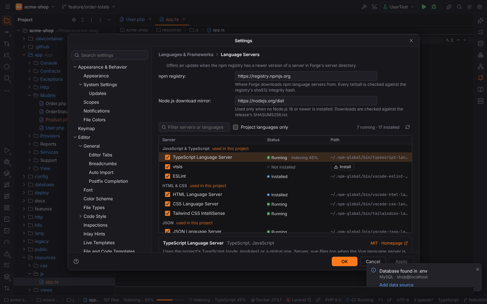
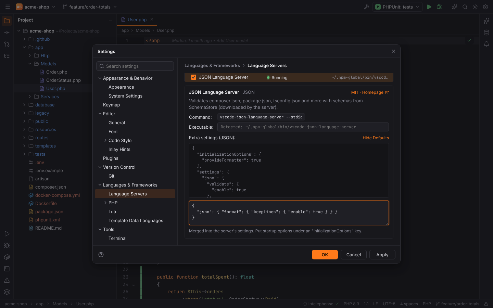
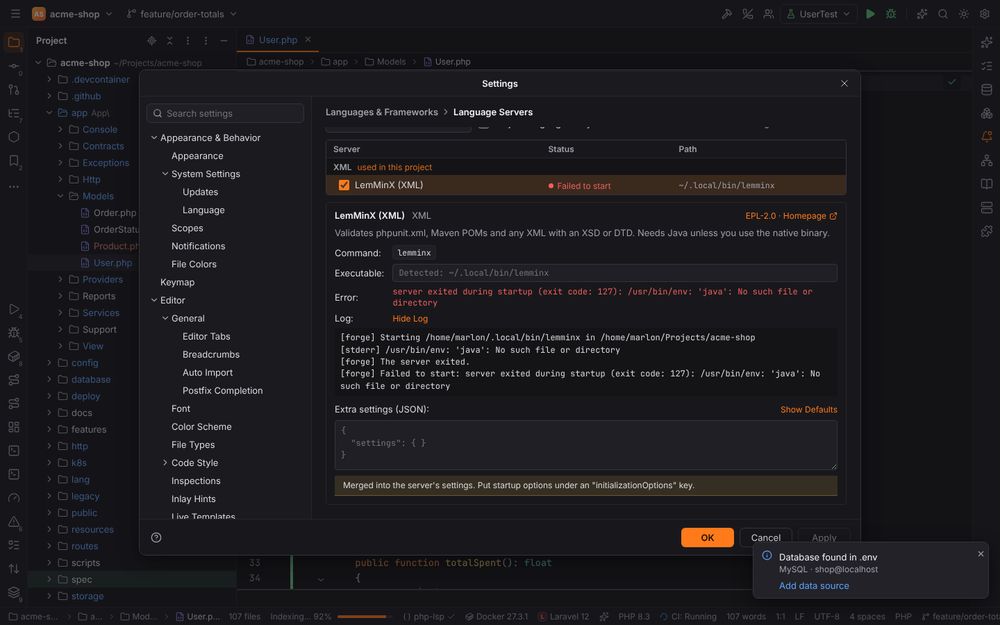
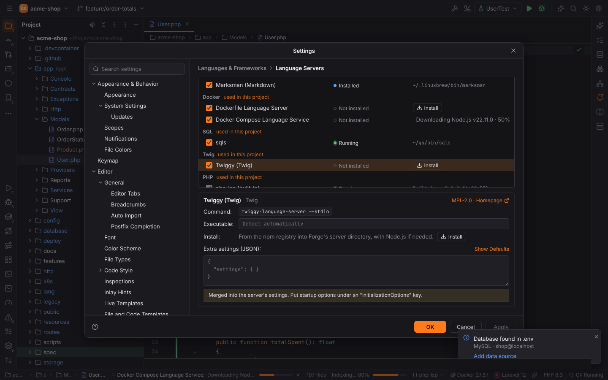
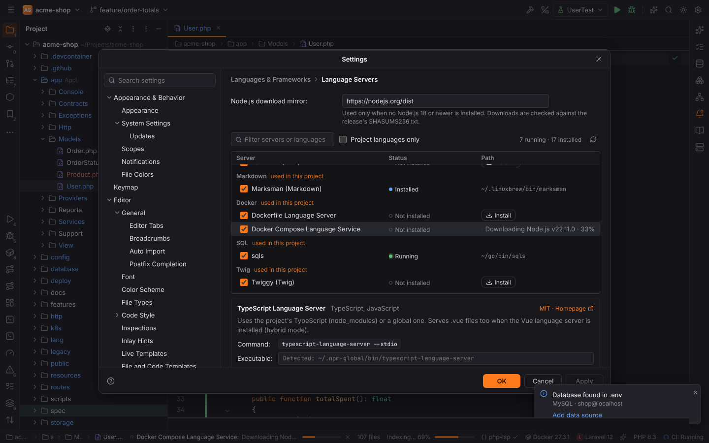
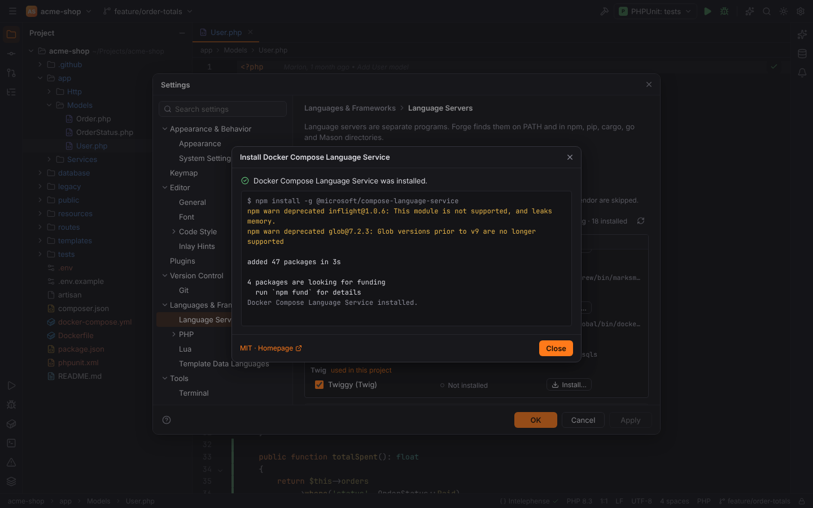
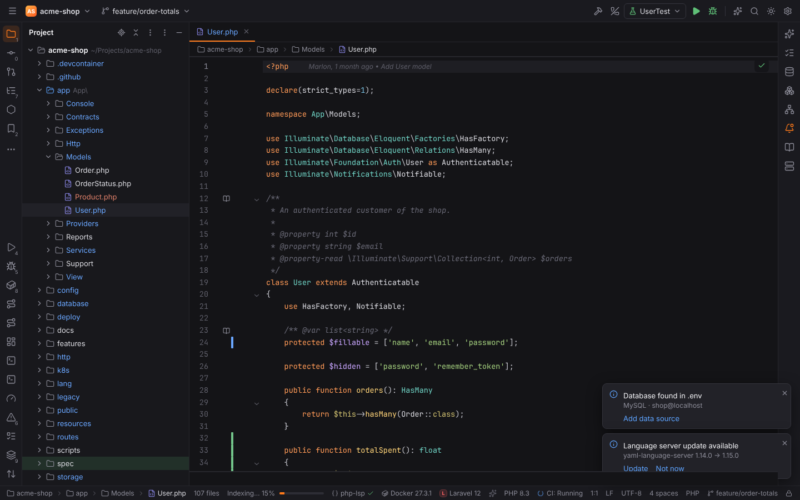
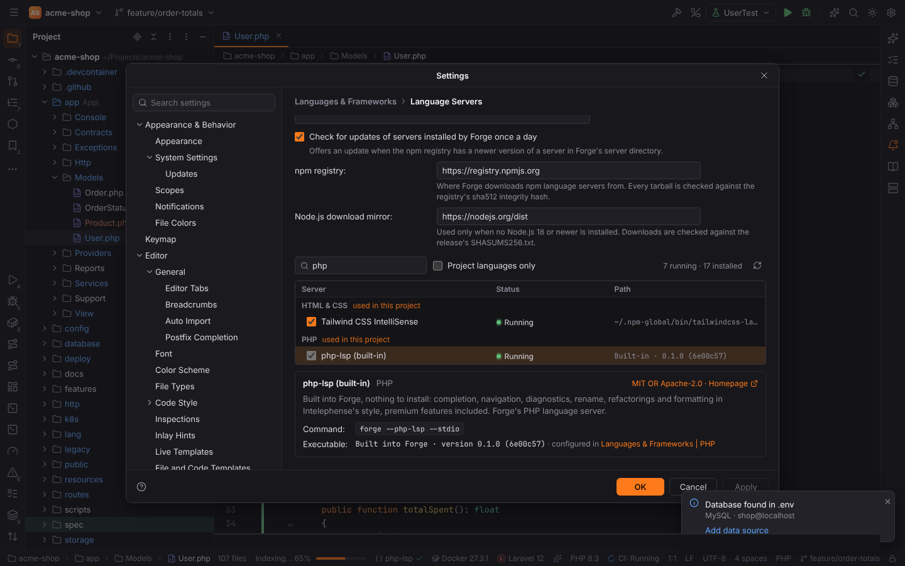
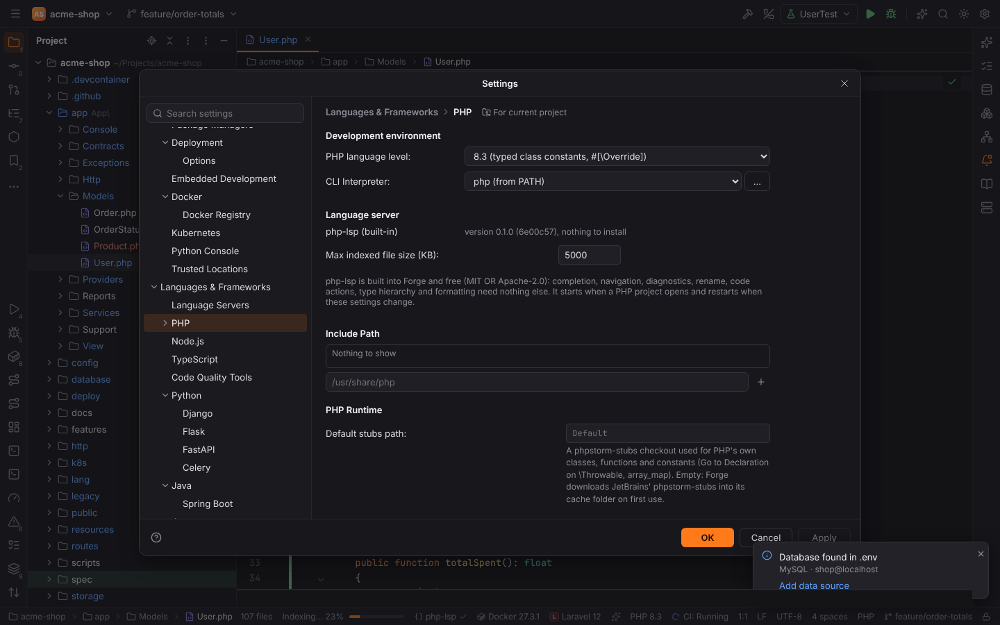
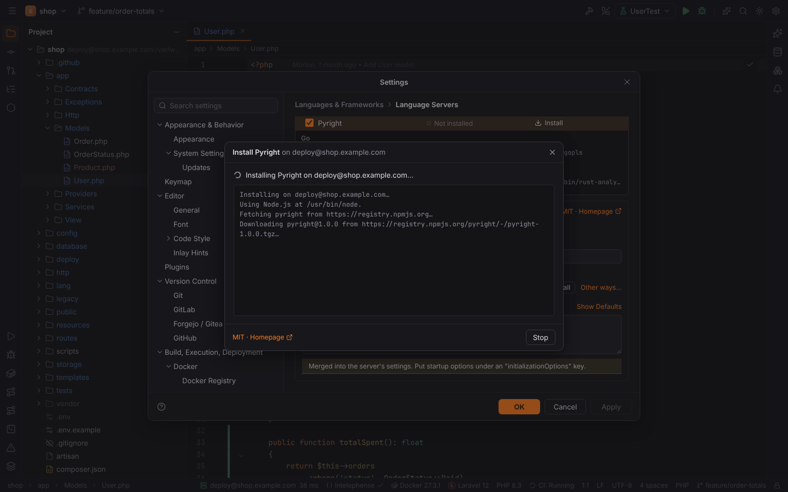

# Language servers

Completion, hover documentation, diagnostics, Go to Declaration and formatting for most
languages come from **language servers**: separate programs that speak the Language Server
Protocol. Apart from PHP's [php-lsp](#php-lsp-built-in), which is built into Forge, Forge
does not bundle them. It knows about 30 of them, finds the ones you have
installed, offers to install missing ones, and starts them when a project needs them.

Servers start **lazily**: when you open the first file of a language. Several servers can serve
the same file and their results are merged, for example TypeScript + ESLint + Tailwind CSS on
a `.tsx` file.

A server that crashes or is killed starts again with the next edit or request in one of its
files, and gets the open documents again. After five exits within three minutes Forge stops
restarting it and shows it as failed; turning it off and on again on the Language Servers page
(or reopening the project) resets the count.

## Settings | Languages & Frameworks | Language Servers

| Option | Setting | Default |
| --- | --- | --- |
| Start language servers for languages found in the project | `langservers.autoStart` | on |
| Files scanned to detect languages (ignored files, `node_modules` and `vendor` are skipped) | `langservers.scanLimit` | 20000 |
| Suggest installing missing language servers | `langservers.hints.enabled` | on |

Below is the server table, grouped by language. Groups for languages that occur in the open
project are marked **used in this project**; **Project languages only** hides the others. The
header shows how many servers are running and installed, and **Detect Again** (the refresh
icon) searches for executables again.

Each row has:

- an **Enabled** checkbox (`langservers.servers.<id>.enabled`);
- the **Status**: Running (with indexing progress), Failed to start, Installed, Not found,
  Disabled, or why a server is skipped (for example a server of the same alternative group
  already running);
- the **Path** where it was found, or an **Install…** button.

Select a row to see its details:

| Field | Meaning |
| --- | --- |
| Description, licence, homepage | from the catalog |
| Command | the command line Forge starts |
| Executable | a custom path to the executable (`langservers.servers.<id>.path`); empty = detect automatically |
| Extra settings (JSON) | merged into the server's settings (`langservers.servers.<id>.settings`); put startup options under an `"initializationOptions"` key. **Show Defaults** shows what Forge sends by default. |
| Install | the ways to install it |
| Error | why the last start failed (only for **Failed to start**): the start error (`could not start …: The system cannot find the file specified`), or the exit code and the last lines the server wrote to stderr when it quit during startup |
| Log | **Show Log** shows the server's log for this project: the command line and folder it was started with, what it wrote to stderr, its log messages, start errors and exits (the last 500 lines; kept in memory, not in a file) |

### Where Forge looks for servers

In this order: the project's `node_modules/.bin`, Forge's own server folder
(`<data dir>/forge/langservers/node_modules/.bin`, e.g.
`~/.local/share/forge/langservers` on Linux), the `PATH`, npm/nvm/volta/fnm global folders,
`~/.local/bin`, Composer's global `vendor/bin`, cargo, go, dotnet and gem folders, Neovim's
Mason (`~/.local/share/nvim/mason/bin`) and Windows `.cmd` shims. TypeScript SDKs and
`@vue/typescript-plugin` are also looked up in the project's and Forge's `node_modules`.

### Installing a server

**npm servers install with one click.** Their rows have an **Install** button; Forge downloads
everything itself, nothing else needs to be installed first:

1. **Node.js**: a `node` 18 or newer on the machine is used; otherwise Forge downloads the
   official Node.js LTS build from `langservers.download.nodeMirror`
   (default `https://nodejs.org/dist`), checks it against the release's `SHASUMS256.txt` and
   keeps it in `<data dir>/forge/runtimes/`.
2. **The package**: packages without dependencies come straight from the npm
   registry (`langservers.download.npmRegistry`, default `https://registry.npmjs.org`) and are
   checked against the registry's sha512 integrity hash; others are installed with the npm that
   belongs to that Node.js, into Forge's server folder — never globally.
3. Servers in Forge's folder are started with Forge's Node.js, so no `node` on your `PATH` is
   needed.

Progress shows in the status bar ("Docker Compose Language Service: Downloading Node.js … 45%")
and in the row. Afterwards the server starts with the next matching file, without reopening the
project.

Other servers keep **Install…**, which opens a dialog with the command and its output:

- Other tools (`brew`, `pipx`, `go install`, `cargo install`, `dotnet tool`, `gem`,
  `composer global require`) run exactly as listed in the catalog, without a shell.
- Commands that need root (`apt`, `pacman`) are only shown with **Copy Command**; run them in a
  terminal.
- Download-only servers link to their release page; download them and set **Executable**.

The full list of servers, their commands and install options is in the
[language servers reference](../reference/language-servers.md).

### Updates

Once a day Forge asks the npm registry whether the servers it installed have newer versions
(**Check for updates of servers installed by Forge once a day**, `langservers.updates.check`).
A balloon "Language server update available" offers **Update** / **Not now**; updating
restarts the server.

| Option | Setting | Default |
| --- | --- | --- |
| Check for updates once a day | `langservers.updates.check` | on |
| npm registry | `langservers.download.npmRegistry` | `https://registry.npmjs.org` |
| Node.js download mirror | `langservers.download.nodeMirror` | `https://nodejs.org/dist` |

For development there is also a command-line installer (`pnpm langservers` in `app/ui`, binary
`forge-langservers`): `install <package…>`, `updates`, `where`.

### Alternatives

Some servers are alternatives: only the first enabled and installed one starts.
`typescript-language-server` is preferred over `vtsls`; `basedpyright` over `pyright`.
Disable the preferred one to use the other.

### Servers that depend on the project

ESLint starts only with an ESLint config (`eslint.config.*`, `.eslintrc*`) or an `eslint`
dependency; Tailwind CSS only with `tailwind.config.*` or a Tailwind dependency; the Angular
Language Service only with `@angular/core`. Servers that belong to a plugin (TypeScript to
WebForge, Vue to `forge.vue`, Lua to `forge.lua`) start only while that plugin is active.

## Install suggestions in the editor

When a file uses something only a language server provides, and that server is not installed,
a banner above the editor offers it. A JSON `"$schema"` or a YAML
`# yaml-language-server: $schema=…` modeline needs no server: Forge validates, completes and
documents such files itself (see [JSON Schema](json-schema.md)). While the JSON or YAML server
runs for a file, Forge leaves schema problems, completion and hover to it.

- **Install…** opens the install dialog.
- **Not now** hides the banner until Forge restarts.
- **Don't show again** stores the server in `langservers.hints.dismissed`.

## Status bar

The language server widget shows "Indexing… TypeScript 45%" while a server reports progress,
otherwise the running servers and their state. Click it to open the Language Servers page.

## PHP: php-lsp

PHP has one language server: php-lsp, built into Forge. The PHP pack configures it from
Settings | Languages & Frameworks | **PHP**; it starts when a PHP project opens and restarts
when those settings change. To run PHP without a language server, turn off the PHP plugin
(Settings | Plugins); Forge's own PHP index then still gives structure, search and hover.

> **Note:** earlier versions could also run Intelephense or Phpactor
> (`php.lsp.server`, `php.intelephense.*`, a licence key in the keychain). Support for both was
> removed; old values of these settings are ignored and php-lsp starts instead.

### php-lsp (built-in)

php-lsp is a PHP language server written in Rust (MIT OR Apache-2.0) that works like
Intelephense: the same diagnostics (codes, messages and severities), the same formatting and the
same `intelephense.*` settings, with Intelephense's premium features included and free: rename,
code actions and refactorings, Go to Implementation and Type Definition, type and call
hierarchy, inlay hints. It is linked into Forge itself, so there is **nothing to install and no
licence key**. Forge runs it in its own process (`forge --php-lsp --stdio`), so a crash of the
server never takes the IDE down (it starts again with the next edit); the status bar and the Language Servers page show it as
**php-lsp (built-in)** with its version.

Forge configures it from the PHP settings: the language level (`environment.phpVersion`),
include paths, the max indexed file size, the brace style of the PHP code style, "Add packages
as libraries" and the stub sets of the frameworks in `composer.json`. PHPStan, Psalm and
PHP_CodeSniffer stay with Forge's [Quality Tools](php.md#quality-tools), so php-lsp's own tool
runners are off and no problem shows twice. Its index cache and unpacked PHP stubs live in
`<cache dir>/forge/php-lsp`, never in your project; repeated starts only parse changed files.
In [remote projects](#remote-projects) the Forge agent on the host runs the same built-in
server.

Forge does not use php-lsp's semantic tokens (Forge highlights PHP itself) or its code lenses
(the gutter's run icons and "implemented / overridden" markers cover them).

## Lua

lua-language-server gets the APIs of LÖVE or Neovim depending on Settings | Languages &
Frameworks | Lua | **Lua environment**. See [LuaForge](luaforge.md#lua-language-server).

## Remote projects

In a [remote project](remote-development.md) language servers run on the remote host, next to
the files: the PHP server (the Forge agent runs its built-in php-lsp) and the catalog servers, whose project scan, detection (`node_modules/.bin`, `PATH`, npm/nvm/volta, …)
and configuration happen on the host too.

**Install** on the Language Servers page installs on the host: the Forge agent downloads
Node.js (when the host has none) and the npm package into Forge's directory on the host
(`~/.local/share/forge`), checking their hashes, and streams its steps and download progress to
the page. The page and the install dialog name the host. Updates of the servers Forge installed
are checked on the host too.

## Troubleshooting

- **"Not found" although it is installed**: Forge may have been started from a desktop launcher
  with a shorter `PATH` than your shell. Set **Executable** to the full path, or start Forge
  from a terminal.
- **A Node-based server fails to start**: servers you installed yourself need `node` on Forge's
  `PATH`; servers installed by Forge use Forge's Node.js.
- More in [Troubleshooting](../troubleshooting.md#language-server-not-found).
