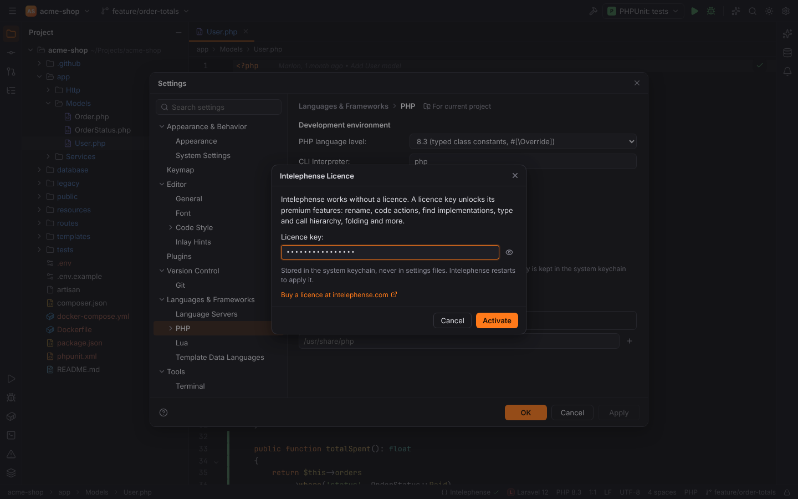

# Language servers

Completion, hover documentation, diagnostics, Go to Declaration and formatting for most
languages come from **language servers**: separate programs that speak the Language Server
Protocol. Forge does not bundle them. It knows about 30 of them, finds the ones you have
installed, offers to install missing ones, and starts them when a project needs them.

Servers start **lazily**: when you open the first file of a language. Several servers can serve
the same file and their results are merged, for example TypeScript + ESLint + Tailwind CSS on
a `.tsx` file.

## Settings | Languages & Frameworks | Language Servers

| Option | Setting | Default |
| --- | --- | --- |
| Start language servers for languages found in the project | `langservers.autoStart` | on |
| Files scanned to detect languages (ignored files, `node_modules` and `vendor` are skipped) | `langservers.scanLimit` | 20000 |
| Suggest installing missing language servers | `langservers.hints.enabled` | on |

Below is the server table, grouped by language. Groups for languages that occur in the open
project are marked **used in this project**; **Project languages only** hides the others. The
header shows how many servers are running and installed, and **Detect Again** (the refresh
icon) searches for executables again.

Each row has:

- an **Enabled** checkbox (`langservers.servers.<id>.enabled`);
- the **Status**: Running (with indexing progress), Installed, Not found, Disabled, or why a
  server is skipped (for example "Chosen in Languages & Frameworks | PHP" for the PHP
  servers, or a server of the same alternative group already running);
- the **Path** where it was found, or an **Install…** button.

Select a row to see its details:

| Field | Meaning |
| --- | --- |
| Description, licence, homepage | from the catalog |
| Command | the command line Forge starts |
| Executable | a custom path to the executable (`langservers.servers.<id>.path`); empty = detect automatically |
| Extra settings (JSON) | merged into the server's settings (`langservers.servers.<id>.settings`); put startup options under an `"initializationOptions"` key. **Show Defaults** shows what Forge sends by default. |
| Install | the ways to install it |

### Where Forge looks for servers

In this order: the project's `node_modules/.bin`, Forge's own server folder
(`<data dir>/forge/langservers/node_modules/.bin`, e.g.
`~/.local/share/forge/langservers` on Linux), the `PATH`, npm/nvm/volta/fnm global folders,
`~/.local/bin`, Composer's global `vendor/bin`, cargo, go, dotnet and gem folders, Neovim's
Mason (`~/.local/share/nvim/mason/bin`) and Windows `.cmd` shims. TypeScript SDKs and
`@vue/typescript-plugin` are also looked up in the project's and Forge's `node_modules`.

### Installing a server

Click **Install…** in a row (or in an install banner, see below). The dialog shows the
command and its output while it runs.

- **npm servers are never installed globally.** A catalog entry such as
  `npm install -g typescript-language-server typescript` runs as
  `npm install --prefix <Forge's server folder> --no-fund --no-audit typescript-language-server typescript`.
  Node.js and npm must be installed; a server started through `#!/usr/bin/env node` needs
  `node` on the `PATH` Forge was started with.
- Other tools (`brew`, `pipx`, `go install`, `cargo install`, `dotnet tool`, `gem`,
  `composer global require`) run exactly as listed in the catalog, without a shell.
- Commands that need root (`apt`, `pacman`) are only shown with **Copy Command**; run them in a
  terminal.
- Download-only servers link to their release page; download them and set **Executable**.

The full list of servers, their commands and install options is in the
[language servers reference](../reference/language-servers.md).

### Alternatives

Some servers are alternatives: only the first enabled and installed one starts.
`typescript-language-server` is preferred over `vtsls`; `basedpyright` over `pyright`.
Disable the preferred one to use the other.

### Servers that depend on the project

ESLint starts only with an ESLint config (`eslint.config.*`, `.eslintrc*`) or an `eslint`
dependency; Tailwind CSS only with `tailwind.config.*` or a Tailwind dependency; the Angular
Language Service only with `@angular/core`. Servers that belong to a plugin (TypeScript to
WebForge, Vue to `forge.vue`, Lua to `forge.lua`) start only while that plugin is active.

## Install suggestions in the editor

When a file uses something only a language server provides, and that server is not installed,
a banner above the editor offers it, for example for a JSON file with `"$schema"` or a YAML file
with a `# yaml-language-server: $schema=…` modeline: "The $schema of this file is not used: no
validation, completion or documentation from it."

- **Install…** opens the install dialog.
- **Not now** hides the banner until Forge restarts.
- **Don't show again** stores the server in `langservers.hints.dismissed`.

## Status bar

The language server widget shows "Indexing… TypeScript 45%" while a server reports progress,
otherwise the running servers and their state. Click it to open the Language Servers page.

## PHP: Intelephense and Phpactor

PHP servers are configured by the PHP pack, on Settings | Languages & Frameworks | **PHP**
(`php.lsp.server`):

| Choice | Behaviour |
| --- | --- |
| Auto (default) | Intelephense if installed, else Phpactor |
| Intelephense | always Intelephense (shows where it was found, or "not found on PATH (npm i -g intelephense)") |
| phpactor | always Phpactor |
| None (built-in index only) | no language server; completion and diagnostics from a server are missing, Forge's index still gives structure, search, hover and Generate |

The server starts when a PHP project opens and restarts when these settings change. Its cache
goes to `<cache dir>/forge/intelephense`, never into your project. Install Intelephense with
`npm install -g intelephense` or the **Install…** button on the Language Servers page.

### Intelephense licence key (premium)

Intelephense is free; a licence key from intelephense.com unlocks its premium features (rename,
code actions, type hierarchy and more). Forge never ships a key.

1. Open Settings | Languages & Frameworks | Language Servers (or the PHP page) and find
   **Intelephense: Free**.
2. Click **Enter Licence Key…**, paste your key and confirm with `Enter`.
3. The status changes to **Premium (key …1234)** and Intelephense restarts.

The key is stored in the operating system's keychain (service `forge-lsp`, account
`intelephense`), never in a settings file, and is passed to the server as `licenceKey`. In free
mode no key is sent. **Change Licence Key…** replaces it; **Remove Licence** in the dialog
deletes it.

> **Note:** a key saved by an older Forge version in the setting `php.lsp.licenceKey` is moved
> to the keychain once.

## Lua

lua-language-server gets the APIs of LÖVE or Neovim depending on Settings | Languages &
Frameworks | Lua | **Lua environment**. See [LuaForge](luaforge.md#lua-language-server).

## Remote projects

In a [remote project](remote-development.md) the PHP language server runs on the remote host,
next to the files, and indexes them there; the Forge agent finds Intelephense or Phpactor on
the host.

> **Note:** servers from the catalog (TypeScript, Python, YAML, …) are not started for remote
> projects yet; only the PHP pack's servers are.

## Troubleshooting

- **"Not found" although it is installed**: Forge may have been started from a desktop launcher
  with a shorter `PATH` than your shell. Set **Executable** to the full path, or start Forge
  from a terminal.
- **A Node-based server fails to start**: `node` must be on Forge's `PATH`.
- More in [Troubleshooting](../troubleshooting.md#language-server-not-found).
