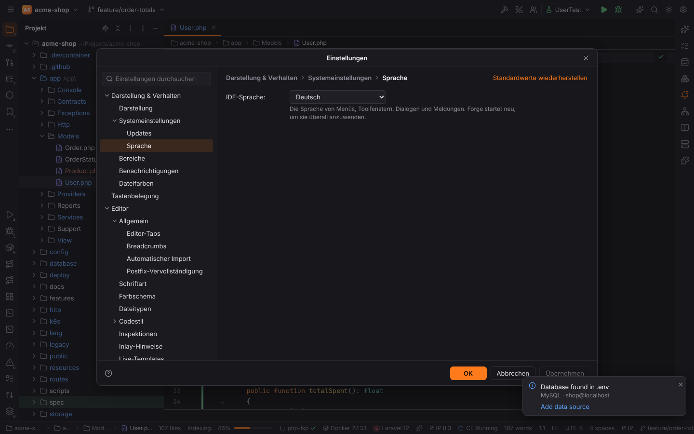
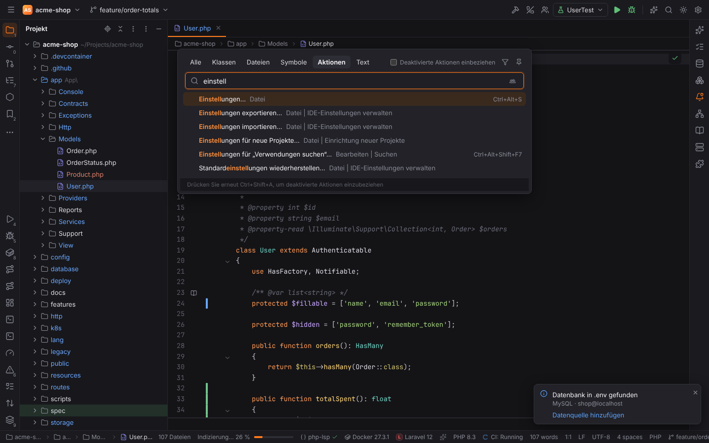
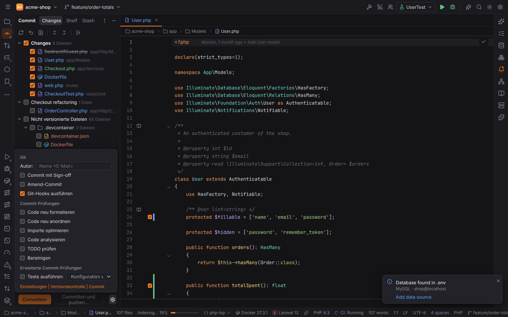
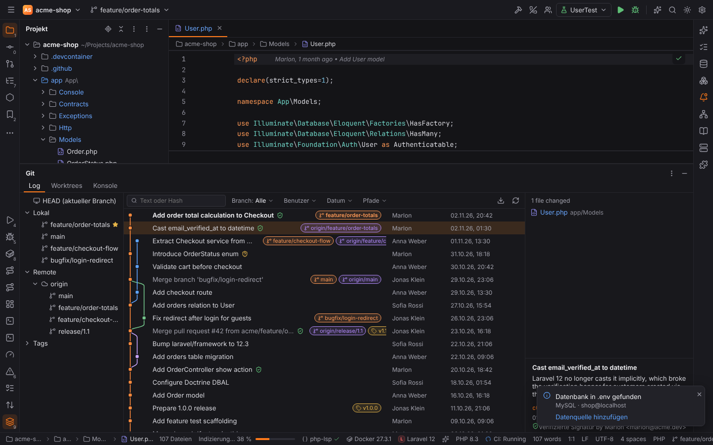
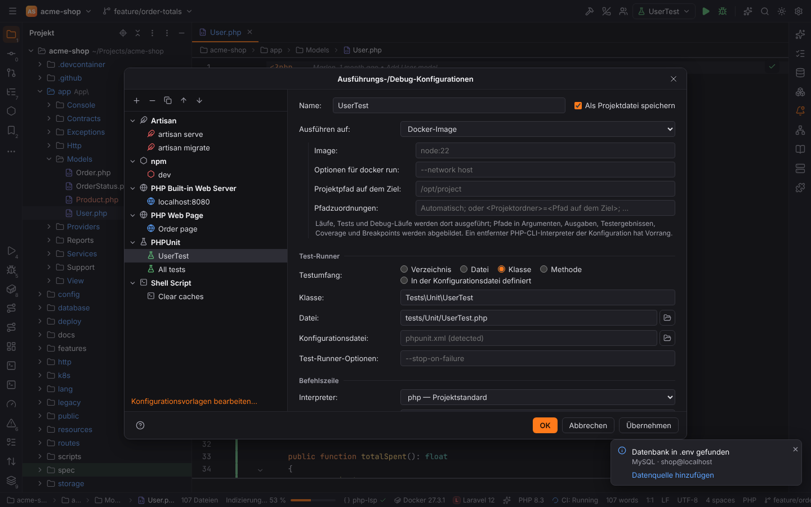

# IDE language

Forge is English by default, like PHPStorm. Other languages come as translations bundled with
Forge; German (Deutsch) is the first one.

## Changing the language

1. Open Settings (`Ctrl+Alt+S`, macOS `Cmd+,`) | Appearance & Behavior | System Settings |
   Language.
2. Pick **IDE language**: English or Deutsch.
3. Press OK or Apply. Forge asks to restart. **Restart** applies the language everywhere;
   **Not Now** keeps working.

Most of the UI switches at once, because it renders its text through the translation catalog.
Text that Forge computes once at startup keeps the previous language until the restart: tool
window and Settings page titles, the action list of Find Action and the keymap, and messages
that are already open. The setting is `ide.language` (`en` or `de`) and is stored in the user
settings, so it applies to every project.

## What is translated

| Area | German |
| --- | --- |
| Main menu (File … Help), its submenus and mnemonics | yes |
| Action names in Find Action, the keymap settings and the main menu | yes (PHPStorm actions) |
| Tool window titles and stripe buttons, tool window options menu | yes |
| Status bar (line separator, encoding, indent widgets) | yes |
| Settings dialog: page tree, buttons, search, Appearance, System Settings, Editor General, Editor Tabs, Font, Terminal, Git and Commit settings | yes |
| Welcome screen | yes |
| Search Everywhere and Find Action | yes |
| Find in Files, Rename, New Project, Run/Debug Configurations | yes |
| Commit tool window and Commit Options | yes |
| Project view and editor tab context menus, the editor context menu | yes |
| Notifications tool window and the balloons of the shell | yes |
| Git: Branches popup, Git log and file history, Merge, Rebase, Pull, Reset, Stash, Shelf, Patch, Worktrees, Clone and the merge window | yes |
| Debugger tool window, Breakpoints dialog, Attach to Process, Web Server Debug Validation, Servers | yes |
| Database tool window, Data Sources and Drivers, table editor and consoles, import, dump, Modify Table, schema comparison and diagrams | yes |
| Refactoring dialogs (Move, Copy, Safe Delete, Change Signature, Extract, Pull Members Up / Push Members Down, Extract Interface / Superclass), Find Usages and the Find tool window | yes |
| Run tool window, run configuration fields and types, Run on targets (Docker, Docker Compose, SSH, WSL, Dev Container) | yes |
| Forge's own actions without a PHPStorm counterpart (e.g. New Window, Code With Me, AI, Database actions) in Find Action and the keymap | yes |
| Settings pages Languages & Frameworks \| PHP (with Composer, Quality Tools, Debug, Laravel, Symfony, Doctrine, WordPress), Editor, Version Control and Tools | yes |
| Safe Mode refusals and common backend errors (no project open, file not found, I/O errors) | yes |
| Other tool windows and dialogs (.NET, C/C++, code hosts, Code With Me, game engines, Python, Java, Services, …), the settings of other language packs, file templates and New Project generator names | not yet, they stay English |

Untranslated text is always English, never a key or an empty label. The
[developer guide](../developer/localization.md) explains how the coverage is measured and how
to add translations.

> **Note:** plugin names, settings and tool window titles of the bundled plugins are about half
> translated: the PHP, Editor, Version Control and Tools pages are German, the settings of the
> other language packs stay English for now. Third-party plugins can ship their own translations
> in their manifest.

## Find Action in two languages

With German selected, Find Action (`Ctrl+Shift+A`) and the Actions tab of Search Everywhere
show the German action names, and a query matches both names: `einstell` finds
*Einstellungen…* and `reformat` finds *Code neu formatieren* (Reformat Code), like PHPStorm with
a language pack. Matches on the German name rank first.

## Terminology

The German translation follows JetBrains' German terminology and addresses you formally
("Sie"): *Einstellungen*, *Projekt*, *Ausführen*, *Debuggen*, *Refactoring*, *Toolfenster*,
*Änderungsliste*. Git terms stay as JetBrains keeps them: *Commit*, *Push*, *Pull*, *Branch*,
*Merge*, *Rebase*, *Stash*. Keyboard shortcuts keep their English key names (`Ctrl+Alt+S`).

Numbers, dates and plurals follow the language: *1.234 Dateien*, *04.11.2026*.

