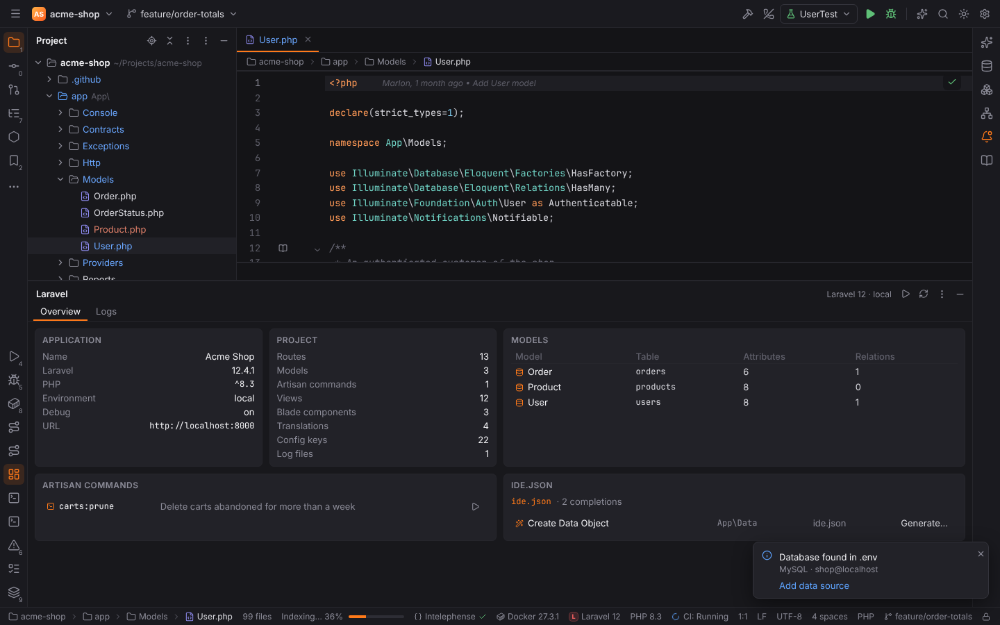
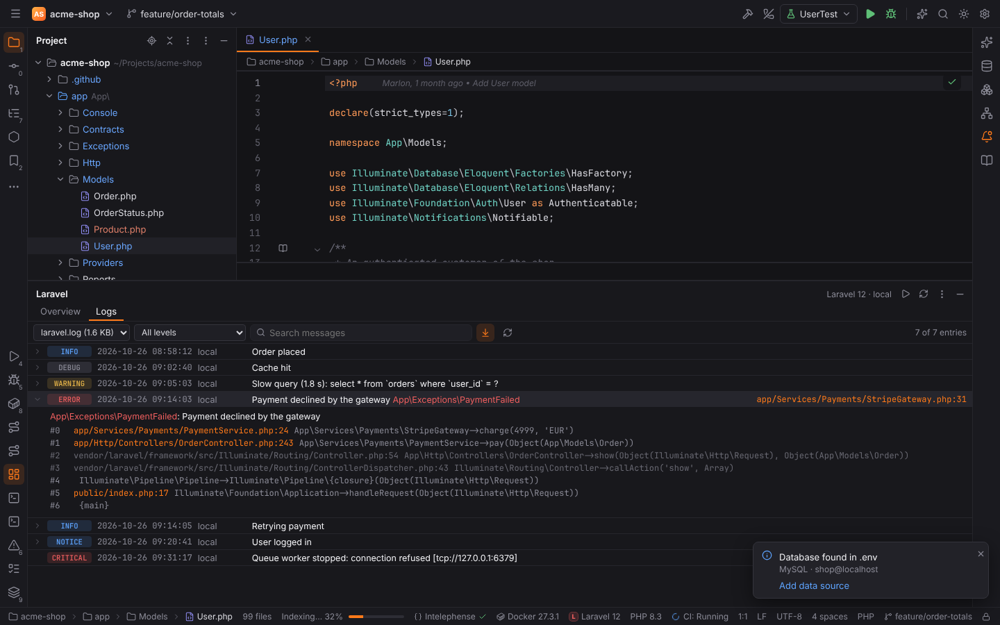
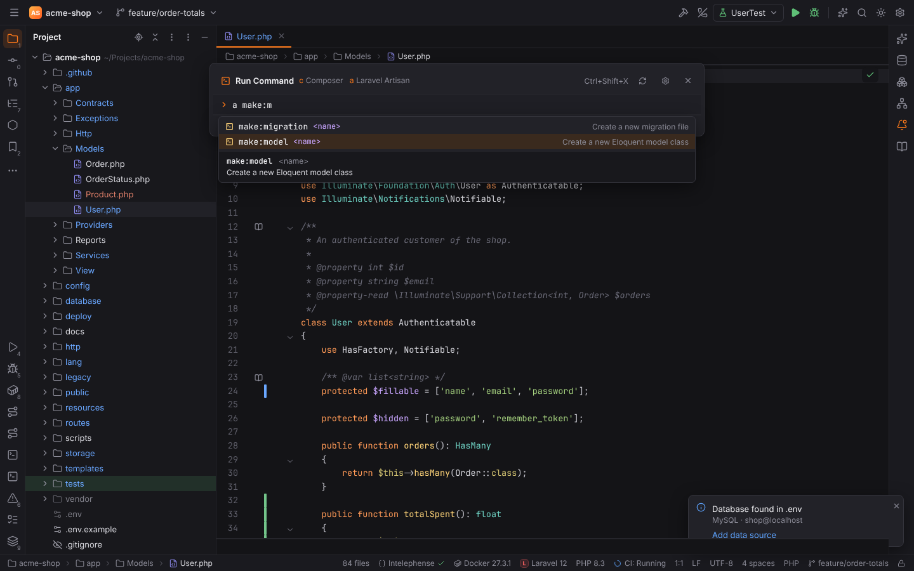
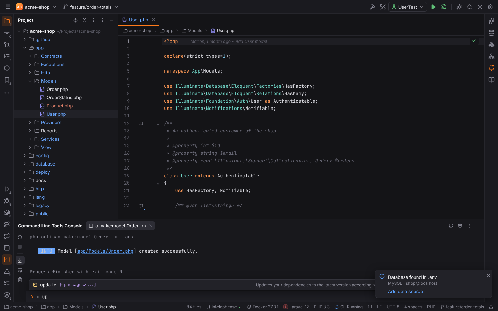

# Laravel

The Laravel plugin (`forge.laravel`, PHPForge pack) activates in projects that require
`laravel/framework` or have an `artisan` file. It analyses the project statically in Rust (no
need to boot the application) and reloads when files change.

The status bar shows **Laravel 12** (the installed version); its tooltip counts routes, models,
views, components and config keys. Click it to open Settings | Languages & Frameworks | PHP |
Laravel.

## Blade

`*.blade.php` files are highlighted as Blade: HTML with echoes (`{{ }}`, `{!! !!}`), comments
(`{{-- --}}`), directives (`@foreach (...)`), `@php` blocks, components (`<x-alert :type="$t">`,
`<livewire:counter>`) and embedded `<script>`/`<style>`. PHP inside is highlighted as PHP.


- Directives are completed, including the closing directive (`@foreach` … `@endforeach`).
- Custom directives registered with `Blade::directive()` or `Blade::if()` in the project are
  highlighted and completed like built-in ones. Add others in Settings | … | Laravel |
  **Additional Blade directives** (`laravel.blade.customDirectives`, names without `@`).


## Completion and Go to Declaration

In PHP and Blade files, Laravel completion appears next to the language server's, and
`Ctrl+B` / `Ctrl+Click` tries Laravel targets first:

| Where | Completes | Ctrl+B goes to |
| --- | --- | --- |
| `route('…')`, `to_route('…')` | route names | the route definition |
| `view('…')`, `@include('…')`, `@extends`, `View::make` | view names | the Blade file |
| `<x-…>` tags | Blade components (anonymous, class-based, Livewire) | the component |
| `config('…')` | config keys from `config/*.php` | the key in the config file |
| `env('…')` | keys from `.env` | the line in `.env` |
| `__('…')`, `trans('…')`, `@lang` | translation keys (PHP and JSON language files) | the translation |
| `->where('…')`, `orderBy`, `pluck` and other query builder calls | database columns, read from the migrations | the migration |
| `with('…')`, `load('…')` | Eloquent relations | the relation method |
| `$model->…` | model attributes (columns, `$fillable`, casts, accessors) and relations | the declaration |
| `Model::…` | local scopes | the `scope…` method |
| `[Controller::class, '…']` | controller methods | the method |
| custom Blade directives | | the `Blade::directive` call |


When a name has several targets (a view in two places, a component with a class and a
template), a **Choose Declaration** popup lists them.


Turn completion off with **Complete routes, views, config, translations and model attributes**
(`laravel.completion.enabled`) and **Complete database columns in query builder calls**
(`laravel.completion.columns`).

## ide.json

Packages and projects describe extra completions in an `ide.json` file (the format Laravel IDE
plugins such as Laravel Idea document). Forge reads the project's `ide.json` and the
`ide.json` of every installed package (`vendor/<vendor>/<package>/ide.json`):

- **completions:** `staticStrings` (a fixed list), `directoryFiles` (files of a folder, without
  `suffixToClear`) and the project's own lists `routeName`, `viewName`, `configKey`,
  `translationKey`, `envKey` and `validationRule`, offered where a `condition` applies:
  `functionNames` or `methodNames` (with `classFqn` / `classParentFqn`) and the 1-based
  `parameters`. Setting: **Complete values from ide.json files**
  (`laravel.completion.ideJson`).
- **codeGenerations:** listed in the Overview of the Laravel tool window. **Generate…** asks for
  a class name (`Orders/Invoice`), fills the stub templates (`${INPUT_CLASS|className|upperCamelCase}`,
  `${NAMESPACE}`, `${CLASS}`, with the `classSuffix`) and creates the files that do not exist
  yet below `App\<appNamespace>`.

```json
{
  "completions": [
    {
      "complete": "staticStrings",
      "options": { "strings": ["pending", "paid", "shipped"] },
      "condition": [{ "functionNames": ["order_status"], "parameters": [1] }]
    }
  ]
}
```

## Gutter icons

- **Route** icons next to controller actions that a route points to; click to go to the
  route definition (`laravel.gutter.routes`).
- **View** icons next to `view()` calls and Blade includes; click to open the template
  (`laravel.gutter.views`).


## Routes tool window

The **Routes** tool window (bottom) lists every route with **Method**, **URI**, **Name**,
**Action** and **Middleware**.


- Type in the search field to filter by URI, name, action or middleware; `Up`/`Down` and
  `Enter` work in the list.
- Clicking a row opens the controller method (or the route definition for closures); the
  arrow button at the end of a row opens the route definition.
- **Refresh Routes** re-reads them.

Routes come from one of two sources, chosen with **Read routes from**
(`laravel.routes.source`, can be stored per project):

| Value | Source |
| --- | --- |
| `auto` (default) | `php artisan route:list --json` when a `vendor/` folder exists, else static analysis |
| `artisan` | always `php artisan route:list --json`; also sees routes registered by packages, but needs a bootable application |
| `static` | Forge reads `routes/*.php` itself: verbs, `match`, `view`, `redirect`, `resource`/`apiResource`, groups with prefix/name/middleware/controller, included files and the `api` prefix |

With artisan, the source locations from static analysis are kept so navigation still works.

## Laravel tool window

The **Laravel** tool window (bottom; **Tools | Laravel | Show Laravel Tool Window**) has two tabs.

**Overview:** the application (name, Laravel and PHP version, environment, debug, URL from
`.env` and `composer.json`), counts of routes, models, artisan commands, views, Blade components,
translations, config keys and log files, the Eloquent models with their tables, the
application's artisan commands (`app/Console/Commands` and `routes/console.php`; the run button
opens Run Command with the command typed in) and what `ide.json` contributes.



**Logs** (**Tools | Laravel | Show Logs**): the entries of `storage/logs/*.log` (the newest file
first; the last 2 MB of large files), parsed in Rust from Monolog's line format into level,
time, channel, message and context. Click an entry to expand the exception and its stack trace;
`file:line` links open the file, also for logs written in a container (`/var/www/html/app/…`
is mapped into the project), and vendor frames are dimmed.



- the level filter shows a level and the more severe ones;
- the search field filters messages, exceptions and context;
- **Follow** reloads the log every two seconds and scrolls to new entries (default:
  **Follow log files**, `laravel.logs.follow`).

Reading logs does not run project code, so the tool window also works in Safe Mode.

## Run Artisan Command

Artisan commands run in the Command Line Tools Console: **Tools | Run Command…**
(`Ctrl+Shift+X`, macOS `Cmd+Shift+X`) with the alias `a`, for example `a make:model Order -m`.
Laravel projects get the Artisan tool automatically. Forge completes the commands of
`php artisan list --format=json` (or Laravel's standard commands when the application cannot
boot), their options and arguments, and shows each command's help. **Tools | Laravel | Run
Artisan Command…** opens the popup with `a ` typed in. See
[Command Line Tool Support](command-line-tools.md).



The output goes to the Command Line Tools Console tool window, with clickable paths of the
generated files.



For commands you run often, create an **Artisan** run configuration (Run | Edit
Configurations), which can also be debugged with Xdebug. See
[Run/Debug configurations](run-debug.md).

## Database

Laravel's `DB_*` variables in `.env` are offered as a data source in the Database tool window.
See [Database tools](database.md).

## Settings | Languages & Frameworks | PHP | Laravel


| Option | Setting | Default |
| --- | --- | --- |
| Read routes from | `laravel.routes.source` | `auto` |
| Complete routes, views, config, translations and model attributes | `laravel.completion.enabled` | on |
| Complete database columns in query builder calls | `laravel.completion.columns` | on |
| Complete values from ide.json files | `laravel.completion.ideJson` | on |
| Follow log files | `laravel.logs.follow` | on |
| Show route icons for controller actions | `laravel.gutter.routes` | on |
| Show view icons for `view()` calls and Blade includes | `laravel.gutter.views` | on |
| Additional Blade directives | `laravel.blade.customDirectives` | empty |

## Remote projects

In [remote projects](remote-development.md) the analysis runs in the Forge agent on the host
(completion, navigation and gutter icons cost one round trip), and artisan commands run on the
host.


