# Laravel

The Laravel plugin (`forge.laravel`, PHPForge pack) activates in projects that require
`laravel/framework` or have an `artisan` file. It analyses the project statically in Rust (no
need to boot the application) and reloads when files change.

The status bar shows **Laravel 12** (the installed version); its tooltip counts routes, models,
views, components and config keys. Click it to open Settings | Languages & Frameworks | PHP |
Laravel.

## Blade

`*.blade.php` files are highlighted as Blade: HTML with echoes (`{{ }}`, `{!! !!}`), comments
(`{{-- --}}`), directives (`@foreach (...)`), `@php` blocks, components (`<x-alert :type="$t">`,
`<livewire:counter>`) and embedded `<script>`/`<style>`. PHP inside is highlighted as PHP.

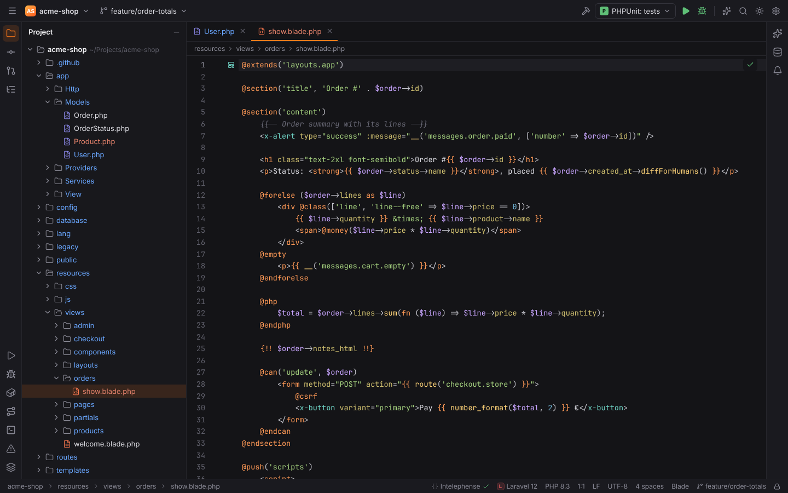

- Directives are completed, including the closing directive (`@foreach` … `@endforeach`).
- Custom directives registered with `Blade::directive()` or `Blade::if()` in the project are
  highlighted and completed like built-in ones. Add others in Settings | … | Laravel |
  **Additional Blade directives** (`laravel.blade.customDirectives`, names without `@`).

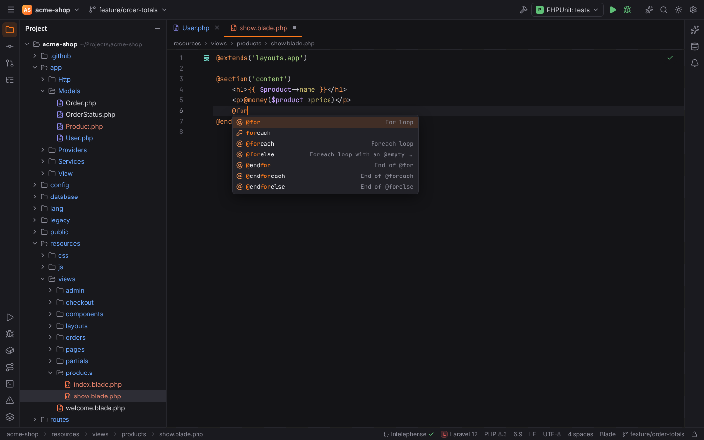

## Completion and Go to Declaration

In PHP and Blade files, Laravel completion appears next to the language server's, and
`Ctrl+B` / `Ctrl+Click` tries Laravel targets first:

| Where | Completes | Ctrl+B goes to |
| --- | --- | --- |
| `route('…')`, `to_route('…')` | route names | the route definition |
| `view('…')`, `@include('…')`, `@extends`, `View::make` | view names | the Blade file |
| `<x-…>` tags | Blade components (anonymous, class-based, Livewire) | the component |
| `config('…')` | config keys from `config/*.php` | the key in the config file |
| `env('…')` | keys from `.env` | the line in `.env` |
| `__('…')`, `trans('…')`, `@lang` | translation keys (PHP and JSON language files) | the translation |
| `->where('…')`, `orderBy`, `pluck` and other query builder calls | database columns, read from the migrations | the migration |
| `with('…')`, `load('…')` | Eloquent relations | the relation method |
| `$model->…` | model attributes (columns, `$fillable`, casts, accessors) and relations | the declaration |
| `Model::…` | local scopes | the `scope…` method |
| `[Controller::class, '…']` | controller methods | the method |
| custom Blade directives | | the `Blade::directive` call |

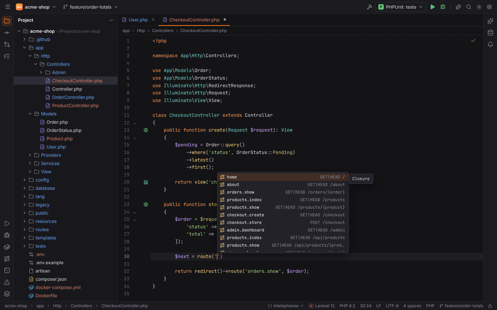

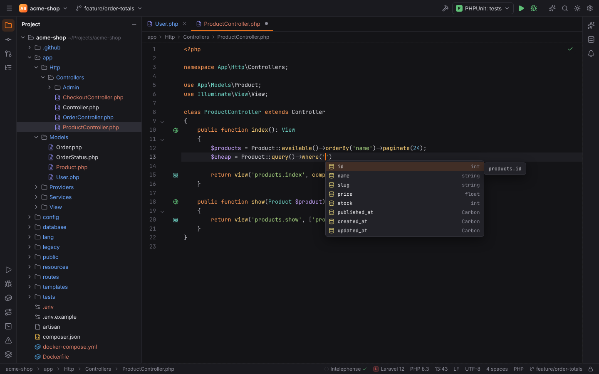

When a name has several targets (a view in two places, a component with a class and a
template), a **Choose Declaration** popup lists them.

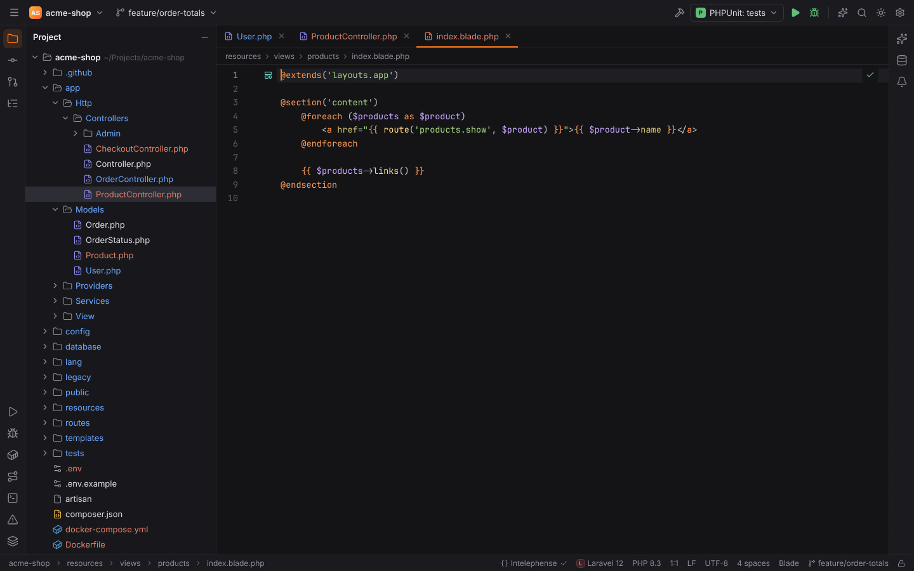

Turn completion off with **Complete routes, views, config, translations and model attributes**
(`laravel.completion.enabled`) and **Complete database columns in query builder calls**
(`laravel.completion.columns`).

## Gutter icons

- **Route** icons next to controller actions that a route points to; click to go to the
  route definition (`laravel.gutter.routes`).
- **View** icons next to `view()` calls and Blade includes; click to open the template
  (`laravel.gutter.views`).

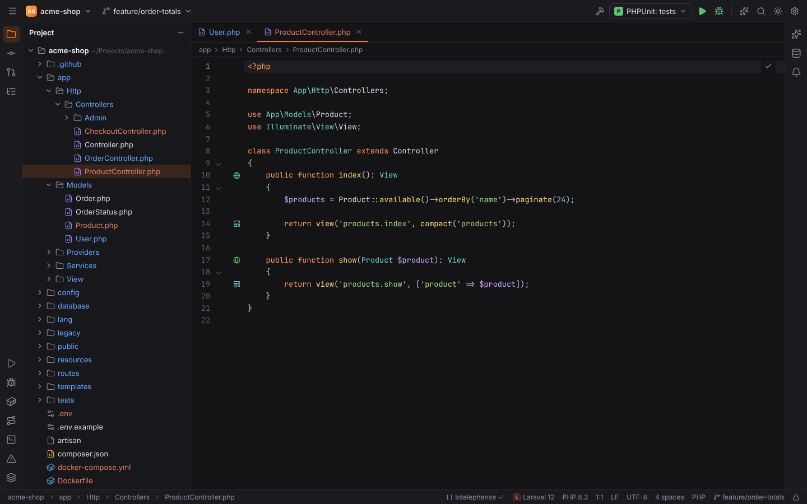

## Routes tool window

The **Routes** tool window (bottom) lists every route with **Method**, **URI**, **Name**,
**Action** and **Middleware**.

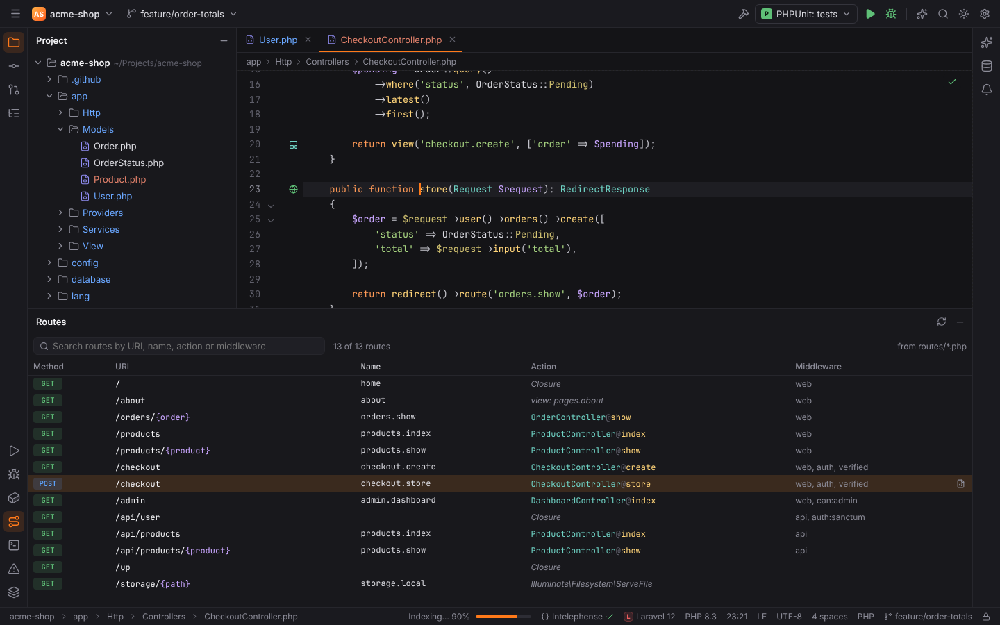

- Type in the search field to filter by URI, name, action or middleware; `Up`/`Down` and
  `Enter` work in the list.
- Clicking a row opens the controller method (or the route definition for closures); the
  arrow button at the end of a row opens the route definition.
- **Refresh Routes** re-reads them.

Routes come from one of two sources, chosen with **Read routes from**
(`laravel.routes.source`, can be stored per project):

| Value | Source |
| --- | --- |
| `auto` (default) | `php artisan route:list --json` when a `vendor/` folder exists, else static analysis |
| `artisan` | always `php artisan route:list --json`; also sees routes registered by packages, but needs a bootable application |
| `static` | Forge reads `routes/*.php` itself: verbs, `match`, `view`, `redirect`, `resource`/`apiResource`, groups with prefix/name/middleware/controller, included files and the `api` prefix |

With artisan, the source locations from static analysis are kept so navigation still works.

## Run Artisan Command

**Run Artisan Command…** (`Ctrl+Shift+X`, macOS `Cmd+Shift+X`) opens a popup listing the
project's artisan commands (from `php artisan list --format=json`, or a built-in list when the
application cannot boot) and your **Recently run** commands. Type a command with its
arguments and press `Enter`.

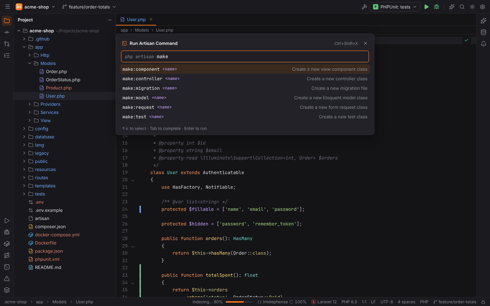

The output appears in the popup; **Rerun** runs it again, `Enter` starts another command,
`Esc` closes.

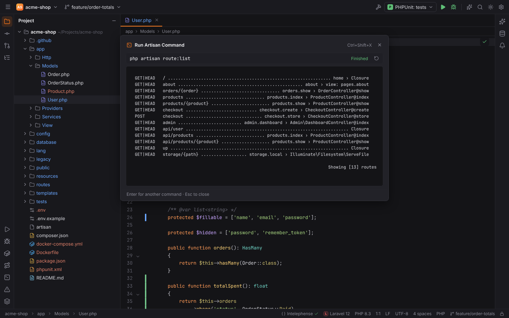

For commands you run often, create an **Artisan** run configuration (Run | Edit
Configurations), which can also be debugged with Xdebug. See
[Run/Debug configurations](run-debug.md).

## Database

Laravel's `DB_*` variables in `.env` are offered as a data source in the Database tool window.
See [Database tools](database.md).

## Settings | Languages & Frameworks | PHP | Laravel

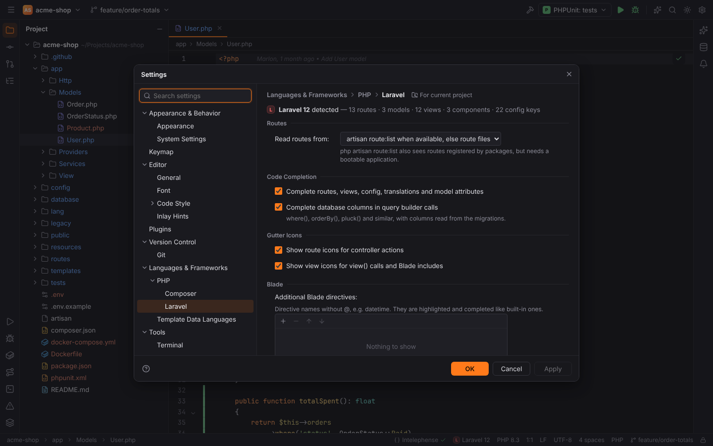

| Option | Setting | Default |
| --- | --- | --- |
| Read routes from | `laravel.routes.source` | `auto` |
| Complete routes, views, config, translations and model attributes | `laravel.completion.enabled` | on |
| Complete database columns in query builder calls | `laravel.completion.columns` | on |
| Show route icons for controller actions | `laravel.gutter.routes` | on |
| Show view icons for `view()` calls and Blade includes | `laravel.gutter.views` | on |
| Additional Blade directives | `laravel.blade.customDirectives` | empty |

## Remote projects

In [remote projects](remote-development.md) the analysis runs in the Forge agent on the host
(completion, navigation and gutter icons cost one round trip), and artisan commands run on the
host.

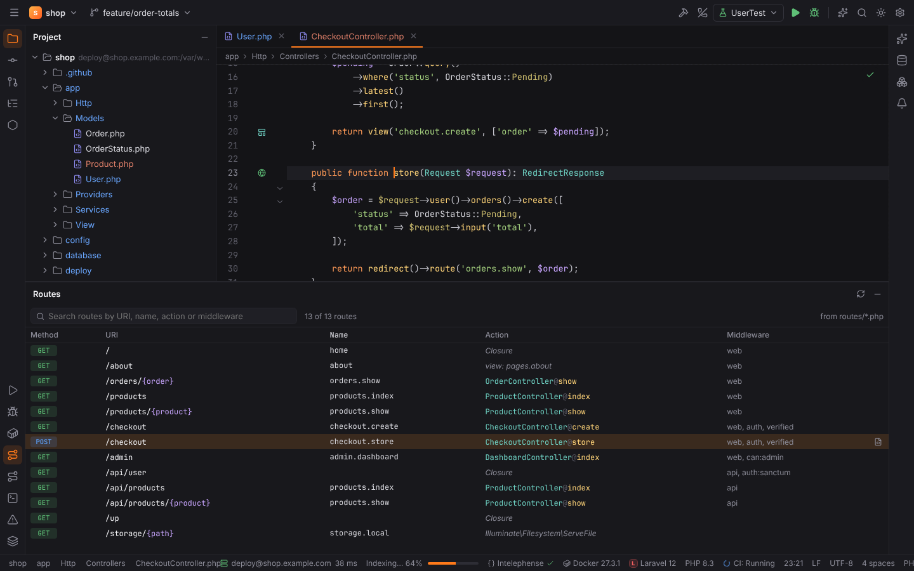
