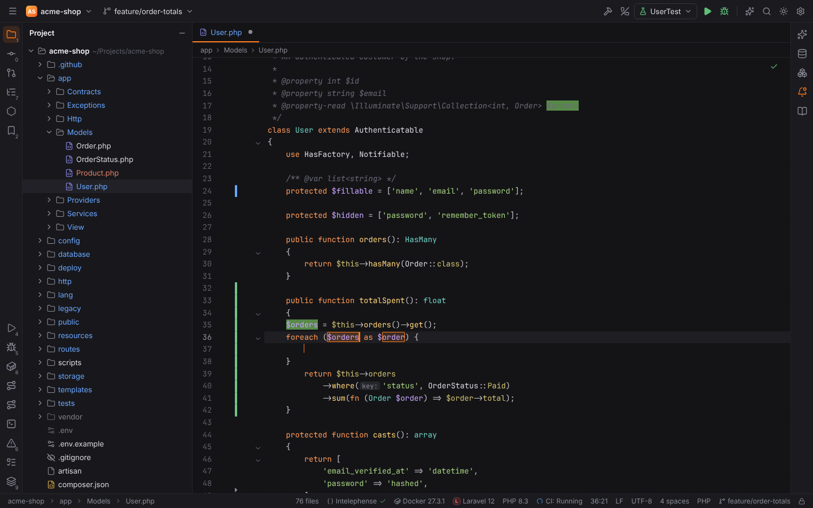
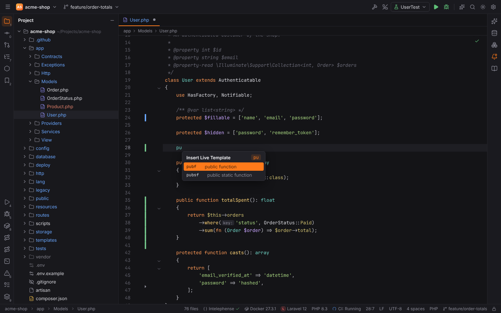
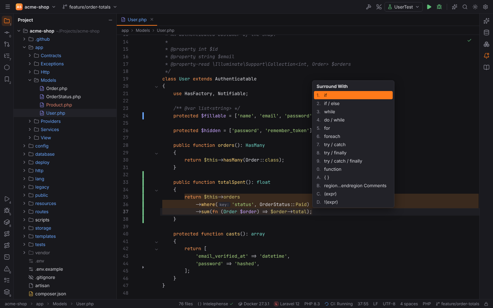
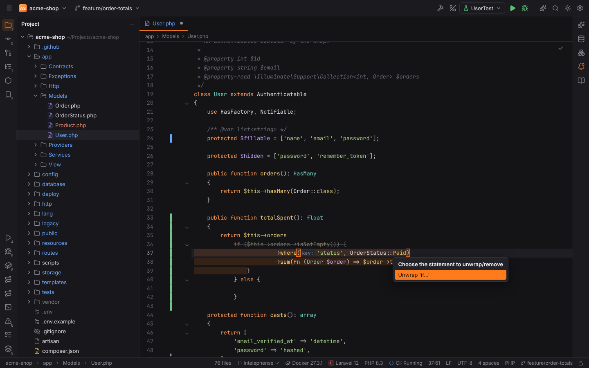
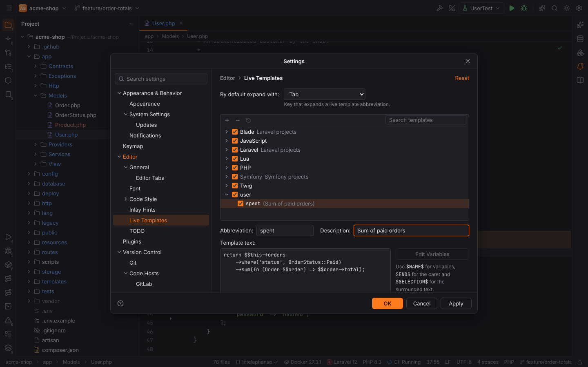
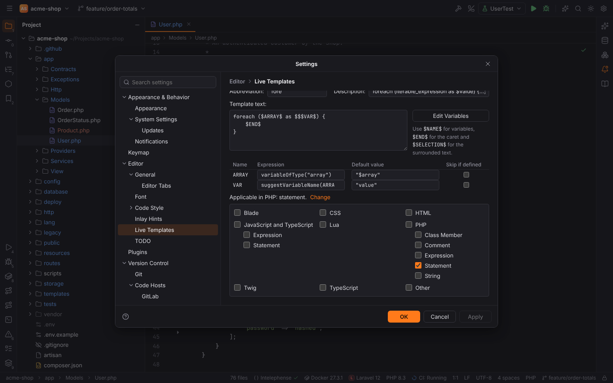

# Live templates

Live templates work as in PHPStorm: type an abbreviation such as `fore` and press `Tab`, and
Forge inserts the code it stands for. The variables of the template become tab stops: the
first one is selected, `Tab` moves to the next one (`Shift+Tab` back), and `Escape` or moving
the caret away finishes the template. Every occurrence of a variable is edited at once.

The template sets, the contexts a template applies in, the variable expressions and the
expansion are computed in Rust (`crates/forge-livetemplates`), so the desktop app and browser
mode behave the same.

## Expanding a template

- **By abbreviation:** type the abbreviation and press the expand key, `Tab` by default. The
  key keeps its usual meaning when no template applies (the word is not an abbreviation, or
  the template does not fit the place). Change the key in Settings | Editor | Live Templates
  ("By default expand with": `Tab`, `Space` or `Enter`).
- **From completion:** templates that apply at the caret are listed in code completion with
  their description; choosing one expands it.
- **Insert Live Template** (`Ctrl+J`, macOS `Cmd+J`, Code | Insert Live Template): a list of
  every template that applies at the caret. It is filtered by the word before the caret; type
  to narrow it further, `Enter` or `Tab` inserts the selected template and replaces the typed
  prefix.

An abbreviation only expands as a whole word: `$fore`, `$x->fore` or `prefore` do not
expand, and neither do abbreviations inside comments or strings.

## Contexts

Each template says where it applies ("Applicable in"), with PHPStorm's contexts:

| Context | Where |
| --- | --- |
| PHP: Statement | where a statement can start (inside functions or at the top level of a PHP file) |
| PHP: Class Member | directly in a class, interface, trait or enum body |
| PHP: Expression | inside an expression, e.g. after `=` or `(` |
| PHP: Comment / String | inside comments or strings (only templates that ask for them) |
| PHP | all PHP code except comments and strings |
| JavaScript and TypeScript: Statement / Expression | JavaScript and TypeScript files and `<script>` blocks |
| TypeScript | TypeScript files and `<script lang="ts">` |
| HTML, CSS | markup (including the HTML parts of PHP files) and `<style>` blocks |
| Blade, Twig | Blade and Twig templates |
| Lua | Lua files |
| Other | every other file type |

## Variables and expressions

Template text uses `$NAME$` for a variable, `$END$` for the caret position after the last
variable and `$SELECTION$` for the text a template surrounds. `$$` is a literal dollar sign,
so PHP variables in template text are written `$$this`.

In "Edit Variables" each variable has an **expression**, a **default value** and
**Skip if defined**. The expression computes the initial value; when it is empty, the default
value (an expression too, usually a string such as `"value"`) is used. A variable with a value
and "Skip if defined" is filled in without a tab stop.

| Expression | Value |
| --- | --- |
| `className()`, `methodName()`, `functionName()`, `namespace()` | the class, method or function around the caret and the PHP namespace |
| `fileName()`, `fileNameWithoutExtension()` | the current file name |
| `date("yyyy-MM-dd")`, `time("HH:mm")` | the current date and time (Java `SimpleDateFormat` patterns) |
| `user()`, `clipboard()` | the system user name and the text last copied in Forge |
| `variableOfType("array")` | a variable used before the caret, preferring collections (`$orders`) |
| `suggestVariableName(ARRAY)` | a singular name for an element: `$orders` → `order` |
| `camelCase(s)`, `snakeCase(s)`, `capitalize(s)`, `decapitalize(s)`, `capitalizeAndUnderscore(s)`, `lowercaseAndDash(s)`, `spaceSeparated(s)`, `underscoresToCamelCase(s)`, `underscoresToSpaces(s)` | case conversions |
| `concat(a, b, …)`, `substringBefore(s, delimiter)`, `enum("a", "b")`, `complete()` | joining, cutting, the first of several values, an empty field |

## Built-in templates

| Group | Applies | Templates |
| --- | --- | --- |
| PHP | always | `fore`, `forek`, `fori`, `__c` (closure), `__fn` (arrow function), `eco`, `thr`, `inc`, `inco`, `rqr`, `rqro`, `pubf`, `prof`, `prif`, `pubsf`, `prosf`, `prisf`, `con`, `ctor`, `dc` |
| JavaScript | always (also TypeScript) | `fori`, `itar`, `ritar`, `iter`, `itin`, `log`, `anf`, `arf`, `imp`, `imd` |
| Lua | always | `fori`, `forp`, `forip`, `fun`, `lfun`, `req` |
| Twig | always | `for`, `if`, `block`, `extends`, `include` |
| Laravel | Laravel projects | `rget`, `rpost`, `rres`, `rgroup`, `dd`, `validate`, `hasmany`, `belongsto`, `scope` |
| Blade | Laravel projects | `bif`, `bforeach`, `bforelse`, `bsection`, `bextends`, `binclude` |
| Symfony | Symfony projects | `action`, `route`, `render`, `redirect`, `json`, `flash`, `path`, `trans` |

The Laravel, Blade and Symfony groups apply only in projects that use the framework (and
while its plugin is enabled in Settings | Plugins).

## Surround With

**Code | Surround With** (`Ctrl+Alt+T`, macOS `Cmd+Alt+T`) wraps the selected lines, or the
caret line, in a statement. In PHP and JavaScript: `if`, `if / else`, `while`,
`do / while`, `for`, `foreach` (PHP), `try / catch`, `try / finally`,
`try / catch / finally`, `function`, `{ }`, `region...endregion Comments`, `(expr)` and
`!(expr)`; Lua, HTML, Blade and Twig have their own lists (`if … then … end`, `<tag></tag>`,
`@if`, ``, …). Press the number or letter in front of an entry to pick it. The
selection is re-indented inside the new block and the caret lands in the condition.

Below them, under "Live templates", the popup lists the templates that use `$SELECTION$`.
**Code | Surround with Live Template** (`Ctrl+Alt+J`, macOS `Cmd+Alt+J`) lists only those.

## Unwrap/Remove

**Code | Unwrap/Remove** (`Ctrl+Shift+Delete`, macOS `Cmd+Shift+Delete`) lists the
statements around the caret, innermost first. While an entry is selected, the editor shows
what goes away (struck through) and what stays (highlighted).

- **Unwrap 'if...'**, **'foreach...'**, **'for...'**, **'while...'**, **'do...'**,
  **'try...'**, **braces**: replaces the statement with the body the caret is in,
  re-indented.
- **Unwrap 'else...'** / **'elseif...'**: keeps that branch instead of the whole `if`.
- **Remove 'else...'**, **'elseif...'**, **'catch...'**, **'finally...'**: deletes only that
  branch.

It works in PHP, JavaScript and TypeScript (brace statements) and Lua (`if … then … end`,
`for`/`while … do … end`, `repeat … until`, `do … end`).

## Save as Live Template

Select code and choose **Tools | Save as Live Template** (also in the Code menu). Settings |
Editor | Live Templates opens with a new template in the `user` group: the selection is the
template text (dollar signs written as `$$`) and the contexts are those of the selection.
Enter an abbreviation and a description, turn parts of the text into `$VARIABLES$` and press
OK.

## Settings | Editor | Live Templates

- **By default expand with:** the expand key (`editor.liveTemplates.expandKey`).
- **Template groups:** check boxes enable or disable a template or a whole group; a disabled
  template neither expands nor shows in completion. Framework groups are marked with the
  projects they apply to. Use the search field to filter by abbreviation or description.
- **Toolbar:** `+` adds a template to the selected group (`user` when none is selected), `−`
  removes the selected template, and the restore button brings a changed built-in template
  (or all built-ins of the selected group, including removed ones) back to its shipped state.
  Changed built-in templates are shown in blue.
- **Editor:** abbreviation, description, template text, "Edit Variables" (name, expression,
  default value, skip if defined) and "Applicable in" with **Change** to pick the contexts.

User templates and changes to built-in ones are stored in the user settings
(`editor.liveTemplates.custom`), disabled templates in `editor.liveTemplates.disabled`;
Apply, Cancel and Reset work as on every other settings page.
