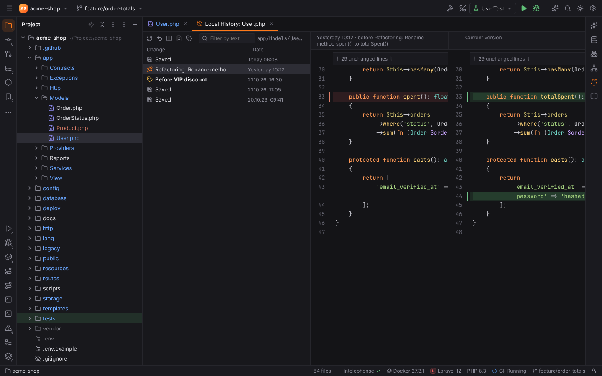
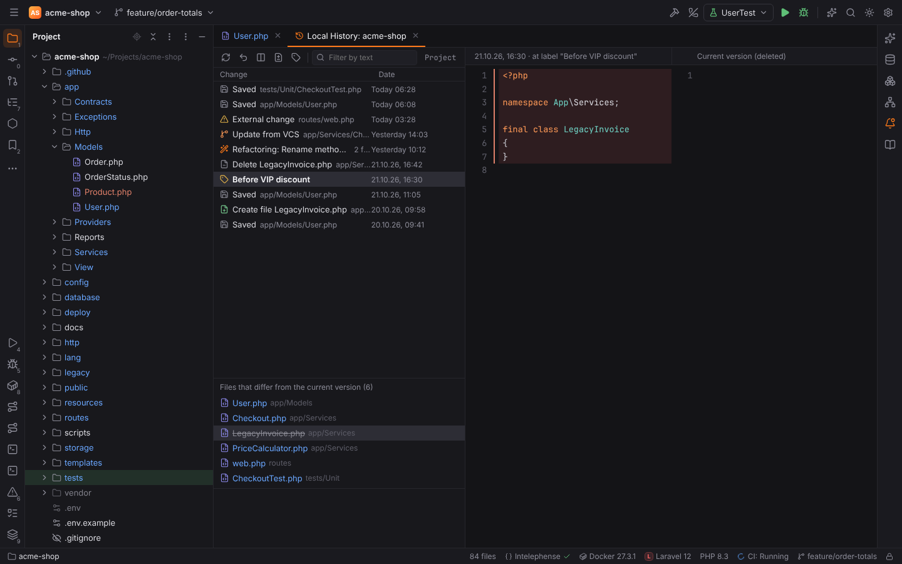
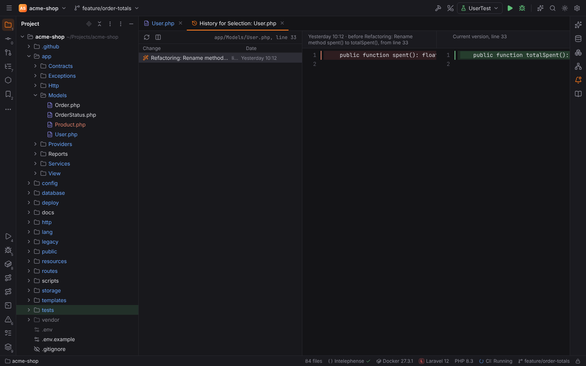
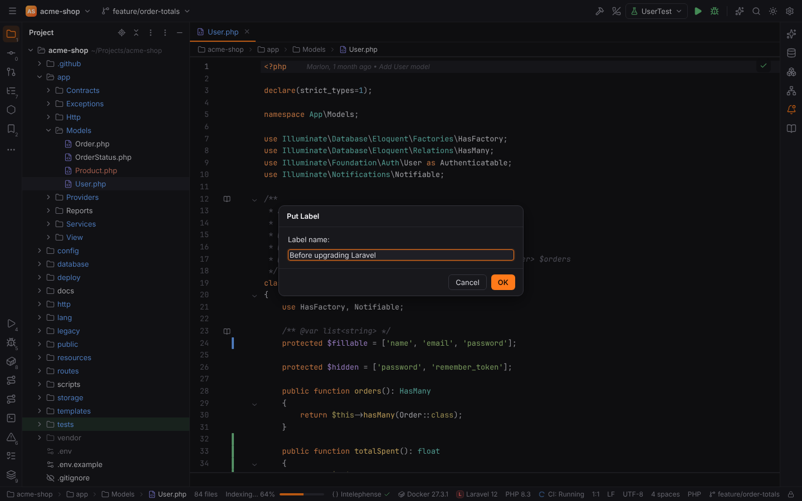
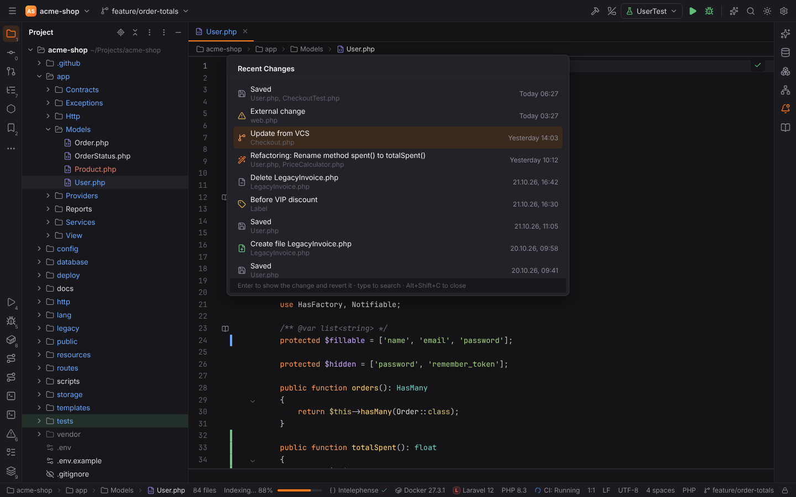
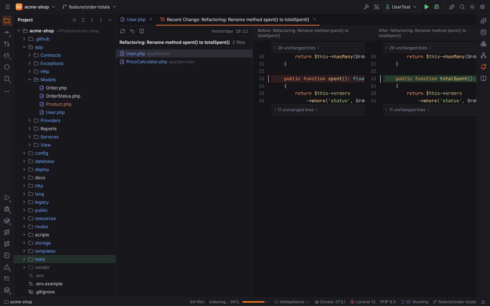
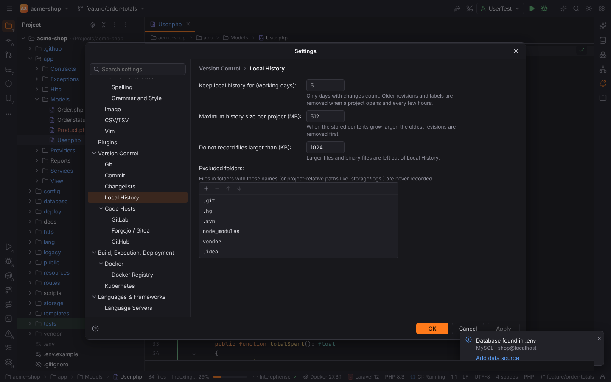

# Local History

Local History is Forge's own record of how your project files changed, independent of Git.
It works in every project (with or without a repository, local or
[remote](remote-development.md)) and lets you look at and restore earlier contents of a file,
a folder or a few lines, even of files you never committed.

## What is recorded

Forge records the content of a file:

| Event | Shown as |
| --- | --- |
| Every save (`Ctrl+S`, autosave, Actions on Save) | `Saved` |
| A refactoring (rename, move, extract, quick fixes that change several files, Replace in Files, Structural Replace): all files it changes, open editors included, as one change | `Refactoring: Rename spent() to totalSpent()`, `Replace in Files` |
| VCS operations: Update Project / Pull, Checkout, Merge, Rebase, Reset, Rollback, Stash / Unstash, Shelve / Unshelve | `Update from VCS`, `Checkout main`, `Rollback`, `Unshelve <name>`, … |
| Changes made outside Forge (another editor, a terminal, `composer`, a code generator), found by the file watcher | `External change` |
| Creating, deleting, renaming, moving and copying files and folders (Project view, refactorings, file templates) | `Create file A.php`, `Delete Legacy`, `Rename A.php to B.php`, `Move A.php to app/Models` |
| Labels you put | the label's name, in bold |
| Local History's own Revert | `Revert to …` |

Forge also keeps the content of a file when it first opens it, so the first change of a file
can be compared with and reverted to how it was before. A file that changed while Forge was
closed is recorded as an `External change` the next time Forge reads it.

Recording happens in the background: saving never waits for it.

**Not recorded:** files in excluded folders (by default `.git`, `.hg`, `.svn`, `node_modules`,
`vendor` and `.idea`, at any depth), binary files and files larger than the size limit
(1024 KB by default). See [Settings](#settings).

## Show History

Open the history of a file, a folder or the whole project:

- **File | Local History | Show History** (in projects without Git also **VCS | Local History |
  Show History**): the file or folder selected in the Project view, otherwise the file in the
  editor;
- **Project view** context menu ▸ **Local History** ▸ **Show History** (on the project root:
  the whole project);
- **editor** context menu ▸ **Local History** ▸ **Show History**.

The history opens as an editor tab, **Local History: _name_**:

- the **revision list**, newest first: what happened (`Saved`, `Refactoring: …`,
  `External change`, labels in bold) and when. A revision is the state of the file **before**
  that change (for a label: at the label), so the newest revision compared with the current
  version shows the latest change. Renamed and moved files keep their history; the old path
  is shown next to the revision.
- the **diff** of the selected revision against the current version (the editor's text when
  the file is open, unsaved edits included). Double-click a revision or press `Ctrl+D` for the
  full diff viewer.
- **Filter by text** in the toolbar keeps the revisions whose name or content contains the
  text, e.g. a method name you deleted somewhere along the way.

For a **folder**, a revision lists every file in the folder that differs from now: changed
files, files created since (Revert deletes them) and files deleted since (shown struck
through; Revert recreates them). Select a file to see its diff.

### Toolbar and context menu

| Action | What it does |
| --- | --- |
| **Revert** | Restores the selected revision: the file gets its old content back. For a folder (after a confirmation) every listed file is restored, deleted files and folders are recreated and files created since are deleted. Unsaved edits are saved first; the revert itself is recorded, so it can be reverted too. |
| **Show Diff** (`Ctrl+D`) | The selected revision against the current version in the diff viewer. |
| **Create Patch…** | The difference between the revision and now as a unified diff (git format), copied to the clipboard or saved to a file. Apply it later with Git ▸ Patch ▸ Apply Patch. |
| **Put Label…** | See [Labels](#labels). |
| **Refresh** | Reloads the list (it also refreshes by itself when something is recorded). |

## Show History for Selection

Select lines in the editor (or put the caret on one line) and choose **Local History ▸ Show
History for Selection** in the editor context menu (action `LocalHistory.ShowSelectionHistory`,
also in Find Action). The **History for Selection** tab lists only the revisions in which those
lines were different, with the lines as they were next to the lines now. The lines are
followed through the file's history, also when code above them was added or removed.

## Labels

**File | Local History | Put Label…** (or the Project view and editor menus, VCS | Local
History in projects without Git, or the tag button in a history tab) names the current moment for the whole
project, e.g. "Before upgrading Laravel". Unsaved edits are saved first.

Labels appear in bold in the history of every file and folder. Select a label and press
**Revert** to put a file, a folder or (in the project's history, or from Recent Changes) the
whole project back to that moment.

## Recent Changes

**View | Recent Changes** (`Alt+Shift+C`, macOS `Opt+Shift+C`) lists what happened recently in
the whole project, newest first: refactorings, external changes, VCS operations, labels,
created and deleted files; saves in a row are one entry. Type to filter, use the arrow keys and
press `Enter` (or click) to open the change.

The change opens as a tab with its files and the diff of each file before and after the change.
**Revert** there gives the files the content they had before the change (for a label: the
whole project goes back to the label).

## Settings

Settings | Version Control | Local History:

| Setting | Default | |
| --- | --- | --- |
| Keep local history for (working days) | 5 | Only days on which something was recorded count, like PHPStorm's "working days". Older revisions and labels are removed when a project opens and every few hours. |
| Maximum history size per project (MB) | 512 | When the stored contents grow larger, the oldest revisions are removed first. |
| Do not record files larger than (KB) | 1024 | Binary files are never recorded. |
| Excluded folders | `.git`, `.hg`, `.svn`, `node_modules`, `vendor`, `.idea` | Folder names (at any depth) or project-relative paths like `storage/logs`. |

## Where it is stored

Local History is kept on this computer, never inside the project:
`<data dir>/forge/projects/<name>-<hash>/local-history/` (see
[File locations](../reference/file-locations.md)). `changes.jsonl` lists the changes, one per
line; `content/` holds each file content once (contents are compressed and stored by their
hash, so saving the same text again costs nothing). For a remote project the contents are read
through the SSH connection and stored locally.

> **Note:** Local History is not a backup. It is cleaned up after the configured working days,
> and it is lost when Forge's data directory is deleted. Commit important work.

## Shortcuts and actions

| Action | Action id | Windows / Linux | macOS |
| --- | --- | --- | --- |
| Show History | `LocalHistory.ShowHistory` | — | — |
| Show History for Selection | `LocalHistory.ShowSelectionHistory` | — | — |
| Put Label… | `LocalHistory.PutLabel` | — | — |
| Recent Changes | `RecentChanges` | `Alt+Shift+C` | `Opt+Shift+C` |

Assign shortcuts in Settings | [Keymap](keymap.md).
