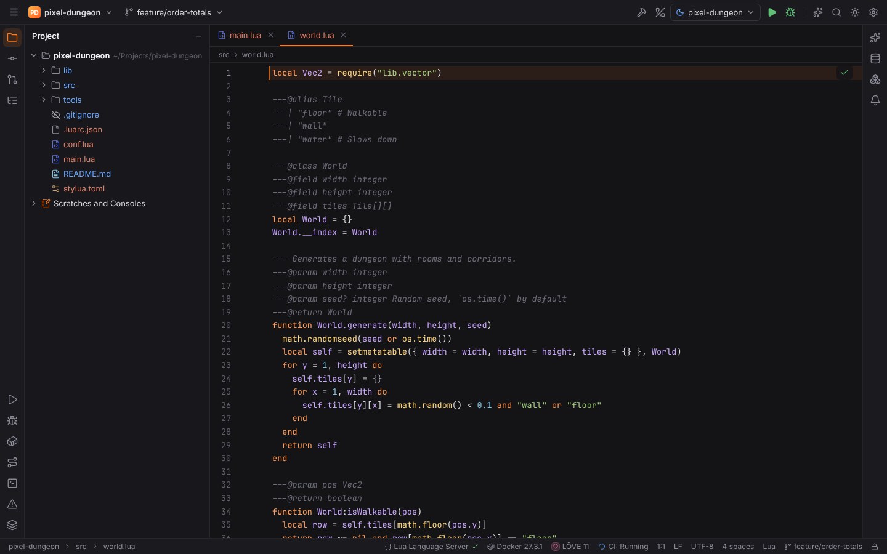
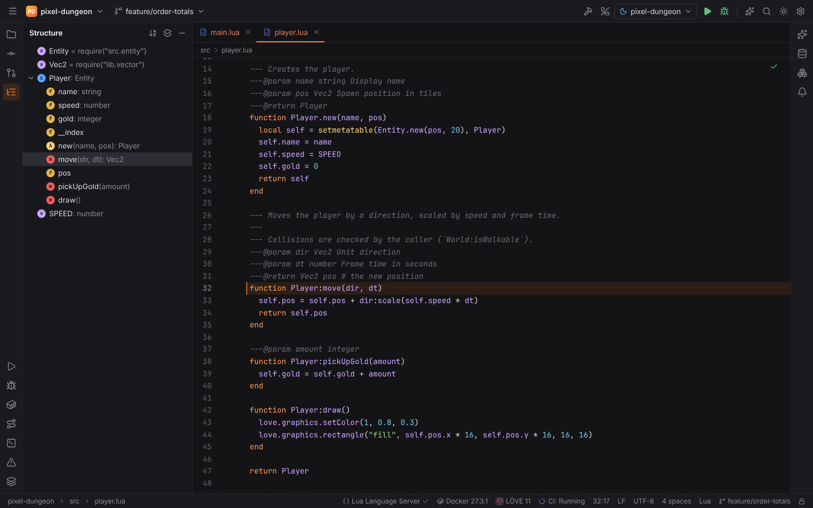
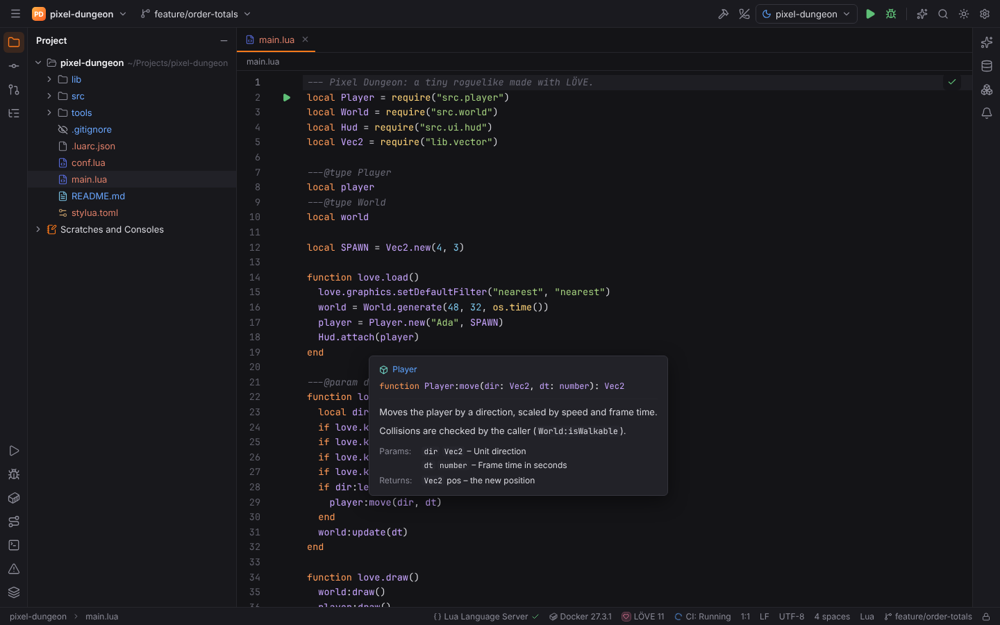
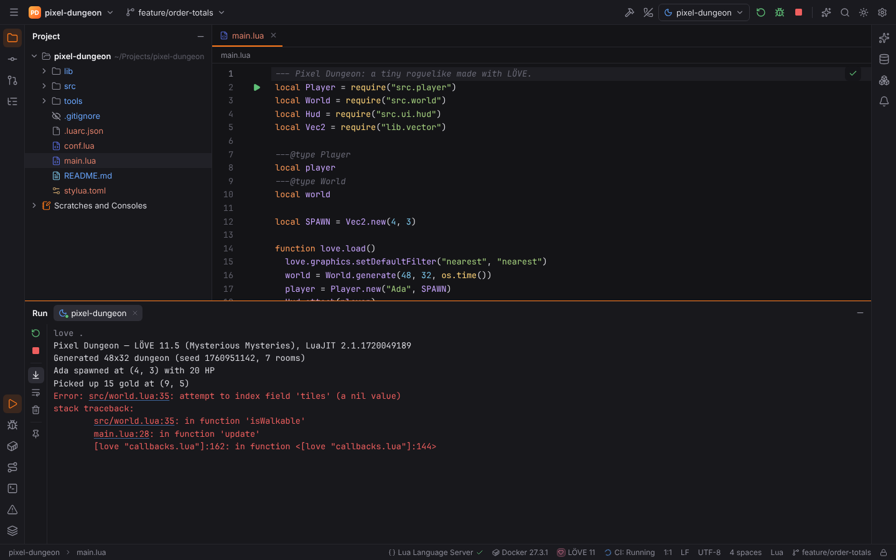
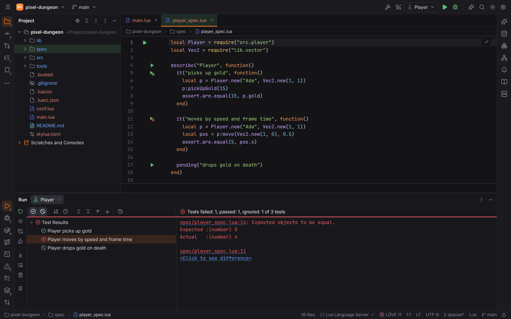
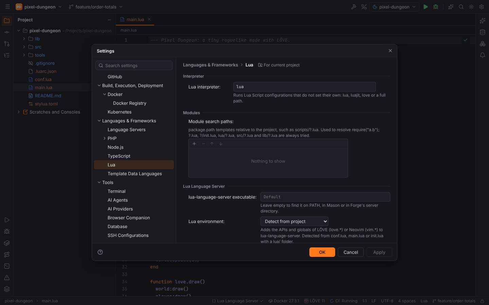

# LuaForge

**LuaForge** (plugin `forge.lua`) supports Lua 5.1–5.4 and LuaJIT, LÖVE games and Neovim
configurations and plugins. It activates in [Lua projects](../getting-started/project-detection.md):
Lua files in the root, two or more in a folder, `.luarc.json`, `.luacheckrc`, `stylua.toml`,
`selene.toml` or a `*.rockspec`. LÖVE is detected from `conf.lua` (or a `main.lua` using
`love.`), Neovim from `init.lua` next to `lua/`, or `lua/` + `plugin/`.

## The Lua index

Forge indexes every Lua file in Rust (also in [remote projects](remote-development.md)):
locals with their scopes, parameters, globals, table fields, functions and methods
(`function M.f`, `function M:f`, `M.f = function`), `require` calls and each module's `return`.
Doc comments (`---`) are parsed as EmmyLua/LuaLS annotations: `@class`, `@field`, `@param`,
`@return`, `@type`, `@alias` (with `---|` values), `@deprecated`, `@see`.

Types are followed across files: `---@class`, `---@type`, `---@param`, the `---@return` of
called functions (`Class.new()` without annotations returns the class), `setmetatable` and class
parents.

**Reindex Lua Files** (Find Action) rebuilds the index.

### Modules and `require`

`require("a.b")` is resolved through `package.path`-like templates, in this order:
Settings | Languages & Frameworks | Lua | **Module search paths** (`lua.requirePaths`, e.g.
`scripts/?.lua`), `runtime.path` from `.luarc.json`, then `?.lua`, `?/init.lua`, `lua/?.lua`,
`src/?.lua` and `lib/?.lua`.

## Navigation and search

- `Ctrl+B` / `Ctrl+Click` on a local, global, field, method or `require` string opens its
  declaration (tried before lua-language-server).
- **Go to Class** (`Ctrl+N`) finds `---@class` types, aliases and modules; **Go to Symbol**
  (`Ctrl+Alt+Shift+N`) finds functions and fields.
- **Structure** (`Alt+7`) shows the functions, tables and classes of the current file.

## Hover documentation

Hovering shows the signature and annotations of functions, classes and fields. When
lua-language-server runs and answers, its hover is shown instead.

## lua-language-server

lua-language-server comes from the [language server catalog](language-servers.md). Install it
with your package manager (`brew install lua-language-server`, `sudo pacman -S
lua-language-server`) or from its releases.

| Option (Settings | Languages & Frameworks | Lua) | Setting | Default |
| --- | --- | --- |
| Lua environment: `auto`, `plain`, `love`, `neovim` — adds the APIs of LÖVE (`love.*`) or Neovim (`vim.*`); `auto` detects them from the project | `langservers.lua.environment` | `auto` |
| Lua version (Lua 5.1–5.4, LuaJIT), used with plain Lua; LÖVE and Neovim run LuaJIT | `langservers.lua.version` | Lua 5.4 |
| lua-language-server executable (empty: PATH, Mason or Forge's server folder) | `langservers.servers.lua-language-server.path` | empty |
| Library paths (`workspace.library`), e.g. `~/.luarocks/share/lua/5.4` | `langservers.lua.libraries` | empty |

## StyLua

**Reformat Code** (`Ctrl+Alt+L`) formats Lua files with StyLua when it is installed; the
project's `stylua.toml` is honoured. Without one, StyLua gets the Lua
[code style](editor.md#code-style) (indent, hard wrap, quotes, call parentheses, simple
statements on one line) on its command line. Settings: **Reformat Code with StyLua**
(`lua.stylua.enabled`, on) and **StyLua executable** (`lua.stylua.path`, `stylua`). In a
[remote project](remote-development.md) StyLua runs on the host (install it there).

## Running Lua

Files with a main chunk get a ▶ icon in the gutter, and `Ctrl+Shift+F10` runs the current
file. Both create a **Lua Script** run configuration that runs
`<interpreter> <interpreter options> <file> <arguments>`. The interpreter defaults to
Settings | Languages & Frameworks | Lua | **Lua interpreter** (`lua.interpreter`, `lua`; e.g.
`luajit`, `love` or a full path). LÖVE games run as `love <dir>`.

## Tests with busted

LuaForge registers [busted](https://lunarmodules.github.io/busted/) on the shared
[test runner](testing.md): `*_spec.lua` files get ▶ gutter icons on every `describe` block and
`it` test, a **busted** run configuration type runs all specs, a directory, a spec file, one
test (by its full name, `--filter`) or a name pattern, and the results arrive as TAP
(`busted --output=TAP`) in the test tree with **Click to see difference** for failed
`assert.are.equal` comparisons. **Rerun Failed Tests** passes one `--filter` per failed test.
The executable is Settings | Languages & Frameworks | Lua | **busted executable**
(`lua.busted.path`, `busted`) unless the configuration sets its own.

**Run with Coverage** runs `busted --coverage`; with luacov's LCOV reporter in `.luacov`
(`runreport = true`, `reporter = "lcov"`) the report `luacov.report.out` is shown in the
[Coverage](coverage.md) tool window and the editor.

## Settings summary

See the [settings reference](../reference/settings.md#languages--frameworks--lua) for every key.
