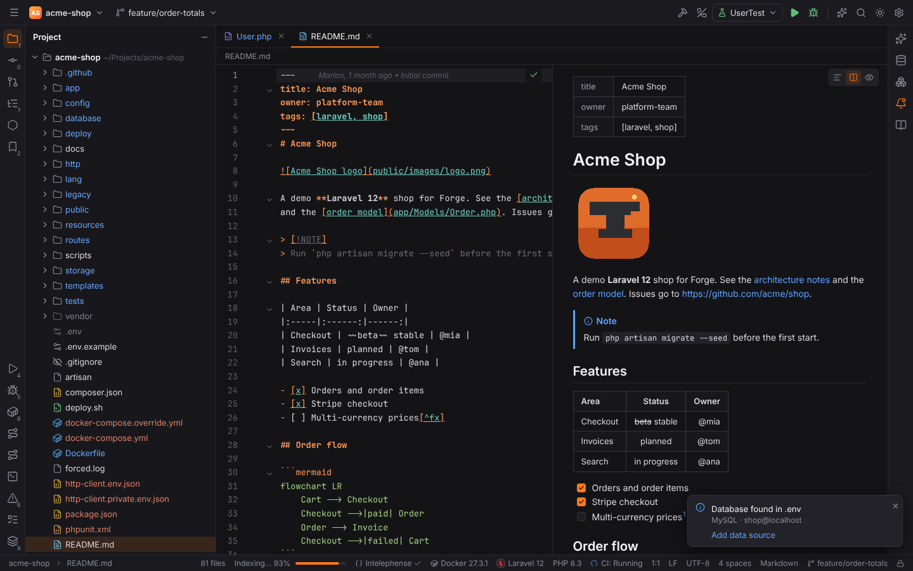
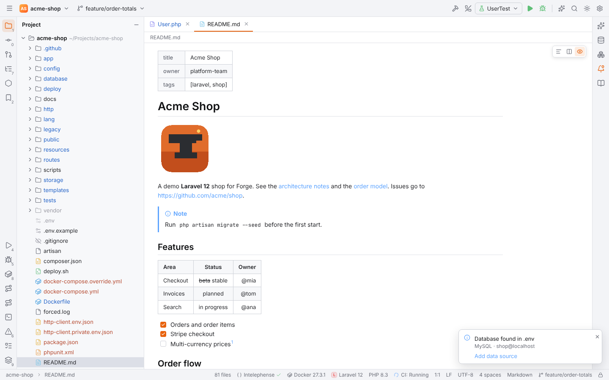
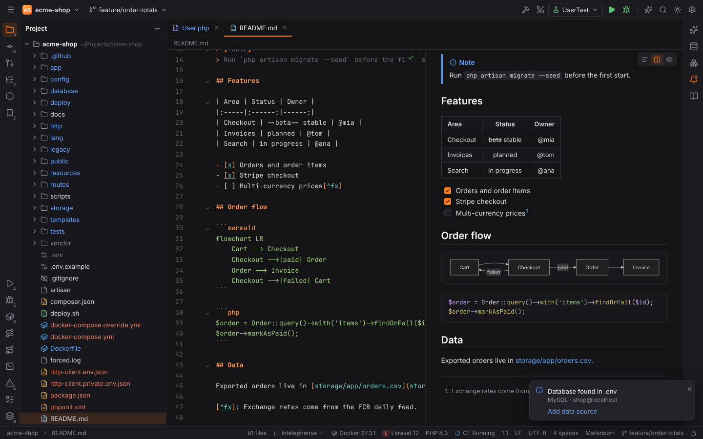
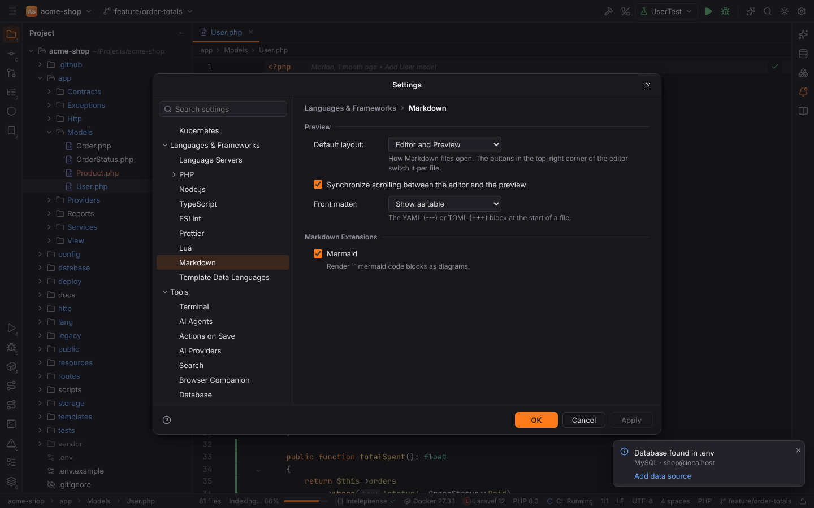
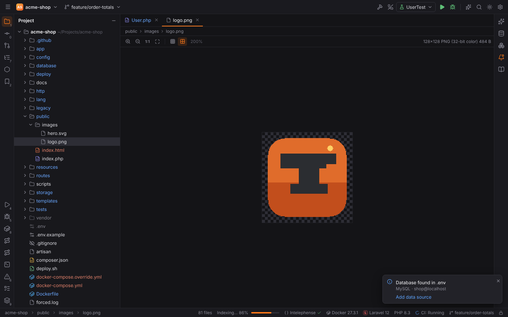
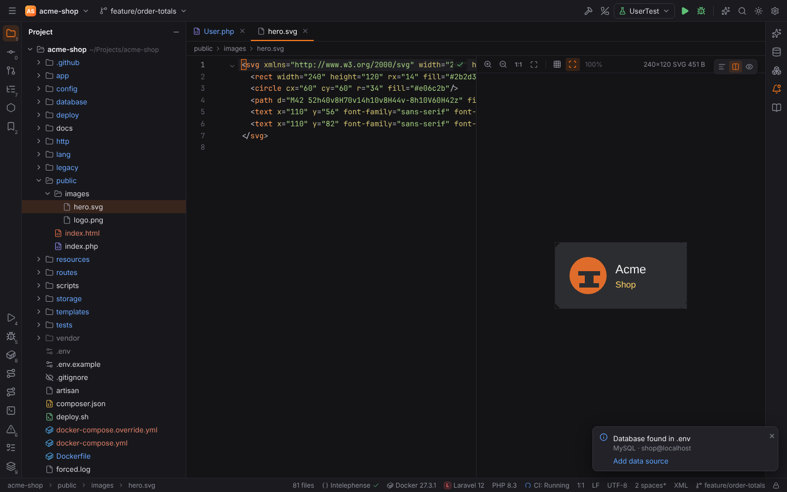
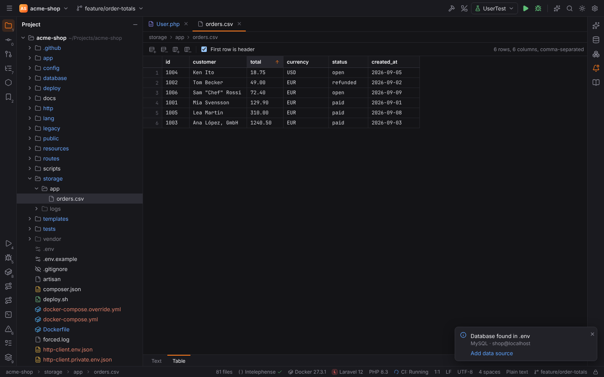

# Markdown, images and CSV

Some files open in an editor made for them, like in PHPStorm: Markdown files and SVG images
get a preview next to the text, raster images open in the image editor, and CSV/TSV files can
be edited as a table. All of them work in remote projects too: files and images are read
through the project backend.

## Markdown

`.md` and `.markdown` files open in the Markdown editor: the text on the left, the rendered
preview on the right.



### Layout

The three buttons in the top-right corner of the editor switch the layout of the file:

| Button | Action | Action id |
| --- | --- | --- |
| Editor Only | only the text | `TextEditorWithPreview.Layout.EditorOnly` |
| Editor and Preview | text and preview side by side; drag the divider to resize | `TextEditorWithPreview.Layout.EditorAndPreview` |
| Preview Only | only the preview | `TextEditorWithPreview.Layout.PreviewOnly` |

The actions have no default shortcut; find them with Find Action (`Ctrl+Shift+A`) or bind
keys in Settings | Keymap. The layout is remembered per file until Forge restarts; new files
open with the default layout from Settings | Languages & Frameworks | Markdown.



### What the preview shows

- **GitHub-flavored Markdown**: tables (with column alignment), task lists, strikethrough,
  footnotes (numbered in the order they are used, listed at the end), autolinks (`https://…`,
  `www.…` and e-mail addresses) and GitHub alerts (`> [!NOTE]`, `[!TIP]`, `[!IMPORTANT]`,
  `[!WARNING]`, `[!CAUTION]`).
- **Code blocks** with syntax colors for PHP, JavaScript, TypeScript, JSX/TSX, CSS, HTML,
  JSON, YAML, XML, Python and Rust (other languages get a simple highlighter).
- **Mermaid diagrams**: a ```` ```mermaid ```` block is drawn as a diagram (flowcharts,
  sequence, class, state, ER, Gantt, …). An invalid diagram shows Mermaid's error and the
  code. Turn it off in the settings to see the code instead.
- **Images**: relative paths (``, ``)
  are resolved against the Markdown file (`/…` against the project root) and loaded from the
  project; `https://` images are loaded from the web.
- **Front matter**: a YAML (`---`) or TOML (`+++`) block at the start of the file is shown as
  a table, or hidden (setting **Front matter**).
- **HTML in Markdown** is shown safely: ``, `<a href>`, `<br>`, `<b>`/`<strong>`,
  `<i>`/`<em>` and `<s>`/`<del>` are rendered, HTML comments and all other tags (scripts,
  styles, event handlers) are dropped and only their text is kept.

The preview updates while you type.

### Links

| Link | Click opens |
| --- | --- |
| `#getting-started` | scrolls the preview to that heading (GitHub-style anchors) |
| `docs/setup.md`, `../app/Models/User.php` | the project file in Forge |
| `docs/setup.md#install` | the Markdown file at that heading |
| `src/app.ts#L42` | the file at line 42 |
| `https://…`, `mailto:…` | the system browser or mail client |

### Synchronized scrolling

With **Editor and Preview**, scrolling the editor scrolls the preview to the same block and
scrolling the preview moves the editor to its source. Turn it off with **Synchronize scrolling
between the editor and the preview**.



### Settings

Settings | Languages & Frameworks | Markdown:

| Setting | Key | Default |
| --- | --- | --- |
| Default layout | `markdown.defaultLayout` | Editor and Preview |
| Synchronize scrolling between the editor and the preview | `markdown.syncScroll` | on |
| Front matter: Show as table / Hide | `markdown.frontMatter` | Show as table |
| Mermaid | `markdown.mermaid` | on |



## Images

PNG, JPEG, GIF, WebP, ICO and BMP files open in the image editor.



| Toolbar button | Action id | Windows / Linux | macOS |
| --- | --- | --- | --- |
| Zoom In | `Images.Editor.ZoomIn` | `Ctrl+=`, `Ctrl+NumPad+` | `Cmd+=`, `Cmd+NumPad+` |
| Zoom Out | `Images.Editor.ZoomOut` | `Ctrl+-`, `Ctrl+NumPad-` | `Cmd+-`, `Cmd+NumPad-` |
| Actual Size (1:1) | `Images.Editor.ActualSize` | `Ctrl+/`, `Ctrl+NumPad/` | `Cmd+/`, `Cmd+NumPad/` |
| Fit Zoom to Window | `Images.Editor.FitZoomToWindow` | | |
| Show Grid | `Images.Editor.ToggleGrid` | | |
| Show Chessboard | `Images.ToggleTransparencyChessboard` | | |

- `Ctrl` + mouse wheel zooms as well. Images open at 100%, or smaller when they do not fit.
- The **chessboard** shows transparent areas; the **grid** draws pixel lines from 300% zoom.
- The toolbar shows the zoom and the image info, for example
  `128x128 PNG (32-bit color) 484 B`. Format, size and colour depth are read from the file
  header in Rust.
- The editor reloads the image when the file changes on disk.

> **Note:** in a code editor `Ctrl+=`, `Ctrl+-` and `Ctrl+/` keep their editor meaning
> (Expand, Collapse, Comment with Line Comment); the image shortcuts apply while the image
> editor has focus.

### SVG

SVG files are text: they open in an editor with an image preview (the same toolbar), which
follows your typing. The layout buttons work as for Markdown; the default is set in
Settings | Editor | Image | **SVG files open with**.



Settings | Editor | Image:

| Setting | Key | Default |
| --- | --- | --- |
| Show chessboard | `images.showChessboard` | on |
| Show grid | `images.showGrid` | off |
| SVG files open with | `images.svgDefaultLayout` | Editor and Preview |

## CSV and TSV: Edit as Table

`.csv`, `.tsv` and `.tab` files have two tabs at the bottom of the editor: **Text** and
**Table**. The actions **Edit as Table** (`Csv.EditAsTable`) and **Edit as Text**
(`Csv.EditAsText`) switch them from Find Action or a shortcut you assign.



- The delimiter is detected: tab for `.tsv`/`.tab`, otherwise the most frequent of `,` `;`
  tab and `|` in the first line. The toolbar shows it with the row and column count.
- **First row is header** uses the first row as column titles (columns are named `C1`, `C2`,
  … otherwise).
- Click a column header to sort ascending, again for descending, a third time for the file
  order. Numbers sort by value, text case-insensitively, empty cells last. Sorting changes
  only the view, not the file.
- Double-click a cell, press `Enter` or `F2`, or just start typing to edit it; `Enter` saves
  and moves down, `Tab` moves right, `Escape` cancels.
- The toolbar and the context menu add rows (above/below) and columns (left/right) and delete
  the selected rows or columns.
- The table and the text are the same document: every table change is one undoable edit in
  the editor, `Ctrl+S` saves it. Cells you do not touch are written back exactly as they
  were: the delimiter, the quotes of quoted cells, the line separator and the final line break
  stay. New values are quoted only when they need it (delimiter, quote or line break inside).

Settings | Editor | CSV/TSV:

| Setting | Key | Default |
| --- | --- | --- |
| Open CSV/TSV files as: Text / Table | `csv.defaultView` | Text |
| First row is header | `csv.firstRowIsHeader` | on |
