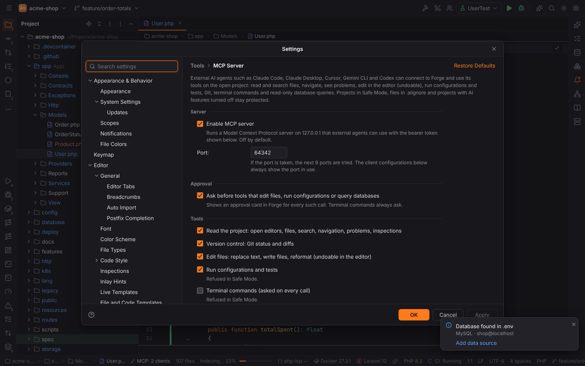
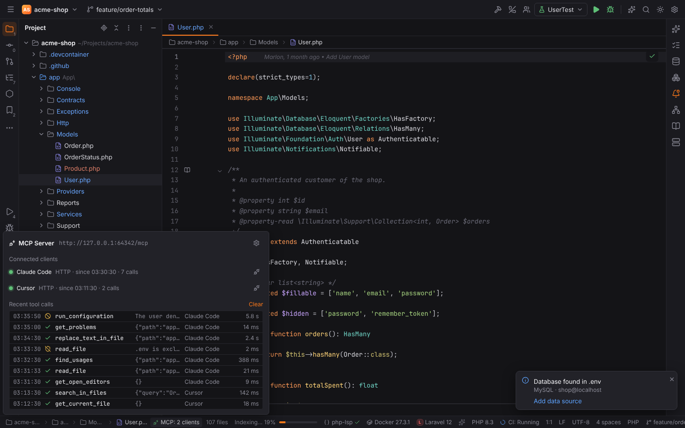
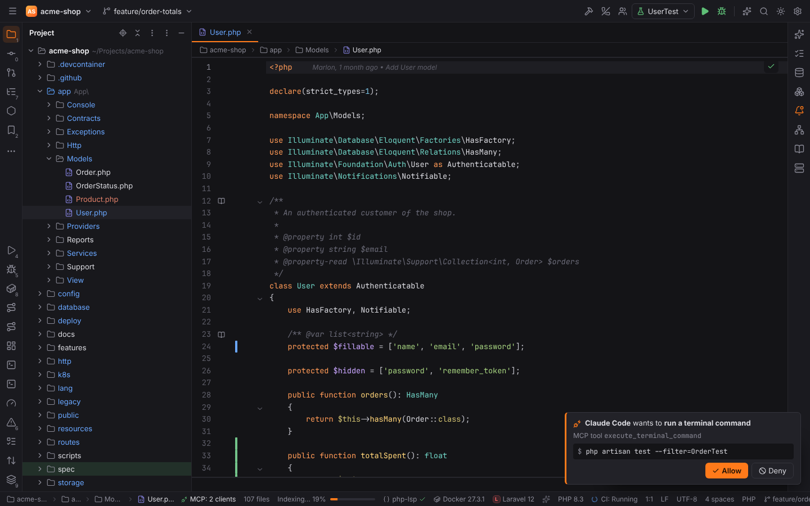

# MCP Server

Like JetBrains IDEs, Forge has a built-in [Model Context Protocol](https://modelcontextprotocol.io)
server (`forge.mcp-server`). External agents such as Claude Code, Claude Desktop, Cursor,
Gemini CLI or Codex connect to the running Forge and use its tools on the project open in it:
they see what you are looking at, search and navigate with Forge's indexes, read the problems
Forge shows, edit in the editor (so every change is undoable), run your run configurations and
tests, look at Git, and query your data sources read-only.

The server is **off by default**. Turn it on in Settings | Tools | MCP Server (`mcp.enabled`).

## Connecting a client

Settings | Tools | MCP Server shows the server's address and, under **Client Configuration**,
a ready-made configuration for each client. Pick the client and click **Copy**:

| Client | Transport | Where it goes |
| --- | --- | --- |
| Claude Code | Streamable HTTP | run the copied `claude mcp add --transport http forge http://127.0.0.1:64342/mcp --header "Authorization: Bearer …"` |
| Claude Desktop | stdio proxy | `claude_desktop_config.json` (Settings › Developer › Edit Config) |
| Cursor | Streamable HTTP | `~/.cursor/mcp.json` or `.cursor/mcp.json` |
| Gemini CLI | Streamable HTTP | `~/.gemini/settings.json` (`httpUrl` with the `Authorization` header) |
| Codex CLI | stdio proxy | `~/.codex/config.toml` |
| VS Code (Copilot) | Streamable HTTP | `.vscode/mcp.json` |

The server listens on `127.0.0.1` only, on port `64342` (`mcp.port`; when it is taken the next
9 ports are tried and the configurations show the port in use). Every request needs the
**bearer token** from the configuration. The token is kept in the system keychain, so copied
configurations keep working after a restart; **Regenerate Token** replaces it (connected
clients and old configurations stop working).

Clients that only start stdio servers run `forge --mcp-stdio`. This hidden mode of the `forge`
executable finds the running Forge through `<config dir>/forge/mcp-server.json` (port and
process id, no secrets) and forwards every message to it, with the token from the keychain or
the `FORGE_MCP_TOKEN` environment variable. When Forge is not running the proxy answers every
request with an error saying so, and connects as soon as Forge is back.

Older clients that still use the HTTP+SSE transport of protocol version 2024-11-05 can connect
to `http://127.0.0.1:64342/sse` with the same token.

## Tools

Paths are relative to the project root, lines and columns are 1-based.

| Group (setting) | Tools |
| --- | --- |
| Read the project (`mcp.tools.read`) | `get_open_editors`, `get_current_file` (caret, selection, optionally the unsaved text), `open_file_in_editor`, `read_file` (optionally a line range), `list_directory`, `find_files` (like Go to File), `search_in_files` (Find in Files with regex, case, whole words, file masks, directory), `find_symbol` (Go to Symbol / Class), `go_to_definition`, `find_usages`, `get_problems` (what the editor and the Problems tool window show), `run_inspections` (the project's inspection profile on a file or folder), `list_run_configurations` |
| Version control (`mcp.tools.vcs`) | `git_status`, `git_diff` (working tree or staged, optionally for some paths) |
| Edit files (`mcp.tools.edit`) | `replace_text_in_file`, `write_file`, `reformat_file` (Reformat Code with the project's code style) |
| Run configurations and tests (`mcp.tools.run`) | `run_configuration`: runs it in the Run tool window and waits: exit code, test results with the failed tests, the end of the console |
| Terminal commands (`mcp.tools.terminal`, off by default) | `execute_terminal_command` in the project root, with exit code and output |
| Databases (`mcp.tools.database`) | `list_data_sources`, `run_sql_query` (read-only) |

Edits are made **in Forge's editor**: the file opens, the change is one undo step and the file
is saved. `Ctrl+Z` (macOS `Cmd+Z`) in Forge reverts it, and Local History has it too.

The server also offers **resources** (the open editors as `forge://project/<path>`, any project
file through the `forge://project/{path}` template) and three **prompts**: `review_changes`,
`fix_problems` and `explain_selection`.

## Approval and safety

- **Approval cards.** With **Ask before tools that edit files, run configurations or query
  databases** (`mcp.requireApproval`, on by default), every such call shows a card above the
  status bar: which client, what it wants to do ("edit app/Models/Order.php", the command, the
  query, the replaced text) and **Allow**, **Allow for This Session** (that tool, until the
  client disconnects) or **Deny**. A card nobody answers within two minutes is denied.
  Terminal commands always ask, on every call, whatever the setting says.
- **Tool groups.** Each group can be turned off; its tools then disappear from the client's
  tool list and calls are refused.
- **Safe Mode.** In a project you have not trusted, run configurations and terminal commands
  are refused before anything is asked. Reading and editing still work.
- **AI switch and `.aiignore`.** When AI features are turned off for the project
  (`ai.enabled`, Settings | Tools | AI Assistant) every call is refused. Files matched by
  `.aiignore` or `.aiexclude` cannot be read, searched or edited, and they are left out of
  listings and search results (the result says how many were left out). Paths outside the
  project are refused.
- **Databases.** `run_sql_query` only runs read-only statements (`SELECT`, `SHOW`, `EXPLAIN`,
  …); writes and schema changes are refused before they reach the database, and the data
  source's own read-only and production guards still apply.
- **Loopback only.** The server binds `127.0.0.1`, refuses requests whose `Host` is not a
  loopback name (against DNS rebinding) and requests with a foreign `Origin` (web pages), and
  compares the token in constant time.

## Status bar and call log

While the server is on, the status bar shows **MCP** and the connected client
("MCP: Claude Code", "MCP: 2 clients"). Clicking it shows the connected clients (with
**Disconnect**), the latest tool calls with their result (done, failed, refused by the
settings, denied by you) and duration, and a link to the settings. The full call log is at the
bottom of Settings | Tools | MCP Server. Find Action: **Show MCP Server Calls**,
**MCP Server Settings**.

## Settings

| Setting | Default | Meaning |
| --- | --- | --- |
| `mcp.enabled` | `false` | run the server |
| `mcp.port` | `64342` | first port tried |
| `mcp.requireApproval` | `true` | approval cards for edit, run and database tools |
| `mcp.tools.read`, `mcp.tools.vcs`, `mcp.tools.edit`, `mcp.tools.run`, `mcp.tools.database` | `true` | tool groups |
| `mcp.tools.terminal` | `false` | terminal commands |

Only the first project window runs the server; the tools work on the project open in it. See
the [settings reference](../reference/settings.md#tools--mcp-server) and, for developers, the
[forge-mcp crate](../developer/crates/forge-mcp.md).
