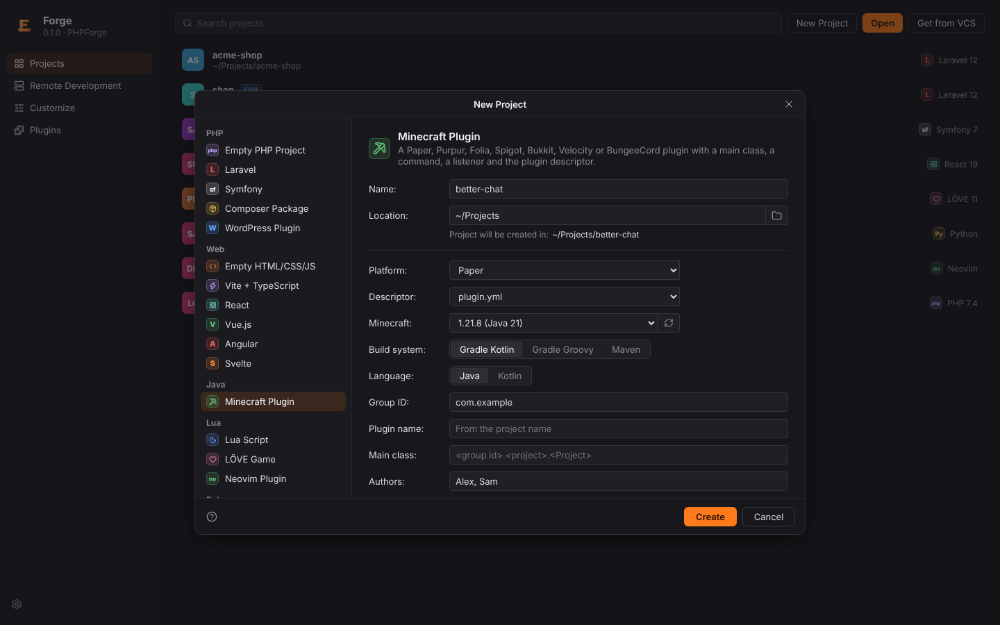
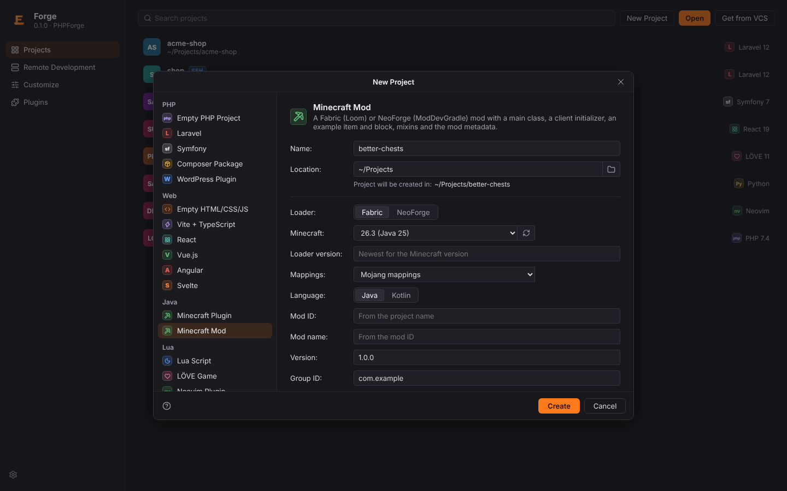
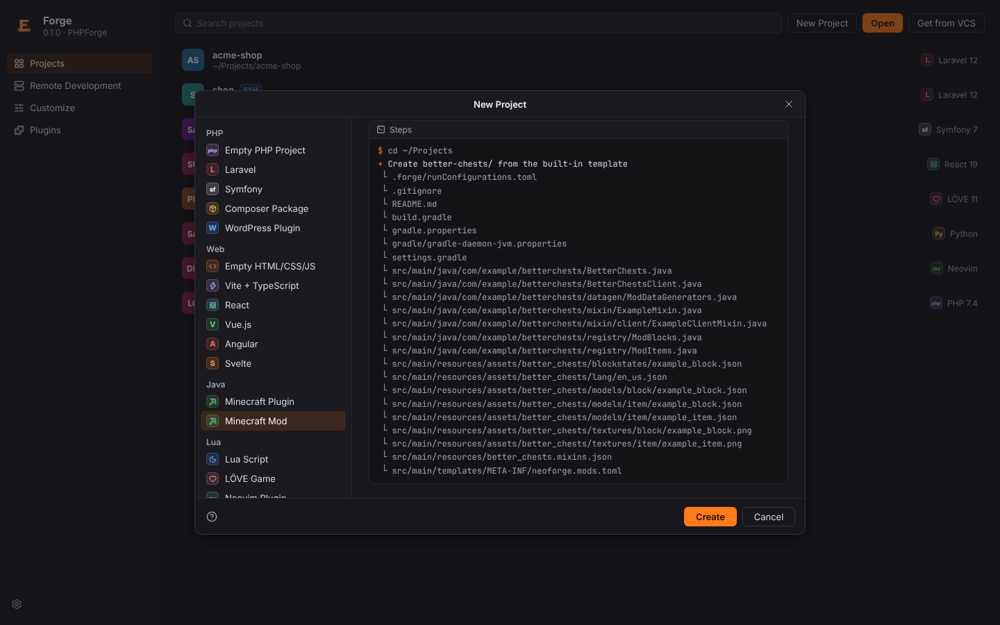
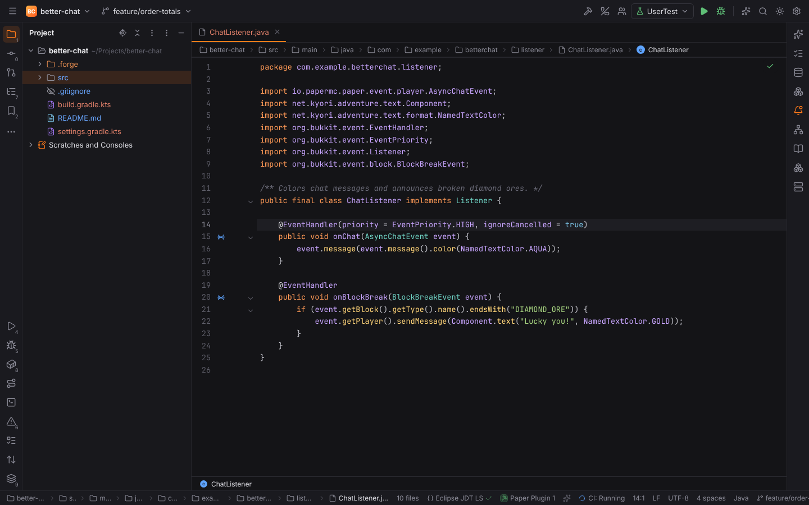
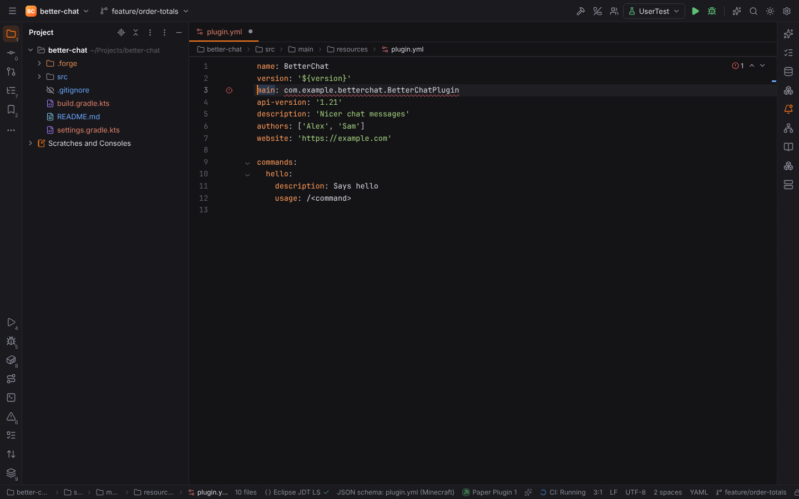

# Minecraft plugins and mods

The **Minecraft Development** plugin (`forge.minecraft`, JavaForge pack) helps you write
server and proxy plugins and Fabric and NeoForge mods for Minecraft, in the style of
IntelliJ's Minecraft Development plugin. It builds on [JavaForge](java.md) (Gradle, Maven, JDKs, Eclipse JDT LS) and
[KotlinForge](kotlin.md) for Kotlin sources.

## New Project: Minecraft Plugin

**File | New Project** (`NewProject`) lists **Minecraft Plugin** in the **Java** group. It
creates the project offline, from Forge's own templates: nothing is downloaded while the
project is created.

| Option | |
| --- | --- |
| Platform | Paper, Purpur, Folia, Spigot, Bukkit (servers); Velocity, BungeeCord / Waterfall (proxies) |
| Descriptor | `plugin.yml` or `paper-plugin.yml` (Paper, Purpur and Folia; Minecraft 1.20.6 and newer) |
| Minecraft | The server version the plugin targets (servers only). Each version shows the Java release it needs |
| Build system | Gradle Kotlin DSL (default), Gradle Groovy DSL or Maven |
| Language | Java or Kotlin (Gradle builds) |
| Group ID | The Maven group and the base package, `com.example` |
| Plugin name | Empty: the main class name derived from the project name (`better-chat` → `BetterChat`) |
| Main class | Empty: `<group id>.<project>.<Project>`, e.g. `com.example.betterchat.BetterChat` |
| Authors, Description, Website | Written into the descriptor (authors are comma-separated) |
| API version | `api-version` of the descriptor; empty: the Minecraft version's (`1.21`) |
| Run Paper server (run-paper) | Applies [run-paper](https://github.com/jpenilla/run-gradle) (`runServer`) and adds the **Run Paper Server** configuration (Gradle builds, servers) |
| Shadow jar | Bundles libraries into the plugin jar (Gradle Shadow, Maven Shade); always on for Kotlin, which bundles its standard library |
| Create Git repository | `git init` |

Options that do not apply to the chosen platform or build are hidden (a proxy has no
Minecraft version or run-paper, Maven has no Kotlin). The preview under the form lists the
files that will be written; problems with the group ID, main class, plugin name or versions
show under the form before you create the project.

The project contains:

- the build: `build.gradle.kts` + `settings.gradle.kts`, `build.gradle` + `settings.gradle`, or
  `pom.xml`, with the platform's repository, its API as a `compileOnly` / `provided`
  dependency, the Java release as toolchain and compiler release, and resource filtering that
  writes the project version into the descriptor (`${version}`, Maven `${project.version}`);
  Gradle settings apply the foojay toolchain resolver;
- the descriptor in `src/main/resources`: `plugin.yml` (with the `/hello` command),
  `paper-plugin.yml`, `velocity-plugin.json` or `bungee.yml`; Folia plugins declare
  `folia-supported: true`;
- the main class with `onEnable` / `onDisable` (Velocity: `ProxyInitializeEvent` /
  `ProxyShutdownEvent` with constructor injection), a `/hello` command (Bukkit
  `CommandExecutor`, Paper's Brigadier `BasicCommand` registered through the lifecycle API for
  `paper-plugin.yml`, Velocity `SimpleCommand`, BungeeCord `Command`) and a join listener; Paper
  and proxies use Adventure components, Spigot and Bukkit `ChatColor`;
- `.gitignore` (`build/`, `target/`, `.gradle/`, run-paper's `run/`) and a README;
- with run-paper, `.forge/runConfigurations.toml` with the shared **Run Paper Server**
  configuration.

Gradle projects have no wrapper yet, since the wrapper jar is a binary Forge does not ship: run
`gradle wrapper` once with an installed Gradle (see [Gradle settings and the wrapper](java.md#gradle-settings-and-the-wrapper)).

### Platforms and versions

Forge keeps a pinned table of Minecraft versions (1.16.5 to 1.21.11, then 26.1.1, 26.1.2,
26.2 and 26.3; the default is 1.21.11), the Java release each one needs (1.16.5: 8, 1.17: 16,
1.18 to 1.20.4: 17, 1.20.5 to 1.21.11: 21, 26.x: 25) and each platform's dependency:

| Platform | Repository | Dependency |
| --- | --- | --- |
| Paper, Folia | `https://repo.papermc.io/repository/maven-public/` | `io.papermc.paper:paper-api:<version>-R0.1-SNAPSHOT` up to 1.21.11 (1.16.5: `com.destroystokyo.paper:paper-api`); from 26.1 `<version>.build.<n>-stable` |
| Purpur (1.18+) | Paper's and `https://repo.purpurmc.org/snapshots` | `org.purpurmc.purpur:purpur-api:<version>-R0.1-SNAPSHOT`; from 26.1 `<version>.build.<n>-stable` |
| Spigot | `https://hub.spigotmc.org/nexus/content/repositories/snapshots/` | `org.spigotmc:spigot-api:<version>-R0.1-SNAPSHOT` |
| Bukkit | the Spigot repository | `org.bukkit:bukkit:<version>-R0.1-SNAPSHOT` up to 1.20.5; newer versions have no Bukkit artifact, so they use `spigot-api` (a superset; the generated code only uses the Bukkit API) |
| Velocity | Paper's | `com.velocitypowered:velocity-api:4.3.1` (Java 25: Velocity 4.x is built for it) |
| BungeeCord / Waterfall | Maven Central | `net.md-5:bungeecord-api:1.21-R0.4` (Java 17) |

From Minecraft 26.1 on, Paper and Purpur publish their API with build numbers
(`26.3.build.240-stable`), so the dependency cannot be derived from the Minecraft version.
The table pins a build for 26.3 (Paper `26.3.build.240-stable`, Purpur
`26.3.build.2655-stable`). For other 26.x versions, Gradle builds use the dynamic version
`<version>.build.+` (the newest build, including pre-release builds when no stable one
exists), and Maven builds need **Refresh** first, which fills in the newest stable build.

Folia plugins compile against the Paper API, which contains Folia's region, entity and global
schedulers; Folia (1.20+) only loads plugins that declare `folia-supported: true`.

The **Refresh** button next to **Minecraft** (the version) reads `maven-metadata.xml` of
paper-api from `repo.papermc.io` and of purpur-api from `repo.purpurmc.org`: it adds the
release versions the table does not have yet and the newest stable Paper and Purpur builds
of each 26.x version. It only runs when you click it, and the result is cached in the user
cache directory (`<cache>/forge/minecraft/versions.json`), never in a project. New versions
get their coordinates and Java release from the same rules.

Pinned values that go out of date over time (refresh to update the Paper / Purpur builds;
the rest changes with Forge releases): the 26.3 builds above, Velocity 4.3.1, BungeeCord
1.21-R0.4, and the build plugins of generated projects: run-paper 3.1.0, Shadow
(`com.gradleup.shadow`) 9.6.1, Kotlin 2.4.21 and the foojay toolchain resolver 1.0.0.

Generated Gradle builds need Gradle 9 or newer (Shadow 9 does not load on Gradle 8). Their
`settings.gradle(.kts)` applies the foojay toolchain resolver, so Gradle downloads the JDK of
the project's Java release (for example 25 for Minecraft 26.x) when it is not installed.
Paper 1.21.11 (Java, run-paper, Shadow), Paper 26.3 (Kotlin), Folia 26.3 with
`paper-plugin.yml`, Purpur 26.2 (Groovy DSL, dynamic build), Velocity 4.3.1, BungeeCord
(Kotlin) with Gradle 9.8.2 and Spigot 26.3 with Maven were built from generated projects.

## New Project: Minecraft Mod

**File | New Project** lists **Minecraft Mod** in the **Java** group, next to Minecraft Plugin.
Like the plugin wizard it works offline: the files come from Forge's own templates and its
pinned version table.

| Option | |
| --- | --- |
| Loader | **Fabric** (Fabric Loom, Fabric API) or **NeoForge** (ModDevGradle) |
| Minecraft | The game version. Each version shows the Java release it needs; **Refresh** reads newer ones (see below) |
| Loader version | Empty: the newest Fabric Loader or NeoForge version known for the Minecraft version. A NeoForge version must belong to the Minecraft version (`21.1.265` is 1.21.1, `26.3.0.101` is 26.3) |
| Mappings | Fabric: **Mojang mappings** (`loom.officialMojangMappings()`) or **Yarn**; NeoForge: **Parchment** (Mojang's names plus parameter names) or **Official (Mojang)**. Only for Minecraft 1.21.x: from 26.1 on the game ships without obfuscation, so mods use Mojang's names directly and there are no mappings to choose |
| Language | Java or Kotlin (Fabric, with Fabric Language Kotlin) |
| Mod ID | Empty: from the project name (`better-chests` → `better_chests`); 2 to 64 lowercase letters, digits and `_`, starting with a letter |
| Mod name, Version, Group ID, Authors, Description, License | Written into the metadata; the package is `<group id>.<mod id without _>`, the main class the mod id in PascalCase (`com.example.betterchests.BetterChests`) |
| Entrypoints | **Client and server** (the main class and a client initializer), **Client only** or **Server only** (a dedicated server initializer); sets Fabric's `environment` or NeoForge's `displayTest` |
| Mixins | A mixin configuration with an example mixin (and a client mixin) |
| Data generation | A data generator (Fabric API's `fabric-datagen` entrypoint, NeoForge's `GatherDataEvent`) and its run configuration |
| Create Git repository | `git init` |

The project contains:

- `settings.gradle` (the Fabric Maven repository for Loom; the foojay toolchain resolver),
  `build.gradle` and `gradle.properties` with the versions (`minecraft_version`,
  `loader_version`, `loom_version`, `fabric_api_version`, `yarn_mappings` or `neo_version`,
  `parchment_*`). Fabric 26.x builds apply `net.fabricmc.fabric-loom` and depend on the loader
  and Fabric API with `implementation`; 1.21.x builds apply the remapping `fabric-loom` with
  `mappings` and `modImplementation`. Fabric splits client code into `src/client`
  (`splitEnvironmentSourceSets()`). NeoForge builds apply `net.neoforged.moddev` with the
  `client`, `server` (and `data`) runs;
- `gradle/gradle-daemon-jvm.properties`: Loom 1.19 only runs on Java 25, so Gradle's daemon
  runs on a JDK 25, which Gradle downloads when none is installed (also for 1.21.x mods, whose
  code is still compiled for Java 21 through the toolchain);
- `src/main/resources/fabric.mod.json` (entrypoints, mixins, `depends` on Fabric Loader,
  `~<minecraft>`, Java and Fabric API) or `src/main/templates/META-INF/neoforge.mods.toml`
  (Gradle fills in the versions from `gradle.properties`);
- the main class (`ModInitializer`, or `@Mod` with the mod event bus), the client initializer
  (`ClientModInitializer`, or `@Mod(dist = Dist.CLIENT)`), `registry/ModItems` and
  `registry/ModBlocks` with an example item and block (NeoForge: `DeferredRegister`, added to
  the creative tabs), mixins in the `mixin` package, the data generator;
- assets: `lang/en_us.json`, the item and block models, the blockstate, item model
  definitions (`items/`, 1.21.4 and newer), 16×16 placeholder textures and, for Fabric, the
  mod icon (PNGs drawn by Forge, colored by the mod ID);
- `.gitignore`, a README and `.forge/runConfigurations.toml` with the shared **Minecraft
  Client** (`runClient`), **Minecraft Server** (`runServer`) and, with data generation, **Data
  Generation** (`runDatagen` / `runData`) Gradle configurations.

Like every run of project code, the run configurations are refused in
[Safe Mode](project-trust.md) until you trust the project. Accept the Minecraft EULA in
`run/eula.txt` before the first `runServer`.

### Mod versions

The pinned table covers Minecraft 1.21.1, 1.21.4, 1.21.8, 1.21.10, 1.21.11, 26.1.2, 26.2 and
26.3 (the default), checked on 2026-11-04:

| Minecraft | Java | Fabric API | Yarn | NeoForge | Parchment |
| --- | --- | --- | --- | --- | --- |
| 26.3 | 25 | 0.165.2+26.3 | — | 26.3.0.101 | — |
| 26.2 | 25 | 0.161.0+26.2 | — | 26.2.0.93 | — |
| 26.1.2 | 25 | 0.155.3+26.1.2 | — | 26.1.2.126 | — |
| 1.21.11 | 21 | 0.141.6+1.21.11 | 1.21.11+build.6 | 21.11.48 | 2025.12.20 |
| 1.21.10 | 21 | 0.138.4+1.21.10 | 1.21.10+build.3 | 21.10.64 | 2025.10.12 |
| 1.21.8 | 21 | 0.136.1+1.21.8 | 1.21.8+build.1 | 21.8.57 | 2025.09.14 |
| 1.21.4 | 21 | 0.119.4+1.21.4 | 1.21.4+build.8 | 21.4.161 | 2025.03.23 |
| 1.21.1 | 21 | 0.116.17+1.21.1 | 1.21.1+build.3 | 21.1.265 | 2024.11.17 |

Fabric Loader 0.20.1, Loom 1.19.3, ModDevGradle 2.0.148, Fabric Language Kotlin
1.14.2+kotlin.2.4.21. NeoForge names its versions after the game: `21.1.x` is Minecraft
1.21.1, `21.11.x` is 1.21.11, and from 26.1 on `<year>.<drop>.<hotfix>.<build>`
(`26.3.0.101` is 26.3, `26.1.2.126` is 26.1.2). Fabric API appends the game version
(`0.165.2+26.3`); Yarn stops at 1.21.11.

**Refresh** next to **Minecraft** in the mod wizard reads, only when you click it, Fabric's
meta API (`https://meta.fabricmc.net/v2/versions/loader`, `/game`, `/yarn`), the
`maven-metadata.xml` of Fabric API and Loom on `maven.fabricmc.net`, and of NeoForge
(`https://maven.neoforged.net/releases/net/neoforged/neoforge/maven-metadata.xml`) and
ModDevGradle on `maven.neoforged.net`. It adds the stable Minecraft releases a loader
supports, the newest Fabric API, Yarn and NeoForge version of each (a stable NeoForge version
wins over a newer beta), and newer Fabric Loader, Loom and ModDevGradle versions. The result
is cached with the plugin versions in `<cache>/forge/minecraft/versions.json`.

Generated Fabric (Java and Kotlin, 26.3; Java with Yarn, 1.21.11) and NeoForge (Java, 26.3)
mods were built with Gradle 9.8.2.

## Minecraft plugin and mod projects

A project is a Minecraft plugin when its build (`build.gradle(.kts)`, `pom.xml`,
`gradle/libs.versions.toml`) depends on `paper-api`, `purpur-api`, `folia-api`, `spigot-api`,
`org.bukkit:bukkit`, `velocity-api`, `bungeecord-api` or `waterfall-api`, or uses paperweight's
`paperDevBundle`. The status bar shows the platform and the Minecraft version, for example
**Paper Plugin 1.21.8**, and the plugin activates (see
[project detection](../getting-started/project-detection.md)). A Gradle build that applies
Fabric Loom (`fabric-loom`, `net.fabricmc.fabric-loom`), Quilt Loom, NeoForge's ModDevGradle
(`net.neoforged.moddev`) or NeoGradle, or ForgeGradle is a mod: **Fabric Mod 26.3**,
**NeoForge Mod 1.21.1**, with the version from `minecraft_version` in `gradle.properties`.

### Plugin descriptors

`plugin.yml`, `paper-plugin.yml`, `velocity-plugin.json` and `bungee.yml` in
`src/main/resources` get completion, documentation on hover and validation from schemas
bundled with Forge (see [JSON Schema](json-schema.md)): the keys of each format, `load`,
`api-version`, commands with aliases, usage and permissions, permission defaults and
children, `paper-plugin.yml` dependencies (`load: BEFORE | AFTER | OMIT`, `required`,
`join-classpath`), Velocity's plugin id pattern.

The `main` class is checked against the module's sources (`src/main/java`, `src/main/kotlin`):
an invalid class name or a class that does not exist is an error. **Go to Declaration**
(`Ctrl+B`, `Ctrl+Click`) on the value opens the class.

### Mod metadata

`fabric.mod.json` and mixin configurations (`*.mixins.json`) get completion, documentation on
hover and validation from schemas bundled with Forge: the entrypoint kinds (`main`, `client`,
`server`, `fabric-datagen`, …), `environment`, `depends` and the other dependency maps,
authors and contact, `mixins` entries; in mixin configurations `package`,
`compatibilityLevel`, the `mixins` / `client` / `server` lists, `injectors` and `overwrites`.

The classes they name are checked against the module's sources (`src/main`, `src/client` and
`src/server`, Java or Kotlin): an entrypoint (`pkg.Class` or `pkg.Class::field`, also
`{ "adapter": "kotlin", "value": … }`) or a mixin (`package` + entry) that does not exist is
an error, a mixin configuration listed in `fabric.mod.json` that is missing in the resources a
warning. **Go to Declaration** (`Ctrl+B`, `Ctrl+Click`) opens the class or the configuration.

In `neoforge.mods.toml` (and Forge's `mods.toml`), completion offers the keys of the table the
cursor is in (the root, `[[mods]]`, `[[dependencies.<modid>]]`, `[[mixins]]`,
`[[accessTransformers]]`, `[features.<modid>]`) that it does not have yet, with what each one
means, the values of `type`, `ordering`, `side`, `displayTest` and `modLoader`, and the table
headers after `[`.

### Run Paper Server

Projects that apply run-paper run their plugin on a real server with the **Run Paper Server**
configuration: a Gradle configuration with the `runServer` task, which builds the plugin,
downloads Paper of the configured version into Gradle's cache and starts it in `run/` with the
plugin installed. Start it from the toolbar, **Tools | Minecraft | Run Paper Server**, Find
Action, or the ▶ gutter icon on the plugin's main class. Generated projects have it as a
shared configuration; in other projects Forge creates a temporary one.

Like every run of project code, Run Paper Server is refused in
[Safe Mode](project-trust.md) until you trust the project. Accept the Minecraft EULA in
`run/eula.txt` on the first start.

### Gutter icons

Methods annotated with `@EventHandler` (Bukkit, Paper, Spigot, BungeeCord), `@Subscribe`
(Velocity) or `@SubscribeEvent` (NeoForge) show an icon with the event they listen to ("Listens to PlayerJoinEvent"). Turn
the icons off in Settings | Languages & Frameworks | Java | **Minecraft** (**Show gutter
icons**).

## Browser mode

`?project=minecraft` opens `better-chat`, a Paper plugin as the wizard generates it plus a
chat listener. The descriptor check, Go to Declaration, the gutter icons and the wizard's
files run in Rust through WebAssembly; **Refresh** answers with canned versions. The Minecraft
Mod wizard plans its files the same way.
