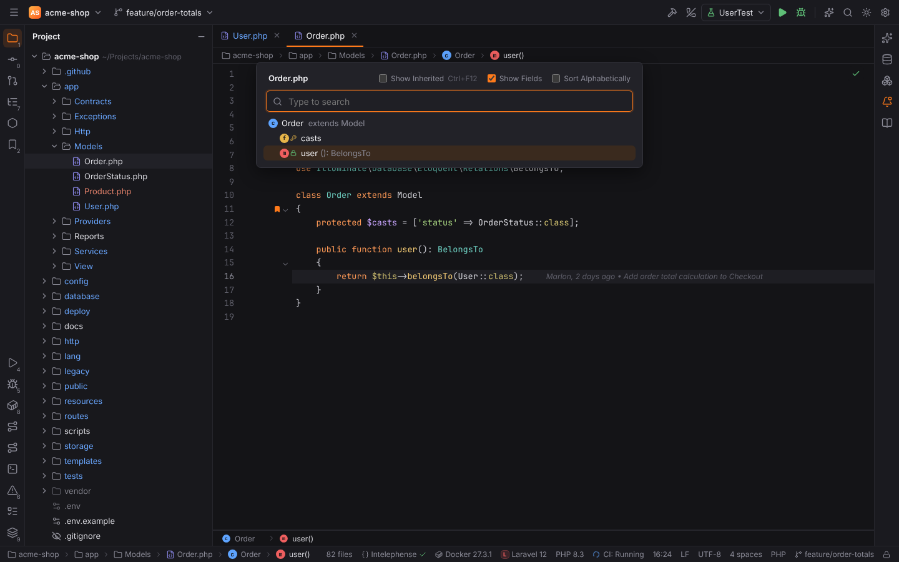
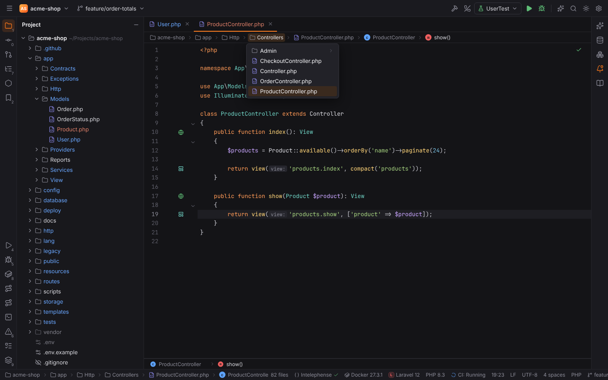
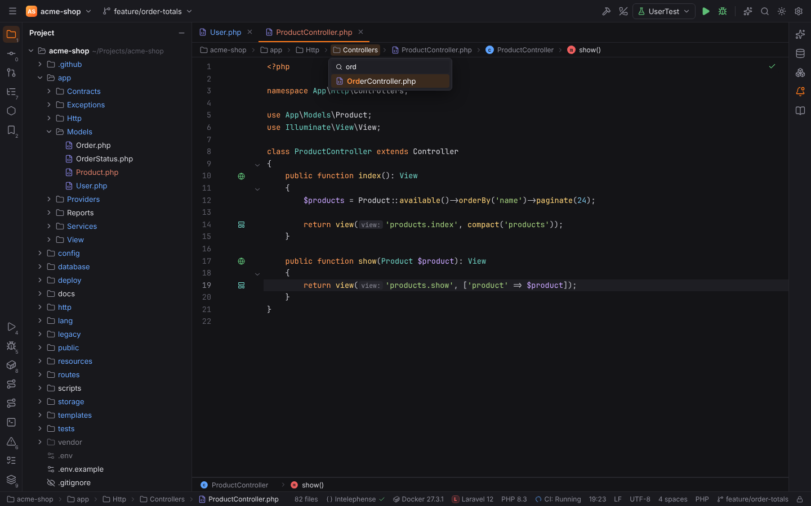
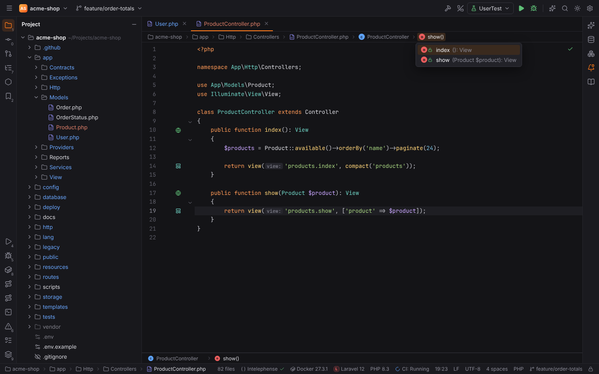
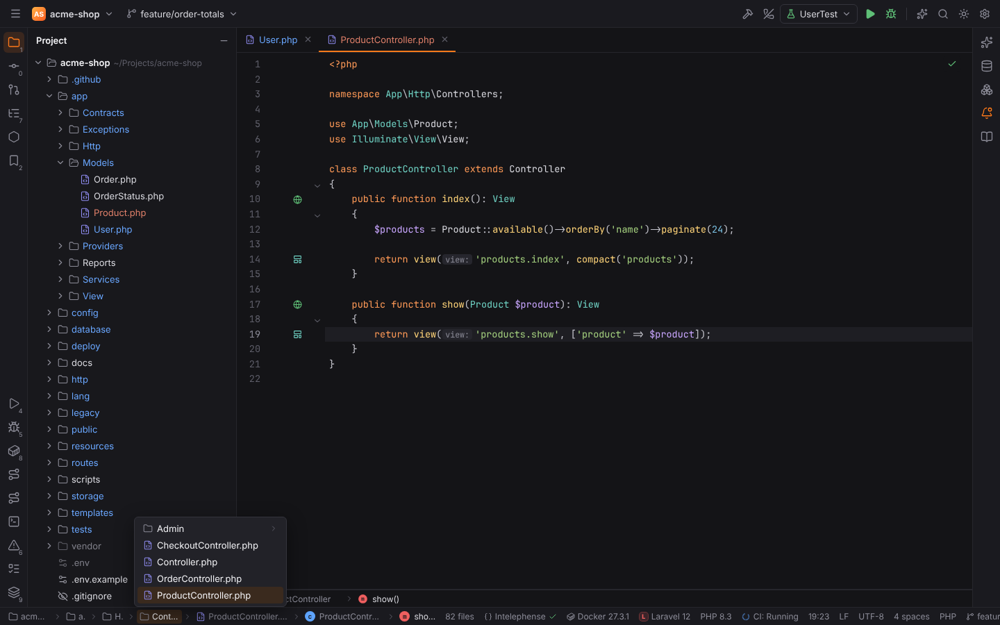
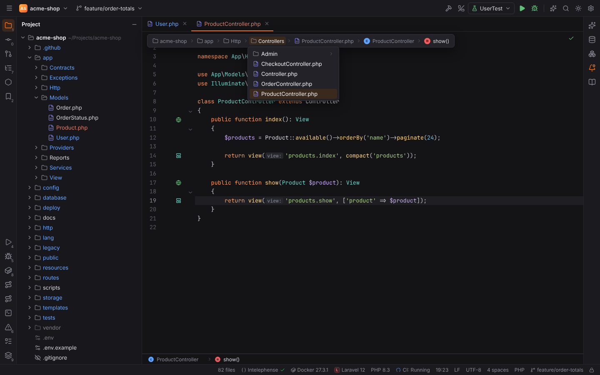
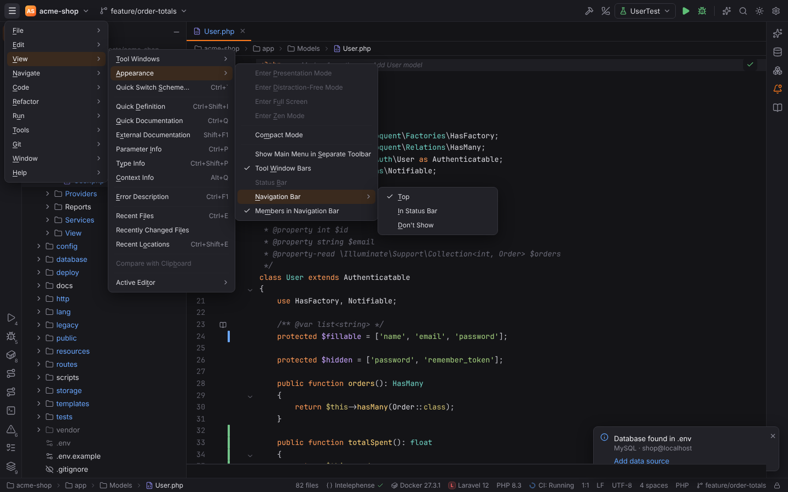
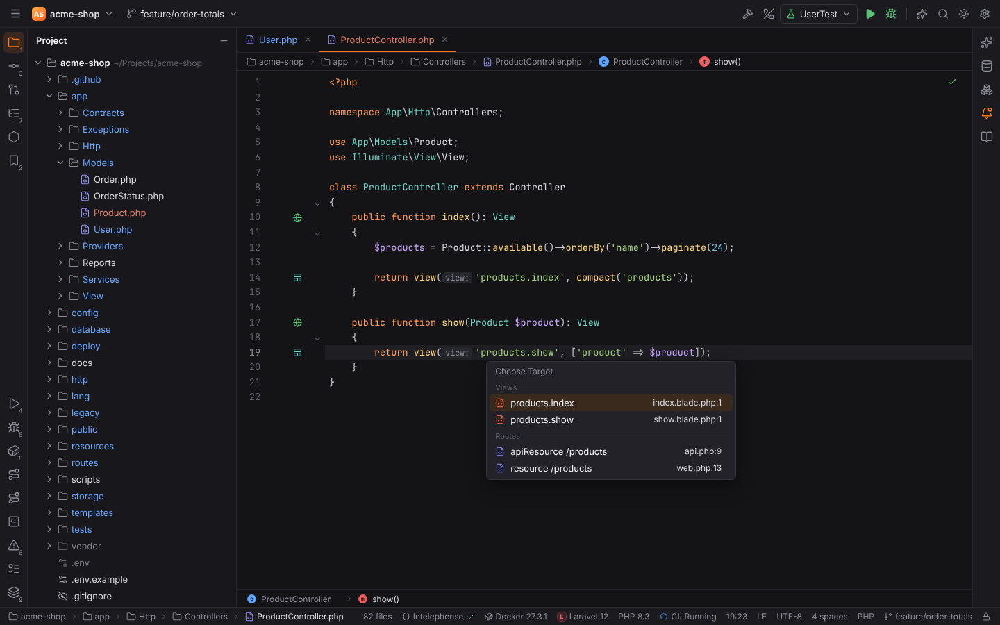
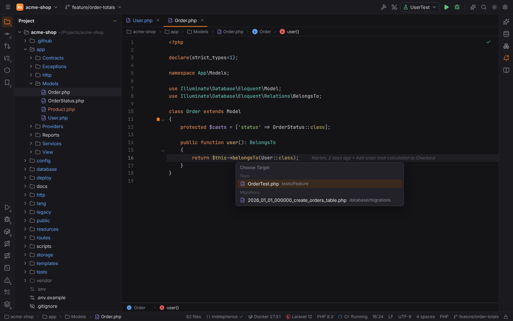

# File Structure, Navigation Bar and Related Symbol

Three of PHPStorm's navigation helpers, with the same shortcuts and wording. All three work
for PHP, Laravel, Symfony, Lua, HTML, CSS, JavaScript, TypeScript and Vue files, and in
remote projects.

## File Structure popup

**Navigate | File Structure** (`Ctrl+F12`, macOS `Cmd+F12`) shows the structure of the
current file as a tree: namespaces, classes, interfaces, traits and enums with their
constants, properties and methods (signatures, visibility and static/abstract badges as in
the [Structure tool window](php.md#structure)), functions, Lua tables and modules, CSS rules, HTML
elements and custom folding regions. The member at the caret is selected when it opens.

- **Type to search**: the tree keeps the matching members and their classes; matched
  characters are highlighted and the best match is selected. Matching is fuzzy with camel
  humps, as in [Search Everywhere](search-everywhere.md#fuzzy-matching).
- `Up` / `Down`, `PageUp` / `PageDown` move the selection, `Enter` or a click jumps to the
  member, `Escape` closes the popup.
- **Show Inherited** (PHP): also lists the members a class inherits from its parent classes
  and interfaces, read from the PHP index; they are grayed out with `↑Parent` on the right.
  Press `Ctrl+F12` again while the popup is open to switch it.
- **Show Fields**: properties, constants and variables (shown when the file has some).
- **Show Lambdas**: anonymous functions and callbacks in JavaScript and TypeScript.
- **Sort Alphabetically**: sorts each level by name, keeping constants, properties and
  methods grouped.

## Navigation Bar

The navigation bar shows where you are: the project, the folders, the file and, with
**Members in Navigation Bar**, the class and method at the caret:
`acme-shop › app › Http › Controllers › ProductController.php › ProductController › show()`.

- Click a segment to open its dropdown: a folder lists its folders and files, a file its
  classes and functions, a class its members. Type to filter the list; `Enter` opens a file,
  jumps to a member, or moves into a folder and shows its content.
- **Jump to Navigation Bar** (`Alt+Home`, macOS `Cmd+Up`) focuses the bar with the file's
  folder open and the file selected. `Left` / `Right` move between segments (and their
  dropdowns), `Down` opens the dropdown, `Enter` opens the selected file, `Escape` returns to
  the editor.

**View | Appearance | Navigation Bar** chooses where it is shown:

| Option | Where |
| --- | --- |
| **Top** (default) | above the editor of every editor group; the status bar keeps the file's path (project, folders, file) and works the same way |
| **In Status Bar** | only in the status bar, members included; dropdowns open upwards |
| **Don't Show** | hidden; `Alt+Home` shows the bar as a popup over the editor |

The same options are in **Settings | Appearance & Behavior | Appearance | Navigation Bar**:
*Navigation bar* (`appearance.navigationBar.location`: `top`, `statusBar`, `hidden`) and
*Show members in the navigation bar* (`appearance.navigationBar.showMembers`, on by default).
Library files (PHP stubs), scratches and data editors show their own path, without
dropdowns.

The structure breadcrumbs at the bottom of the editor are a separate feature, see
[Sticky lines, breadcrumbs and Reader mode](code-structure.md#breadcrumbs).

## Related Symbol

**Navigate | Related Symbol...** (`Ctrl+Alt+Home`, macOS `Ctrl+Cmd+Up`) jumps to the files
that belong to the current one. With one result Forge opens it directly; with several the
**Choose Target** popup lists them grouped by kind.

| From | To |
| --- | --- |
| PHP class | its PHPUnit or Pest test (`OrderTest.php`), and back from the test |
| Laravel controller | the views it renders (`view('products.show')`, `View::make`, Inertia pages) and its routes in `routes/*.php` |
| Blade view | the controller methods that render it and `Route::view` routes |
| Laravel model | its migrations (`create_orders_table`, `add_…_to_orders_table`, or the model's `$table`), factory, policy and seeder, and back |
| Symfony controller | the Twig templates it renders (`render()`, `renderView()`, `#[Template]`) |
| Twig template | the controller actions that render it |
| Vue, React, Svelte component or JS/TS module | its tests (`*.test.ts`, `*.spec.ts`, `__tests__/`, a `tests/` folder), stories (`*.stories.ts`) and style sheets (`*.module.css`, `*.scss`), and back |

If nothing is related, a hint says "No related symbols". The files are found in Rust next
to the project's files, so remote projects are searched on their host.
