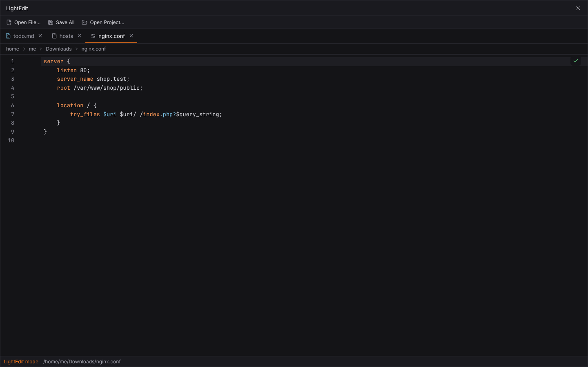
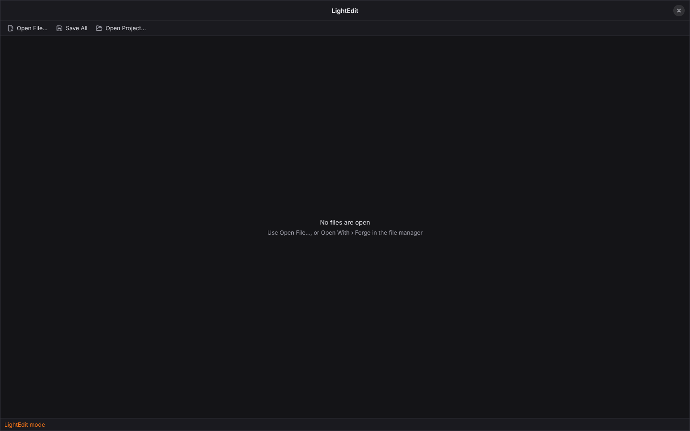
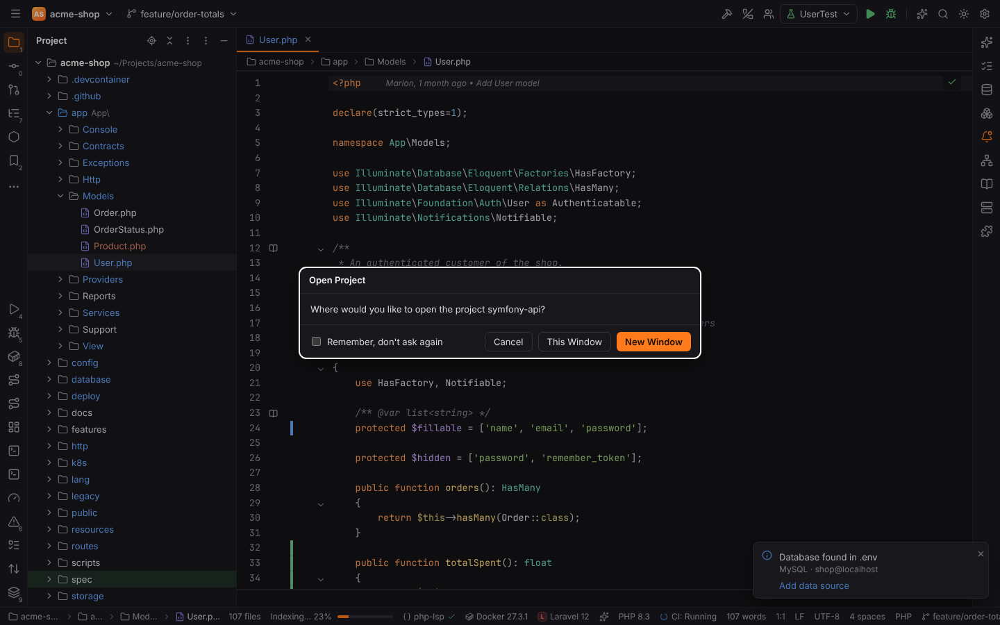
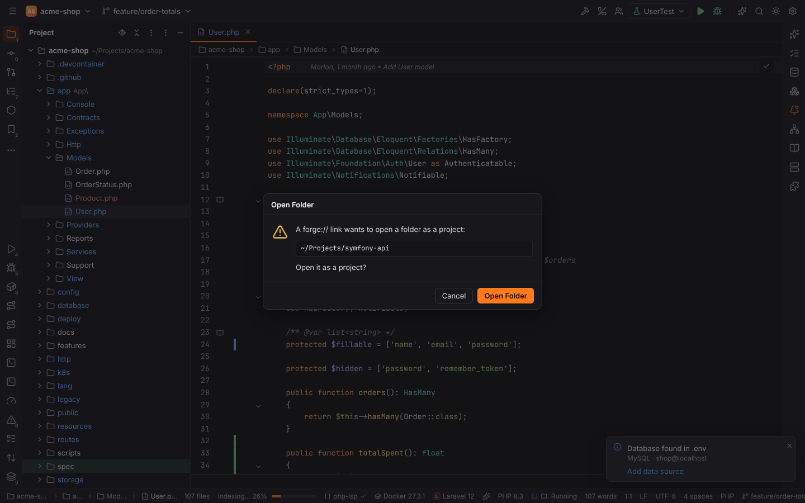

# Forge as the system's text editor

The Forge installers register Forge as a text editor for common text and source files, so it
shows up under **Open With** in the file manager and can be made the default editor for a
file type. Folders get **Open Folder in Forge**.

- Opening a **file** this way opens it in the **LightEdit** window: just the editor with tabs
  and the basic actions, without a project, tool windows or indexing (PHPStorm's LightEdit
  mode). Every further file goes into the same window as a new tab, also when Forge is
  already running. A file that is open already becomes the active tab again.
- Opening a **folder** opens it as a project. While a project window is open, Forge asks
  **This Window / New Window** (or does what Settings | Appearance & Behavior | System Settings
  | Project | *Open project in* says).
- A file that belongs to the project open in the project window opens there, not in LightEdit.

## The LightEdit window

| Part | What it does |
| --- | --- |
| **Open File…** | add files with the system file dialog |
| **Save All** | save the changed files (also Ctrl+S, the PHPStorm keymap applies) |
| **Open Project…** | open a folder as a project in the project window; when Forge runs with the LightEdit window only, the project window opens first |
| tabs | close with the × or Ctrl+F4; the window stays open without tabs |
| status line | *LightEdit mode* and the path of the active file |

- Files keep their encoding, byte order mark and line separator when they are saved.
- Closing the window saves its changed files first.
- When Forge was started for files only, it shows the LightEdit window alone: no splash
  continues into a project window and the last project is not reopened. Closing the project
  window while LightEdit is open keeps the LightEdit window (the project closes).
- The window has no project and no project lifecycle: it sends no `opened` / `closing`
  (`project://lifecycle`), and project switches in the project window do not touch its tabs.
- There is no project, so project features (code insight from the project index, run
  configurations, VCS, tool windows) are not available; syntax highlighting, editing, Find and
  Replace and the editor actions are.

## Opening a folder

**Open Folder in Forge** (Explorer, Dolphin), Open With → Forge on a folder (Finder, GNOME
Files), a folder on the command line (`forge ~/Projects/shop`) and a
`forge://open?file=/path/to/folder` link all open the folder as a project:

- Without an open project it opens in the project window right away.
- With an open project Forge asks where:

  

- A `forge://` link can come from any web page, so Forge first asks whether to open the
  folder at all:

  

### The trust question opens in the target window

"Trust and Open Project?" ([Project trust](project-trust.md)) is asked **only in the window
the project opens in**:

- **This Window**: the current window asks before it opens the folder.
- **New Window**: the new window opens the folder in Safe Mode and asks as soon as it is on
  screen. *Trust Project* leaves Safe Mode, *Preview in Safe Mode* keeps it, *Don't Open*
  closes the new window again.
- A folder from the command line or the file manager when Forge was not running: the first
  window asks the same way (*Don't Open* shows the Welcome screen).

The window you started from never asks on behalf of a window that does not exist yet.

## How a launch is routed

Every way in ends in one handler in Rust (`companion::handle_launch_args`, sorted by
`forge_open::launch`), so they all behave the same:

| Argument | Goes to |
| --- | --- |
| a folder | a project (first folder at startup: this window; later: the window question) |
| a file of the open project (or of the folder opened in the same launch) | the project window |
| any other file | the LightEdit window |
| `-e FILE` / `--edit FILE` | the LightEdit window, also for project files |
| `file:///…` URLs (some file managers pass URLs) | as the path they name |
| `forge://open?file=/folder` | a project, after the link question |
| other `forge://` links | as before ([CLI arguments and forge:// links](../reference/cli-and-links.md)) |

## Linux

The deb and rpm packages install:

| File | Purpose |
| --- | --- |
| `/usr/share/applications/forge.desktop` | `Exec=forge %F`, `MimeType=` for text and source types (`text/plain`, `text/markdown`, `application/json`, `application/x-php`, `text/x-lua`, …) and `inode/directory` |
| `/usr/share/applications/forge-url-handler.desktop` | the `forge://` scheme (`x-scheme-handler/forge`, `Exec=forge %u`, hidden from menus) |
| `/usr/share/kio/servicemenus/forge-open-folder.desktop` | Dolphin's **Open Folder in Forge** on folders |

- GNOME Files and other file managers list Forge under *Open With Other Application* for
  folders and text files; *Set as default* makes it the default editor for a type.
- The arguments reach a running Forge through the single-instance hand-over.
- **AppImage:** the image carries the same desktop entry. AppImage integration tools
  (AppImageLauncher, Gear Lever) install it; without them the AppImage registers only the
  `forge://` scheme at runtime.
- **Flatpak:** `dev.forge.ide.desktop` declares the same MIME types and `inode/directory`.
- Uninstalling the package removes every file above.

## Windows

The NSIS (`.exe`) and MSI installers register:

| Entry | Purpose |
| --- | --- |
| file associations (`bundle.fileAssociations`) | `.txt`, `.md`, `.php`, `.js`, `.ts`, `.lua`, `.json`, `.yaml`, … with the verb **Open with Forge**, under `HKCU\Software\Classes` (per-user install) or `HKLM` (per-machine) |
| `Directory\shell\Forge` | **Open Folder in Forge** on folders |
| `Directory\Background\shell\Forge` | **Open Folder in Forge** on the background of an open folder |
| `*\shell\Forge` | **Edit with Forge** on every file, also files without an extension |

- Windows asks once which app opens a type; choose Forge there or under *Settings › Apps ›
  Default apps*.
- The arguments reach a running Forge through the single-instance hand-over.
- Uninstalling removes all associations and context-menu entries (NSIS installer hook, MSI
  component); the NSIS uninstaller also restores the previous handler of an extension.

## macOS

`Forge.app` declares document types in its `Info.plist` (`CFBundleDocumentTypes`, role
**Editor**) for plain text, source code, scripts, JSON, XML and YAML, and `public.folder`
with rank *Alternate* (Forge is offered for folders, never made their default):

- Finder: *Open With → Forge*, or *Get Info › Open with › Change All…* to make it the default
  editor of a type.
- Drop files or folders on the Dock icon.
- macOS hands these to the app as an open-file event (`RunEvent::Opened`), not as
  command-line arguments; Forge routes them into the same handler, also while it runs.
- Removing `Forge.app` removes the document types.

## Troubleshooting

- **Forge is missing from Open With (Linux):** run `update-desktop-database
  ~/.local/share/applications` (or reinstall the package) and log out and in.
- **A file opens in the project window instead of LightEdit:** it belongs to the open
  project. Use `forge -e FILE` to force LightEdit.
- **Nothing happens on macOS when a file is dropped on the Dock icon while Forge starts:** the
  file opens once the startup reaches "Opening project"; look in the LightEdit window.
