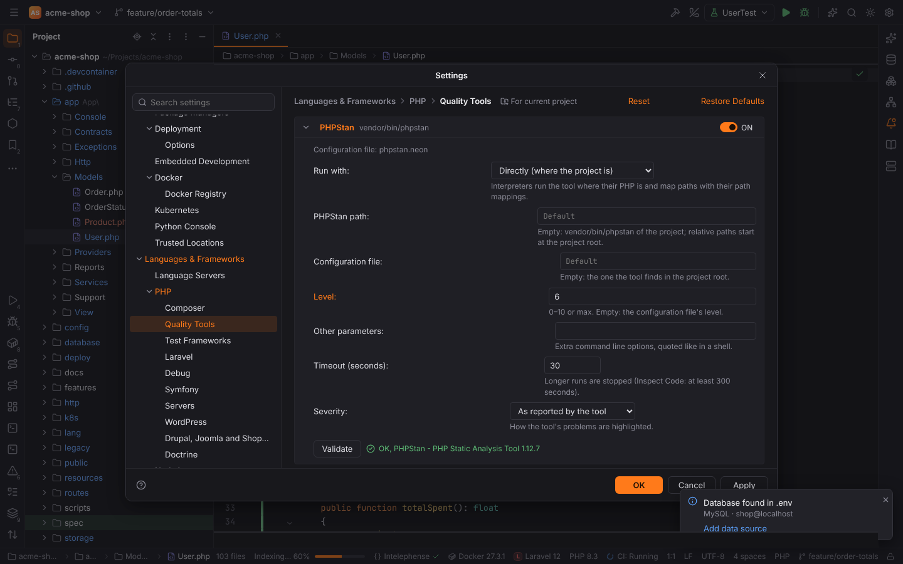
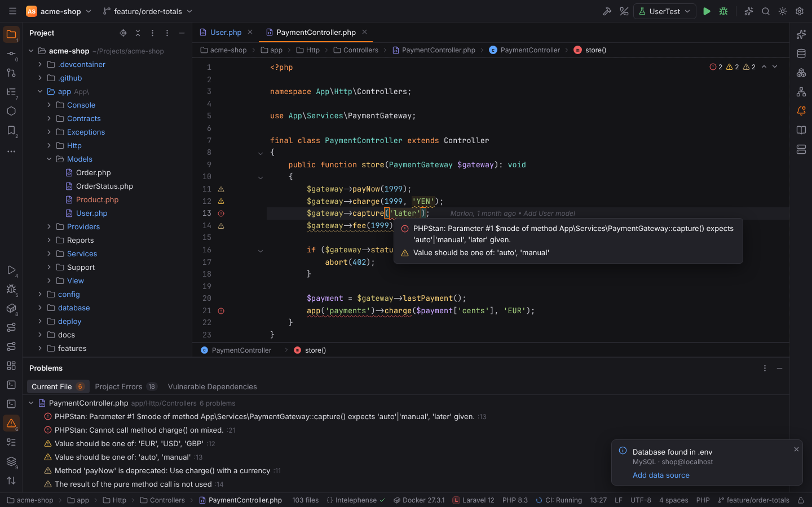
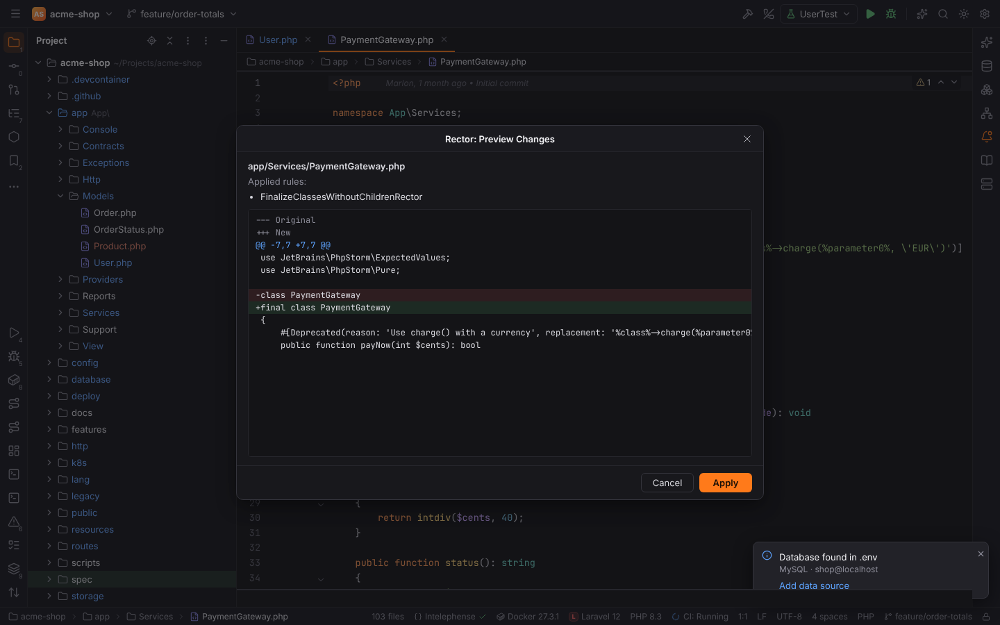
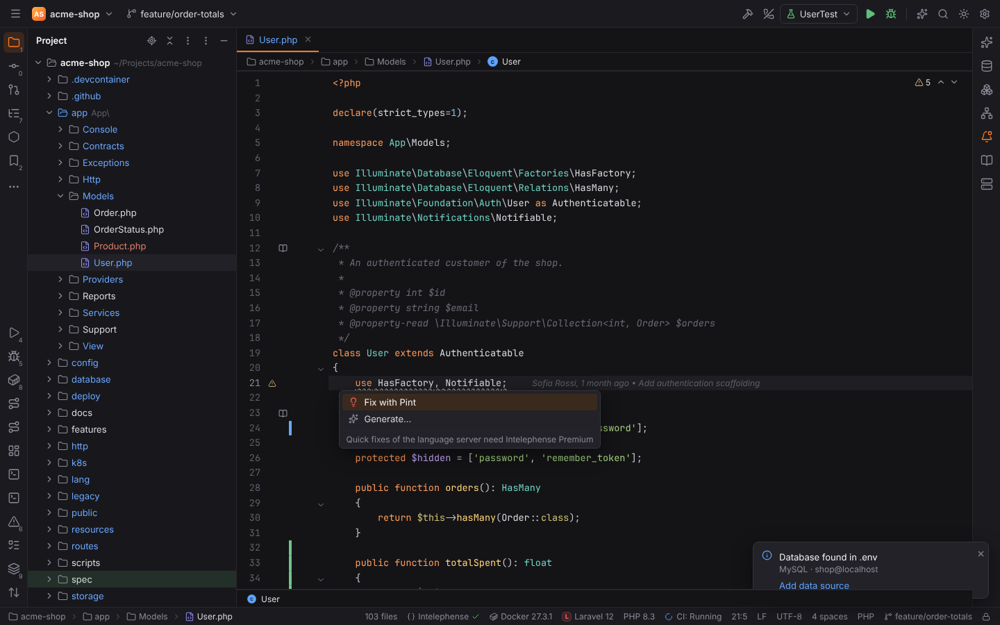
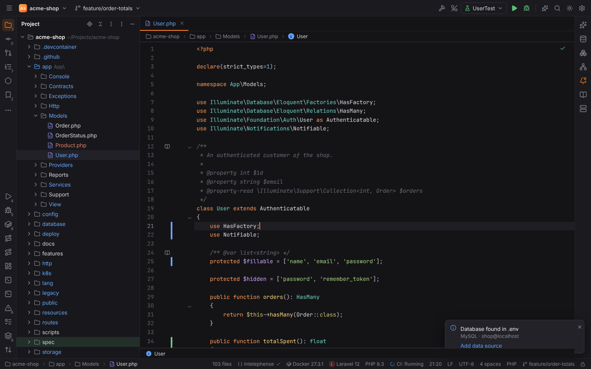

# PHP Quality Tools

Forge runs the PHP quality tools of your project the way PHPStorm does: their problems appear
in the editor while you type and after you save, and in the Problems tool window; the fixers
reformat files, fix problems with `Alt+Enter` and run on save.

| Tool | Checks with | Fixes with |
| --- | --- | --- |
| **PHPStan** (and Larastan) | `phpstan analyse --error-format=json` | |
| **Psalm** | `psalm --output-format=json` | |
| **PHP_CodeSniffer** | `phpcs --report=json` | `phpcbf` |
| **PHP Mess Detector** | `phpmd <file> json <rulesets>` | |
| **PHP CS Fixer** | `php-cs-fixer fix --dry-run --diff --format=json` | `php-cs-fixer fix` |
| **Laravel Pint** | `pint --test --format=json` | `pint` |
| **Rector** | `rector process --dry-run --output-format=json` | `rector process` (with a preview) |

The tools are your project's own: Forge never bundles or downloads them. Install them with
Composer (`composer require --dev phpstan/phpstan`, `laravel/pint`, …) or point Forge to them.

## Settings

Settings | Languages & Frameworks | PHP | Quality Tools (`Ctrl+Alt+S`) lists every tool with
an **ON/OFF** switch and where it was found (`vendor/bin/phpstan`, or "Not installed in the
project"). The switch turns the tool's inspection on: its problems are shown on the fly, on
open and on save, and by Inspect Code with Quality Tools. Expand a tool to configure it:

| Option | Meaning |
| --- | --- |
| **Run with** | *Directly (where the project is)*: the executable runs on the project's machine. *Project PHP interpreter*, or any configured [CLI interpreter](php.md#cli-interpreters): the tool runs as `php <tool> …` with that interpreter, locally, in Docker, Docker Compose, over SSH or in WSL. Paths in the arguments are mapped to the interpreter's side and the paths in the report back to the project, with the interpreter's path mappings. |
| **Path** | The executable; empty means `vendor/bin/<tool>` of the project. A relative path starts at the project root. PHP_CodeSniffer also has the **phpcbf path**. |
| **Configuration file** | Empty: the file the tool finds in the project root (`phpstan.neon`, `phpstan.neon.dist`, `psalm.xml`, `.php-cs-fixer.php`, `.php-cs-fixer.dist.php`, `phpcs.xml`, `.phpcs.xml.dist`, `phpmd.xml`, `pint.json`, `rector.php`). The page shows which one was found. |
| **Level / ruleset** | PHPStan's **Level** (`0`–`10`, `max`), phpcs's **Coding standard** (`PSR12`, …; a configuration file is the standard), PHP Mess Detector's **Rulesets** (default `cleancode,codesize,controversial,design,naming,unusedcode`), PHP CS Fixer's **Rules** (`@PSR12`), Pint's **Preset** (`laravel`, `psr12`, `per`, `symfony`). Empty: the configuration file decides. |
| **Other parameters** | Extra options, quoted like in a shell (`--memory-limit=1G`). |
| **Timeout (seconds)** | A run that takes longer is stopped (default 30). Inspect Code allows at least 300 seconds. |
| **Severity** | *As reported by the tool*, or always Error, Warning or Weak Warning. |

**Validate** runs `<tool> --version` with the options shown (before you apply them) and shows
the version, or why the tool does not run.

**Run inspections on the fly** (`php.tools.onTheFly`, on by default) checks the file you edit
after a short pause in typing.

## Problems in the editor

When a PHP file opens, after a pause in typing and after it is saved, the tools whose
inspection is on check it. Their problems are underlined in the editor with the tool's
severity, listed in the Problems tool window (`Alt+6`, Current File and Project Errors) and
show the tool's name and rule (`PHPStan · argument.type`):

While the text is not saved, only the tools that can read it run: PHP_CodeSniffer and PHP CS
Fixer get the editor text on stdin, PHPStan gets a temporary copy (`--tmp-file … --instead-of
…`) when its PHP runs on this machine. Psalm, PHP Mess Detector, Pint and Rector check the
saved file. Severities follow the tool: PHPStan's errors and Psalm's errors are errors, Psalm's
info issues weak warnings, phpcs's errors and warnings stay as they are, PHP Mess Detector's
priority 1–2 are warnings and 3–5 weak warnings, and what a fixer would change (PHP CS Fixer,
Pint, Rector) is a weak warning on the changed lines.

A tool that is not installed, fails or times out is reported once per session in a balloon
with a **Configure…** link (notification group "PHP Quality Tools").

## Fixing

- **Code | Reformat with PHP CS Fixer**, **Reformat with phpcbf** and **Reformat with Pint**
  fix the current file. The result is applied as one edit, so `Ctrl+Z` undoes it. PHP CS Fixer
  and phpcbf work on the editor text; Pint works on the saved file (Forge saves it first, then
  restores the file and applies Pint's result as an edit).
- **Alt+Enter** on a fixable problem offers **Fix with PHP CS Fixer**, **Fix with phpcbf** or
  **Fix with Pint**.
- **Code | Run Rector on File…** (and **Preview and apply Rector changes…** on a Rector
  problem) shows the rules that apply and Rector's diff before anything changes; **Apply**
  puts the changes into the editor.

## On save

[Actions on Save](actions-on-save.md) (Settings | Tools | Actions on Save) has **Run Rector**,
**Run PHP CS Fixer**, **Run phpcbf** and **Run Laravel Pint**. They run on explicit save
(`Ctrl+S`) in this order, with the tool's configuration file, ruleset, options and PHP
interpreter from the Quality Tools page:

## Inspect Code

**Code | Inspect Code with Quality Tools** runs every tool whose inspection is on over the
whole project: tools with a configuration file check what it names, the others the project
root without `vendor/` and `node_modules/`. The problems replace the tools' earlier ones in the
Problems tool window, and a balloon sums them up.

## Remote projects and Safe Mode

In [remote projects](remote-development.md) the tools run on the remote host, next to the
files, through the Forge agent, like Composer and the run configurations do; interpreters work
there too.

Running a project's vendor tools runs code from the project. In
[Safe Mode](project-trust.md) Forge never runs them: checks, fixers, Validate and the PHP
tools of Actions on Save are refused until you trust the project.

## Settings keys

Every tool has the keys `php.tools.<tool>.inspection`, `.interpreter`, `.path`, `.config`,
`.level` (not Psalm and Rector), `.options`, `.timeout` and `.severity`, with `<tool>` one of
`phpstan`, `psalm`, `phpCsFixer`, `phpcs`, `phpmd`, `pint`, `rector`; plus
`php.tools.phpcs.phpcbfPath` and `php.tools.onTheFly`. They are project settings, so a team
can share them in `.forge/settings.toml`. See the
[settings reference](../reference/settings.md#languages--frameworks--php--quality-tools).
