# PHP

PHP support is the **PHPForge** pack (plugin `forge.php`). It combines two engines:

- **Forge's PHP index**, built with tree-sitter in Rust: classes, interfaces, traits, enums,
  functions, constants, members, PHPDoc and attributes of every PHP file in the project. It
  powers the Structure tool window, Go to Class/Symbol, index-based hover, the Generate
  actions and [navigation](#navigation) when no language server answers, and works without
  any language server.
- **A PHP language server**, Intelephense or Phpactor, for completion, diagnostics,
  Go to Declaration, hover and formatting. See
  [Language servers](language-servers.md#php-intelephense-and-phpactor).

The pack activates in projects with a `composer.json` or `.php` files.

## The PHP index

Indexing starts when a PHP project opens. The status bar shows **Indexing… 45%** with a
progress bar; afterwards the index follows file changes on its own.

- Files in `vendor/` are not indexed up front. When a class from a dependency is needed (as an
  ancestor, in hover), Forge loads it on demand through Composer's PSR-4 autoload map.
- The index is cached in `<cache dir>/forge/php-index/` (keyed by the project path), so the
  next start only re-reads changed files. Nothing is written into the project.
- **Reindex PHP Files** (Find Action) rebuilds it.
- Extra library folders can be added under Settings | Languages & Frameworks | PHP |
  **Include Path** (`php.includePaths`). Forge indexes them as libraries and passes them to
  the language server; see [Include paths and External
  Libraries](#include-paths-and-external-libraries).
- `.phpstorm.meta.php` files are read with the index, in the project and in vendor packages;
  see [PHPStorm metadata](#phpstorm-metadata-phpstormmetaphp).

## Structure

The **Structure** tool window (`Alt+7`, macOS `Cmd+7`) lists the classes of the active file
with their constants, properties and methods, including signatures and visibility. Click an
entry to jump to it.

- **Show Inherited** adds members of parent classes, traits and interfaces, grayed and with
  the declaring class.
- **Sort Alphabetically** sorts within each kind.
- **Options** (⋮): **Autoscroll to Source** (on: a single click jumps to the member; off: a
  click selects and a double click jumps) and **Autoscroll from Source** (the member at the
  caret is selected as you move through the editor). Both are also settings
  (`structureView.autoscrollToSource`, `structureView.autoscrollFromSource`).

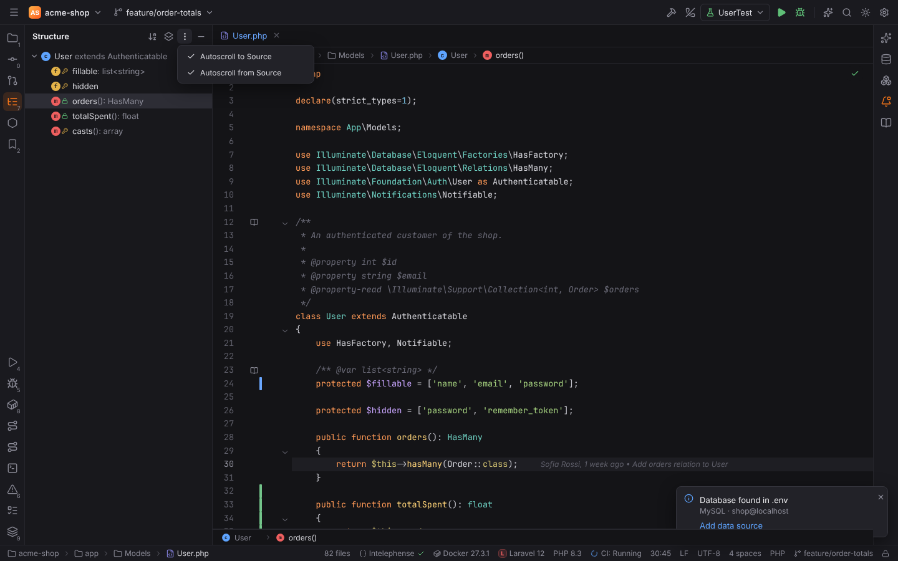


## Go to Class and Go to Symbol

**Go to Class** (`Ctrl+N`, macOS `Cmd+O`) and **Go to Symbol** (`Ctrl+Alt+Shift+N`, macOS
`Cmd+Alt+O`) search the PHP index with camel-hump matching: `OrCo` finds
`OrderController`, `OrderController::sto` finds its `store` method. See
[Search Everywhere](search-everywhere.md).

## Navigation

Navigation works like in PHPStorm on every PHP symbol. The language server answers first;
when none runs (or it has no answer) Forge's PHP index does, so navigation also works without
Intelephense. Everything runs through the project's backend, so it works the same in
[remote projects](#remote-projects).

### Go to Declaration

`Ctrl+Click`, `Ctrl+B` (macOS `Cmd+Click`, `Cmd+B`) or a middle click jumps to the declaration
of:

- classes, interfaces, traits and enums, written with or without a leading backslash
  (`\Throwable`, `\App\Models\User`, `User`), resolved through `use` imports (also aliases
  `use X as Y` and group uses `use App\Models\{User, Order}`) and the current namespace;
- names in `use` statements, including `use function` and `use const`;
- functions (`array_map`, namespaced functions with PHP's fallback to the global function);
- methods and properties on `$this`, `self::`, `static::`, `parent::`, class names and
  variables, typed through parameters, `new`, `catch (X $e)`, inline `/** @var X $x */`,
  property types and PHPDoc, and call chains through return types
  (`$user->orders()->first()`);
- class constants, enum cases and namespace constants (`PHP_EOL`, `const VERSION = 2`);
- variables: the parameter or first assignment in the method or function.

While `Ctrl` (macOS `Cmd`) is held, the symbol under the mouse is underlined like a link and a
small tooltip shows where it is declared: the namespace or class and the declaration.


On a declaration itself (a class name in `class User`, a method or function name, a property,
a variable's first assignment), Go to Declaration shows its **usages** instead, like
PHPStorm's "Declaration or Usages"; a single usage opens directly. Several targets open the
Choose Declaration popup. `Ctrl+Alt+Click` (macOS `Cmd+Alt+Click`) goes to the
implementations.

### PHP's own classes and functions

`\Throwable`, `\Exception`, `ArrayAccess`, `PDO`, `array_map`, `PHP_EOL` and the other
built-in symbols open their declaration in the **PHP stubs**, read-only, like PHPStorm's "PHP
Runtime" library. The tab shows a banner "Read-only library file" with the source of the
stubs, and the breadcrumbs read `PHP Runtime › Core › Core_c.php › Throwable`. Library files
cannot be edited; navigation inside them (for example from `Exception` to `Throwable`) works.


Where the stubs come from:

1. Settings | Languages & Frameworks | PHP | **Default stubs path** (`php.stubs.path`): a
   checkout of [JetBrains' phpstorm-stubs](https://github.com/JetBrains/phpstorm-stubs)
   (Apache-2.0) or a compatible folder.
2. Otherwise Forge downloads a pinned phpstorm-stubs release on first use into
   `<cache dir>/forge/php-stubs/<version>`, checks the unpacked files against a pinned digest
   and keeps its licence file. The status bar shows the download.
3. When Intelephense is installed and nothing else is available, its own stubs are used.

When Intelephense runs, its definition (which points into the stubs inside its package) is
opened read-only directly.

> **Note:** the download needs access to `codeload.github.com`. Offline, set **Default stubs
> path** or install Intelephense; otherwise Go to Declaration on a built-in symbol explains how
> to get the stubs.

### Show Usages and Find Usages

**Show Usages** (`Ctrl+Alt+F7`, macOS `Cmd+Alt+F7`, or `Ctrl+Click` on a declaration) opens
a popup with every usage: the code line with the reference highlighted, file and line,
grouped by usage type like PHPStorm (Usage in import, New instance creation, Method call,
Static member access, Usage in extends/implements clause, Usage in type declaration, Usage in
PHPDoc, Dynamic usages, …). `Up`/`Down` select, `Enter` opens, `Escape` closes; the pin
button **Open in Find Window** keeps the result in the Find tool window.

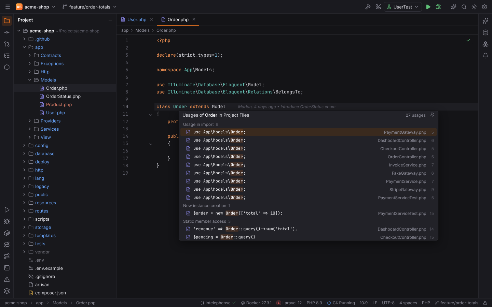

For a method or function the popup lists its call sites. Calls through a parent or child
class count too: the usages of an interface method include calls on its implementations.


**Find Usages** (`Alt+F7`) shows the usages in the **Find** tool window (`Alt+3`, macOS
`Cmd+3`): one tab per search, a tree grouped by usage type (toggle **Group by Usage Type**)
and file. Click a usage to open it.

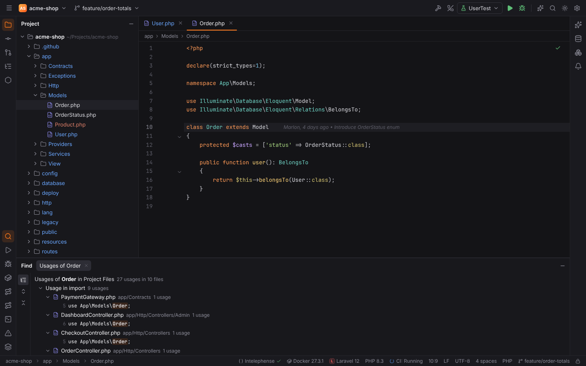

Members used on expressions the index cannot type (`$any->save()`) are listed as **Dynamic
usages**. Comments and strings are not usages unless **Search in comments and strings** is on
in the [Find Usages dialog](editor.md#find-usages-settings) (`Ctrl+Alt+Shift+F7`), which also
adds the usages of a class's methods and fields, derived and implementing classes, derived
interfaces and overriding methods on request, and limits the search to a scope.

**Highlight Usages in File** (`Ctrl+Shift+F7`) and the highlighting at the caret use the index
when no language server answers: property and variable reads and writes, the exit points of a
method on `return` / `throw`, and on `implements` / `extends` the methods that implement or
override the parents' methods (see [Highlight usages](editor.md#highlight-usages)).

### Implementation, Super Method and Type Declaration

| Action | Shortcut | macOS | Goes to |
| --- | --- | --- | --- |
| Implementation(s) | `Ctrl+Alt+B` | `Cmd+Alt+B` | classes extending or implementing the class or interface at the caret, or the methods overriding the method |
| Super Method | `Ctrl+U` | `Cmd+U` | the method this method overrides or implements; on a class, its parent and interfaces |
| Type Declaration | `Ctrl+Shift+B` | `Cmd+Shift+B` | the class of the variable, property or method return type at the caret |

Several targets open the Choose Declaration popup with names and namespaces. Go to
Implementation needs Intelephense Premium in Intelephense; without a licence Forge answers from
the index, and says so when the index finds nothing either.

### Hierarchies

Type Hierarchy (`Ctrl+H`), Method Hierarchy (`Ctrl+Shift+H`) and Call Hierarchy
(`Ctrl+Alt+H`) work from the index too, with traits, abstract classes and interfaces, and are
merged with Intelephense Premium's type and call hierarchy when it runs. See
[Type, Method and Call Hierarchy](hierarchies.md).

### Gutter icons

Like PHPStorm, the gutter marks inheritance:

- ↓ on a class with subclasses ("Is subclassed by"), on an interface with implementations and
  on interface or abstract methods with implementations ("Is implemented in"), and on methods
  overridden in subclasses ("Is overridden in");
- ↑ on methods that implement an interface method ("Implements method in") or override a
  parent's method ("Overrides method in").

Click an icon to go to the target, or to choose one of several.


## Rename

**Rename…** (`Shift+F6`) works on classes, interfaces, traits, enums, methods, properties,
constants, functions and variables; see [Editor](editor.md#rename) for the in-place editing,
the dialog and undo.

- With **Intelephense Premium** (licence key in Settings | Languages & Frameworks | PHP) or
  Phpactor, the language server renames.
- **Intelephense without a licence** cannot rename. Forge then renames with its PHP index: the
  declaration and every usage the index finds in the project (imports, `new`, static calls,
  type hints, PHPDoc types, `$this->` and typed receivers, members through parent and child
  classes). Members used on expressions the index cannot type (dynamic usages) are not renamed;
  Forge says how many it skipped. The first time this happens in a session, a balloon explains
  that the full rename needs Intelephense Premium and links to the licence key setting.
- Renaming a class also renames its file when the file is named after it (`Order.php` →
  `Purchase.php`).
- Conflicts: a class with the new name in the same namespace, or a method, property or constant
  with the new name in the same class, are listed in **Problems Detected** before anything
  changes.


## Extract, introduce and inline

The Refactor menu's **Extract/Introduce** and **Inline** refactorings work like PHPStorm's. Forge
computes them itself from the PHP syntax tree, so they need no language server (and no
Intelephense licence); call sites and usages in other files come from the PHP index. Every
refactoring is one undo step, also when it changes several files, and works in remote projects.
Problems (a name that is taken, a call that cannot be updated, an initializer with side
effects) are listed in **Problems Detected** first; **Preview** in the dialogs lists every
change before anything is written.

- **Introduce Variable** (`Ctrl+Alt+V`): select an expression, or put the caret in it. When the
  caret is in several expressions (`$order`, `$order->lines()`, `$order->lines()->get()`), the
  **Expressions** popup lets you pick one; the editor highlights the expression of the selected
  row. With several occurrences in the function, **Multiple occurrences found** asks whether to
  replace this one only or all of them. The variable is declared before the statement (a body of
  `if` / a loop without braces gets braces) and its name is edited in place: names are suggested
  from the method or property the expression reads (`getUserName()` → `$userName`, `$name`), the
  class it creates, the variable it is assigned to or its type. `Up` / `Down` pick another
  suggestion, `Enter`, `Tab` or `Escape` finish.
- **Introduce Constant** (`Ctrl+Alt+C`): a literal or other constant expression becomes a class
  constant (after the other constants, referenced as `self::NAME`) or, outside classes, a global
  `const` after the imports. The dialog asks for the name (suggested in `UPPER_CASE`), the
  visibility and **Replace all occurrences**.
- **Introduce Field** (`Ctrl+Alt+F`): an expression of a method becomes a property, initialized
  in the **current method**, the **field declaration** (constant expressions) or the **class
  constructor** (created when the class has none; not for expressions with local variables). In
  a static method the field is static (`self::$name`).
- **Introduce Parameter** (`Ctrl+Alt+P`): adds a parameter to the enclosing function or method
  (before a variadic one) and passes the expression at every call the PHP index finds; the
  function's parameters in the expression are replaced by the call's arguments and `$this` by
  the receiver. **Optional parameter** makes a constant expression the default value instead
  and leaves the calls alone. Expressions with other local variables cannot become parameters.
- **Extract Method** (`Ctrl+Alt+M`): select whole statements or an expression. Variables the
  fragment reads before it writes them become parameters (reorder and rename them in the
  dialog); variables it changes that are used afterwards (also in the next loop iteration) are
  returned, several as an array: `[$min, $max] = $this->bounds($xs);`. A fragment that ends with
  `return` is returned as a whole. The method is private and **Declare static** is on when the
  fragment does not use `$this`; outside classes Forge extracts a function. When other code of
  the class is the same (up to variable names), the dialog offers to replace those fragments
  with calls too. Fragments with `break` / `continue` out of them or several exit points cannot
  be extracted.
- **Inline** (`Ctrl+Alt+N`) on a variable, method, function or constant, at the declaration or a
  usage. A variable used once is inlined right away; otherwise the dialog offers **Inline all
  references and remove the variable** or **Inline this reference only and keep the variable**
  (methods and functions also **Inline all invocations and keep the method**). Values get
  parentheses where the context needs them. A variable that is assigned more than once cannot be
  inlined; an initializer with side effects that would run several times, or whose variables
  change before a reference, is reported as a problem. Methods with several `return` statements,
  recursive methods and generators cannot be inlined. A method body of statements is put before
  the call's statement, with locals renamed when they clash and arguments assigned to variables
  when the body changes them.

In JavaScript and TypeScript files the same shortcuts offer the language server's refactorings
(typescript-language-server: "Extract to function in module scope", "Extract to constant in
enclosing scope", "Inline variable"…) in a popup.

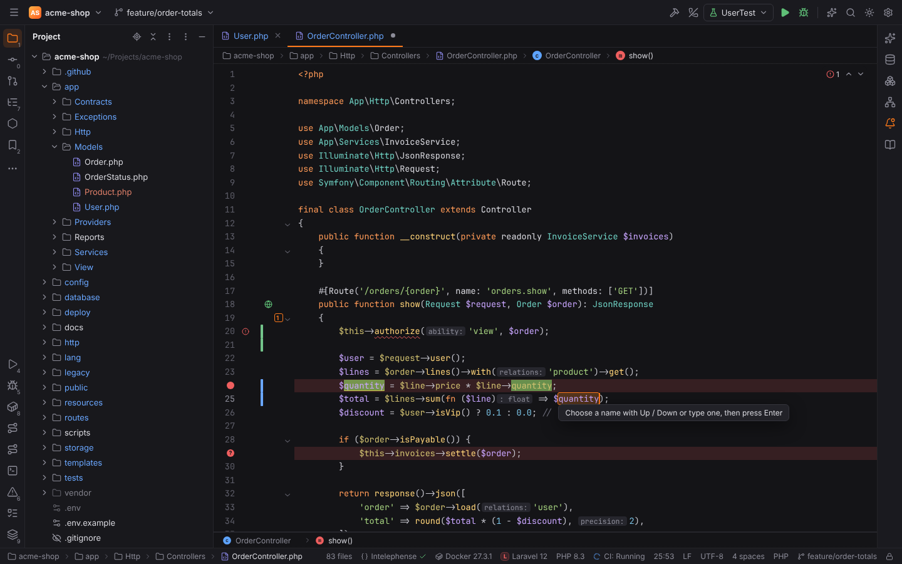

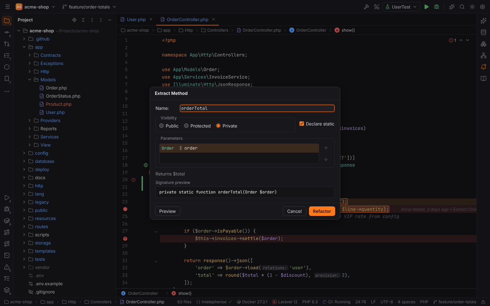

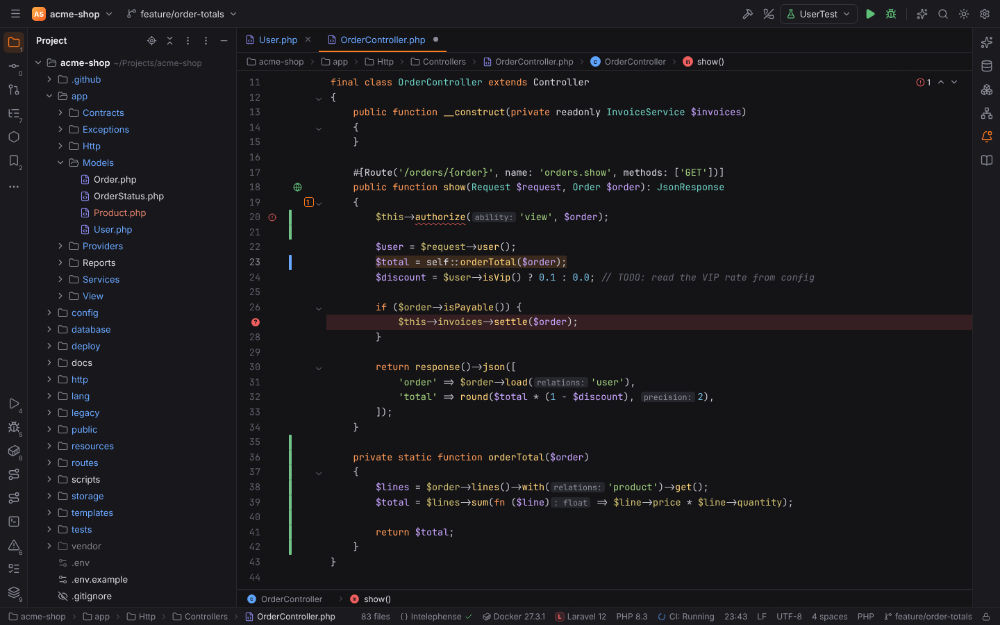

## Move, copy, safe delete, change signature and make static

The other refactorings of the Refactor menu work like PHPStorm's too. Forge finds the usages
with its PHP index and computes every edit itself (no language server or licence needed); the
whole refactoring, file moves included, is one undo step (`Ctrl+Z` in any changed editor) and
works in remote projects. **Preview** lists every change first, **Problems Detected** the
conflicts (a class that already exists, a call that cannot be updated).

- **Move** (`F6`) on a class (its name or header, or a reference to it): the **Move Class**
  dialog asks for the namespace and the target directory, which follows the namespace through
  the PSR-4 rules of `composer.json` until you edit it. The namespace statement, every `use`
  import (group imports too), fully qualified name and PHPDoc type is updated, files of the old
  namespace that used the class by its short name get an import, and the moved file imports the
  classes of its old namespace it uses. A class alone in its file moves with the file
  (`app/Models/Order.php` → `app/Domain/Sales/Order.php`); otherwise it goes into a new file.
  **Search in comments and strings** also updates `'App\Models\Order'` and comments.
- **Move** on a static method, static property or constant: the **Move Members** dialog lists
  the class's static members; checked ones move to the class you name (fully qualified).
  `Source::member` references become `Target::member` (`self::` inside the target), `self::`
  references in the moved code to members that stay become `Source::`, and class names in the
  moved code are fully qualified where the target file would resolve them differently. Private
  members still used by the class are reported.
- **Move** on a function: **Move Function** moves it to another PHP file; calls and
  `use function` imports follow when the namespace changes.
- **Move** in the Project view (`F6`, or drag and drop onto a folder): a PHP file with one class
  opens Move Class; files and folders otherwise move to the folder you choose. PHP files that
  follow PSR-4 get the namespace of their new folder and the references to their classes are
  updated (**Search for references**).
- **Copy** (`F5`) on a class: **Copy Class** creates a copy with a new name in a namespace and
  directory of your choice; the class's references to itself are renamed and the copy imports
  what it used from its old namespace. In the Project view `F5` copies files and folders.
- **Safe Delete** (`Alt+Delete`) on a class, interface, trait, enum, method, property, constant,
  enum case, function or parameter (or files and folders in the Project view) asks first
  (**Search in comments and strings**), then searches for usages. Without usages the element is
  deleted (a class alone in its file deletes the file). With usages, **Usages Detected** says how
  many usages are not safe to delete: **View Usages** lists them in the Find tool window (with
  **Delete Anyway** below), **Delete Anyway** deletes right away. A parameter is removed with its
  arguments at every call site and in overriding methods; its uses in the body are the usages
  that are not safe to delete.
- **Change Signature** (`Ctrl+F6`) on a method or function (its declaration, a call or the
  caret in its body): change the name, visibility and return type, and add, remove, reorder and
  edit parameters (type, name, default value). A new parameter needs a **value at call sites**
  (or a default value). The declaration, the overriding and implementing methods and every call
  site change: positional arguments are reordered, removed ones dropped, named arguments keep
  their names, and once an argument is left out the following ones become named. Renamed
  parameters are renamed in the body and the PHPDoc; removing a parameter the body uses is a
  problem. On a constructor, `new` expressions are updated.
- **Make Static** (Refactor | Make Static…) on an instance method: a method without `$this`
  just becomes `static`; otherwise **Add object as a parameter** passes the object (`$this` →
  `$price`) or **Add parameters for fields** passes the fields it reads. Calls change from
  `$obj->m()` to `Class::m()` (`self::m()` inside the class) with the object or its fields as the
  first arguments.

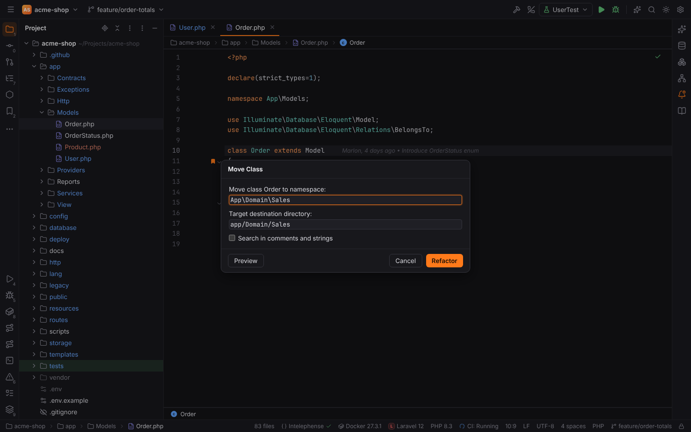

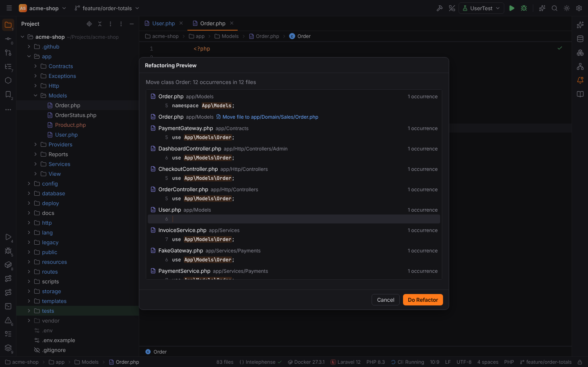

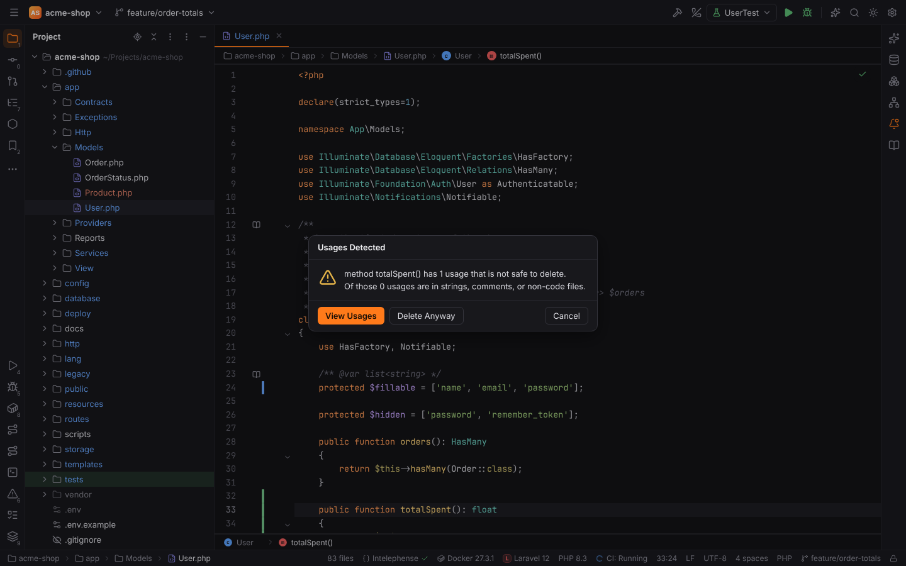

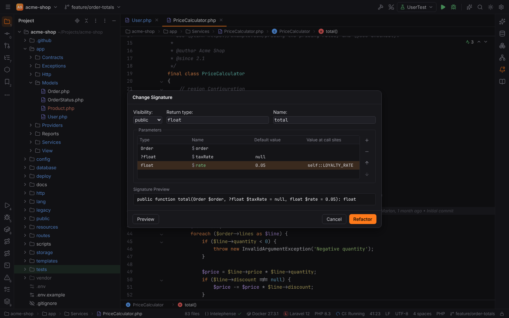

## Extract interface and superclass, pull members up and push members down

The class hierarchy refactorings work like PHPStorm's and, like the others, are computed by
Forge from its PHP index: one undo step, a **Preview**, conflicts in **Problems Detected**, and
remote projects work. Members a chosen member uses are highlighted in the member table, and
class names in moved code are imported in the target file. New files come from your
**PHP Interface** / **PHP Class** file templates (Settings | Editor | File and Code Templates).

- **Extract Interface** (Refactor | Extract/Introduce | Interface…) in a class or enum: name,
  namespace and directory (the directory follows the namespace through the PSR-4 rules), and the
  **Members to Form Interface**: public methods (declared in the interface with their PHPDoc)
  and constants (moved there). The class gets `implements NewInterface` (and the import).
  **Replace class references with interface where possible** changes parameter types to the
  interface where the function only calls the interface's methods on the parameter.
- **Extract Superclass** (Refactor | Extract/Introduce | Superclass…) in a class: the chosen
  members move into a new class; **Make abstract** keeps a method in the class and declares it
  `abstract` in the superclass (which then becomes abstract). The class extends the new
  superclass, which extends the class's old parent. Private members the class still uses become
  protected; a moved member that uses a member that stays is a problem.
- **Pull Members Up** (Refactor | Pull Members Up…): choose a superclass or interface of the
  class (the whole hierarchy in the project) and the members. Into a class, members move
  (**Make abstract** declares them abstract there instead); into an interface, public methods
  are declared and constants move (properties cannot). Problems: the target already has the
  member, a moved member uses a member that is not pulled up (or a private one).
- **Push Members Down** (Refactor | Push Members Down…): the chosen members are copied into
  every direct subclass that does not declare them itself (implementing classes of an
  interface get its constants) and leave the class; **Keep abstract** leaves an abstract
  declaration behind. Members of the class that still use a pushed member, and usages outside
  the subclasses, are problems.
- **Refactor This** (`Ctrl+Alt+Shift+T`) lists only what applies: on a class Rename, Move,
  Copy, Safe Delete, Extract Interface / Superclass and Pull Members Up / Push Members Down; on a
  method Rename, Change Signature, Move (static), Safe Delete, Inline, Pull Up / Push Down and
  Make Static; on an expression or a selection the Introduce refactorings and Extract Method.

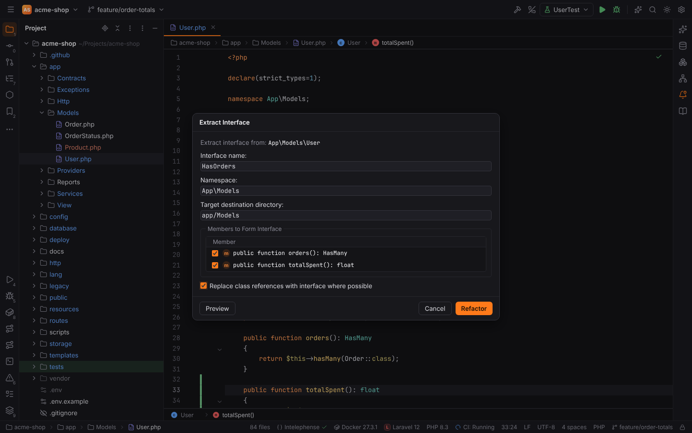

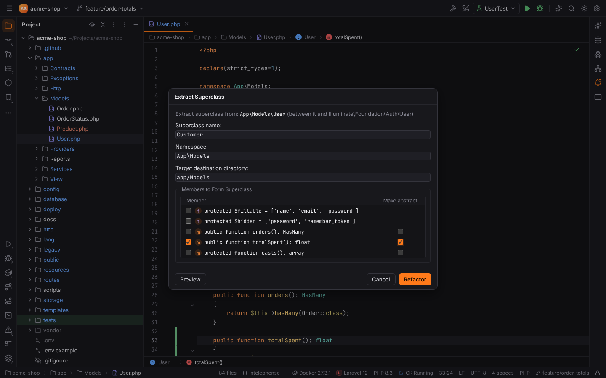

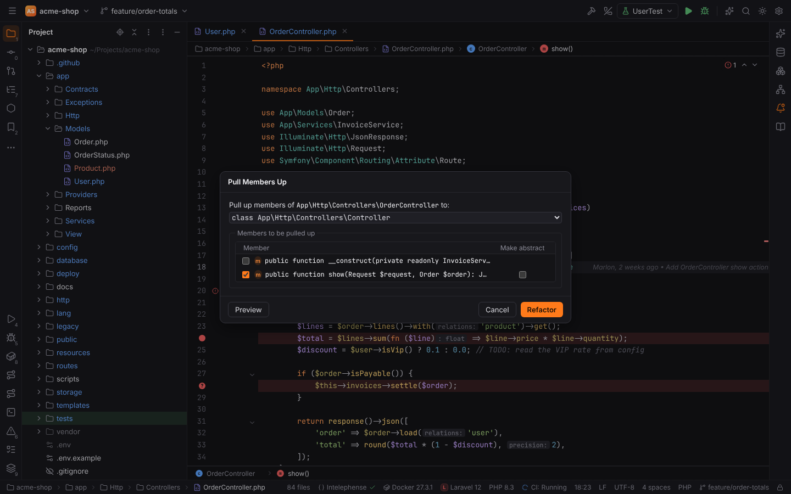

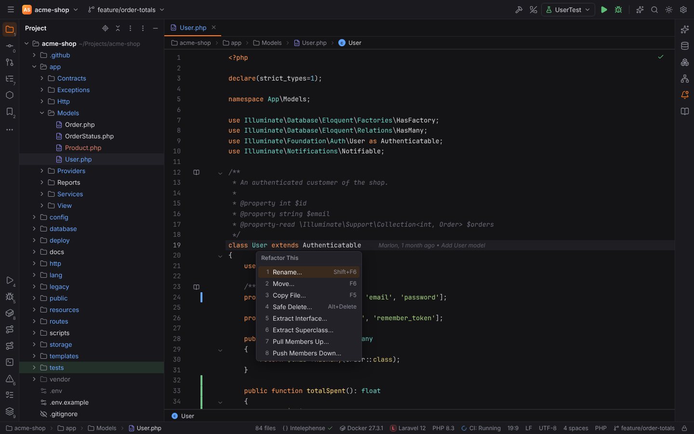

## Context actions and intentions

**Show Context Actions** (`Alt+Enter`) lists the language server's quick fixes (Intelephense
Premium) and Forge's own PHP intentions, see [Editor](editor.md#show-context-actions):

| Intention | Where |
| --- | --- |
| Import class | on a class name that is neither imported nor declared in the namespace: candidates from the index (project and vendor) and PHP's own classes, the "Class to Import" chooser when there are several, see [Auto Import](imports.md#import-class-and-the-import-popup) |
| Replace qualifier with an import | on a fully qualified name (`\App\Models\Order`) |
| Generate getter and setter / getter / setter | on a property without accessors |
| Add 'readonly' modifier | on a typed, non-static property without a default value (also promoted constructor properties) |
| Add method stubs | on a class name that does not implement all abstract or interface methods |
| Generate PHPDoc for '…' | on a function, method or property without a PHPDoc comment |
| Generate… | anywhere in a class: opens the Generate popup (`Alt+Insert`) |


Without Intelephense Premium the popup shows only Forge's intentions and says that the language
server's quick fixes need Premium.

### Create from usage

On a name that is not declared anywhere, `Alt+Enter` offers to create it, like PHPStorm (red
bulb, listed first):

| Quick fix | Where | What is created |
| --- | --- | --- |
| Create method 'notifyCustomer' | `$this->notifyCustomer(…)`, `$order->ship(…)` when the variable's class is known, `Order::find(…)` (static), `parent::boot()` | the method in the receiver's class, after the method you are in (same class) or at the end of the class |
| Create field 'total' | `$this->total`, `$order->total`, `self::$instances` (static) | a property after the other properties, typed from an assigned value when it is obvious (`$this->total = 0` → `private int $total;`) |
| Create constant 'LIMIT' | `self::LIMIT`, `Order::LIMIT`; a bare `VERSION` | a class constant before the properties; a namespace constant after the imports. The value `null` is selected so you can type over it |
| Create enum case 'Closed' | `Status::Closed` on an enum | `case Closed;` (backed enums get a value) |
| Create function 'format_money' | an unknown function call | the function after the function or class you are in, else at the end of the file |
| Create class / interface / trait 'Receipt' | `new Receipt()`, `Receipt::make()`, type hints, `extends`, `implements` (interface), a trait `use` (trait), `catch` and `throw new` (extends `\Exception`), imports | opens **Create New PHP Class** (see [File templates](file-templates.md)) |

- **Parameters** come from the call's arguments: variables keep their names and their types
  (typed parameters, `new`, `@var`, assignments), literals become `string $string`, `int $int`
  …, `new Order()` becomes `Order $order`, `$order->getTotal()` becomes `$total`. Named
  arguments keep their names; `...$rest` stays variadic.
- **Return types** come from the usage when they are obvious: a call used as a statement is
  `void`, `return $this->total()` takes the enclosing return type, conditions (`if`, `!`,
  `&&`) are `bool`, `echo` and concatenation are `string`.
- **Visibility**: `private` for `$this->` / `self::` calls into the class you are in, `protected`
  for `parent::`, else `public`; interfaces get a declaration without a body.
- The body comes from the code template **PHP Implemented Method Body** (Settings | Editor |
  File and Code Templates | Code), and the brace placement from the PHP code style.
- When the class lives in another file, Forge opens it and puts the caret into the new member.
  The change is one undo step: `Ctrl+Z` in either file undoes it.
- **Create class** opens the dialog with the name, the namespace the usage resolves to (its
  imports and the current namespace) and the template (Class, Interface or Trait); the
  directory follows the namespace through composer.json's PSR-4 rules. When you pick another
  namespace, the usage gets a `use` import.
- Nothing is offered for PHP's own functions and classes (`strlen()`, `\Exception`) when the
  PHP stubs are available, for members of classes whose parents are not indexed (a vendor
  parent may declare them; see "Add packages as libraries" under Composer), nor when the
  language server already offers to create the same symbol. Calls on variables whose class is unknown, comments and strings are left alone.
- Remote projects work the same way: the analysis runs next to the files.

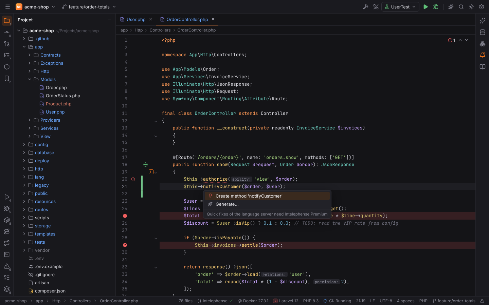

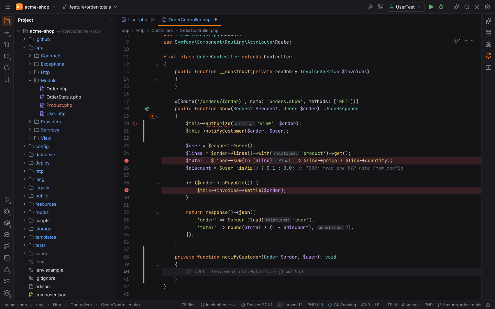

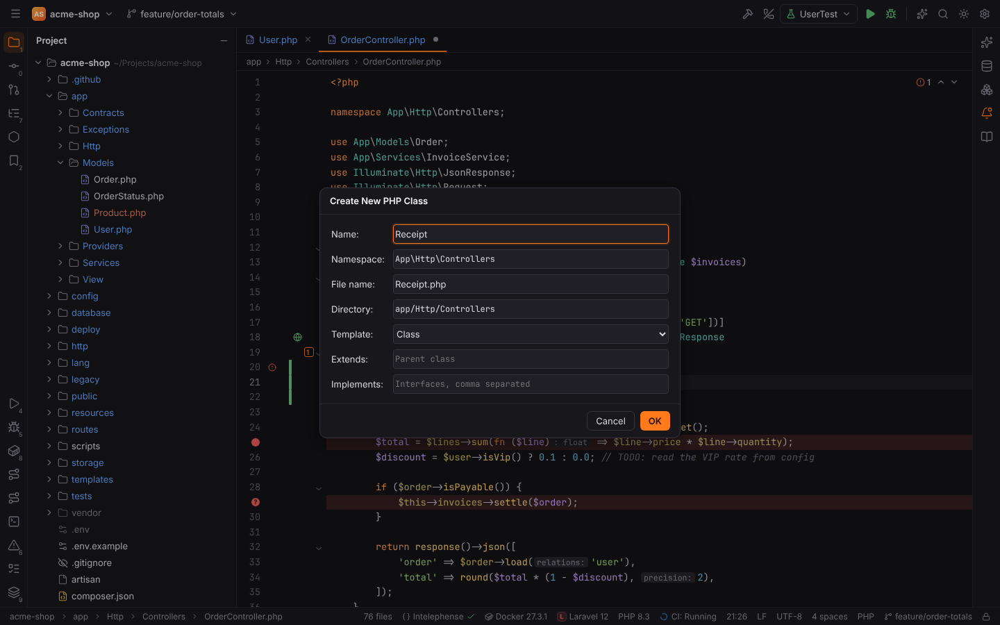

## Hover documentation

Hovering a class, function, method, property or constant shows its signature, attributes
(for example `#[Route('/orders', name: 'orders')]`) and its PHPDoc (description, `@param`,
`@return`, `@throws`, `@deprecated`, links) as a PHPStorm-style popup. The language server's
answer is merged with the index; when no server runs, or it has nothing for a symbol, the
index answers alone.


## Generate

**Generate…** (`Alt+Insert`, macOS `Cmd+N`) in a PHP file opens a popup at the caret with
what can be generated there:

| Entry | Generates |
| --- | --- |
| Constructor | a constructor with a parameter per chosen field that assigns it (`$this->x = $x`) |
| Getters | `getX()` / `isX()` for booleans |
| Setters | `setX()`; tick **Fluent setters** to return `$this` (`: static`) |
| Getters and Setters | both |
| Override Methods… (`Ctrl+O`) | stubs for inherited methods that are not overridden yet |
| Implement Methods… (`Ctrl+I`) | stubs for abstract and interface methods |
| toString() | a `__toString()` method |
| PHPDoc Comment | a PHPDoc block for the function, method, property or class at the caret, with `@param`, `@return` and `@throws` |


Entries that do not apply are disabled (for example Constructor when the class already has
one). Type the underlined letter to pick an entry. For fields and methods a chooser dialog
opens ("Choose Fields to Generate Getters and Setters", "Select Methods to Override") with
**Select All** / **Select None**:


The generated code follows the class's indentation, inserts properties after the last
property and methods at the end of the class, and adds the `use` imports that inherited
signatures need.


The bodies of implemented and overridden methods and the PHPDoc blocks come from the code
templates in Settings | Editor | File and Code Templates | Code (for example
`// TODO: Implement ${NAME}() method.`), see [File and code templates](file-templates.md#code-templates).
New PHP classes, interfaces, traits and enums with their PSR-4 namespace are created with
New ▸ PHP Class in the Project view ([New PHP Class dialog](file-templates.md#the-new-php-class-dialog)).

`Ctrl+O` and `Ctrl+I` work directly in PHP editors as shortcuts for Override/Implement
Methods.

## PHPStorm metadata (`.phpstorm.meta.php`)

Like PHPStorm, Forge reads advanced metadata from `.phpstorm.meta.php` files — or the PHP files
in a `.phpstorm.meta.php/` folder — anywhere in the project and in vendor packages (Laravel IDE
Helper, Symfony and Doctrine plugins ship them). Everything inside
`namespace PHPSTORM_META { … }` is used:

```php
<?php

namespace PHPSTORM_META {
    // The return type from the argument: `$container->get(Mailer::class)` is a Mailer,
    // `app('cache')` the mapped class, `factory('User')` a UserFactory.
    override(\Psr\Container\ContainerInterface::get(0), map([
        '' => '@',
        'cache' => \Illuminate\Cache\Repository::class,
    ]));
    override(\factory(0), map(['' => '@Factory']));
    override(\tap(0), type(0));          // returns the argument's type
    override(\head(0), elementType(0));  // returns the array argument's element type

    registerArgumentsSet('statuses', 'draft', 'paid');
    expectedArguments(\App\Models\Order::setStatus(), 0, argumentsSet('statuses'));
    expectedArguments(\json_encode(), 1, JSON_PRETTY_PRINT | JSON_UNESCAPED_SLASHES);
    expectedReturnValues(\App\Models\Order::status(), argumentsSet('statuses'));
    exitPoint(\abort());
}
```

- **Types**: overridden calls give their result a type for Go to Declaration, hover and the
  inspections below. A method override also applies to the subclasses and implementations of
  the class or interface it names. The type of a variable assigned from such a call follows
  (`$mailer = $container->get('mailer');`).
- **Go to Declaration** (`Ctrl+B`) on a mapped key such as `app('cache')` opens the class it
  maps to (or the map entry).
- **Completion**: the arguments of `expectedArguments()` and the keys of `override()` maps
  (service ids) are offered in the argument, inside a string without quotes; flags written
  `A | B` again after `|`. `expectedReturnValues()` completes comparisons such as
  `$order->status() === '…'`.
- **Exit points**: statements after an `exitPoint()` call are reported as unreachable.

Changed metadata files are read again at once. Forge reads PHPStorm's current syntax; the old
`$STATIC_METHOD_TYPES` array is not supported.

## JetBrains attributes

The attributes of the `jetbrains/phpstorm-attributes` package (and PHP 8.4's own
`#[\Deprecated]`) work as in PHPStorm:

| Attribute | What Forge does |
| --- | --- |
| `#[Deprecated(reason: …, replacement: …, since: …)]` | Usages are struck through with the reason; with a `replacement` (`%class%->pay(%parametersList%)`, `%parameter0%`, `%name%`) Alt+Enter offers **Replace with '…'**. `@deprecated` in PHPDoc counts too. |
| `#[ExpectedValues(['asc', 'desc'])]`, `flags:`, `valuesFromClass:`, `flagsFromClass:` | Completion of the values (or the constants of the class) in the argument, and the warning **Value should be one of: …** for other literals. On a function or method it lists its return values. |
| `#[ArrayShape(['id' => 'int', 'user' => User::class])]` | Completion of the keys in `$data['…']` and the type of `$data['user']->…`, for calls, parameters, variables and properties. |
| `#[Immutable]` (also `PRIVATE_WRITE_SCOPE`, `PROTECTED_WRITE_SCOPE`) | Writing the property (or a property of an immutable class) outside its write scope: **Immutable property '$x' cannot be written outside of the constructor**. |
| `#[Pure]` | **The result of the pure function call is not used** when the call is a statement of its own. |
| `#[NoReturn]` | Statements after the call are unreachable (greyed out). |
| `#[Language('SQL')]` | String arguments of the parameter are a [language injection](language-injections.md) (rule "#[Language] parameters"). |

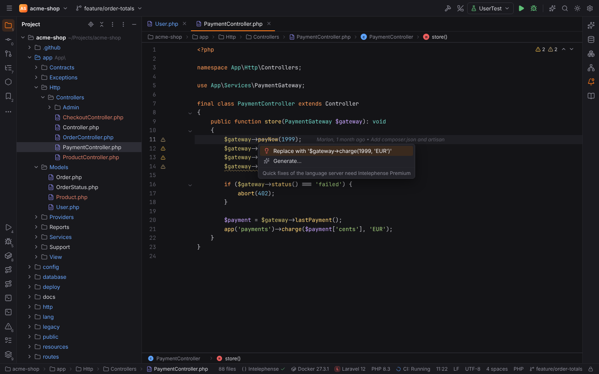

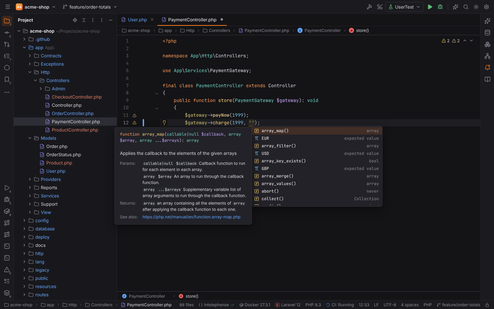

The inspections are Forge's own (from the PHP index, next to the language server's problems)
and appear in the editor and the Problems tool window. Turn them off with **Inspections from
PHPStorm metadata and attributes** (`php.inspections.enabled`) on Settings | Languages &
Frameworks | PHP.

## Source roots and the PSR-4 namespace check

PHPStorm derives the source roots of a PHP project from composer.json's PSR-4 rules
(`autoload`, `autoload-dev`) and lets you change them. Forge does the same:

- **Settings | Directories** lists the **Source Folders** and **Test Source Folders** with
  their **package prefix** (the namespace of the folder). Change a prefix, unmark a
  composer.json root (it stays listed and can be marked again), reset it, or add a folder.
- In the Project view, right-click a folder › **Mark Directory as** › **Sources Root**, **Test
  Sources Root** or **Unmark as Sources Root** (the same menu marks resource roots and excluded
  folders, see [Project structure](workbench.md#project-structure-mark-directory-as)). A new root gets the namespace the folder maps
  to now as its prefix. Source roots get blue folders, test roots green ones, with the prefix
  next to the name.
- The changes are stored in the project setting `php.sourceRoots` (shared through
  `.forge/settings.toml`). **New ▸ PHP Class** fills its namespace from them, **Move** of
  classes and files updates namespaces with them, and the inspection **Namespace name doesn't
  match PSR-0/PSR-4 project structure** checks every file below a root, with the quick-fix
  **Set namespace to '…'**.

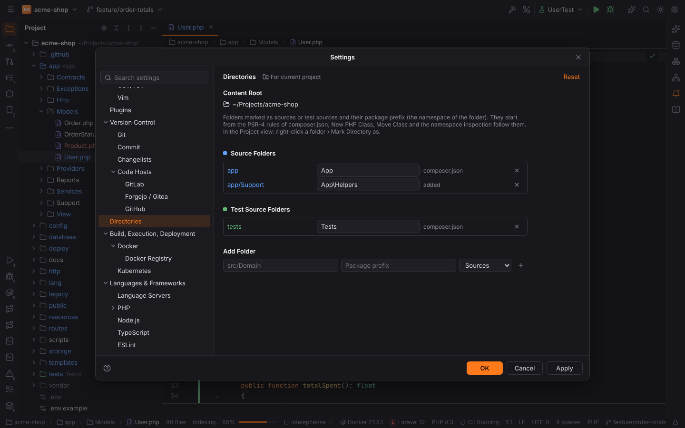

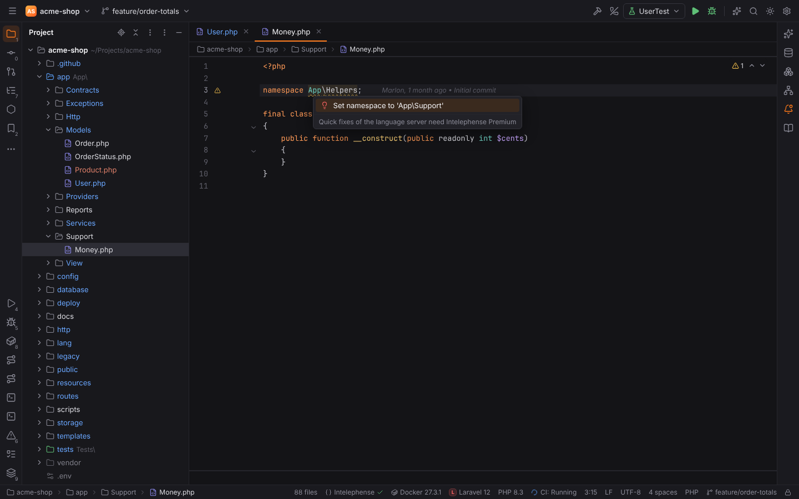

## Include paths and External Libraries

Folders outside the project — a global PEAR folder, framework stubs, a shared library — are
added under Settings | Languages & Frameworks | PHP | **Include Path**. Forge indexes them as
libraries: their classes appear in Go to Class (after the project's), resolve as types and
open read-only on Go to Declaration. They are listed under **External Libraries** at the end
of the Project view, where folders can be browsed and files opened read-only; right-click ›
**Configure PHP Include Paths…** opens the settings page. A path may start with `~/` or be
relative to the project. Changing the include paths indexes the project again.

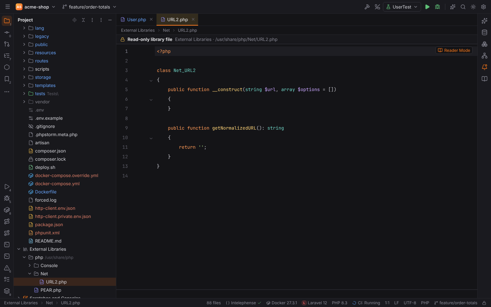

## Settings | Languages & Frameworks | PHP


| Option | Setting | Default |
| --- | --- | --- |
| PHP language level (7.4 – 8.4, or "From the CLI interpreter") | `php.languageLevel` | 8.3 |
| CLI Interpreter (an interpreter's name, or the path of a local `php`) | `php.interpreter` | `php` |
| CLI Interpreters (available in every project) | `php.interpreters` | empty |
| CLI Interpreters "Visible only for this project" | `php.projectInterpreters` | empty |
| Language server (Auto, Intelephense, phpactor, None) | `php.lsp.server` | Auto |
| Max indexed file size for the server (KB) | `php.lsp.maxFileSize` | 5000 |
| When Intelephense is not installed (`ask`, `always`, `never`), see [Installing Intelephense](language-servers.md#installing-intelephense) | `php.intelephense.autoInstall` | `ask` |
| I accept the Intelephense licence | `php.intelephense.licenceAccepted` | off |
| Include Path | `php.includePaths` | empty |
| Inspections from PHPStorm metadata and attributes | `php.inspections.enabled` | on |
| Default stubs path (PHP Runtime), see [PHP's own classes and functions](#phps-own-classes-and-functions) | `php.stubs.path` | empty (managed download) |

The language level and the interpreter can be stored per project ("For current project" in
the page header). The status bar shows the language level in effect ("PHP 8.3"; its tooltip
says when it comes from composer.json); click it to open this page. The page also shows the [Intelephense licence](language-servers.md#intelephense-licence-key-premium).

Sub-pages: **Composer**, **Debug**, **Servers** (see [Debugging](debugging.md)),
**Laravel**, **Symfony**, **Doctrine**.

### CLI interpreters

**CLI Interpreter** picks the PHP that runs scripts, tests, Artisan and Composer commands of
the project. The **…** button next to it opens the **CLI Interpreters** dialog:

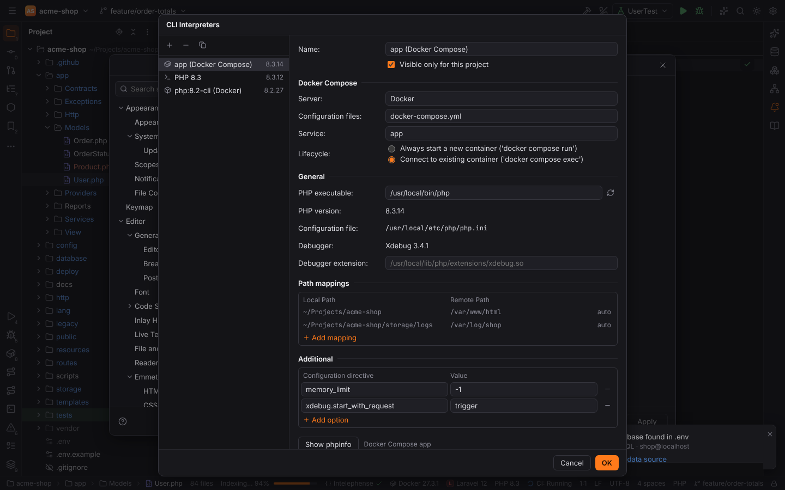

- The list on the left has **+** (add), **−** (remove) and copy. **+** offers **Local Path to
  Interpreter…**, **From Docker, Vagrant, VM, WSL, Remote…** and the PHP executables Forge
  detected on this machine (with their versions): `PATH`, `/usr/bin/php8.x`, Homebrew
  (`/opt/homebrew`, `/usr/local/opt/php@8.x`), phpenv, phpbrew, asdf, mise, Laravel Herd, and
  Laragon, XAMPP or `C:\php` on Windows.
- **Name** and **Visible only for this project**: interpreters are stored in your user
  settings and offered in every project, unless they are visible only for this project
  (then they are stored in the project's `.forge/settings.toml`).
- **General**: the **PHP executable** (with a file chooser for local interpreters) and what
  Reload (↻) detected: **PHP version**, **Configuration file** (the loaded php.ini) and
  additional .ini files, **Debugger** (Xdebug and its version) and the **Debugger
  extension** — a path to `xdebug.so` that Forge loads with `-dzend_extension=` when you debug
  and Xdebug is not loaded by php.ini. Reload runs `php -v`, `php --ini` and `php -m` through
  the interpreter (a Docker image may be pulled the first time).
- **Additional**: configuration options, passed as `-d name=value` to every run.
- **Show phpinfo** shows the output of `php -i`.

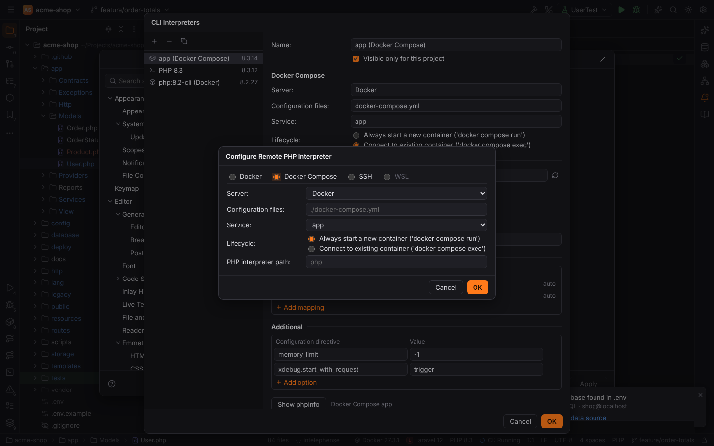

**From Docker, Vagrant, VM, WSL, Remote…** opens **Configure Remote PHP Interpreter**:

| Kind | Fields | Runs as |
| --- | --- | --- |
| Docker | Server (the default Docker or a Docker context), Image name | `docker run --rm -i -v <project>:/opt/project -w <dir> <image> php …` |
| Docker Compose | Server, Configuration files, Service, Lifecycle: **Always start a new container** (`docker compose run --rm`) or **Connect to existing container** (`docker compose exec`) | `docker compose -f <file> run --rm -T -w <dir> <service> php …` |
| SSH | An SSH configuration of [Settings &#124; Tools &#124; SSH Configurations](remote-development.md#saved-configurations) | `ssh -o BatchMode=yes user@host "cd <dir> && php …"` |
| WSL (Windows only) | Linux distribution | `wsl.exe -d <distribution> --cd <dir> --exec php …` |

All kinds take the **PHP interpreter path** inside the container or on the host (default
`php`). SSH interpreters use your SSH agent or the configuration's key file (password
authentication is not available for interpreters).

**Path mappings** say where the project's files are where PHP runs. Forge derives them
("auto" rows): Docker mounts the project at `/opt/project`, Docker Compose services use the
bind mounts of their `volumes` (`.:/var/www/html`), WSL sees `C:\work\shop` as
`/mnt/c/work/shop`. Your own rows win over the automatic ones; SSH interpreters need at least
one (for example the project root ↔ `/srv/shop`). Runs map paths in arguments and the working
directory, the Run console maps paths in the output back so they stay clickable, and the
debugger uses the same mappings.

**PHP language level** can follow the interpreter: choose **From the CLI interpreter** and
Forge uses the version Reload detected (8.2.27 → 8.2). "Synchronize IDE settings with
composer.json" still wins when composer.json requires a PHP version; the status bar tooltip
says where the level comes from.

### Composer

Settings | Languages & Frameworks | PHP | Composer:

| Option | Setting | Default | What it does |
| --- | --- | --- | --- |
| Path to composer.json | `php.composer.json` | `composer.json` | relative to the project root |
| Path to composer | `php.composer.executable` | `composer` | a composer executable or a composer.phar (run with the PHP interpreter); "Download composer.phar from getcomposer.org" fetches one with your consent |
| Synchronize IDE settings with composer.json | `php.composer.syncWithComposerJson` | on | the language level follows `require.php` (`^8.2` → 8.2, `^7.3 \|\| ^8.0` → 7.4); without a constraint the language level setting applies |
| Add packages as libraries | `php.composer.addPackagesAsLibraries` | on | classes in `vendor/` are resolved for navigation and completion and indexed by Intelephense; off leaves `vendor/` out |
| Check for package updates on project open | `php.composer.checkUpdates` | off | runs `composer outdated --direct` on the project's machine and lists the updates in a balloon |
| Use Packagist for completion, versions and outdated packages | `php.composer.packagist` | on | package names, versions and outdated markers from packagist.org (cached); off: installed packages only |

The composer.json toolbar, outdated packages, completion of packages and versions, Manage
Composer Dependencies and `composer audit` are described on the [Composer](composer.md) page.
Run Composer scripts with a **Composer Script** run configuration, see
[Run/Debug configurations](run-debug.md).

### Code style


Settings | Editor | Code Style | PHP (schemes, presets and the preview are described in
[Editor](editor.md#code-style)):

- **Set from…** sets every PHP option from **PSR-12**, **PER Coding Style 2.0**, **Symfony**,
  **Laravel** (Pint's `laravel` preset), **WordPress** or **Drupal**.
- **Tabs and Indents** (tab character, tab size, indent, continuation indent, indents on
  empty lines) apply while you type, to Reformat Code and to the status bar's indent.
- **Spaces**: before the parentheses of declarations, calls, anonymous and arrow functions,
  `if`, `for`/`foreach`, `while`, `switch`/`match` and `catch`; around assignment, logical,
  equality, relational, additive and multiplicative operators, concatenation (`.`), `??`
  and `=>`; within parentheses (WordPress' `foo( $a )`); before/after commas, after type
  casts (`(int) $a`) and after `!` (Laravel's `! $a`).
- **Wrapping and Braces**: brace placement in class declarations, function declarations and
  other blocks (End of line / Next line; a multi-line parameter list keeps `) {` together as
  PSR-12 says, and empty bodies stay `{}`), and `else`, `catch` and `finally` on a new line.
  Intelephense formats with the closest of its brace styles; the Generate actions write
  methods with the function brace placement.
- **Blank Lines**: Forge cuts runs of blank lines to **Keep maximum blank lines in code** and
  sets the blank lines **After namespace**, **After imports**, **Around method** (at least)
  and **Before return statement** (Symfony and Laravel: one). Generated methods are separated
  by "Around method" blank lines.
- **Code Conversion**: array declaration style (keep, short `[]` or long `array()`), a comma
  after the last element of multi-line arrays, and `true`/`false`/`null` in lower or upper
  case.
- **Imports**: sorting (alphabetically, by length), grouping (by kind, by kind and
  namespace), blank lines between groups and "Prefer FQN"; Optimize Imports, Auto Import and
  the refactorings follow them, see [Optimize Imports and Auto Import](imports.md#php-code-style-imports).

Reformat Code (`Ctrl+Alt+L`) lets Intelephense format the file and then applies the spaces,
brace placement, blank lines and conversions on the lines as they are. Strings, heredocs,
comments and inline HTML are never changed.

### Quality Tools

Settings | Languages & Frameworks | PHP | Quality Tools sets the PHP CS Fixer and Laravel Pint
executables (`php.tools.phpCsFixer.path`, `php.tools.pint.path`); empty means
`vendor/bin/php-cs-fixer` and `vendor/bin/pint` of the project. They run on save with
**Run PHP CS Fixer** / **Run Laravel Pint**, and Optimize imports, Rearrange code and code
cleanup of PHP files run there too, see [Actions on Save](actions-on-save.md).

## Running and testing PHP

- **PHP Script** run configurations run a file with the CLI interpreter — the project's, or
  the one the configuration picks ([CLI interpreters](#cli-interpreters): local, Docker,
  Docker Compose, SSH, WSL).
- **PHPUnit**, **Pest**, **Codeception**, **Behat** and **PHPSpec** configurations run tests;
  tests get ▶ icons in the gutter and results appear as a test tree with Rerun Failed Tests,
  Test History and auto-test. Where each framework comes from is set in **Settings | PHP |
  Test Frameworks**, see [PHP test frameworks](test-frameworks.md).
- **PHP scratch files** run with the project's autoloader.

See [Run/Debug configurations](run-debug.md), [Debugging](debugging.md) and
[Scratches](scratches-and-http.md).

## Remote projects

In a [remote project](remote-development.md) the PHP index and the language server run on the
remote host through the Forge agent; Structure, search, hover, Generate, navigation, usages,
gutter icons, Rename, context actions, metadata and attribute inspections and completion,
include paths (folders on the remote host) and source roots work as locally; renamed and fixed files are written on
the remote host. The PHP stubs are read on this machine.
