# PHP

PHP support is the **PHPForge** pack (plugin `forge.php`). It combines two engines:

- **Forge's PHP index**, built with tree-sitter in Rust: classes, interfaces, traits, enums,
  functions, constants, members, PHPDoc and attributes of every PHP file in the project. It
  powers the Structure tool window, Go to Class/Symbol, index-based hover, the Generate
  actions and [navigation](#navigation) when no language server answers, and works without
  any language server.
- **A PHP language server**, Intelephense or Phpactor, for completion, diagnostics,
  Go to Declaration, hover and formatting. See
  [Language servers](language-servers.md#php-intelephense-and-phpactor).

The pack activates in projects with a `composer.json` or `.php` files.

## The PHP index

Indexing starts when a PHP project opens. The status bar shows **Indexing… 45%** with a
progress bar; afterwards the index follows file changes on its own.

- Files in `vendor/` are not indexed up front. When a class from a dependency is needed (as an
  ancestor, in hover), Forge loads it on demand through Composer's PSR-4 autoload map.
- The index is cached in `<cache dir>/forge/php-index/` (keyed by the project path), so the
  next start only re-reads changed files. Nothing is written into the project.
- **Reindex PHP Files** (Find Action) rebuilds it.
- Extra library folders can be added under Settings | Languages & Frameworks | PHP |
  **Include Path** (`php.includePaths`); they are also passed to the language server.

## Structure

The **Structure** tool window (`Alt+7`, macOS `Cmd+7`) lists the classes of the active file
with their constants, properties and methods, including signatures and visibility. Click an
entry to jump to it.

- **Show Inherited** adds members of parent classes, traits and interfaces, grayed and with
  the declaring class.
- **Sort Alphabetically** sorts within each kind.

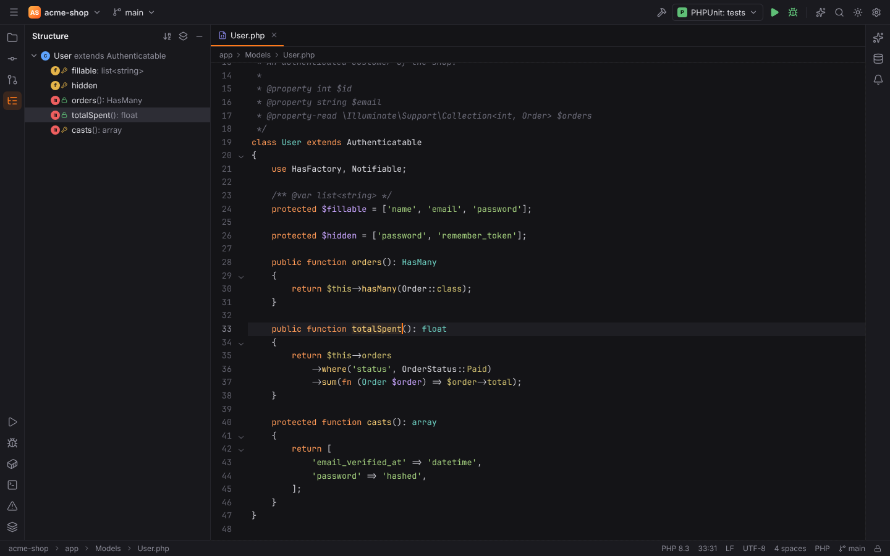

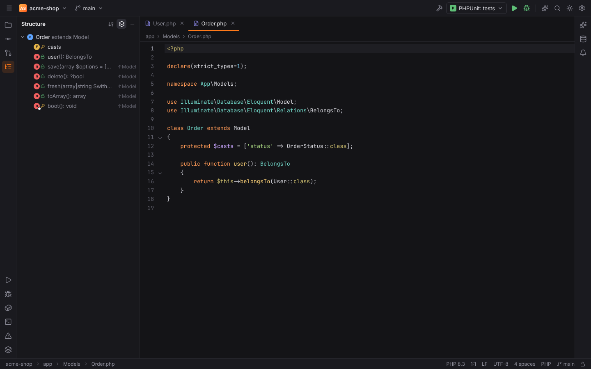

## Go to Class and Go to Symbol

**Go to Class** (`Ctrl+N`, macOS `Cmd+O`) and **Go to Symbol** (`Ctrl+Alt+Shift+N`, macOS
`Cmd+Alt+O`) search the PHP index with camel-hump matching: `OrCo` finds
`OrderController`, `OrderController::sto` finds its `store` method. See
[Search Everywhere](search-everywhere.md).

## Navigation

Navigation works like in PHPStorm on every PHP symbol. The language server answers first;
when none runs (or it has no answer) Forge's PHP index does, so navigation also works without
Intelephense. Everything runs through the project's backend, so it works the same in
[remote projects](#remote-projects).

### Go to Declaration

`Ctrl+Click`, `Ctrl+B` (macOS `Cmd+Click`, `Cmd+B`) or a middle click jumps to the declaration
of:

- classes, interfaces, traits and enums, written with or without a leading backslash
  (`\Throwable`, `\App\Models\User`, `User`), resolved through `use` imports (also aliases
  `use X as Y` and group uses `use App\Models\{User, Order}`) and the current namespace;
- names in `use` statements, including `use function` and `use const`;
- functions (`array_map`, namespaced functions with PHP's fallback to the global function);
- methods and properties on `$this`, `self::`, `static::`, `parent::`, class names and
  variables, typed through parameters, `new`, `catch (X $e)`, inline `/** @var X $x */`,
  property types and PHPDoc, and call chains through return types
  (`$user->orders()->first()`);
- class constants, enum cases and namespace constants (`PHP_EOL`, `const VERSION = 2`);
- variables: the parameter or first assignment in the method or function.

While `Ctrl` (macOS `Cmd`) is held, the symbol under the mouse is underlined like a link and a
small tooltip shows where it is declared: the namespace or class and the declaration.

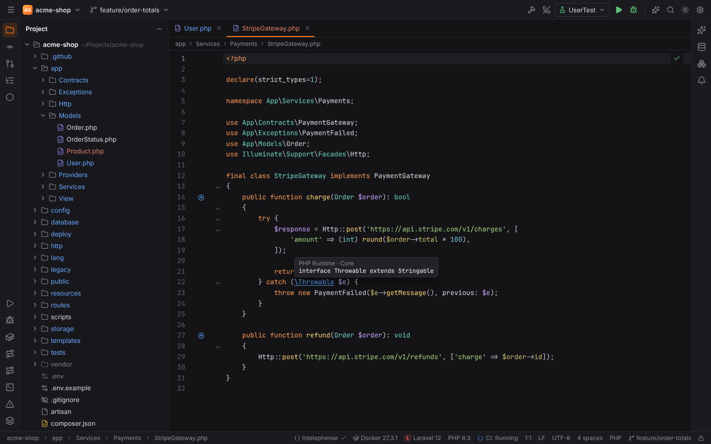

On a declaration itself (a class name in `class User`, a method or function name, a property,
a variable's first assignment), Go to Declaration shows its **usages** instead, like
PHPStorm's "Declaration or Usages"; a single usage opens directly. Several targets open the
Choose Declaration popup. `Ctrl+Alt+Click` (macOS `Cmd+Alt+Click`) goes to the
implementations.

### PHP's own classes and functions

`\Throwable`, `\Exception`, `ArrayAccess`, `PDO`, `array_map`, `PHP_EOL` and the other
built-in symbols open their declaration in the **PHP stubs**, read-only, like PHPStorm's "PHP
Runtime" library. The tab shows a banner "Read-only library file" with the source of the
stubs, and the breadcrumbs read `PHP Runtime › Core › Core_c.php › Throwable`. Library files
cannot be edited; navigation inside them (for example from `Exception` to `Throwable`) works.

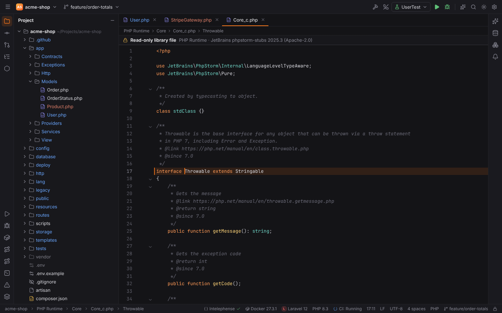

Where the stubs come from:

1. Settings | Languages & Frameworks | PHP | **Default stubs path** (`php.stubs.path`): a
   checkout of [JetBrains' phpstorm-stubs](https://github.com/JetBrains/phpstorm-stubs)
   (Apache-2.0) or a compatible folder.
2. Otherwise Forge downloads a pinned phpstorm-stubs release on first use into
   `<cache dir>/forge/php-stubs/<version>`, checks the unpacked files against a pinned digest
   and keeps its licence file. The status bar shows the download.
3. When Intelephense is installed and nothing else is available, its own stubs are used.

When Intelephense runs, its definition (which points into the stubs inside its package) is
opened read-only directly.

> **Note:** the download needs access to `codeload.github.com`. Offline, set **Default stubs
> path** or install Intelephense; otherwise Go to Declaration on a built-in symbol explains how
> to get the stubs.

### Show Usages and Find Usages

**Show Usages** (`Ctrl+Alt+F7`, macOS `Cmd+Alt+F7`, or `Ctrl+Click` on a declaration) opens
a popup with every usage: the code line with the reference highlighted, file and line,
grouped by usage type like PHPStorm (Usage in import, New instance creation, Method call,
Static member access, Usage in extends/implements clause, Usage in type declaration, Usage in
PHPDoc, Dynamic usages, …). `Up`/`Down` select, `Enter` opens, `Escape` closes; the pin
button **Open in Find Window** keeps the result in the Find tool window.

For a method or function the popup lists its call sites. Calls through a parent or child
class count too: the usages of an interface method include calls on its implementations.

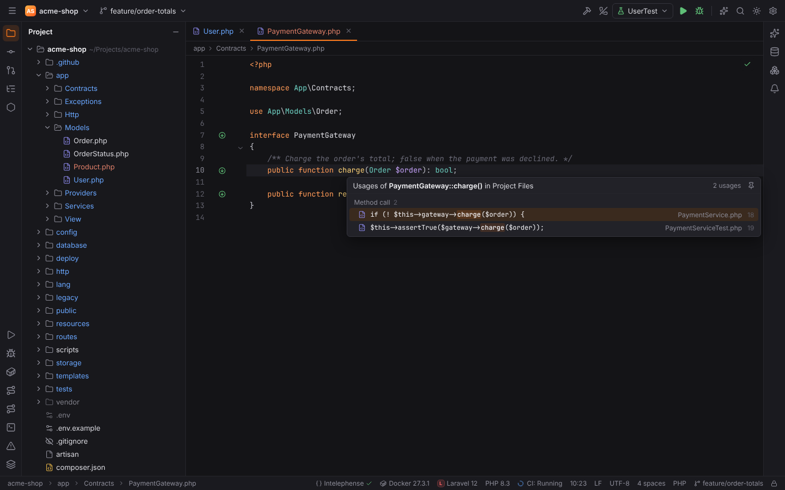

**Find Usages** (`Alt+F7`) shows the usages in the **Find** tool window (`Alt+3`, macOS
`Cmd+3`): one tab per search, a tree grouped by usage type (toggle **Group by Usage Type**)
and file. Click a usage to open it.

Members used on expressions the index cannot type (`$any->save()`) are listed as **Dynamic
usages**. Comments and strings are not usages.

### Implementation, Super Method and Type Declaration

| Action | Shortcut | macOS | Goes to |
| --- | --- | --- | --- |
| Implementation(s) | `Ctrl+Alt+B` | `Cmd+Alt+B` | classes extending or implementing the class or interface at the caret, or the methods overriding the method |
| Super Method | `Ctrl+U` | `Cmd+U` | the method this method overrides or implements; on a class, its parent and interfaces |
| Type Declaration | `Ctrl+Shift+B` | `Cmd+Shift+B` | the class of the variable, property or method return type at the caret |

Several targets open the Choose Declaration popup with names and namespaces. Go to
Implementation needs Intelephense Premium in Intelephense; without a licence Forge answers from
the index, and says so when the index finds nothing either.

### Gutter icons

Like PHPStorm, the gutter marks inheritance:

- ↓ on a class with subclasses ("Is subclassed by"), on an interface with implementations and
  on interface or abstract methods with implementations ("Is implemented in"), and on methods
  overridden in subclasses ("Is overridden in");
- ↑ on methods that implement an interface method ("Implements method in") or override a
  parent's method ("Overrides method in").

Click an icon to go to the target, or to choose one of several.

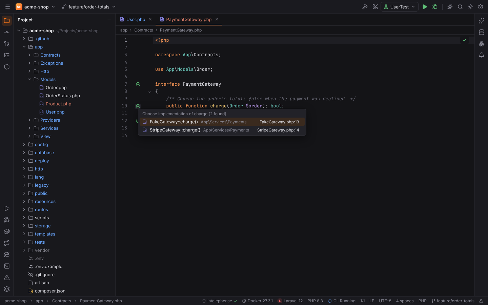

## Rename

**Rename…** (`Shift+F6`) works on classes, interfaces, traits, enums, methods, properties,
constants, functions and variables; see [Editor](editor.md#rename) for the in-place editing,
the dialog and undo.

- With **Intelephense Premium** (licence key in Settings | Languages & Frameworks | PHP) or
  Phpactor, the language server renames.
- **Intelephense without a licence** cannot rename. Forge then renames with its PHP index: the
  declaration and every usage the index finds in the project (imports, `new`, static calls,
  type hints, PHPDoc types, `$this->` and typed receivers, members through parent and child
  classes). Members used on expressions the index cannot type (dynamic usages) are not renamed;
  Forge says how many it skipped. The first time this happens in a session, a balloon explains
  that the full rename needs Intelephense Premium and links to the licence key setting.
- Renaming a class also renames its file when the file is named after it (`Order.php` →
  `Purchase.php`).
- Conflicts: a class with the new name in the same namespace, or a method, property or constant
  with the new name in the same class, are listed in **Problems Detected** before anything
  changes.

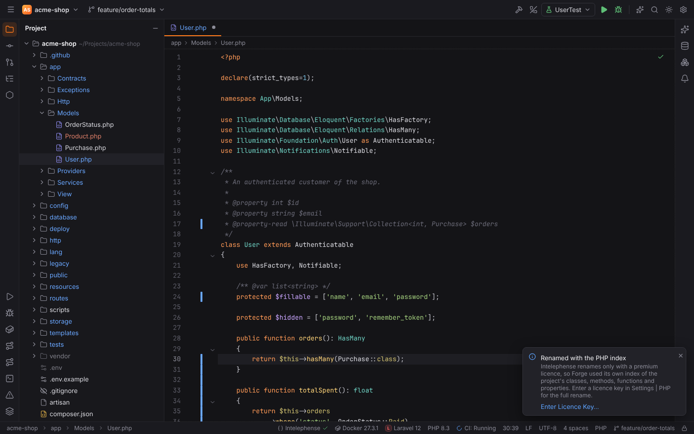

## Context actions and intentions

**Show Context Actions** (`Alt+Enter`) lists the language server's quick fixes (Intelephense
Premium) and Forge's own PHP intentions, see [Editor](editor.md#show-context-actions):

| Intention | Where |
| --- | --- |
| Import class 'App\Models\Order' | on a class name that is neither imported nor declared in the namespace (one entry per candidate) |
| Replace qualifier with an import | on a fully qualified name (`\App\Models\Order`) |
| Generate getter and setter / getter / setter | on a property without accessors |
| Add 'readonly' modifier | on a typed, non-static property without a default value (also promoted constructor properties) |
| Add method stubs | on a class name that does not implement all abstract or interface methods |
| Generate PHPDoc for '…' | on a function, method or property without a PHPDoc comment |
| Generate… | anywhere in a class: opens the Generate popup (`Alt+Insert`) |

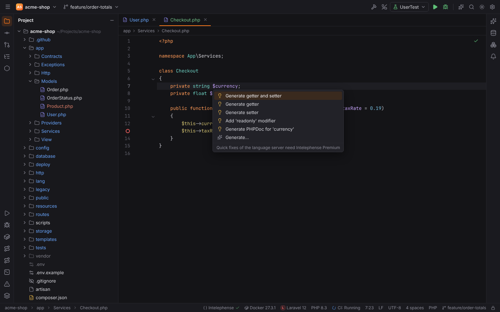

Without Intelephense Premium the popup shows only Forge's intentions and says that the language
server's quick fixes need Premium.

## Hover documentation

Hovering a class, function, method, property or constant shows its signature, attributes
(for example `#[Route('/orders', name: 'orders')]`) and its PHPDoc (description, `@param`,
`@return`, `@throws`, `@deprecated`, links) as a PHPStorm-style popup. The language server's
answer is merged with the index; when no server runs, or it has nothing for a symbol, the
index answers alone.

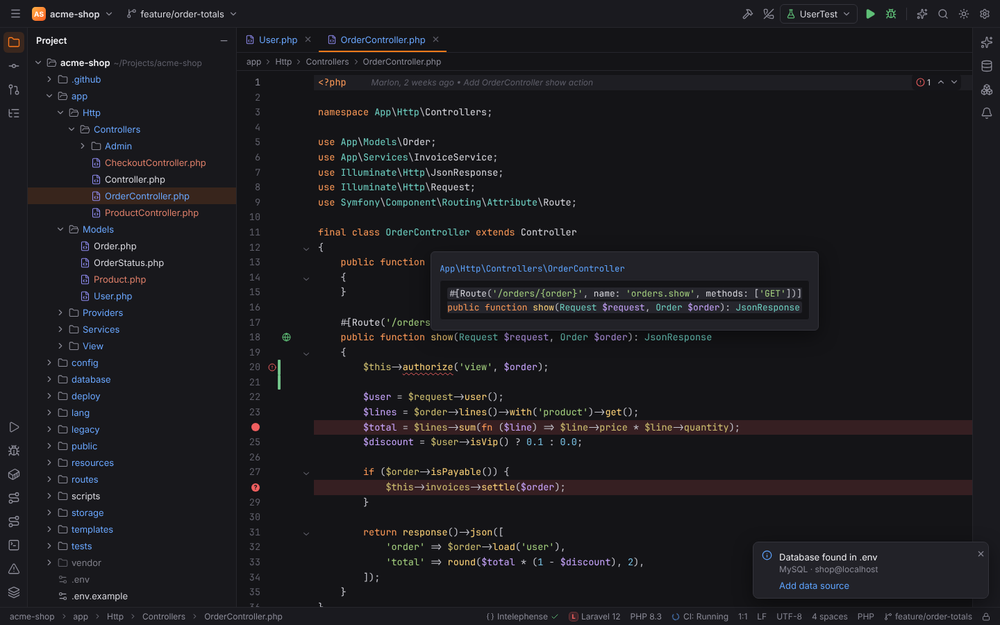

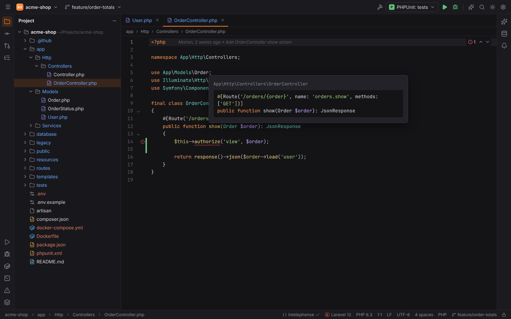

## Generate

**Generate…** (`Alt+Insert`, macOS `Cmd+N`) in a PHP file opens a popup at the caret with
what can be generated there:

| Entry | Generates |
| --- | --- |
| Constructor | a constructor with a parameter per chosen field that assigns it (`$this->x = $x`) |
| Getters | `getX()` / `isX()` for booleans |
| Setters | `setX()`; tick **Fluent setters** to return `$this` (`: static`) |
| Getters and Setters | both |
| Override Methods… (`Ctrl+O`) | stubs for inherited methods that are not overridden yet |
| Implement Methods… (`Ctrl+I`) | stubs for abstract and interface methods |
| toString() | a `__toString()` method |
| PHPDoc Comment | a PHPDoc block for the function, method, property or class at the caret, with `@param`, `@return` and `@throws` |

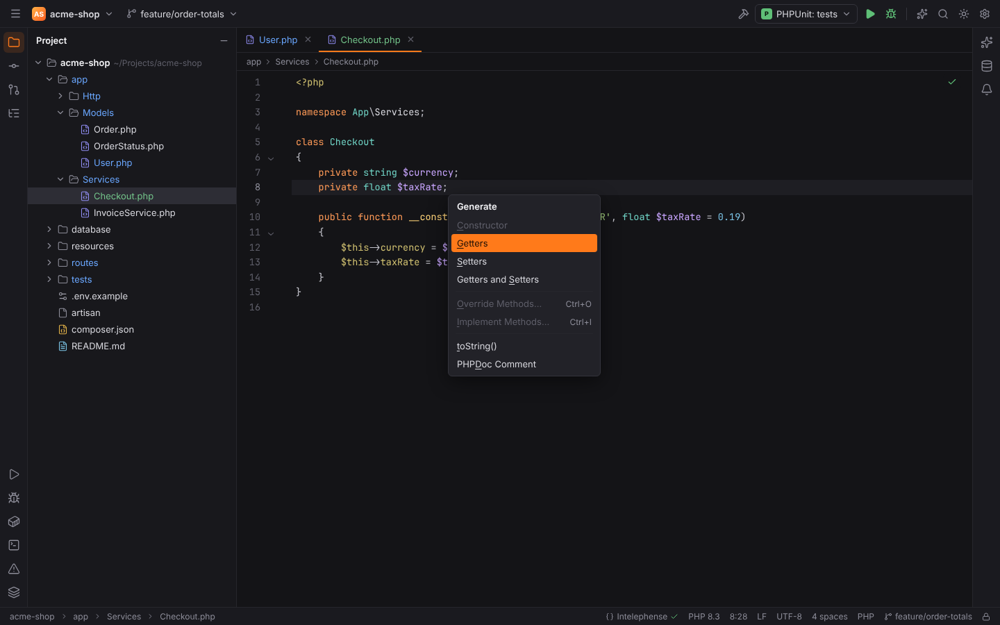

Entries that do not apply are disabled (for example Constructor when the class already has
one). Type the underlined letter to pick an entry. For fields and methods a chooser dialog
opens ("Choose Fields to Generate Getters and Setters", "Select Methods to Override") with
**Select All** / **Select None**:

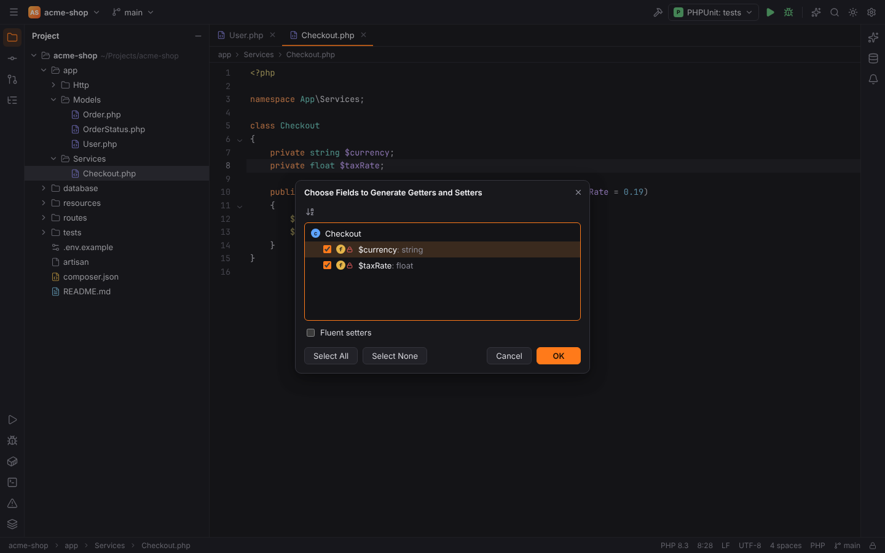

The generated code follows the class's indentation, inserts properties after the last
property and methods at the end of the class, and adds the `use` imports that inherited
signatures need.

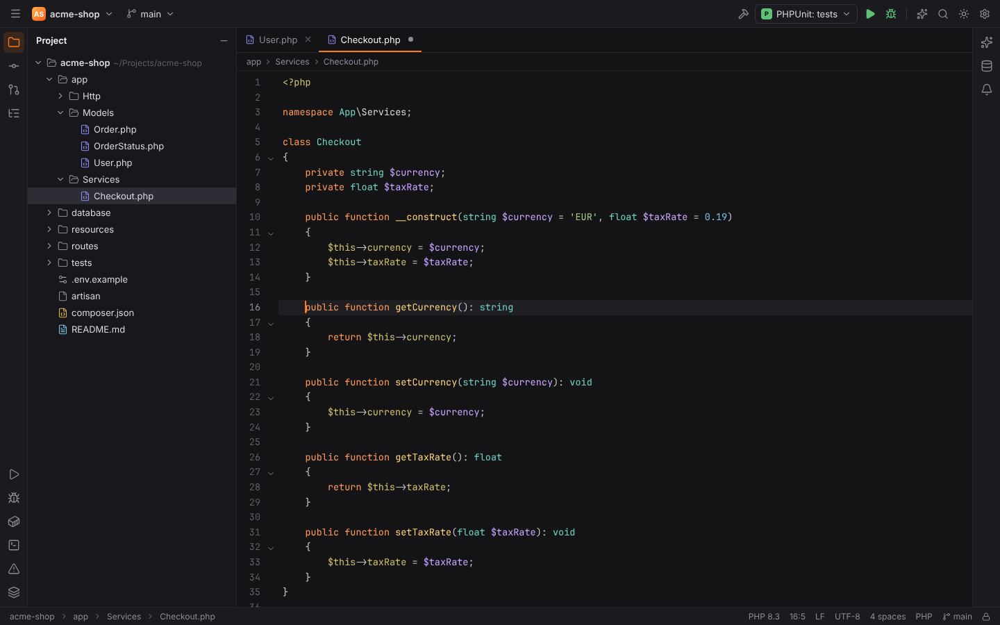

The bodies of implemented and overridden methods and the PHPDoc blocks come from the code
templates in Settings | Editor | File and Code Templates | Code (for example
`// TODO: Implement ${NAME}() method.`), see [File and code templates](file-templates.md#code-templates).
New PHP classes, interfaces, traits and enums with their PSR-4 namespace are created with
New ▸ PHP Class in the Project view ([New PHP Class dialog](file-templates.md#the-new-php-class-dialog)).

`Ctrl+O` and `Ctrl+I` work directly in PHP editors as shortcuts for Override/Implement
Methods.

## Settings | Languages & Frameworks | PHP

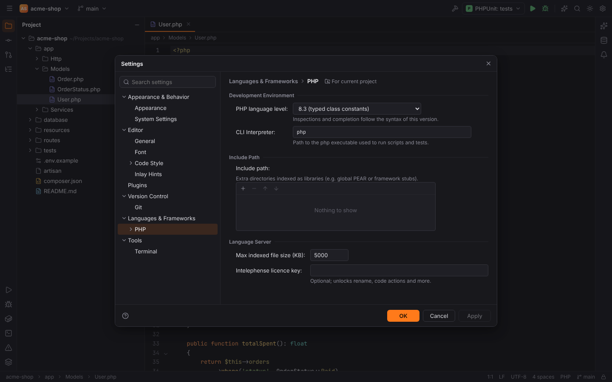

| Option | Setting | Default |
| --- | --- | --- |
| PHP language level (7.4 – 8.4) | `php.languageLevel` | 8.3 |
| CLI Interpreter (path to `php`) | `php.interpreter` | `php` |
| Language server (Auto, Intelephense, phpactor, None) | `php.lsp.server` | Auto |
| Max indexed file size for the server (KB) | `php.lsp.maxFileSize` | 5000 |
| When Intelephense is not installed (`ask`, `always`, `never`), see [Installing Intelephense](language-servers.md#installing-intelephense) | `php.intelephense.autoInstall` | `ask` |
| I accept the Intelephense licence | `php.intelephense.licenceAccepted` | off |
| Include Path | `php.includePaths` | empty |
| Default stubs path (PHP Runtime), see [PHP's own classes and functions](#phps-own-classes-and-functions) | `php.stubs.path` | empty (managed download) |

The language level and the interpreter can be stored per project ("For current project" in
the page header). The status bar shows the language level in effect ("PHP 8.3"; its tooltip
says when it comes from composer.json); click it to open this page. The page also shows the [Intelephense licence](language-servers.md#intelephense-licence-key-premium).

Sub-pages: **Composer**, **Debug**, **Servers** (see [Xdebug debugging](debugging.md)),
**Laravel**, **Symfony**, **Doctrine**.

### Composer

Settings | Languages & Frameworks | PHP | Composer:

| Option | Setting | Default | What it does |
| --- | --- | --- | --- |
| Path to composer | `php.composer.executable` | `composer` | used by Composer run configurations and the update check |
| Path to composer.json | `php.composer.json` | `composer.json` | relative to the project root |
| Synchronize IDE settings with composer.json | `php.composer.syncWithComposerJson` | on | the language level follows `require.php` (`^8.2` → 8.2, `^7.3 \|\| ^8.0` → 7.4); without a constraint the language level setting applies |
| Add packages as libraries | `php.composer.addPackagesAsLibraries` | on | classes in `vendor/` are resolved for navigation and completion and indexed by Intelephense; off leaves `vendor/` out |
| Check for package updates on project open | `php.composer.checkUpdates` | off | runs `composer outdated --direct` on the project's machine and lists the updates in a balloon |

Run Composer scripts with a **Composer Script** run configuration, see
[Run/Debug configurations](run-debug.md).

### Code style

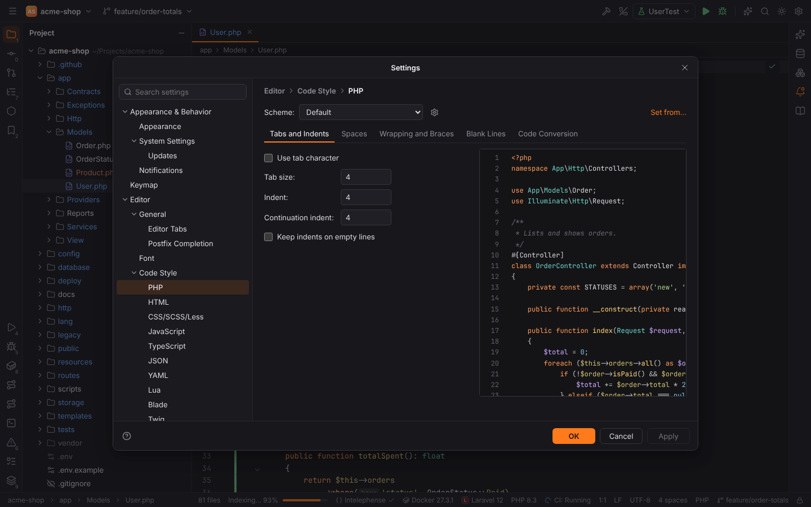

Settings | Editor | Code Style | PHP:

- **Tabs and Indents** (tab character, tab size, indent, continuation indent) apply while you
  type, to Reformat Code and to the status bar's indent, see [Editor](editor.md#code-style).
- **Braces placement** (`php.codeStyle.braces`): PSR-12 (next line for classes and functions,
  end of line otherwise), next line everywhere or end of line everywhere. Reformat Code passes
  it to Intelephense's formatter; the [Generate](#generate) actions write methods with it.
- **Blank Lines**: after Reformat Code (`Ctrl+Alt+L`) Forge cuts runs of blank lines to
  **Keep maximum blank lines in code** and sets the blank lines **After namespace**, **After
  imports** and **Around method** (at least). Strings, heredocs and comments are never
  changed. Generated methods are separated by "Around method" blank lines.

## Running and testing PHP

- **PHP Script** run configurations run a file with the CLI interpreter.
- **PHPUnit** configurations run a class, method, directory or `phpunit.xml`; test classes
  and methods get ▶ icons in the gutter and results appear as a test tree.
- **PHP scratch files** run with the project's autoloader.

See [Run/Debug configurations](run-debug.md), [Xdebug debugging](debugging.md) and
[Scratches](scratches-and-http.md).

## Remote projects

In a [remote project](remote-development.md) the PHP index and the language server run on the
remote host through the Forge agent; Structure, search, hover, Generate, navigation, usages,
gutter icons, Rename and context actions work as locally; renamed and fixed files are written on
the remote host. The PHP stubs are read on this machine.
