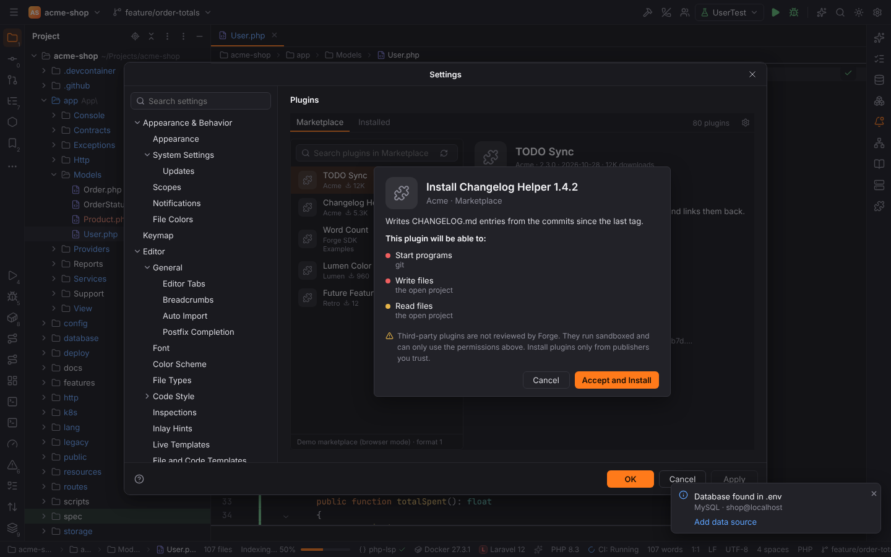
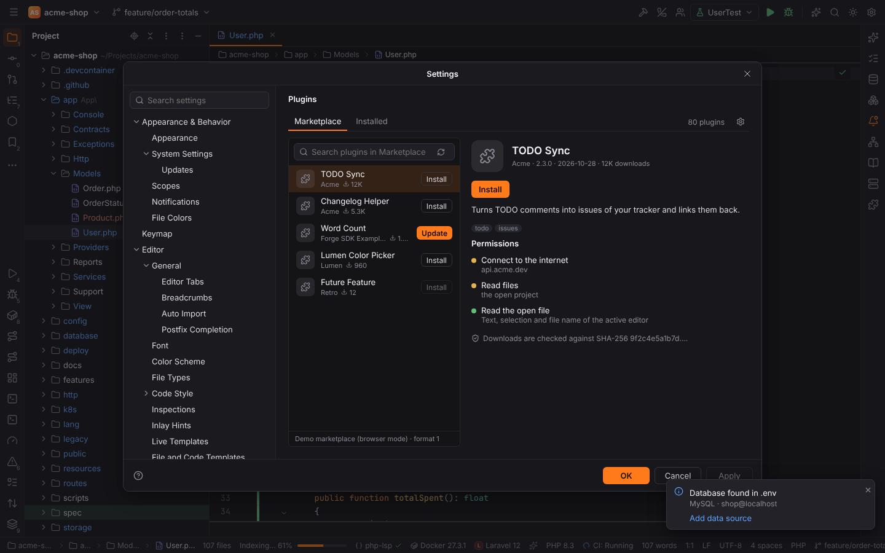

# Plugins and packs

Everything in Forge beyond the workbench is a **plugin**. Plugins are grouped in **packs**:

| Pack | Plugins |
| --- | --- |
| **Core** | Forge Platform (required), Git, GitLab/Forgejo/GitHub, Terminal, Run/Debug, Database Tools and SQL, Docker and Kubernetes, Language Servers, AI Assistant, Claude Code, Gemini CLI, Browser Companion |
| **PHPForge** | PHP, Composer, PHPUnit, Xdebug, Laravel, Symfony, Symfony Services, Doctrine |
| **WebForge** | HTML, CSS & JavaScript, React, Vue.js, Angular |
| **LuaForge** | Lua |
| **PyForge** | Python: interpreters, packages, requirements inspections |
| **GoForge** | Go: SDK and GOPATH, modules, gofmt / goimports, go vet, golangci-lint, Go Build / Go Test, Delve, Profiler |
| **RubyForge** | Ruby: interpreters of rbenv, rvm, chruby, asdf and mise, Bundler, Rake, Ruby / Rake run configurations, RSpec and Minitest, rdbg, RuboCop, Ruby LSP, ERB, the IRB console |
| **RustForge** | Rust: rustup toolchains, the Cargo tool window, Cargo and Cargo Test configurations (nextest, doctests, coverage), Clippy, rustfmt, rust-analyzer, LLDB / GDB with Rust type renderers |
| **JavaForge** | Java (Maven, Gradle, JUnit, TestNG, the Java debugger), Groovy, Scala with sbt, Android |
| **CForge** | C and C++ (clangd, toolchains, CMake, CTest / GoogleTest / Catch2, LLDB / GDB) |
| **DotNetForge** | .NET: C#, F# and Visual Basic (SDKs, solutions and MSBuild projects, the Build and NuGet tool windows, dotnet run / watch with launch profiles, xUnit / NUnit / MSTest, netcoredbg, dotnet new, dotnet format, the Roslyn language server) |
| **KotlinForge** | Kotlin (kotlin-lsp, Kotest, coroutines debugging, ktlint, detekt) |
| **ScriptForge** / **ConfigForge** | Bash, Python / YAML, JSON, .env, Ignore Files, Docker files, Postfix, E-Mail, INI, Config Files |

The packs are built in; there is no separate download. Third-party plugins can be added from
the [Marketplace](#marketplace) or a `.forgeplugin` file (see [Third-party plugins](#third-party-plugins)).

## When plugins are active

A plugin is active when it is **enabled** and the open project **uses** it. Plugins may declare
project types (a language, framework, pack or tool id); without project types they are always
active. For example Laravel needs `laravel`, PHPUnit needs `phpunit` or `pest`, React needs
`react` or `next`. See [Project type detection](../getting-started/project-detection.md) and
the full list in [Reference: plugins](../reference/plugins.md).

Inactive plugins hide their tool windows, status bar widgets and editor features, and their file
types fall back to the bundled ones (in a non-Symfony project `config/services.yaml` is plain
YAML).

## Settings | Plugins

The **Installed** tab lists all plugins grouped by pack, with a search field and a details pane
(description, version, vendor, dependencies). The checkbox enables or disables a plugin;
**Forge Platform** is required and cannot be disabled. Dependent plugins follow: disabling PHP
also disables Laravel, Symfony, Doctrine, Composer, PHPUnit and Xdebug.

Disabled plugins are remembered in the user settings (`plugins.disabled`, a list of plugin ids).

## Third-party plugins

Plugins from other publishers are installed from the **Marketplace** tab or with the gear menu
⚙ | **Install Plugin from Disk…** (a `.forgeplugin` file). They are listed under
**Downloaded** on the Installed tab, where you can enable, disable and **Uninstall** them.

Before a plugin is installed or updated, Forge shows what it may do, most sensitive first:

| Permission | Means |
| --- | --- |
| Start programs | run the named programs (for example `git`) in the project folder |
| Write files | write in the open project or only in the plugin's own data folder |
| Connect to the internet | send requests to the named hosts only |
| Edit the open file | change the text of the active editor |
| Read files | read the open project (or a folder of it) or its own data folder |
| Read and change IDE settings | the named settings; a plugin's own settings need no permission |
| Read the open file | text, selection and file name of the active editor |

An update that asks for more marks the new permissions. Forge enforces them: the plugin's code
runs in a sandbox and every request outside of it is checked. Plugins never load native code.

Third-party plugins live in Forge's data folder (`<data dir>/forge/plugins`, their data in
`<data dir>/forge/plugin-data`), never in a project. In [Safe Mode](project-trust.md) plugins
that may start programs or write project files are not loaded, and no plugin may start
programs or write project files.

## Marketplace

The Marketplace tab reads a plugin index from the URL set with ⚙ | **Marketplace URL…**
(setting `plugins.marketplace.url`). It lists the plugins with search, details, permissions,
**Install** and **Update**; ⚙ | **Check for Updates** reports installed plugins with newer
versions. Every download is checked against the SHA-256 checksum in the index. With trusted
publisher keys (setting `plugins.marketplace.trustedKeys`, base64 Ed25519 public keys) a
valid signature from one of them is required as well.

> **Note:** no public Forge marketplace is live yet. The default URL
> `https://plugins.forge.example/index.json` is a placeholder, so the tab says that no
> marketplace is configured until you enter the URL of an index, for example one your team
> hosts. The index format is described in [Publishing plugins](../developer/plugins/publishing.md).

To write a plugin, see the [plugin SDK](../developer/plugins/index.md).
