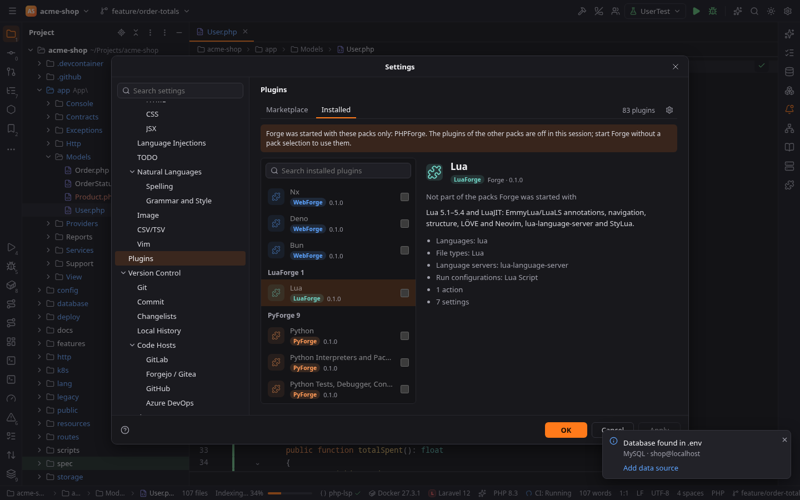
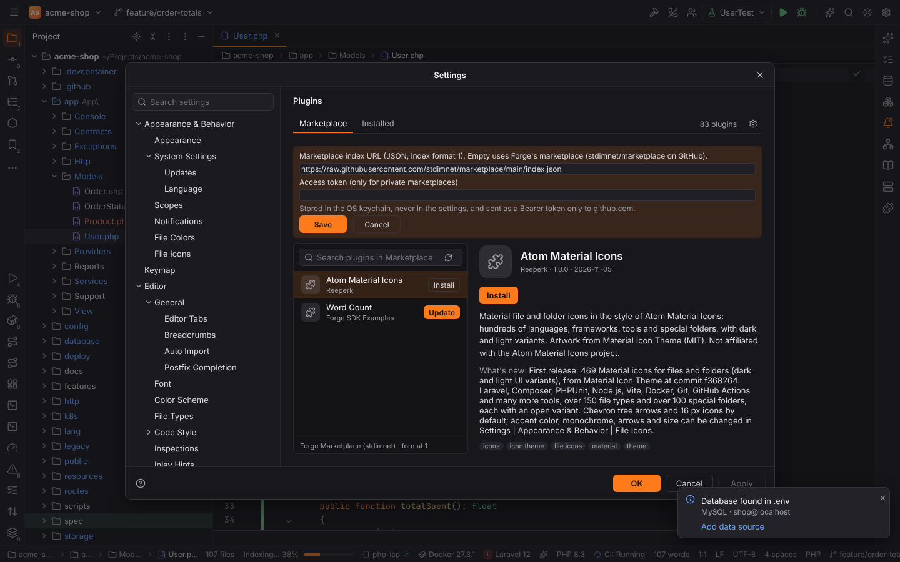
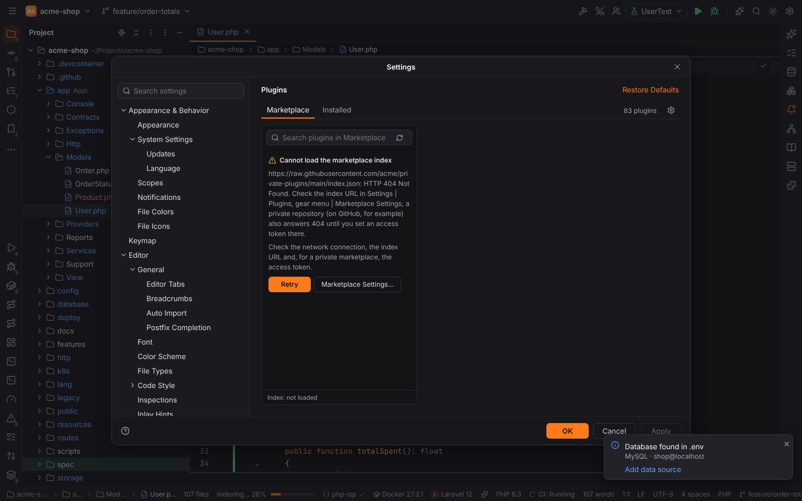

# Plugins and packs

Everything in Forge beyond the workbench is a **plugin**. Plugins are grouped in **packs**:

| Pack | Plugins |
| --- | --- |
| **Core** | Forge Platform (required), Git, GitLab/Forgejo/GitHub, Terminal, Run/Debug, Database Tools and SQL, Docker and Kubernetes, Language Servers, AI Assistant, Claude Code, Gemini CLI, Browser Companion |
| **PHPForge** | PHP, Composer, PHPUnit, Xdebug, Laravel, Symfony, Symfony Services, Doctrine |
| **WebForge** | HTML, CSS & JavaScript, React, Vue.js, Angular |
| **LuaForge** | Lua |
| **PyForge** | Python: interpreters, packages, requirements inspections |
| **GoForge** | Go: SDK and GOPATH, modules, gofmt / goimports, go vet, golangci-lint, Go Build / Go Test, Delve, Profiler |
| **RubyForge** | Ruby: interpreters of rbenv, rvm, chruby, asdf and mise, Bundler, Rake, Ruby / Rake run configurations, RSpec and Minitest, rdbg, RuboCop, Ruby LSP, ERB, the IRB console |
| **RustForge** | Rust: rustup toolchains, the Cargo tool window, Cargo and Cargo Test configurations (nextest, doctests, coverage), Clippy, rustfmt, rust-analyzer, LLDB / GDB with Rust type renderers |
| **JavaForge** | Java (Maven, Gradle, JUnit, TestNG, the Java debugger), Groovy, Scala with sbt, Android |
| **CForge** | C and C++ (clangd, toolchains, CMake, CTest / GoogleTest / Catch2, LLDB / GDB) |
| **DotNetForge** | .NET: C#, F# and Visual Basic (SDKs, solutions and MSBuild projects, the Build and NuGet tool windows, dotnet run / watch with launch profiles, xUnit / NUnit / MSTest, netcoredbg, dotnet new, dotnet format, the Roslyn language server) |
| **KotlinForge** | Kotlin (kotlin-lsp, Kotest, coroutines debugging, ktlint, detekt) |
| **ScriptForge** / **ConfigForge** | Bash, Python / YAML, JSON, .env, Ignore Files, Docker files, Postfix, E-Mail, INI, Config Files |

The packs are built in; there is no separate download. Third-party plugins can be added from
the [Marketplace](#marketplace) or a `.forgeplugin` file (see [Third-party plugins](#third-party-plugins)).

## When plugins are active

A plugin is active when it is **enabled** and the open project **uses** it. Plugins may declare
project types (a language, framework, pack or tool id); without project types they are always
active. For example Laravel needs `laravel`, PHPUnit needs `phpunit` or `pest`, React needs
`react` or `next`. See [Project type detection](../getting-started/project-detection.md) and
the full list in [Reference: plugins](../reference/plugins.md).

Inactive plugins hide their tool windows, status bar widgets and editor features, and their file
types fall back to the bundled ones (in a non-Symfony project `config/services.yaml` is plain
YAML).

## Starting Forge with some packs

`forge` loads every pack. To get an IDE for one stack, start Forge under the pack's name or
with the `--packs` option; the plugins of the other packs are then off for that session:

| Start | Loads |
| --- | --- |
| `forge` | every pack |
| `phpforge`, `webforge`, `pyforge`, `goforge`, `rustforge`, `rubyforge`, `javaforge`, `kotlinforge`, `cforge`, `dotnetforge`, `luaforge` | the core and that pack |
| `forge --packs phpforge,webforge` | the core and the packs listed |
| `forge --packs none` | the core alone: no language packs |
| `forge --packs all` | every pack, also when started under a pack's name |

- **Names** are links to or copies of the Forge program. On Linux and macOS:
  `ln -s "$(command -v forge)" ~/.local/bin/phpforge`. On Windows copy `forge.exe` to
  `phpforge.exe` in the same folder, or put the option into a shortcut:
  `forge.exe --packs phpforge`. A link to an AppImage works the same way. Upper and lower
  case do not matter, and a name that is no pack starts the usual Forge.
- The option wins over the `FORGE_PACKS` environment variable (the same list), which wins
  over the name.
- **Always loaded:** the core plugins (Git, Terminal, Run/Debug, Database, AI, …),
  ConfigForge and ScriptForge (YAML, JSON, `.env`, Bash, …), the plugins you installed from
  the Marketplace or from disk, and whatever a loaded plugin depends on (`kotlinforge` also
  loads Java). PHPForge, PyForge, RubyForge, JavaForge and DotNetForge also load
  **HTML, CSS & JavaScript** for their templates; add `webforge` for React, Vue.js, Angular
  and the JavaScript tools.
- The selection belongs to the session, not to your settings: plugins you disabled stay
  disabled, and starting `phpforge` does not disable anything for `forge`. Project windows
  opened from the session and a restart keep its packs.
- Forge runs once: while it is open, starting it under another name hands the files and
  folders to the open window, which keeps its packs.

**Settings | Plugins** names the packs of the session above the list. The plugins of the other
packs are unchecked and cannot be switched there; their details say
"Not part of the packs Forge was started with".

Forge is one program either way: the packs are not separate downloads, and a session with
fewer packs does not take less disk space.

## Settings | Plugins

The **Installed** tab lists all plugins grouped by pack, with a search field and a details pane
(description, version, vendor, dependencies). The checkbox enables or disables a plugin;
**Forge Platform** is required and cannot be disabled. Dependent plugins follow: disabling PHP
also disables Laravel, Symfony, Doctrine, Composer, PHPUnit and Xdebug.

Disabled plugins are remembered in the user settings (`plugins.disabled`, a list of plugin ids).

## Third-party plugins

Plugins from other publishers are installed from the **Marketplace** tab or with the gear menu
⚙ | **Install Plugin from Disk…** (a `.forgeplugin` file). They are listed under
**Downloaded** on the Installed tab, where you can enable, disable and **Uninstall** them.

Before a plugin is installed or updated, Forge shows what it may do, most sensitive first:

| Permission | Means |
| --- | --- |
| Start programs | run the named programs (for example `git`) in the project folder |
| Write files | write in the open project or only in the plugin's own data folder |
| Connect to the internet | send requests to the named hosts only |
| Edit the open file | change the text of the active editor |
| Read files | read the open project (or a folder of it) or its own data folder |
| Read and change IDE settings | the named settings; a plugin's own settings need no permission |
| Read the open file | text, selection and file name of the active editor |

An update that asks for more marks the new permissions. Forge enforces them: the plugin's code
runs in a sandbox and every request outside of it is checked. Plugins never load native code.

Third-party plugins live in Forge's data folder (`<data dir>/forge/plugins`, their data in
`<data dir>/forge/plugin-data`), never in a project. In [Safe Mode](project-trust.md) plugins
that may start programs or write project files are not loaded, and no plugin may start
programs or write project files.

## Marketplace

The Marketplace tab lists the plugins of Forge's marketplace, the
[`stdimnet/marketplace`](https://github.com/stdimnet/marketplace) repository on GitHub (for
example the **Atom Material Icons** icon theme). It has search, details, permissions,
**Install** and **Update**; ⚙ | **Check for Updates** reports installed plugins with newer
versions. Every download is checked against the SHA-256 checksum in the index. With trusted
publisher keys (setting `plugins.marketplace.trustedKeys`, base64 Ed25519 public keys) a
valid signature from one of them is required as well.

⚙ | **Marketplace Settings…** changes where the plugins come from:

- **Marketplace index URL** (setting `plugins.marketplace.url`): the index the tab reads.
  Empty means Forge's marketplace,
  `https://raw.githubusercontent.com/stdimnet/marketplace/main/index.json`. Enter the URL of
  another index, for example one your team hosts. The index format is described in
  [Publishing plugins](../developer/plugins/publishing.md).
- **Access token**: only for a private marketplace, for example a private GitHub repository
  (a fine-grained token with read access to its contents). Forge stores it in the OS
  keychain, never in the settings, and sends it only to the index's host (for an index on
  GitHub: `raw.githubusercontent.com`, `github.com` and `api.github.com`), never to other
  hosts the index links to. **Remove Token** deletes it.

When the index cannot be read (offline, a wrong URL, a private marketplace without a valid
token), the tab says why, for example `HTTP 404 Not Found`, with **Retry** and a button that
opens Marketplace Settings.

To write a plugin, see the [plugin SDK](../developer/plugins/index.md).
