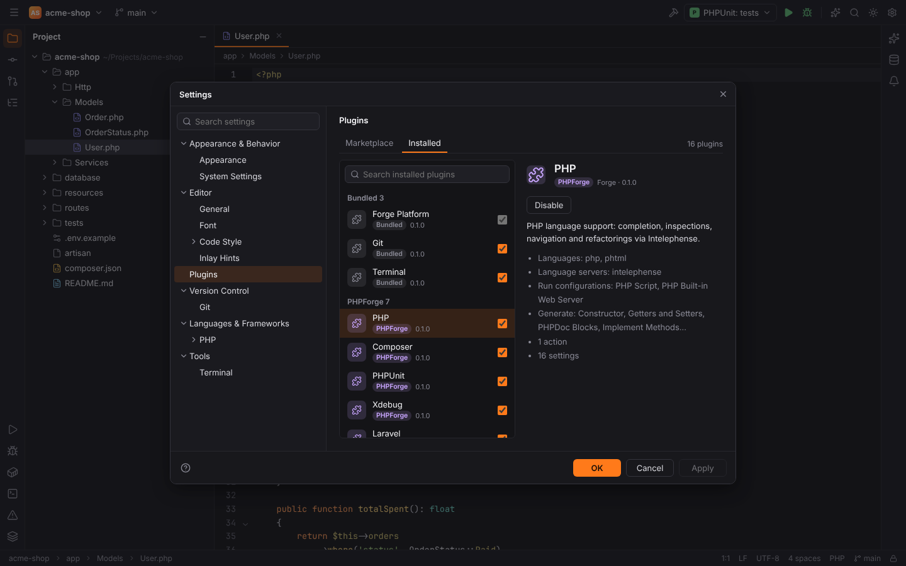

# Plugins and packs

Everything in Forge beyond the workbench is a **plugin**. Plugins are grouped in **packs**:

| Pack | Plugins |
| --- | --- |
| **Core** | Forge Platform (required), Git, GitLab/Forgejo/GitHub, Terminal, Run/Debug, Database Tools and SQL, Docker and Kubernetes, Language Servers, AI Assistant, Claude Code, Gemini CLI, Browser Companion |
| **PHPForge** | PHP, Composer, PHPUnit, Xdebug, Laravel, Symfony, Symfony Services, Doctrine |
| **WebForge** | HTML, CSS & JavaScript, React, Vue.js, Angular |
| **LuaForge** | Lua |
| **PyForge** | Python: interpreters, packages, requirements inspections |
| **JavaForge** | Java (Maven, Gradle, JUnit, TestNG, the Java debugger) |
| **KotlinForge** | Kotlin (kotlin-lsp, Kotest, coroutines debugging, ktlint, detekt) |
| **ScriptForge** / **ConfigForge** | Bash, Python / YAML, JSON, .env, Ignore Files, Docker files, Postfix, E-Mail, INI, Config Files |

All plugins are built in; there is no separate download.

## When plugins are active

A plugin is active when it is **enabled** and the open project **uses** it. Plugins may declare
project types (a language, framework, pack or tool id); without project types they are always
active. For example Laravel needs `laravel`, PHPUnit needs `phpunit` or `pest`, React needs
`react` or `next`. See [Project type detection](../getting-started/project-detection.md) and
the full list in [Reference: plugins](../reference/plugins.md).

Inactive plugins hide their tool windows, status bar widgets and editor features, and their file
types fall back to the bundled ones (in a non-Symfony project `config/services.yaml` is plain
YAML).

## Settings | Plugins

The **Installed** tab lists all plugins grouped by pack, with a search field and a details pane
(description, version, vendor, dependencies). The checkbox enables or disables a plugin;
**Forge Platform** is required and cannot be disabled. Dependent plugins follow: disabling PHP
also disables Laravel, Symfony, Doctrine, Composer, PHPUnit and Xdebug.

Disabled plugins are remembered in the user settings (`plugins.disabled`, a list of plugin ids).

> **Note:** the **Marketplace** tab is not available yet, and third-party plugins cannot be
> installed. New integrations are added to Forge itself; see
> [Writing a plugin or pack](../developer/plugins-and-packs.md).
