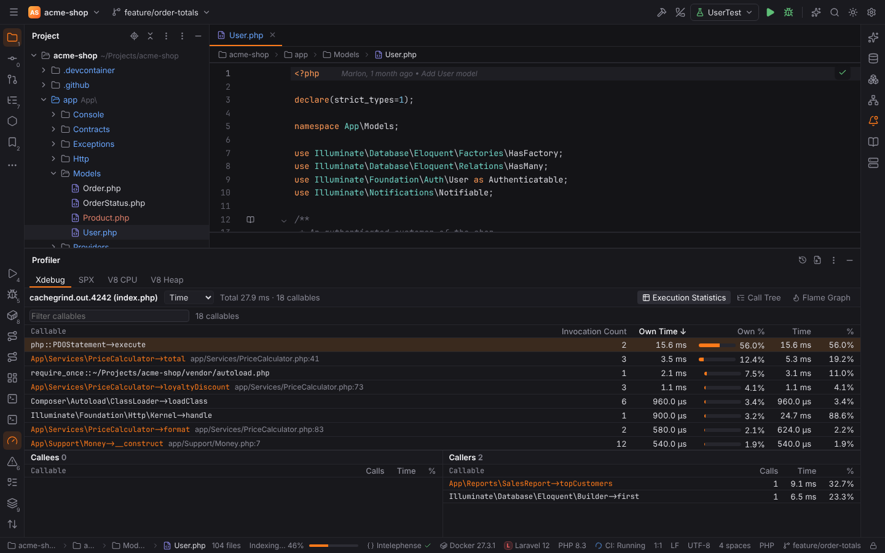
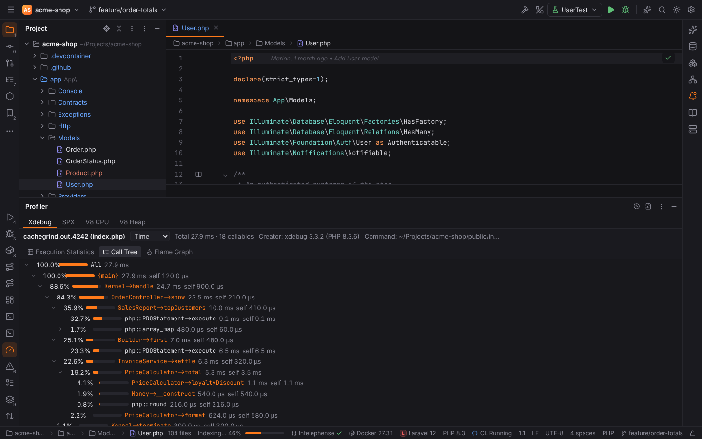
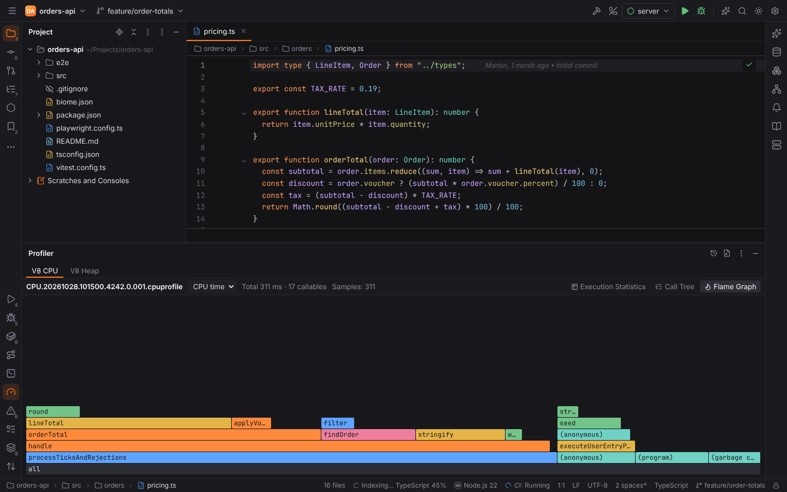
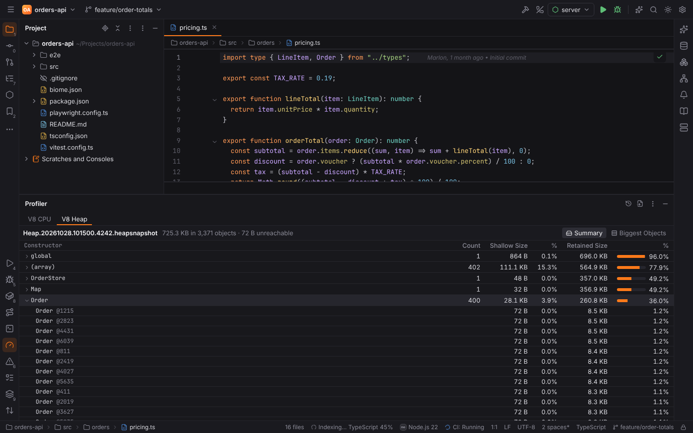

# Profiling PHP and Node.js

Forge reads the snapshots of the common PHP and JavaScript profilers and shows them in the
**Profiler** tool window, like PHPStorm's Xdebug snapshot view and the V8 CPU and memory
profilers:

| Source | Files | How to get one |
| --- | --- | --- |
| **Xdebug** | `cachegrind.out.*`, also gzip-compressed (`.gz`) | Run \| Profile with Xdebug, or Tools \| Analyze Xdebug Profiler Snapshot… |
| **SPX** | php-spx full reports: `spx-full-*.json` and `spx-full-*.txt.gz` | Run \| Profile with SPX, or Tools \| Open Profiler Snapshot… |
| **V8 CPU** | `.cpuprofile` (Node.js `--cpu-prof`, Chrome DevTools) | Run \| Profile with V8 |
| **V8 Heap** | `.heapprofile` (`--heap-prof`) and `.heapsnapshot` (DevTools, `v8.writeHeapSnapshot()`) | Run \| Profile Allocations with V8, or Tools \| Open Profiler Snapshot… |

The Xdebug and SPX sources appear in PHP projects, the V8 sources in JavaScript and
TypeScript projects; any source also appears once it shows a snapshot. Every file is parsed in
Rust (the `forge-profiler` crate); the snapshots of profiling runs are kept in Forge's cache
folder (`<cache>/forge/profiler/`, the newest 20), never in the project. The **Recent
Snapshots** button in the tool window's header reopens them, **Open Profiler Snapshot** opens
a file.



## The views

The toolbar shows the snapshot's name (hover it for the file, the command and the profiler
version), the **metric** (Xdebug: Time and Memory; SPX: the metrics the report recorded,
such as Wall time and ZE memory usage; V8 CPU: CPU time and Samples; heap profiles: Allocated
bytes and Samples) and the total. The tabs:

- **Execution Statistics**: one row per callable with its **Invocation Count** (samples for
  V8 profiles), **Own Time** (the cost in the callable itself), **Time** (with everything it
  called; recursive calls are counted once) and their share of the total. Click a heading to
  sort, type in the filter to find a callable. Selecting a row shows its **Callees** and
  **Callers** below, with the calls and the time spent through each of them; click one to
  jump to it.
- **Call Tree**: the call paths top down with total and own cost; branches below 0.2% of
  the total are left out.
- **Flame Graph**: the same tree with the root at the bottom; click a frame to zoom into it,
  **Reset zoom** to go back.

Double-click a callable of the project (shown in the accent color) to open its source at the
function's line. Built-in functions (`php::…`), `vendor/` and `node_modules/` code are shown but
not opened.



### What the numbers mean

- **Xdebug** writes the cost of each call and the inclusive cost of every call it makes, so
  the statistics, callers and callees are exact. The Call Tree is spread from them: a
  callee's share under a caller is proportional to the cost of the calls between them, like
  in KCachegrind. `Time_(10ns)` (Xdebug 3) and microseconds (Xdebug 2) are shown in
  milliseconds; memory is the change of PHP's memory use, so it can be negative.
- **SPX** records every call start and end with its metrics, so the call tree is exact. SPX
  reports carry no file names, so SPX callables do not open sources.
- **V8 CPU profiles** are sampled: Samples counts how often a function was on top of the
  stack, Own Time is the time of those samples. `(program)`, `(idle)` and
  `(garbage collector)` are V8's own time.

## Profiling PHP with Xdebug

**Run | Profile with Xdebug** runs the selected PHP configuration (PHP Script, PHPUnit, Pest,
Artisan, Codeception, Behat, phpspec, Built-in Web Server) with Xdebug's profiler:

```text
XDEBUG_MODE=profile php -dxdebug.mode=profile -dxdebug.start_with_request=yes -dxdebug.output_dir=<folder> …
```

When the program exits, Forge opens the newest snapshot of the run in the Profiler.
The folder is a temporary folder for local interpreters. For Docker, Docker Compose, SSH and
WSL interpreters and "Run on" targets it is `.forge/test-reports/<run>-profile` in the
project, which the interpreter reaches through its path mappings; the snapshot is read from
there, its container paths are mapped back to the project's files, and the folder is
deleted.

Xdebug 3 has to be installed and loaded by the interpreter (see
[PHP interpreters](php.md)). To analyze a snapshot written elsewhere (for example by a web
server with `xdebug.mode=profile`), use **Tools | Analyze Xdebug Profiler Snapshot…** and
pick the `cachegrind.out` file.

## Profiling PHP with SPX

**Run | Profile with SPX** runs the selected PHP configuration with
[php-spx](https://github.com/NoiseByNorthwest/php-spx) full reports:
`SPX_ENABLED=1 SPX_REPORT=full SPX_AUTO_START=1` and `-dspx.data_dir=<folder>`. The SPX
extension has to be installed in the interpreter.

If your `php.ini` sets `spx.data_dir` and you want the reports to stay there, enter the
folder in Settings | Languages & Frameworks | PHP | Debug, section Profiler, **SPX data directory**
(`php.profiler.spxDataDir`): local runs then read the newest report written there during the
run. To open a report of a web request, pick its `spx-full-….json` (or the `.txt.gz` trace) in
**Tools | Open Profiler Snapshot…**; the other file of the report is read from the same
folder.

## Profiling Node.js with V8

**Run | Profile with V8** runs the selected Node.js or npm configuration with
`--cpu-prof --cpu-prof-dir=<folder>` (npm scripts get it through `NODE_OPTIONS`) and opens the
`.cpuprofile` when the program exits. **Run | Profile Allocations with V8** uses
`--heap-prof` and opens the sampling heap profile: the Call Tree and Flame Graph then show
where memory was allocated. The program has to exit normally (not be killed) for Node.js to
write the profile. V8 profiling of npm scripts is for local runs.

Locations of bundled or compiled code are mapped to their sources when the script has a
source map: a `//# sourceMappingURL=` comment (a file or an inline `data:` URL) or a
`<script>.js.map` file next to it.



## Heap snapshots (Memory view)

A `.heapsnapshot` (Chrome DevTools | Memory | Heap snapshot | Save, `node
--heapsnapshot-signal=SIGUSR2`, or `require("v8").writeHeapSnapshot()`) opens in the
**Memory** view of the V8 Heap source. The file is read as a stream, so large snapshots work.

- **Summary**: the objects grouped by constructor (`Order`, `Map`) or kind (`(string)`,
  `(array)`, `(closure)`, `(compiled code)`, `(system)`), with their **Count**, **Shallow
  Size** (the objects themselves) and **Retained Size** (what would be freed with them,
  computed from the dominator tree; objects inside an object of the same constructor are
  counted once). Click a row to see its largest objects with their `@id`.
- **Biggest Objects**: the objects that retain the most memory.

Objects that are only reachable through weak references are left out; the toolbar shows how
much memory they take ("unreachable").



## Settings and actions

| Action | Where | Notes |
| --- | --- | --- |
| Profile with Xdebug | Run menu (PHP projects) | `profiling.profileXdebug` |
| Profile with SPX | Run menu (PHP projects) | `profiling.profileSpx` |
| Profile with V8 | Run menu (JavaScript projects) | `profiling.profileV8` |
| Profile Allocations with V8 | Run menu (JavaScript projects) | `profiling.profileV8Heap` |
| Analyze Xdebug Profiler Snapshot… | Tools menu (PHP projects) | `profiling.analyzeXdebugSnapshot` |
| Open Profiler Snapshot… | Tools menu | `profiling.openSnapshot` |
| Profiler tool window | View \| Tool Windows | `ActivateProfilerToolWindow` |

None of these actions has a default shortcut; assign one in Settings | Keymap. Profiling runs
start programs of the project, so [Safe Mode](project-trust.md) refuses them in untrusted
projects; opening snapshot files is always allowed.

Python's cProfile ([Python](python.md)), Go's pprof ([Go](go.md)) and perf
([C/C++ dynamic analysis](cpp-tools.md)) use the same Profiler tool window.
