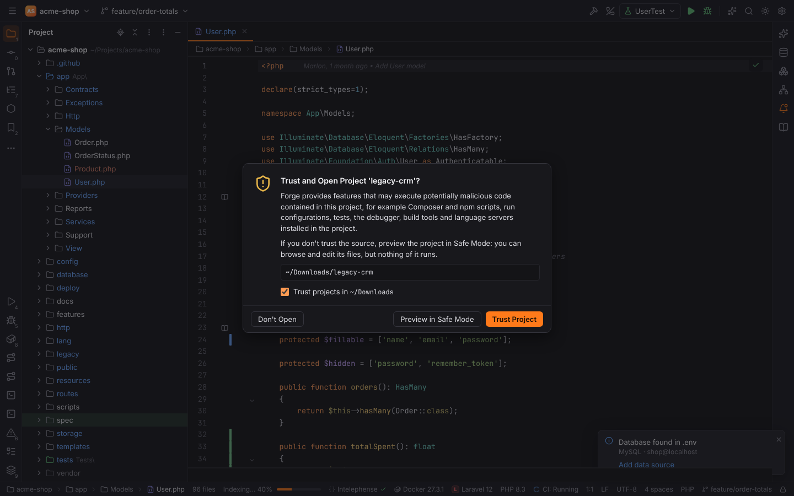
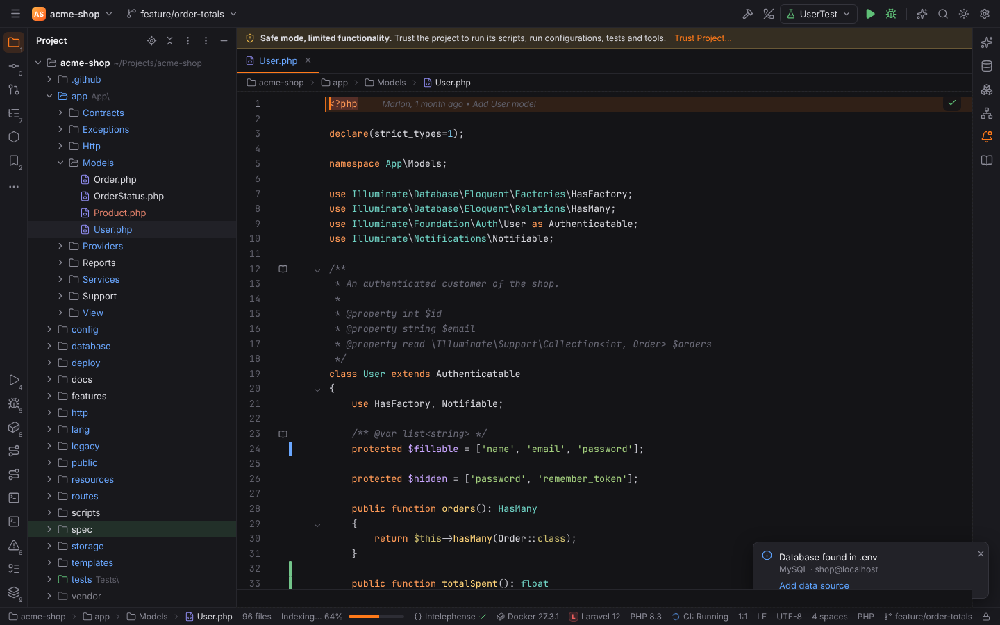
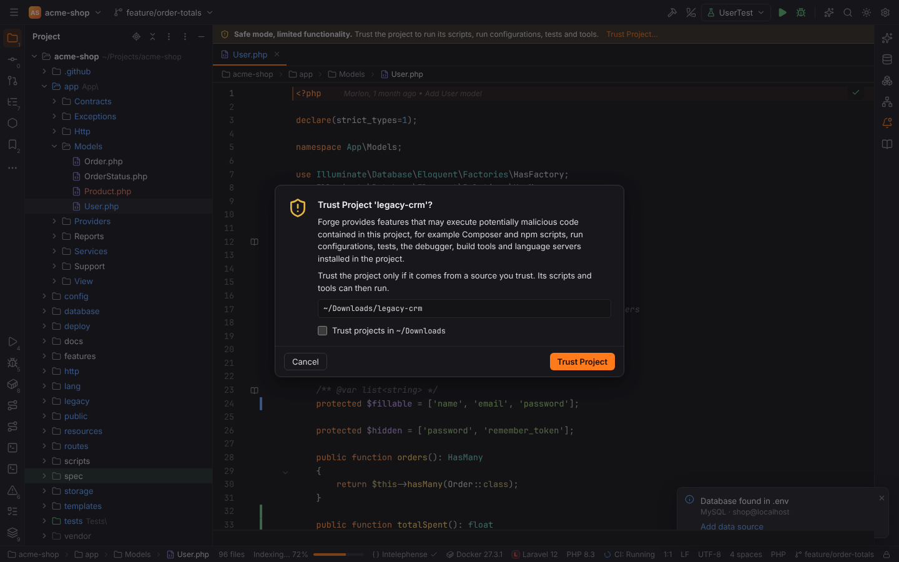
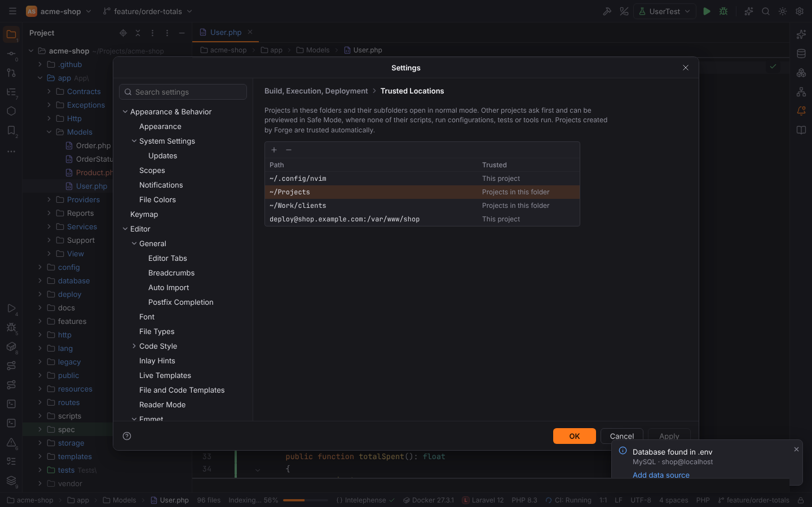

# Project trust and Safe Mode

A project can contain code that runs as soon as an IDE touches it: Composer and npm scripts,
run configurations, test suites, build files, language servers or linters installed in
`node_modules` or `vendor`. Like PHPStorm, Forge asks before it opens a project you have not
trusted yet, and opens untrusted projects in **Safe Mode**, where none of their code runs.

## Trust and Open Project?

When you open a folder that is not trusted (Open…, a recent project, `forge path`, Get from
VCS, the Browser Companion), Forge asks first:

- **Trust Project** opens the project normally and remembers the decision.
- **Preview in Safe Mode** opens it in Safe Mode: you can browse, search and edit the files,
  but nothing of the project runs. You can trust it later from the banner.
- **Don't Open** leaves the current project (or the Welcome screen) as it was.
- **Trust projects in `<parent folder>`** also trusts every project in the folder that
  contains this one (a *trusted location*), for example `~/Projects`. The option is missing
  when the parent is a file system root.

Projects Forge creates itself (File | **New Project…**) are trusted automatically. Reopening
the open project (Repair IDE) does not ask again.

A project passed on the command line while Forge starts (`forge path`) opens right away; when it
is not trusted it opens in Safe Mode and shows the banner.

## Safe Mode

While the project is in Safe Mode, the editor area shows a banner:

Click **Trust Project…** in the banner (or run *Trust Project…* through Find Action,
`Ctrl+Shift+A`) to trust it. The dialog offers the same "Trust projects in …" option:

After trusting, everything below is available at once; language servers that were held back
start on the next file you open.

### What does not run in Safe Mode

Forge's backend refuses these commands with an error that names the action, so they stay
blocked even if a plugin or the UI tries to start them:

| Feature | In Safe Mode |
| --- | --- |
| Run/Debug configurations, Before launch tasks, Run Anything, External Tools | not started (every run goes through one place in the backend) |
| Composer and npm scripts, Artisan, Symfony console, Command Line Tool Support | not started; the Run Command popup lists only the built-in Artisan and Symfony commands |
| Test runners (PHPUnit, Pest, Codeception, Behat, PHPSpec, Vitest, Jest) | not started |
| Xdebug: Start Listening, PHP Web Page | refused |
| Composer: Show Outdated, Audit | refused (Composer loads the project's plugins) |
| Laravel routes | parsed from the route files instead of `php artisan route:list` |
| Docker Compose up and Dockerfile ▶ in the gutter, Compose **Up** in Services | refused |
| PHP interpreters: version and `phpinfo()` of an interpreter inside the project or a Docker Compose service | refused |
| Language servers installed in the project (`node_modules/.bin`, `vendor/bin`, …) | not started |
| ESLint, Tailwind CSS, rust-analyzer, Ruby LSP, Java, Kotlin, Scala (Metals) and C# language servers | not started (they load the project's config files or build scripts) |
| Gradle / Maven sync, Reload sbt Project | refused (the build definition is project code) |
| Groovy scripts, sbt tasks, Android App runs (build, `adb install`, launch) | not started (they are run configurations) |
| Actions on Save: ESLint, Prettier, Rector, PHP CS Fixer, phpcbf, Laravel Pint | not run |
| PHP quality tools (PHPStan, Psalm, phpcs, PHP Mess Detector, PHP CS Fixer, Pint, Rector): checks, Reformat with …, Inspect Code, Validate | refused |
| StyLua installed in the project | not run |
| AI agents (Claude Code, Gemini CLI) | not started (they run the project's hooks and MCP servers) |
| Deployment: automatic upload on save | off (the servers and the option come from the project's own files) |
| SSH session to a deployment server (Tools \| Start SSH Session…) | asks first: the server comes from the project's files; your own SSH configurations connect without asking |

What still works: the editor, the Project view, search, the PHP and Lua indexes, Go to
Declaration, completion from the built-in analysis, language servers installed outside the
project (for example Intelephense from npm or Forge's own install), Git, Local History,
databases, the HTTP client and [Deployment](deployment.md) actions you start yourself (upload,
download, compare and sync only copy files), and the [Remote Host](remote-host-and-ssh.md)
tool window with Edit Remote File.

The **terminal** opens in Safe Mode, because you type the commands yourself. The project's own
settings (`.forge/settings.toml`) cannot choose its shell or environment variables then; your
user settings are used.

> **Note:** Git runs in Safe Mode, like in PHPStorm. Git itself can run programs a repository
> configures in `.git/config` (for example `core.fsmonitor`); Forge does not change that.

## Trusted Locations

Settings | Build, Execution, Deployment | **Trusted Locations** lists the folders whose
projects open without asking, and the projects you trusted one by one:

- **+** adds a folder (`~` is your home folder). Every project inside it, at any depth, is
  trusted. A whole drive or `/` cannot be added.
- **−** removes the selected entry. When nothing trusts the open project any more, it goes
  back to Safe Mode right away.

Changes are saved immediately. Trust decisions are stored in
`<config dir>/forge/trusted-projects.toml` (see [File locations](../reference/file-locations.md)),
never in the project and never in the settings files: a project's own `.forge/settings.toml`
cannot trust itself.

## Remote projects

Remote projects (Welcome | Remote Development) use the same rules: the project on the host is
trusted by itself or by a trusted location on the **same host, user and port**, stored as
`user@host:/path`. Because the folder on the host is only known after connecting, Forge opens
an untrusted remote project in Safe Mode first and then asks. **Don't Open** closes the project
and the connection again; nothing of it ran in the meantime. Trusted locations on this machine
never cover remote projects, and the other way round.

Dev containers are built from a folder on this machine, so the **local folder's** trust counts:
Forge asks before the image build and `postCreateCommand` (they run the project's code), refuses
both for an untrusted folder, and the project in the container is trusted with its sources. A
WSL project is trusted by its `\\wsl.localhost\<distro>\…` path. See
[Dev Containers and WSL](dev-containers-and-wsl.md).

## Browser mode

The demo projects of browser mode live in `~/Projects`, a trusted location, so they open
normally. Opening any other folder (for example `~/Downloads/legacy-crm` from a screenshot
scenario) shows the dialog, and the run mocks refuse like the desktop app does in Safe Mode.
