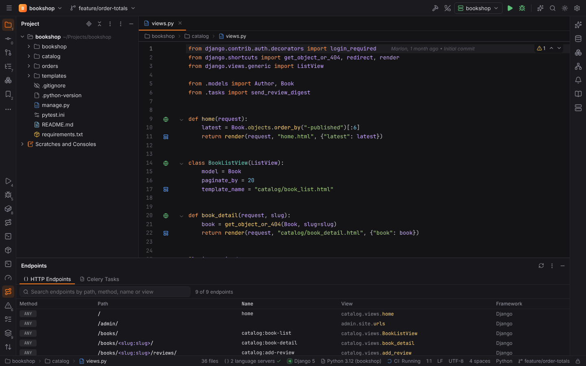
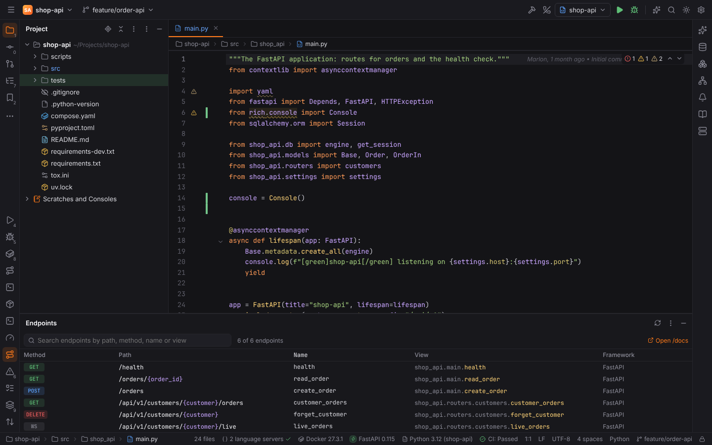
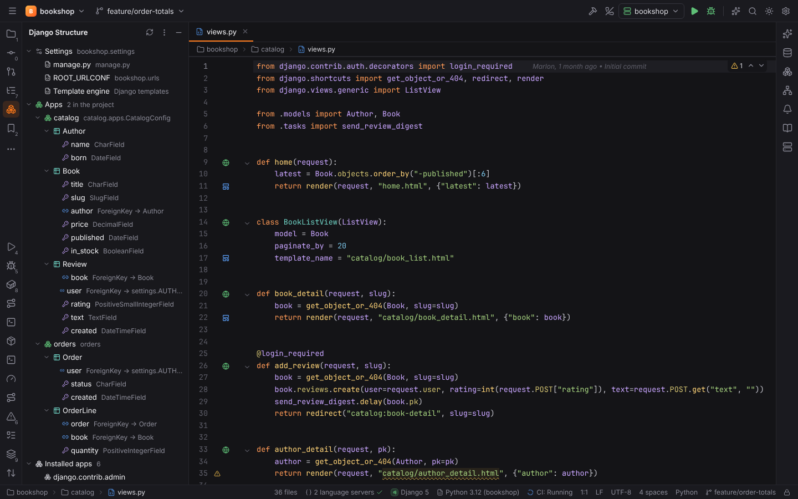
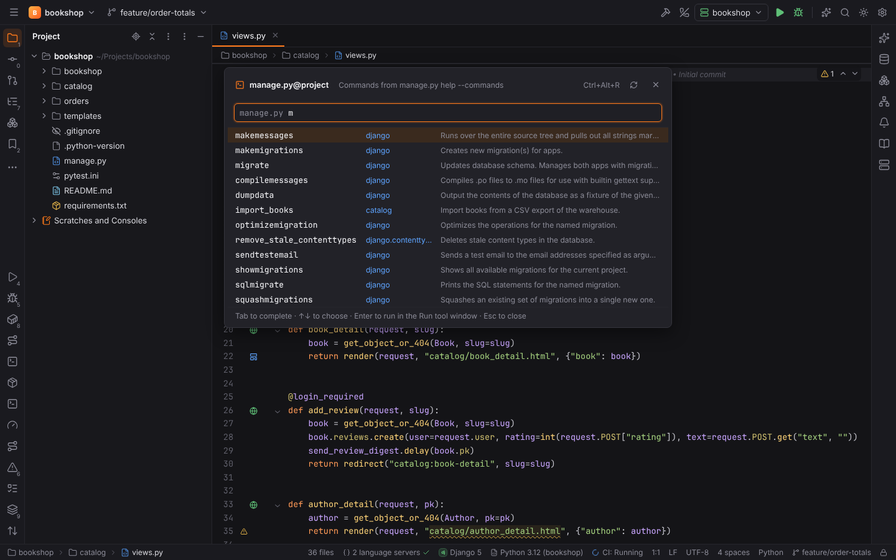
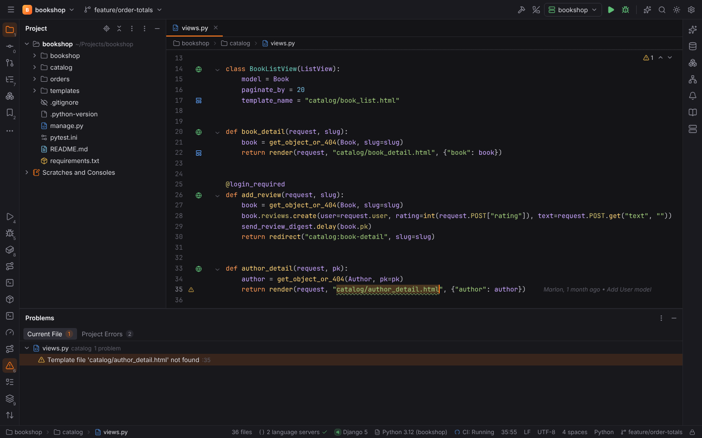
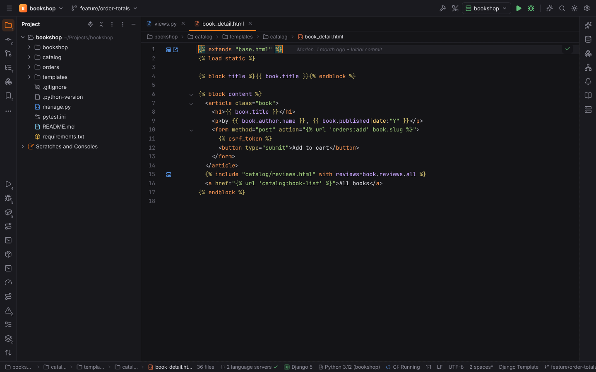
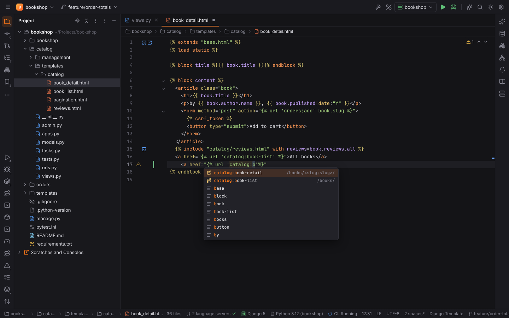
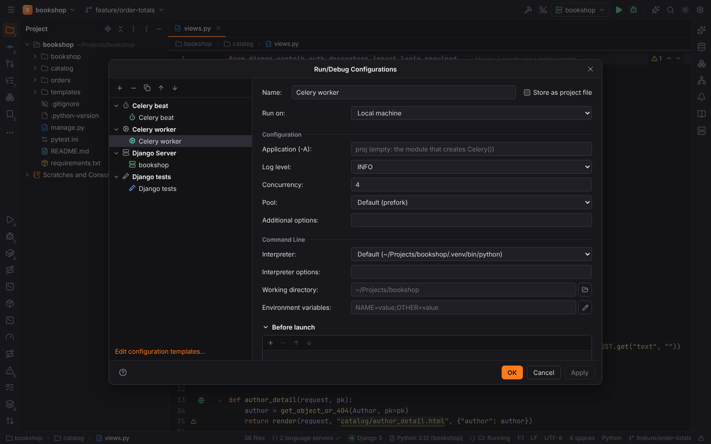

# Django, Flask, FastAPI and Celery

PyForge reads Django, Flask, FastAPI and Celery projects the way PyCharm Professional does:
URL patterns, routes, models, tasks and templates come from the sources, so nothing of the
project runs for them. Only the run configurations and the optional `manage.py help
--commands` start project code, and both are refused in [Safe Mode](project-trust.md).

| Plugin | Active when the project … | Adds |
| --- | --- | --- |
| **Python Web Frameworks** (`forge.python-web`) | uses Django, Flask or FastAPI | the Endpoints tool window, template navigation, completion and inspections |
| **Django** (`forge.django`) | has a `manage.py` and requires `django` | Django templates, the Django Structure tool window, Run manage.py Task…, the Django Server and Django tests configurations |
| **Flask** (`forge.flask`) | requires `flask` | Jinja2 templates in `templates/`, the Flask Server configuration |
| **FastAPI** (`forge.fastapi`) | requires `fastapi` | the FastAPI configuration and the link to `/docs` |
| **Celery** (`forge.celery`) | requires `celery` | Celery tasks and the Celery worker and Celery beat configurations |

A framework is required when `requirements*.txt` (also `requirements/*.txt`),
`pyproject.toml` or the `Pipfile` declares it (see
[project detection](../getting-started/project-detection.md)); the version comes from
`uv.lock` / `poetry.lock` or the constraint, for example **Django 5** in the status bar.
Switch any of the plugins off in Settings | Plugins.

## Endpoints tool window

**View | Tool Windows | Endpoints** lists every HTTP endpoint of the project:

- **Django**: the URL patterns of `ROOT_URLCONF`, followed through `include()` with their
  route prefixes and namespaces (`app_name`, `namespace=`, `include(("shop.urls", "shop"))`,
  inline lists). `path()`, `re_path()` and the old `url()` are read; the name is the
  qualified URL name (`catalog:book-detail`).
- **Flask**: `@app.route(..., methods=[...])`, `@bp.get()` and the other verb decorators,
  `add_url_rule()`, blueprints with their `url_prefix` and the prefix given to
  `register_blueprint()`. The name is the endpoint (`admin.dashboard`).
- **FastAPI**: `@app.get()`, `.post()`, … `.api_route(methods=[...])` and `.websocket()` on
  `FastAPI()` apps and `APIRouter(prefix=...)` routers, with the prefixes of
  `include_router(router, prefix=...)`, also for routers included in other routers.

Type to filter by path, method, name or view; with several frameworks a switch filters by
framework. Clicking a row opens the view function or class. The context menu also offers:

- **Go to URL Pattern** / **Go to Route Declaration**;
- **Open in HTTP Client**: a new HTTP request scratch (see
  [Scratches and HTTP client](scratches-and-http.md)) with the endpoint's method and URL, path
  parameters filled with sample values (`/books/slug/`, `/orders/1`). The send button at the
  end of a row does the same;
- **Open in Browser**, **Copy URL** and **Copy Path**.

The server address is the host and port of the project's first Django Server, Flask Server
or FastAPI configuration (else `127.0.0.1:8000`, Flask `:5000`). For FastAPI projects the
toolbar links to the interactive API documentation, **Open /docs**.

The **Celery Tasks** tab lists the functions decorated with `@shared_task`, `@app.task` or
`@celery.task` (with or without arguments) under their registered name: `name=` or
`<module>.<function>`.

## Django

### Settings detection

The settings module is `DJANGO_SETTINGS_MODULE` from `manage.py`
(`os.environ.setdefault("DJANGO_SETTINGS_MODULE", "mysite.settings")`), else a `settings.py`
next to a `urls.py`. Forge reads `INSTALLED_APPS`, `ROOT_URLCONF` and `TEMPLATES` (`DIRS`
relative to `BASE_DIR`, `APP_DIRS`, the Jinja2 backend) from it, following
`from .base import *` into settings packages.

Settings | Languages & Frameworks | Python | **Django** overrides what is found:

| Setting | Key | Default |
| --- | --- | --- |
| Settings module | `django.settingsModule` | empty: from `manage.py` |
| Manage script | `django.manageScript` | empty: the shallowest `manage.py` |
| Read manage.py commands from the project | `django.manageCommandsFromProject` | on |
| Test runner of new Django tests configurations | `django.testRunner` | Django test runner |

### Django Structure tool window

**View | Tool Windows | Django Structure** shows the settings in effect, the project's apps
with their models and fields (relations with their target model), the installed third-party
apps and the template folders. Double-click a model or field to open it.

### Run manage.py Task…

**Tools | Run manage.py Task…** (`Ctrl+Alt+R`, macOS `Alt+R`) opens a prompt that completes
the project's commands with their app and description: `Tab` completes, `Enter` runs the task
with its arguments (`makemigrations catalog`) in the Run tool window, through the project's
interpreter.

In a trusted project the list is the output of `manage.py help --commands`, so third-party
commands are included; it is cached until you reload it with the button in the popup. In
Safe Mode, or with `django.manageCommandsFromProject` off, Forge lists Django's built-in
commands and the project's own `<app>/management/commands/*.py` without running anything.

### Templates

HTML files in `templates/` folders of a Django project are **Django Template** files (also
`.djhtml`): `` tags, `{{ }}` variables, filters and `{# #}` comments are highlighted on
top of the HTML, with folding and matching of block tags (see
[file types](file-types.md)). The template folders are `TEMPLATES` `DIRS`, each app's
`templates/` (`jinja2/` with the Jinja2 backend) and any other `templates/` folder.

- **Go to Declaration** (`Ctrl+B`, `Ctrl+Click`) on a template name opens the template:
  `render(request, "catalog/book_detail.html")`, `render_to_string`, `get_template`,
  `select_template`, `TemplateResponse`, `template_name = "..."` of generic views, and
  ``, ``, `` / `` in templates. The name
  resolves like Django's loader: the first folder that has it wins.
- On a URL name in ``, `reverse()`, `reverse_lazy()`,
  `redirect()` or `resolve_url()` it goes to the URL pattern.
- **Completion** inside those strings offers the template names and URL names (with their
  path).
- **Gutter icons** mark template references (click to open the template), views served by a
  URL pattern (click to go to the pattern) and, in a template, the views that render it.
- The **unresolved template** inspection warns about template names no folder has, and URL
  names no pattern defines.

### Django Server and Django tests

The **Django Server** configuration runs `manage.py runserver <host>:<port>` (default
`127.0.0.1:8000`, optionally `--noreload`) from the folder of `manage.py` with
`DJANGO_SETTINGS_MODULE` set; empty fields take the detected manage script and settings.
**Debug** (`Shift+F9`) runs it under debugpy, like the [Python configuration](python.md#debugging-with-debugpy);
the autoreloader's child process is debugged too.

**Django tests** runs the tests in the test runner tool window:

- with **Django** (`manage.py test`), through Forge's test runner class on Django's
  `DiscoverRunner`: the test database and settings are Django's, the results stream as a
  tree. The target takes test labels (`catalog.tests catalog.tests.BookViewsTest`; empty:
  all tests);
- with **pytest-django**: pytest with `DJANGO_SETTINGS_MODULE`, the target being pytest node
  ids.

Rerun Failed Tests and Debug work for both.

## Flask

Flask's routes appear in the Endpoints tool window. Templates in the `templates/` folder next
to the module that creates `Flask(...)` (or its `template_folder=`) and in the blueprints'
`template_folder=` are Jinja2 files; `render_template("index.html")` and `` /
`` navigate, complete and are inspected like Django's, and
`url_for("admin.index")` (Python and templates) goes to the route.

The **Flask Server** configuration runs `python -m flask run --host --port` with
`FLASK_APP` (empty: the module that creates `Flask(...)`, or `module:create_app()` for an
application factory), `--debug` (`FLASK_DEBUG`) on by default and an optional
`--no-reload`. Settings | Languages & Frameworks | Python | **Flask** sets the default
application (`flask.app`).

## FastAPI

The **FastAPI** configuration runs `python -m uvicorn <module:app> --host --port --reload`;
the application defaults to the module that creates `FastAPI()` (`shop_api.main:app`, with
`--app-dir src` for a `src/` layout), or `fastapi.app` from Settings | Languages &
Frameworks | Python | **FastAPI**. Debug runs uvicorn under debugpy. Templates of
`Jinja2Templates(directory="templates")` navigate like Flask's.

## Celery

**Celery worker** runs `python -m celery -A <app> worker --loglevel INFO` with an optional
concurrency and pool (use the `solo` pool to stop at breakpoints in tasks); **Celery beat**
runs the scheduler. The application defaults to the module that creates `Celery(...)` — its
package for a `proj/celery.py`, as `celery -A proj` expects — or `celery.app` from Settings |
Languages & Frameworks | Python | **Celery**. In Django projects the worker gets
`DJANGO_SETTINGS_MODULE`. Task functions have a gutter icon with their registered name.

## Remote projects and interpreters

All web configurations are Python runs: they use the project's interpreter (also Docker,
Docker Compose, SSH and WSL) or the configuration's **Run on** target, and the server port is
published for container interpreters. Bind the server to `0.0.0.0` when it runs in a
container. The analysis reads the project's files in one round trip, so it works in
[remote projects](remote-development.md) too.

## Browser mode

`pnpm dev` opens a Django bookshop with `?project=django` (apps `catalog` and `orders`,
Celery tasks, a custom `import_books` command); `?project=python` is the FastAPI service
with an `APIRouter`. The analysis runs as WebAssembly; runs print canned server and worker
output.
