# PyForge (Python)

**PyForge** brings PyCharm's Python support to Forge. It has three plugins:

- **Python** (`forge.python`) — highlighting, scope-aware completion and syntax checks for
  `.py` files, pip requirements files, the Python language servers and Reformat Code. It is
  active in every project, so a lone script is still a Python file.
- **Python Interpreters and Packages** (`forge.python-env`) — interpreters, the Python
  Packages tool window, requirements inspections and the Python run configuration. It is
  active in [Python projects](../getting-started/project-detection.md): `pyproject.toml`,
  `setup.py`, `setup.cfg`, `requirements*.txt`, `Pipfile`, `environment.yml`, Python files in
  the root, or two or more in a folder.
- **Python Tests, Debugger, Console and Profiler** (`forge.python-tools`) — pytest, unittest
  and tox in the test runner, debugging with debugpy, the Python Console and the profiler, in
  the same projects.

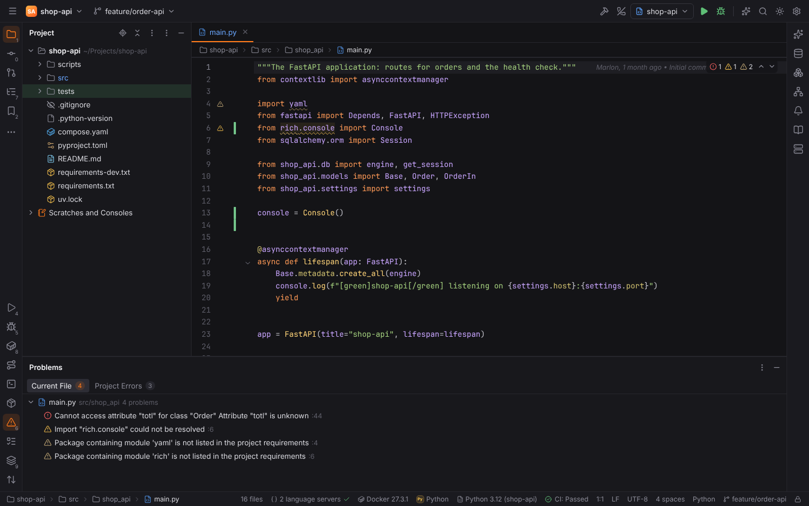

## Python interpreter

The status bar shows the project's interpreter, PyCharm style: **Python 3.12 (shop-api)**.
Click it (or run **Switch Python Interpreter…** from Find Action) to switch between the
configured interpreters, the project's environments and the Pythons found on this machine,
to add a new one, or to open the settings.

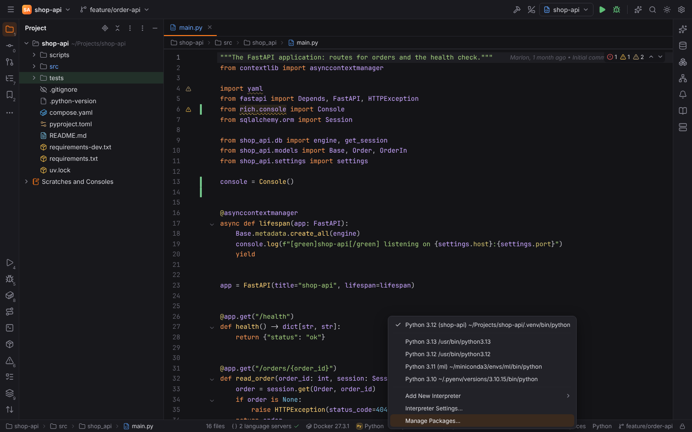

Without a selection Forge uses the project's own environment (`.venv`, `venv` or the Poetry,
Pipenv or Hatch environment of the project) automatically.

### Settings | Project | Python Interpreter

The page selects the interpreter (`python.interpreter`: the path of a local `python`, or the
name of a configured interpreter) and lists its packages with the latest version on PyPI.
**Add Interpreter…** opens the **Add Python Interpreter** dialog.

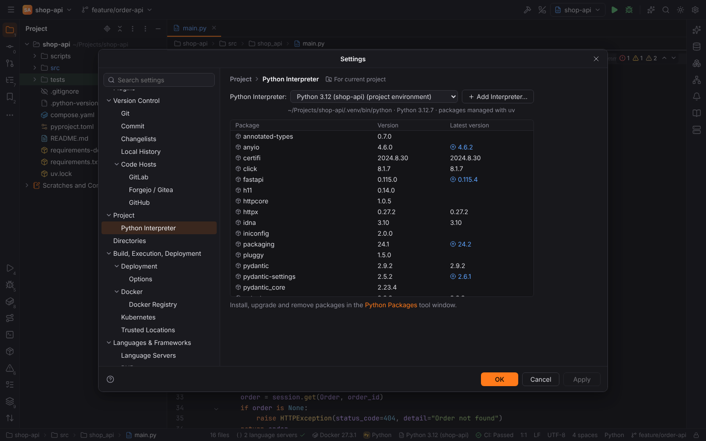

Forge finds, without running anything inside the project:

| Kind | Where |
| --- | --- |
| Virtualenv / venv | `.venv`, `venv`, `env` with a `pyvenv.cfg` (typed by `pyvenv.cfg`: uv and virtualenv write their own key) |
| uv | an environment created by `uv venv` / `uv sync`, or any project environment next to `uv.lock` |
| Poetry | `<cache>/pypoetry/virtualenvs/<name>-…`, else `poetry env info -p` |
| Pipenv | `~/.local/share/virtualenvs/<folder>-…` (`WORKON_HOME`), else `pipenv --venv` |
| Hatch | `<data>/hatch/env/virtual/<name>/…` |
| conda / mamba | `~/miniconda3`, `~/anaconda3`, `~/miniforge3`, `~/mambaforge`, `~/micromamba`, `/opt/conda` and their `envs/`, `~/.conda/environments.txt`; the version comes from `conda-meta` |
| pyenv | `~/.pyenv/versions/*` (`PYENV_ROOT`) |
| System | `python`, `python3`, `python3.X` on `PATH`, `/usr/bin`, `/usr/local/bin`, Homebrew; python.org installs on Windows (`%LOCALAPPDATA%\Programs\Python`) |

Only system Pythons are asked for their version (`python --version`); environments report
theirs from their metadata. The tools (`poetry`, `pipenv`) are asked only outside
[Safe Mode](project-trust.md).

### Add Python Interpreter

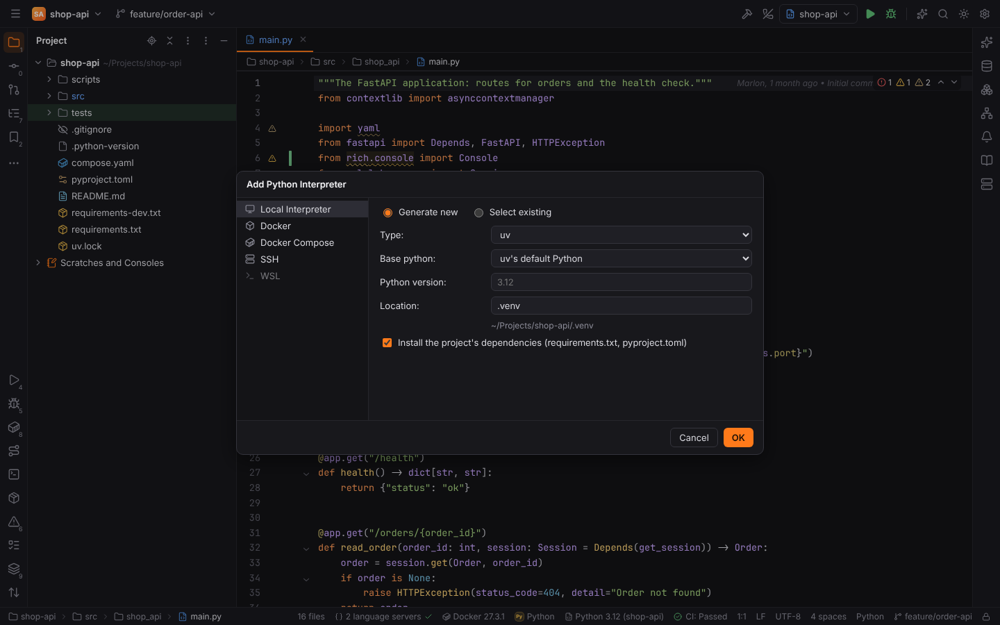

- **Local Interpreter | Generate new** creates an environment:
  - **Virtualenv**: `<base python> -m venv <location>`, then `pip install -r requirements.txt`.
  - **uv**: `uv venv <location> --python <base or version>`, then `uv sync` (with `uv.lock`)
    or `uv pip install -r requirements.txt`.
  - **Poetry**: `poetry env use <base python>`, then `poetry install`.
  - **Conda**: `conda create --yes --prefix <location> python=<version>`, then pip.

  The commands run one after another in the Run tool window; the new environment becomes the
  project's interpreter. "Install the project's dependencies" can be turned off.
- **Local Interpreter | Select existing** picks a detected interpreter or a path.
- **Docker**, **Docker Compose**, **SSH** and **WSL** work like PHP's
  [CLI interpreters](php.md): an image (the project is mounted at `/opt/project`), a compose
  service (`docker compose run` or `exec`), an SSH configuration of Settings | Tools | SSH
  Configurations, or a WSL distribution, plus the path of `python` there. Paths in arguments
  and the Run console are mapped both ways. Such interpreters are stored in
  `python.projectInterpreters` (or `python.interpreters` for every project).

## Python Packages tool window

**View | Tool Windows | Python Packages** lists the packages of the project's interpreter
with their versions; a newer release on PyPI is shown next to the version. Type in the search
field to filter them and to search PyPI. The right side shows the selected package: summary,
latest version, required Python, licence and home page, with **Install** (choose a version),
**Upgrade to …** and **Delete Package**.

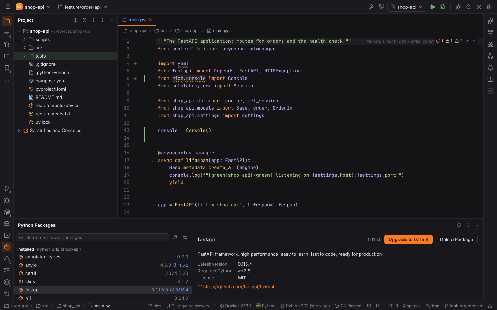

Packages are installed with the tool that manages the environment:

| Environment | Command |
| --- | --- |
| uv (or a venv next to `uv.lock`) | `uv pip install --python <python> …` / `uv pip uninstall` |
| Poetry | `poetry add` / `poetry remove` / `poetry update` (also changes `pyproject.toml`) |
| Pipenv | `pipenv install` / `uninstall` / `update` |
| anything else | `python -m pip install` / `uninstall --yes` / `install --upgrade` |

The commands run in the Run tool window and are refused in [Safe Mode](project-trust.md).
Installed packages are read with a small `importlib.metadata` script, so environments without
pip (uv's) work too.

PyPI answers are cached for 12 hours in `<cache dir>/forge/pypi` and the cache is used when
PyPI cannot be reached. Settings | Languages & Frameworks | Python | **Look up packages on
PyPI** (`python.packages.pypi`) turns the lookups off; **Package index**
(`python.packages.index`) points them at a mirror with PyPI's JSON API.

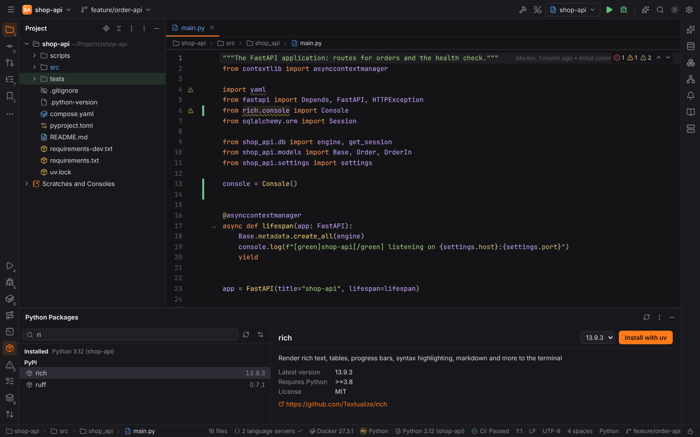

## Requirements inspections

- **Package requirement 'X' is not satisfied**: a dependency in `requirements*.txt` or
  `pyproject.toml` (PEP 621 `dependencies` and `optional-dependencies`, PEP 735
  `dependency-groups`, Poetry's `tool.poetry.*dependencies`) is not installed, or the
  installed version does not match its specifiers. `Alt+Enter`: **Install requirement**,
  **Install all missing requirements**, **Ignore requirement**.
- **Package containing module 'x' is not listed in the project requirements**: an import of a
  third-party package that no dependency file declares. `Alt+Enter`: **Add requirement 'x' to
  pyproject.toml** (or `requirements.txt` when the project has no PEP 621 / Poetry
  dependencies), **Install package x** when it is not installed, **Ignore requirement**.
  The distribution name is taken from the installed packages (`import yaml` → `PyYAML`).

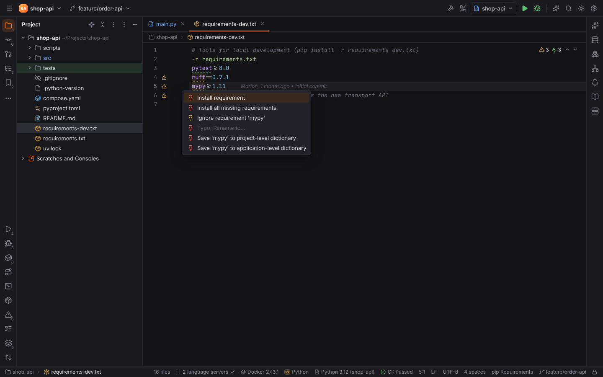

Versions are compared with PEP 440 rules (`~=`, `==1.4.*`, pre-releases, local versions,
Poetry's `^` and `~`). Dependencies with environment markers are not checked. **Install
Requirements** (Find Action) installs everything that is not satisfied. Settings | Languages &
Frameworks | Python | Inspections turns the two inspections off and lists ignored packages
(`python.inspections.ignoredPackages`).

Requirements files are highlighted (names, extras, specifiers, markers, options, URLs) and
complete package names (installed ones and PyPI) and versions; so do the dependency strings
of `pyproject.toml`.

## Language servers

Settings | Languages & Frameworks | Python lists the Python servers of the
[language server catalog](language-servers.md):

| Server | Role |
| --- | --- |
| **basedpyright** (default) | types, completion, navigation, hover; Forge installs it from npm with one click |
| **Pyright** | starts when basedpyright is missing or disabled |
| **ty** (preview) | Astral's type checker; off by default, enable it and disable basedpyright and Pyright |
| **Ruff** | `ruff server`: lint diagnostics and fixes next to the type checker |

Forge downloads ruff and ty itself, with your consent, as the official wheel of your platform
from PyPI, checked against the SHA-256 digest PyPI publishes, into
`<data dir>/forge/langservers/bin`. Nothing is bundled with Forge.

**Use language servers from the interpreter's environment**
(`python.lsp.useEnvironmentTools`, on by default): a basedpyright, ruff or ty installed in the
selected environment (or the project's `.venv`) is used before Forge's download and `PATH`.
basedpyright and Pyright get the interpreter as `python.pythonPath`, so imports resolve
against its site-packages.

## Reformat Code

`Ctrl+Alt+L` (and "Reformat code" in [Actions on Save](actions-on-save.md)) formats Python files
with the formatter of **Reformat Code with** (`python.formatter`): **ruff format** (default),
**Black**, **the language server** or **do not format**. Their settings in `pyproject.toml`,
`ruff.toml` or `.ruff.toml` apply. The executables come from `python.ruff.path` /
`python.black.path`, else the interpreter's environment, Forge's download (ruff) or `PATH`.

## Running Python code

The **Python** run configuration runs a **Script path** or a **Module name** (`python -m`) with
script parameters, interpreter options, environment variables and a working directory,
through the configuration's interpreter or the project's (local, Docker, Docker Compose, SSH or
WSL). `PYTHONUNBUFFERED=1` keeps the output live. A ▶ in the gutter of
`if __name__ == "__main__":` runs the file, as does `Ctrl+Shift+F10` in a Python file.

Running scripts, modules, pip and environment tools is running project code: it is refused in
[Safe Mode](project-trust.md), like tests, debugging, the Python Console and Profile below.

## Testing with pytest, unittest and tox

Python tests run in the shared [test runner](testing.md): gutter icons, the test tree with
**Click to see difference**, Rerun Failed Tests, [Test History](testing.md) and
[Run with Coverage](coverage.md).

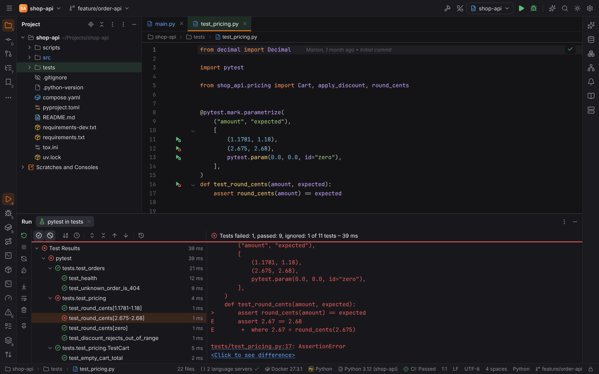

- **Gutter icons** come from the source (no test run, no plugin needed): pytest's
  `test*` functions in `test_*.py` / `*_test.py` files, `Test*` classes without `__init__`
  (also nested ones) and their methods, and `unittest.TestCase` subclasses with their `test*`
  methods in any file. `@pytest.mark.parametrize` cases get icons of their own when each
  value is on its own line; their names are pytest's ids (`ids=`, `pytest.param(id=…)`, the
  values themselves, `argname0` otherwise; stacked decorators multiply). The icons show the
  last result, a failing case marks its test.
- **Default test runner** (Settings | Tools | Python Integrated Tools,
  `python.testing.runner`): *Autodetect* uses pytest when the project uses it
  (`pytest.ini`, `conftest.py`, `[tool.pytest.ini_options]`, `[tool:pytest]`, tox's
  `[pytest]` or a `pytest` dependency) and unittest for files with only test cases; or always
  pytest / always Unittests. Run Context Configuration (`Ctrl+Shift+F10`) runs the test at the
  caret, else the file; in a file without tests it runs the file as a Python script.
- **pytest** configurations run all tests, a directory, a **Script path**, a test (the node id
  after the file: `TestCart::test_add[one]`) or **Keywords** (`-k`), with additional
  arguments. Results come from pytest's JUnit XML (`--junitxml`, built in) or, with **pytest
  results** set to *Report log*, from the pytest-reportlog plugin. **Rerun Failed Tests** runs
  the failed tests' node ids, with their classes read from the files. **Run with Coverage**
  needs pytest-cov: it adds `--cov --cov-report=xml:…` and shows the Cobertura report in the
  Coverage tool window and the editor.
- **Unittests** configurations run discovery below the project or a directory (pattern
  `test*.py`), a file, a class or a test method with Forge's own runner: a small script that
  comes with Forge (standard library only, sent inline with `python -c`), reports every test as
  it runs and records `assertEqual` values for the comparison. Rerun Failed Tests runs the
  failed tests' ids (`tests.test_cart.TestCart.test_total`).
- **tox** configurations run the environments you name (empty: tox's `env_list`) with
  `python -m tox`, or the program of **tox executable** (`python.tox.path`). Every
  environment is a test of the tree, with its output and its result (`OK`, `FAIL`, `SKIP`).
  **Run tox Environment…** (Tools menu, Find Action) lists the environments of `tox.ini`,
  `setup.cfg`, `tox.toml` or `pyproject.toml` (`[tool.tox]`), generative names such as
  `py{311,312}` expanded, and runs one.

All of them run through the configuration's or the project's interpreter, including Docker,
Docker Compose, SSH and WSL interpreters, and on a configuration's [run target](run-targets.md).
Report files go to the system temp folder, or to `.forge/test-reports/<run>` in the project
when the interpreter or target is remote, and are read and removed when the run ends.

## Debugging with debugpy

Debug (`Shift+F9`) on a Python, pytest or Unittests configuration, or **Debug** in a test's
gutter menu, debugs it with [debugpy](https://github.com/microsoft/debugpy) (MIT) in the
shared [debugger](debugging.md): breakpoints, conditions and logpoints, stepping, frames and
variables, watches, inline values, Set Value, exception breakpoints (raised, uncaught, user
uncaught) and the **Console** tab, which evaluates expressions in the selected frame.

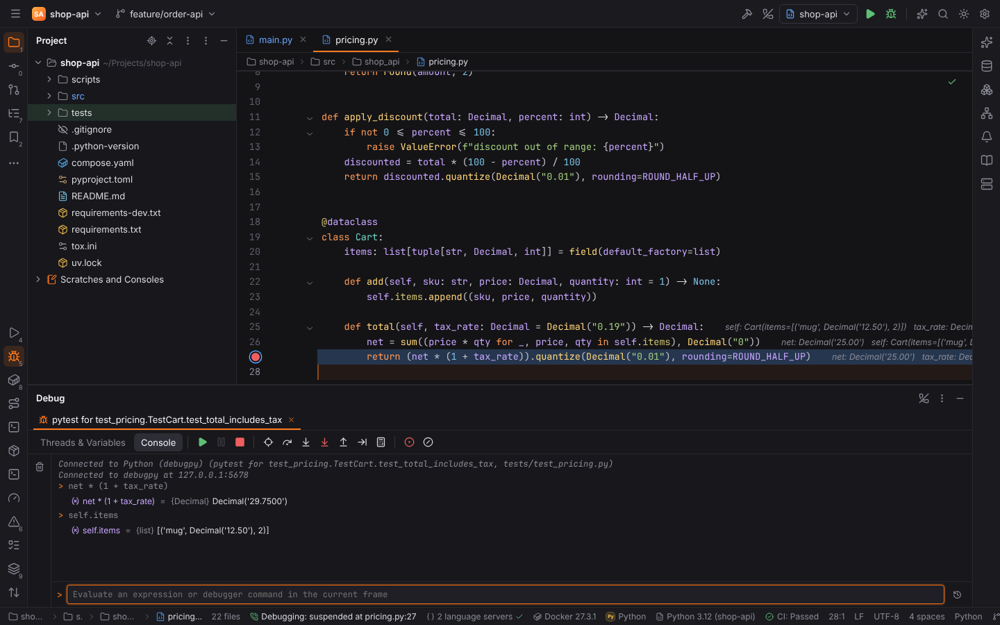

- When the interpreter has no debugpy, Forge asks before it installs it with the
  environment's package manager (`pip install debugpy`, `uv pip install debugpy`, …); **Install
  debugpy without asking** turns the question off.
- The run starts in the Run tool window as `python [options] -m debugpy --listen
  127.0.0.1:<port> --wait-for-client …` and Forge attaches to it. Docker, SSH and WSL
  interpreters and run targets listen on every interface; the port is published or forwarded
  and the project's path mappings become debugpy's `pathMappings`, so breakpoints work in
  containers and on remote hosts.
- **Attach to Process** (`Ctrl+Alt+F5`) attaches debugpy to a running local Python process,
  with the adapter (`python -m debugpy.adapter`) started in the project's interpreter.
  **Attach to DAP Server** connects to a program started with
  `python -m debugpy --listen 5678 app.py`.
- Settings | Build, Execution, Deployment | Debugger | **Python Debugger**:
  **Step only through the project's code** (`python.debugger.justMyCode`, on) and
  **Attach to subprocesses automatically** (`python.debugger.subProcess`, on).

## Python Console

The **Python Console** tool window (Tools | Python Console) is an interactive REPL in the
project's interpreter, IPython when the interpreter has it (Settings | Build, Execution,
Deployment | Python Console, **Use IPython if available**).

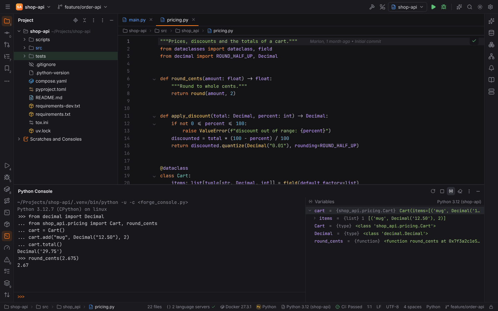

- Type at the prompt; `Enter` runs the input, an incomplete statement continues with `...`,
  `Shift+Enter` adds a line, `Up` / `Down` go through the command history (kept per project in
  Forge's state folder). A program's `input()` asks at the prompt.
- **Run Selection in Python Console** (`Alt+Shift+E`) runs the selection, or the caret's line,
  in the console and starts it when needed. **Run File in Python Console** runs the whole file
  in the console's namespace.
- **Show Variables** shows the console's variables with their types and values; lists, dicts,
  sets and objects expand.
- The toolbar reruns, stops and clears the console. It runs through Docker, SSH and WSL
  interpreters too and is refused in Safe Mode.

## Profiler

**Run | Profile** runs the selected Python configuration under cProfile (standard library):
`python [options] -m cProfile -o <snapshot> (<script> | -m <module>) …`. The snapshot
(`.pstats`) goes to Forge's cache folder (`<cache dir>/forge/profiles/<project>`; the newest
**Profiler snapshots to keep** stay); runs on remote interpreters write it into the project's
`.forge/test-reports` folder first, then Forge moves it out. Forge reads the file itself, no
Python is needed to view it.

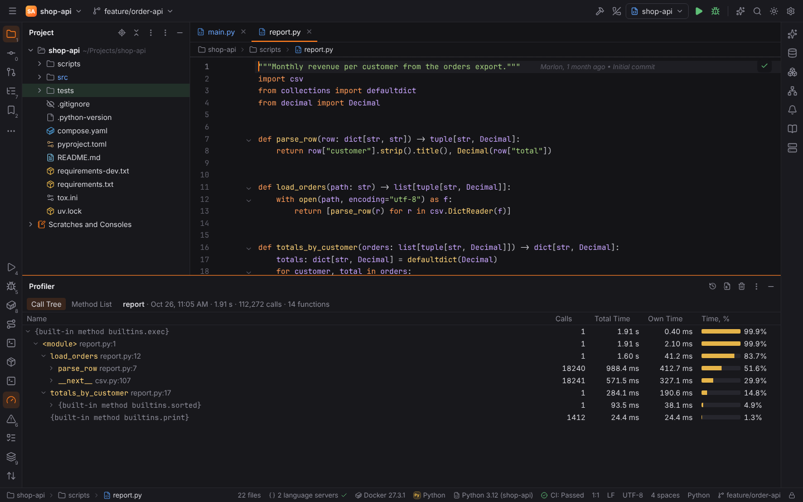

The **Profiler** tool window shows a snapshot:

- **Call Tree**: what called what, with calls, total and own time and the share of the run;
  recursion shows once, cheap calls deep in the tree are left out.
- **Method List**: the hot spots — every function with its calls (`calls/primitive calls`
  for recursion), own time and share, and total time; sort by any column.

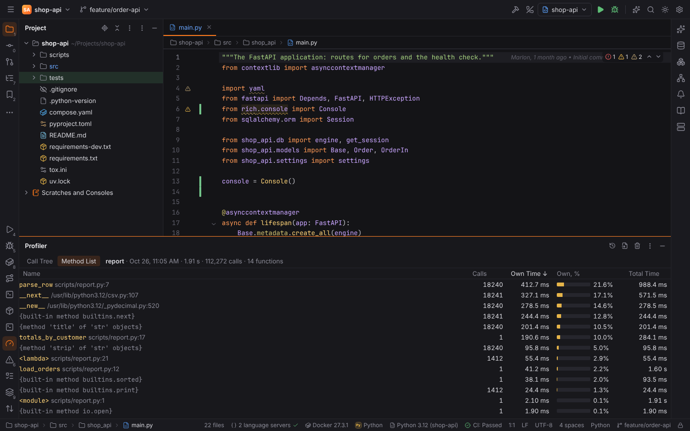

Double-click a row to open the function's source. **Snapshots…** switches between the
project's snapshots, **Open Snapshot…** reads a `.pstats` file of the project, **Delete
Snapshot** removes one.

## Settings

| Setting | Key | Default |
| --- | --- | --- |
| Python Interpreter | `python.interpreter` | the project's environment |
| Reformat Code with | `python.formatter` | `ruff` |
| ruff / Black executable | `python.ruff.path`, `python.black.path` | found automatically |
| Use language servers from the interpreter's environment | `python.lsp.useEnvironmentTools` | on |
| Look up packages on PyPI | `python.packages.pypi` | on |
| Package index | `python.packages.index` | `https://pypi.org` |
| Report unsatisfied requirements | `python.inspections.requirements` | on |
| Report imports of packages missing from the requirements | `python.inspections.imports` | on |
| Ignored packages | `python.inspections.ignoredPackages` | none |
| Default test runner | `python.testing.runner` | `auto` |
| pytest results | `python.pytest.reporter` | `junitxml` |
| tox executable | `python.tox.path` | `python -m tox` |
| Profiler snapshots to keep | `python.profiler.snapshots` | 20 |
| Step only through the project's code (justMyCode) | `python.debugger.justMyCode` | on |
| Attach to subprocesses automatically | `python.debugger.subProcess` | on |
| Install debugpy without asking | `python.debugger.installWithoutAsking` | off |
| Use IPython if available | `python.console.ipython` | on |
| Python Console interpreter options | `python.console.interpreterOptions` | none |

## Shortcuts

| Action | Id | Windows / Linux | macOS |
| --- | --- | --- | --- |
| Run Selection in Python Console | `ExecuteInPyConsoleAction` | `Alt+Shift+E` | `Alt+Shift+E` |
| Run File in Python Console | `RunFileInPythonConsole` | — | — |
| Python Console | `ActivatePythonConsoleToolWindow` | — | — |
| Profiler | `ActivateProfilerToolWindow` | — | — |
| Profile | `python.profile` | — | — |
| Run tox Environment… | `python.runToxEnvironment` | — | — |

## Browser mode

`?project=python` opens the demo service `shop-api` (FastAPI, SQLAlchemy, a uv environment).
Its tests (pytest with a failing parametrized case, a unittest test case), `tox.ini`, a debug
session in `Cart.total`, the Python Console and a profile of `scripts/report.py` are simulated;
discovery, command lines, tox environments and the snapshot's call tree are computed by the
same Rust code (WebAssembly).
