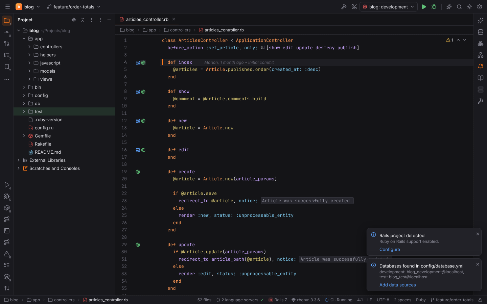
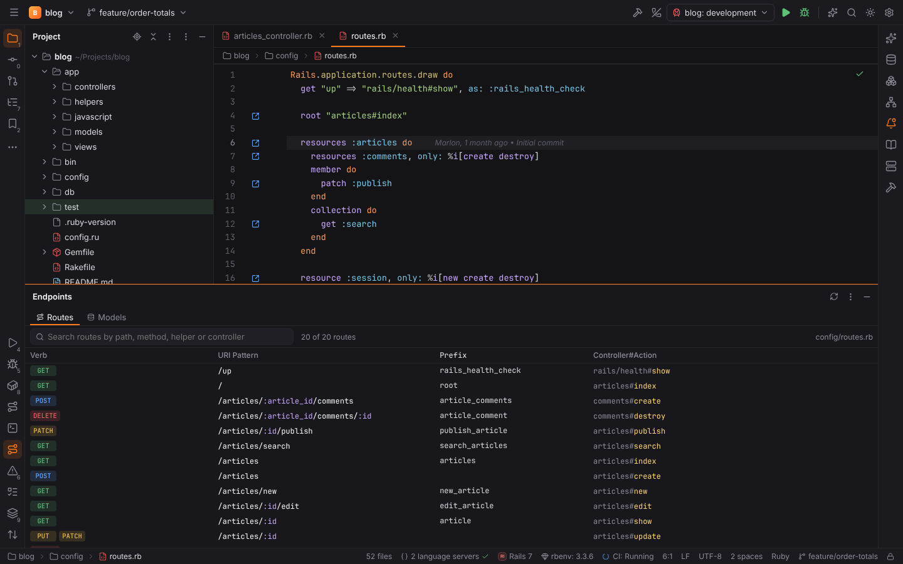
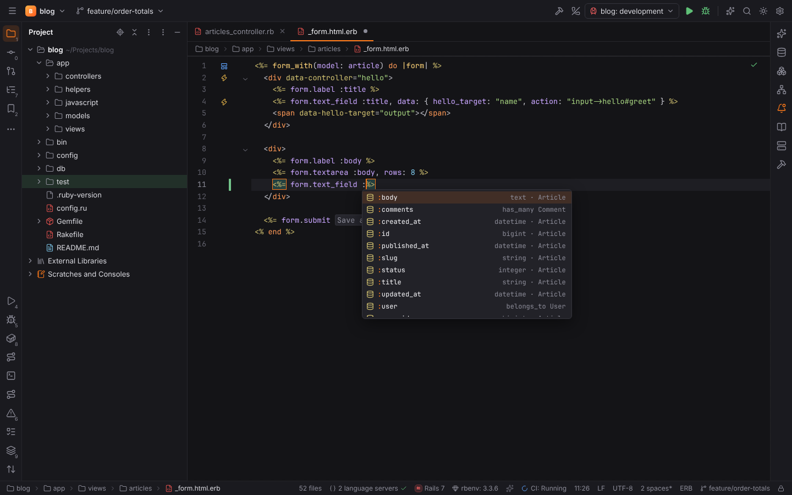
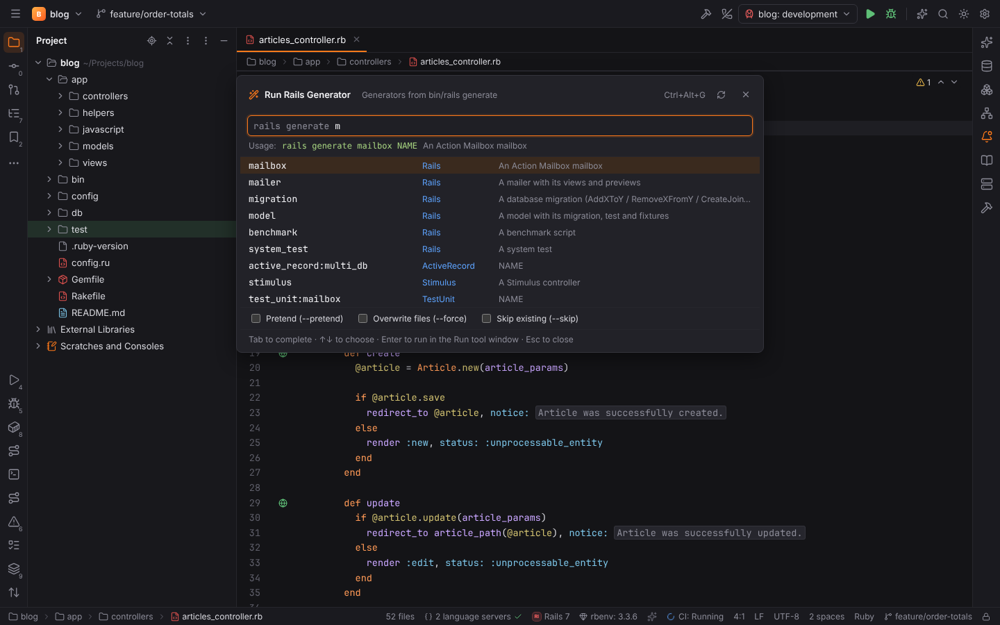
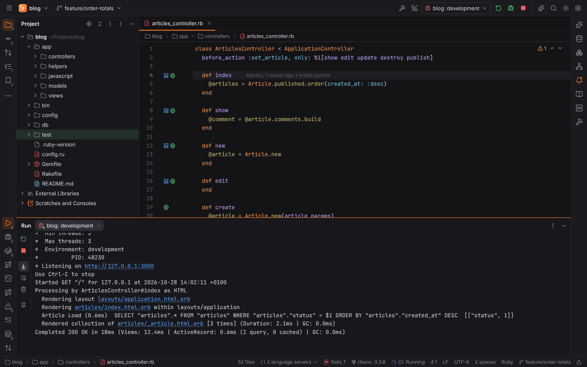
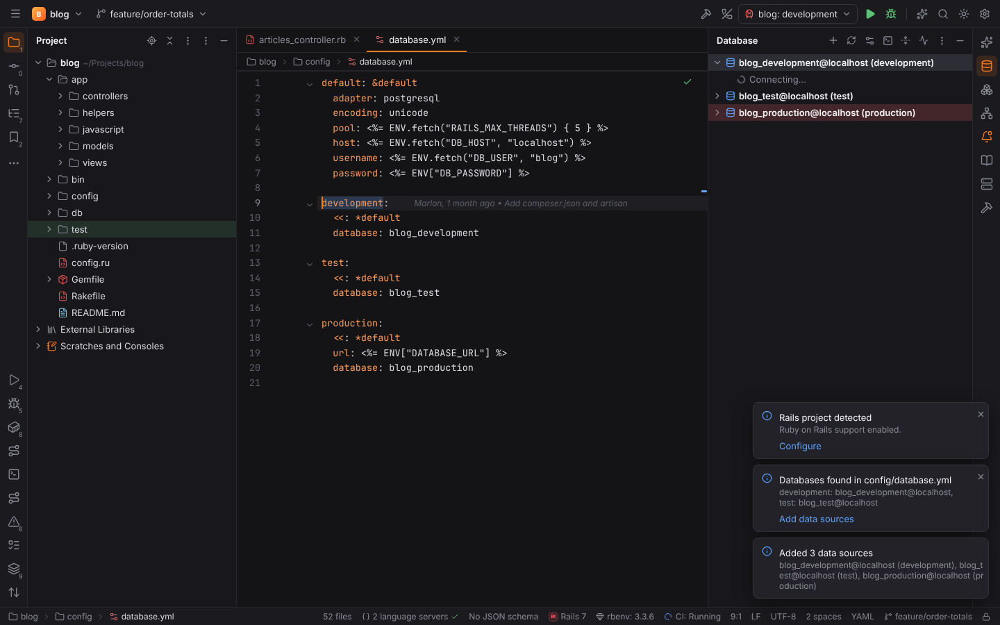
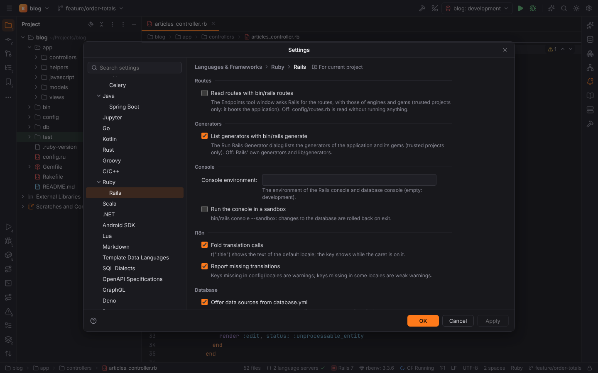

# Ruby on Rails

The plugin **Ruby on Rails** (`forge.rails`) of [RubyForge](ruby.md) brings RubyMine's Rails
support to Forge. It is active in Rails applications: a `Gemfile` with `gem "rails"` (or
`railties`) and a `config/application.rb`. The status bar shows the version from
`Gemfile.lock` (`Rails 7`).

Everything is read from the project's files in Rust (`packs/rubyforge/fw-rails`): routes,
controllers, views, models, `db/schema.rb` and the migrations, `config/database.yml`, the locale
files and the Stimulus controllers. Nothing of the application runs, except the few commands
below that need it — and those only in [trusted projects](project-trust.md). Code insight for
Ruby itself comes from Ruby LSP, which Rails' features complement.

## Routes (Endpoints)

**View | Tool Windows | Endpoints** (or **Show Rails Routes** in Find Action) lists the routes
like `bin/rails routes`: verb, URI pattern, prefix (the route's name: `article` gives
`article_path` and `article_url`) and `controller#action`.

- Routes are read from `config/routes.rb` without running anything: `resources` and
  `resource` (with `only`, `except`, `controller`, `path`, `as`, `param`, nested resources,
  `member` / `collection` blocks and `on: :member`), `namespace`, `scope` (path, `module`,
  `as`, `controller`), `get` / `post` / `patch` / `put` / `delete` / `match … via:`, `root`,
  `mount`, `concern` / `concerns`, `redirect(…)` and `draw(:admin)` for
  `config/routes/admin.rb`.
- **Read routes with bin/rails routes** (Settings | Languages & Frameworks | Ruby | Rails, off
  by default) asks Rails instead, which also lists the routes of engines and gems (Devise,
  Turbo). It boots the application, so it runs only in trusted projects; Refresh runs it
  again. Each row keeps its place in `routes.rb` when Forge can match it.
- Click a row to open the controller action. The context menu jumps to the route,
  **Generate HTTP Request** opens a new [HTTP request](scratches-and-http.md) scratch (`GET
  http://localhost:3000/articles/1`; the host and port come from the first Rails run
  configuration), **Open in Browser**, and copies the URL, path or helper.
- The **Models** tab lists the ActiveRecord models with their table, columns and associations.

## Navigation

- **Navigate | Related Symbol** (`Ctrl+Alt+Home`) in a model, controller, view, helper, test,
  spec, fixture, factory or migration lists the other files of the resource: the model, the
  controllers (also namespaced ones), the views, the helper, tests and specs, fixtures and
  factories, the migrations that create or change the table and the lines of `routes.rb`.
- **Go to Declaration** (`Ctrl+B`, `Ctrl+Click`) on
  - a route helper (`articles_path`, `edit_article_url`) opens its route in `routes.rb`;
  - `render "form"`, `render partial: "comments/comment"`, `render @articles`, `render :edit`
    in a controller and `layout "admin"` open the partial, template or layout (partials are
    looked up in the view's folder, then `application/`);
  - a translation key (`t(".title")`, `I18n.t("articles.index.title")`) opens it in every
    locale file;
  - `data-controller`, `data-action` and `data-*-target` values open the Stimulus
    controller, method or target (also in `data: { controller: "hello" }` hashes);
  - a Turbo frame id (`turbo_frame_tag "comments"`, `<turbo-frame id>`, `data-turbo-frame`,
    `turbo_stream.replace "comments"`) shows the frame and its other uses;
  - a target in `routes.rb` (`"articles#index"`, `resources :articles`) opens the action.
- Gutter icons: an action leads to its views and lists its routes; a view leads to its
  action; a partial lists the places that render it; a model opens its table in
  `db/schema.rb` and the migrations; associations open their model; lines of `routes.rb` open
  the actions; Stimulus controllers list the views that use them and views mark their
  controllers.

## Completion

- Route helpers (`new_ar` → `new_article_path`) with their route.
- Partials and templates in `render "…"`, layouts in `layout "…"`.
- Translation keys in `t("…")`; in a view or action, `t(".` offers the keys of its lazy
  lookup scope (`articles.index.` in `articles/index.html.erb`).
- Model attributes from `db/schema.rb` and the newer migrations: `Article.where(ti` →
  `title:`, `order(:` / `pluck(:` → `:published_at`, `@article.` → columns and associations,
  `Article.` → scopes, `validates :` in a model, `form.text_field :` in a form for the model,
  and `params.require(:article).permit(:`.
- Stimulus identifiers in `data-controller`, `controller#method` in `data-action`, targets in
  `data-<identifier>-target`.
- Turbo helpers (`turbo_frame_tag`, `turbo_stream_from`), `turbo_stream.` actions and the
  frame ids of `turbo_stream.replace "…"` and `data-turbo-frame`.

## Inspections and folding

- **Missing translation** (*Ruby | Rails*): a key that `config/locales/**/*.yml` does not
  define is a warning; a key that some locales miss is a weak warning that names them. Keys of
  Rails itself (`helpers.`, `activerecord.`, `date.`, …) are not reported.
- **Unresolved partial or template**: `render` or `layout` names a file that `app/views` does
  not have.
- **Unknown Stimulus controller, action or target**.
- Translation calls fold to the text of the default locale (`config.i18n.default_locale`, else
  `en`): `t(".created")` reads *Article was successfully created.* until the caret is on it.
  **Fold translation calls** and **Report missing translations** turn this off.

## Run Rails Generator

**Tools | Run Rails Generator…** (`Ctrl+Alt+G`) completes the generators and runs
`bin/rails generate <generator> <arguments>` in the Run tool window: type the generator
(`Tab` completes it), then its arguments (`model Article title:string body:text`); the
generator's usage is shown below. **Pretend**, **Overwrite files** and **Skip existing** add
`--pretend`, `--force` and `--skip`. **Destroy Generated Code…** runs `bin/rails destroy`.

The list comes from `bin/rails generate` (with the generators of the bundle's gems; **List
generators with bin/rails generate**), else from Rails' own generators and
`lib/generators`. Generators load the application, so they run only in trusted projects.

## Console and server

- **Tools | Run Rails Console** opens a Terminal tab with `bin/rails console` (environment and
  `--sandbox` from the settings); **Run Rails Database Console** runs `bin/rails dbconsole`.
  Both are refused in Safe Mode.
- The **Rails** run configuration runs `bin/rails server -b <IP address> -p <port> -e
  <environment>` with the project's Ruby, Ruby arguments and server arguments. Debug runs it
  under [rdbg](ruby.md#debugging). Without `bin/rails`, commands run as `bundle exec rails`.
- Database tasks (`db:migrate`, `db:rollback`, `db:seed`) are [Rake](ruby.md#rake) tasks: run
  them from the Rake tool window or as Rake configurations.

## Data sources from database.yml

When a Rails project opens, a balloon offers the databases of `config/database.yml` that the
[Database](database.md) tool window does not have yet (**Offer data sources from
database.yml**); **Tools | Add Data Sources from database.yml** adds them any time. Each
environment becomes a project data source (`blog_development@localhost (development)`), and the
databases of multi-database setups (`production: primary:`, `cache:`) their own. Production
data sources get the production color, so unfiltered changes ask first.

- Adapters: `postgresql` / `postgis`, `mysql2` / `trilogy`, `sqlite3` (the file relative to
  the project), `sqlserver` and `oracle_enhanced`.
- The ERB in database.yml is read the simple way: `<%= ENV["X"] %>`, `<%= ENV.fetch("X") { 5
  } %>`, `<%= ENV.fetch("X", "d") %>` and `<%= ENV["X"] || "d" %>` take the variable (from the
  environment, the project's `.env` or **Settings | Ruby | Environment**) or the default;
  other Ruby is left out. `url:` is split into host, port, database and user.
- Passwords go to the OS keychain, like every data source password.

## Settings

**Settings | Languages & Frameworks | Ruby | Rails**:

| Setting | Default | Meaning |
| --- | --- | --- |
| Read routes with bin/rails routes | off | ask Rails for the routes (trusted projects) instead of reading `routes.rb` |
| List generators with bin/rails generate | on | the generators of the application and its gems (trusted projects) |
| Console environment | — | the environment of the consoles (empty: development) |
| Run the console in a sandbox | off | `bin/rails console --sandbox` |
| Fold translation calls | on | `t(…)` shows the text of the default locale |
| Report missing translations | on | the Missing translation inspection |
| Offer data sources from database.yml | on | the balloon when a Rails project opens |

All keys are in the [settings reference](../reference/settings.md#languages--frameworks--ruby--rails).
