# Remote development

Forge can open a project that lives on another machine, like JetBrains Gateway. It connects over
SSH, installs a small headless **Forge agent** on the host and runs indexing, the PHP language
server, Git, terminals and run configurations **next to the files**. Only the UI runs on your
machine.

## Requirements

| Side | Needs |
| --- | --- |
| Remote host | **Linux** on x86_64 or aarch64, an SSH server, a POSIX shell, write access to `~/.cache`. PHP, Git, language servers etc. installed on the host as you would need them locally (PHP's php-lsp is built into the agent). |
| Forge | a build that bundles the agents (`pnpm release`), or agent binaries in `FORGE_REMOTE_AGENT_DIR` / an `agents/` folder next to the `forge` binary. See [Release builds](../developer/release-builds.md). |

Nothing needs to be installed on the host in advance: Forge uploads the agent itself.

The same agent also runs **in a dev container** (over `docker exec`) and **in a WSL
distribution** (over `wsl.exe`); see [Dev Containers and WSL](dev-containers-and-wsl.md). The
Welcome screen's Remote Development section has a page for each: **SSH**, **Dev Containers** and
**WSL**.

## Connecting

Welcome screen → **Remote Development** → **New Connection** (or **New SSH Connection…** in
Find Action).

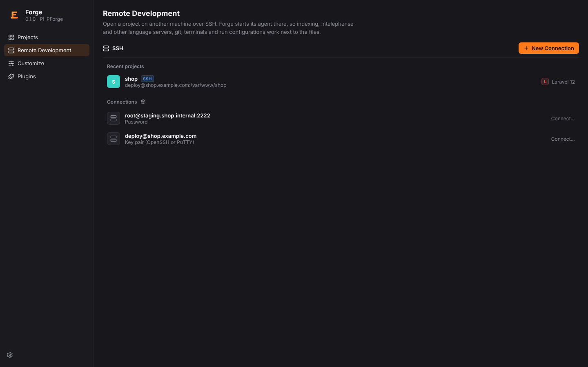

**Step 1 – Connect to SSH**

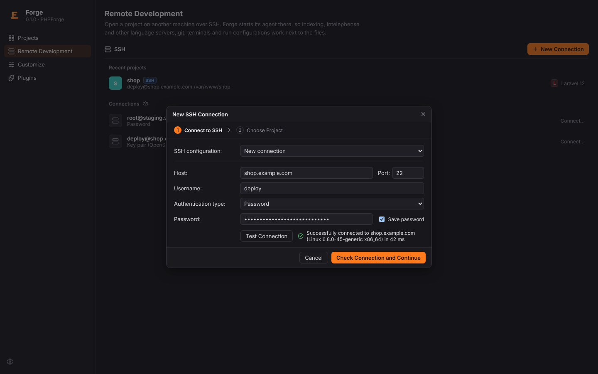

| Field | Notes |
| --- | --- |
| SSH configuration | a saved configuration, a host from `~/.ssh/config` (with `Include`s), or **New connection** |
| Host, Port, Username | |
| Authentication type | **Password**, **Key pair (OpenSSH or PuTTY)** with an optional passphrase, or **OpenSSH config and authentication agent** (ssh-agent plus the `IdentityFile`s of `~/.ssh/config`) |
| Save password / passphrase | stored in the OS keychain (service `forge-ssh`), never in a file |

**Test Connection** shows the host's system and the latency. **Check Connection and Continue**
moves to step 2.

**Step 2 – Choose Project**: browse the host's folders (home, parent, show hidden files) and
double-click the project folder, or type its path, then **Open Project**.

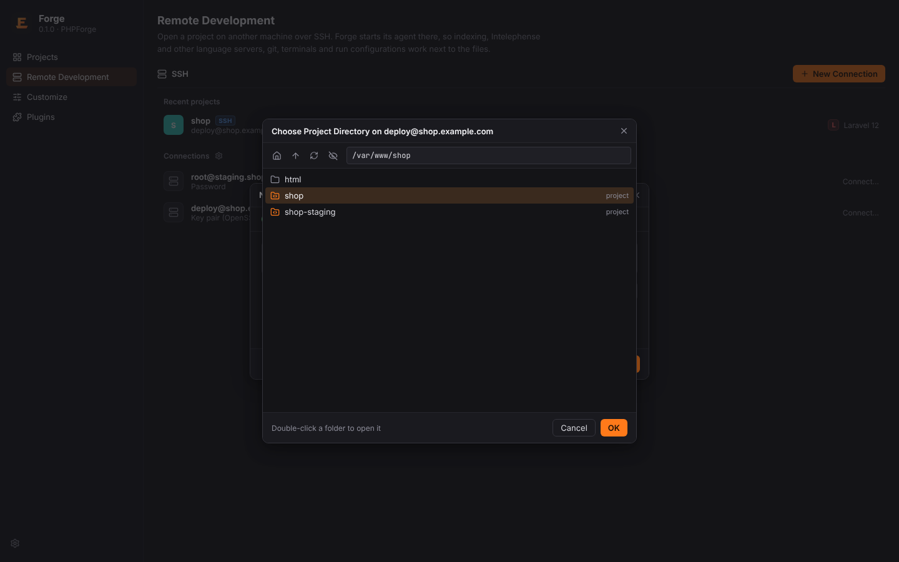

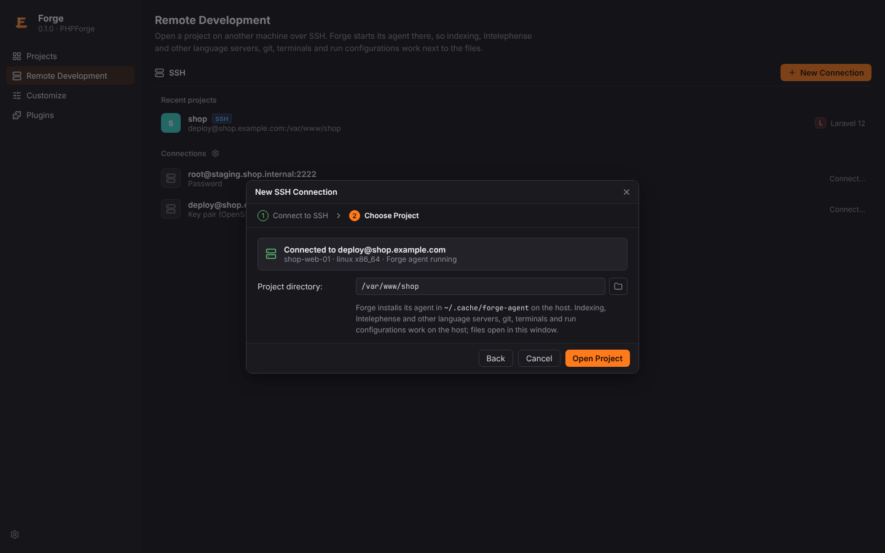

### Jump hosts and proxy commands

Hosts from `~/.ssh/config` keep their `ProxyJump` and `ProxyCommand`:

- **ProxyJump**: Forge connects through each hop in turn, tunnelling the next connection
  through the previous one; every hop's host key is checked like the target's.
- **ProxyCommand**: Forge runs the command (with `%h`, `%p`, `%r` and `%n` expanded) and speaks
  SSH over its input and output.

```text
Host shop
    HostName 10.0.0.12
    User deploy
    ProxyJump bastion.example.com
```

### Host keys

Host keys are checked against `~/.ssh/known_hosts`. An **Unknown Host** shows the key type and
fingerprint ("Are you sure you want to continue connecting?"); **Accept New Key** adds it to
`known_hosts`. A **changed** key is reported prominently ("Host Key Has Changed") and must be
confirmed explicitly before the stored key is replaced.

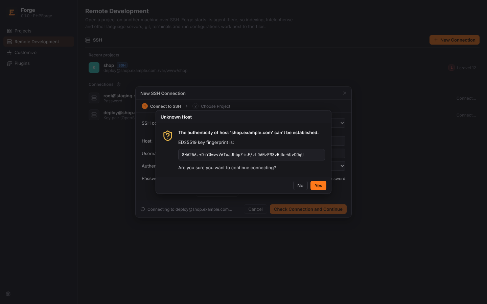

## The Forge agent

After connecting, Forge probes the host with one shell command (OS, architecture, home folder,
installed agent), uploads the matching agent to `~/.cache/forge-agent/<version>/` when it is
missing or differs (checked by SHA-256), and starts it in a login shell. The agent then serves
the project over the SSH channel.

Set `FORGE_AGENT_LOG=debug` in the host's environment for verbose agent logs (stderr).

## Working in a remote project

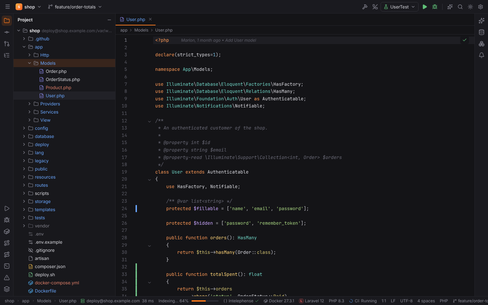

The project's root is shown as `user@host:/path`. Recent Projects keeps remote projects with an
**SSH** badge (**Container** and **WSL** for [dev container and WSL projects](dev-containers-and-wsl.md));
clicking one reconnects.

A remote project you have not trusted yet opens in Safe Mode and Forge asks "Trust and Open
Project?" right after connecting; trust is kept per host, user, port and folder, see
[Project trust and Safe Mode](project-trust.md#remote-projects).

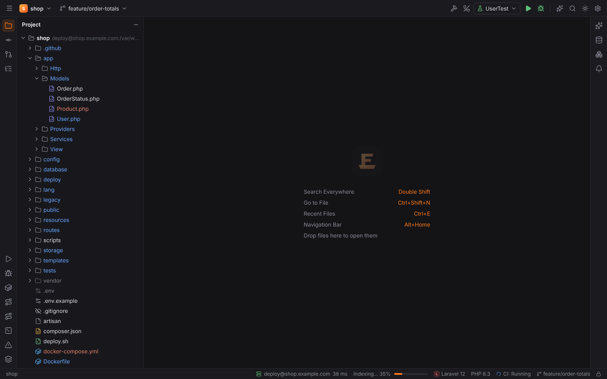

| Works on the host | |
| --- | --- |
| Project view, editing, saving, file operations, file watching | yes |
| Go to File, Search Everywhere | yes |
| Git (status, commit, diff, blame, branches, log) | yes; output is parsed locally |
| Find in Files | yes, searched on the host |
| Scopes (Find in Files, Find Usages, Structural Search), the Scopes page's file tree | yes, evaluated and listed on the host |
| Structural Search and Replace | yes: the files are parsed on the host; Replace All writes through the agent |
| Analyze Stack Trace | yes: files are looked up on the host; PHP servers' path mappings and Compose bind mounts are read from the host |
| PHP index, Structure, Generate, php-lsp | yes; the agent's built-in php-lsp indexes the remote files itself |
| Catalog language servers (TypeScript, YAML, Python, …) | yes: scan, detection and the servers run on the host |
| Installing language servers (Settings) | yes: the agent downloads Node.js and the npm servers into Forge's directory on the host, with progress here |
| Laravel, Symfony and Doctrine analysis | yes, in the agent; artisan and `bin/console` run on the host |
| WebForge: npm tool window, React / Vue / Angular navigation and gutter icons | yes: `package.json` files, scripts, package managers and components are read in the agent; scripts run on the host |
| LuaForge index | yes, all Lua files are read on the host in one batch |
| StyLua (Reformat Code) | yes, StyLua runs on the host |
| Code hosts (GitLab, Forgejo, GitHub) | yes: the repository is detected with git on the host; API calls go from your machine with your tokens |
| HTTP client (`.http` files) | environment and body files are read on the host; requests are sent **from the host** through an SSH tunnel, so `localhost` URLs reach its services (Settings \| Tools \| HTTP Client \| **Send requests from**) |
| Services: compose files and Dockerfile ▶ | compose files are read on the host and `docker compose` / `docker build` run there; by default Docker of the host is used through the project's SSH connection |
| Services: Kubernetes | contexts come from the host's kubeconfig and `kubectl` runs on the host (tree, logs, exec, apply/delete manifests); port forwards are tunnelled back through the SSH connection, see [Services](services.md#kubernetes-in-remote-projects) |
| Browser Companion | files the browser reports (host paths, container paths like `/app/src/…`) open in the remote project |
| Project settings (`.forge/settings.toml`) and other `.forge/` files | yes, read and written on the host |
| Terminal | yes, a shell on the host |
| Run/Debug configurations (run) | yes, processes run on the host |
| Database tools | project data sources connect through an SSH tunnel, see [Database](database.md#remote-projects) |
| Xdebug | through a reverse SSH tunnel, see [Xdebug](debugging.md#remote-projects) |
| AI Chat (Claude Code, Gemini CLI) | the CLI runs on the host |

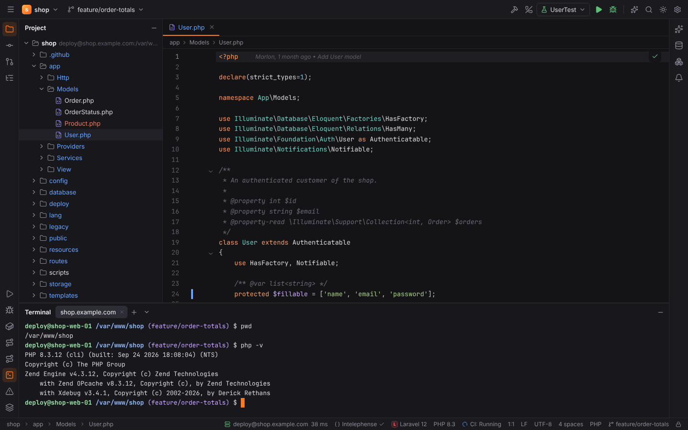

Every feature works in remote projects. Things that are about your machine stay local on
purpose: code host API calls (your tokens), the keychain and,
when you choose it, HTTP requests ("Send requests from: This machine") and Docker or Kubernetes
of this machine (see [Services](services.md#remote-projects)).

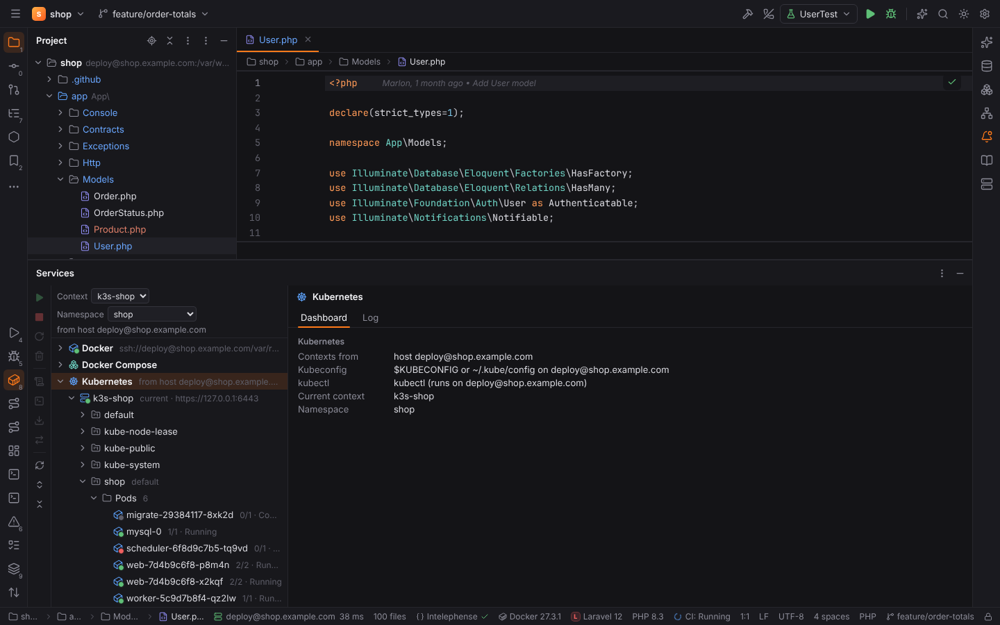

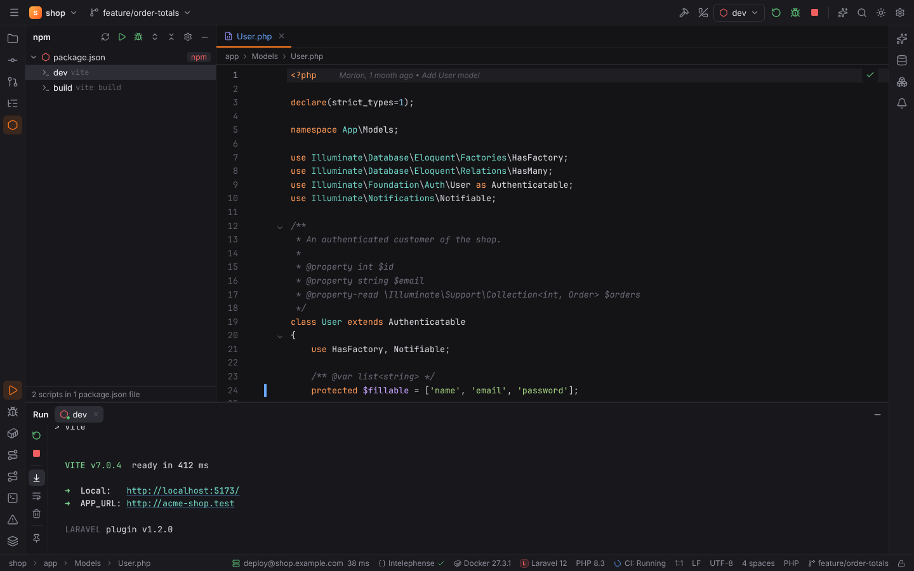

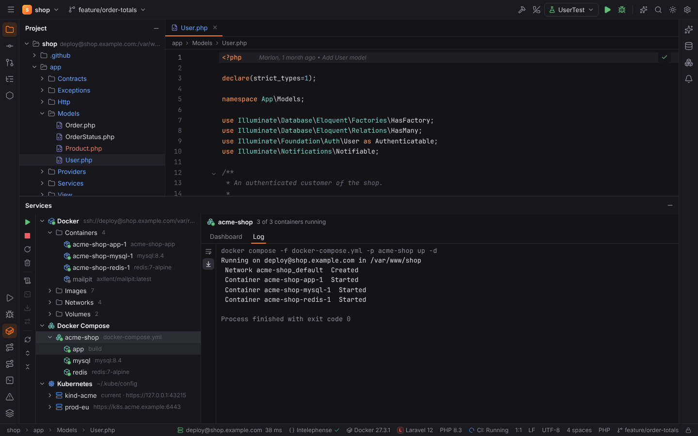

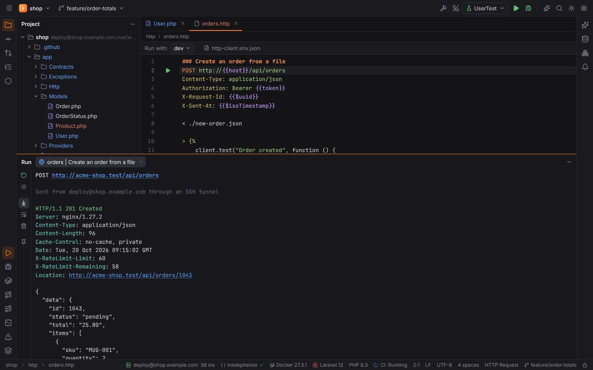

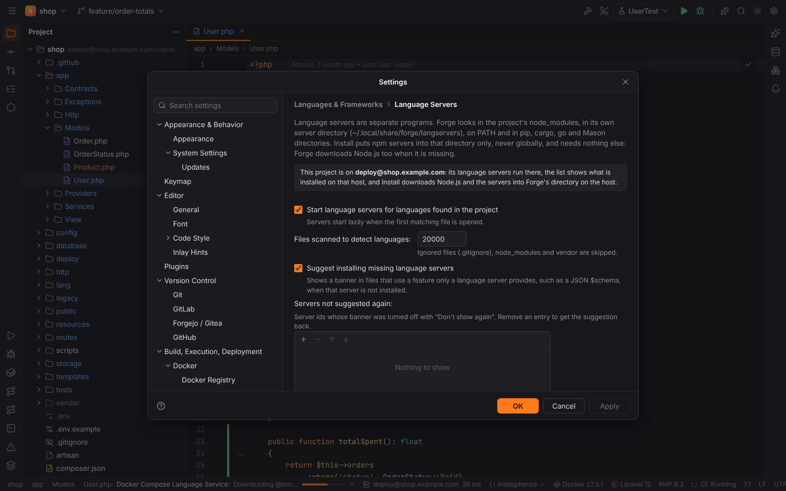

## Connection status and reconnects

The status bar shows the host and latency (pinged every 5 seconds). Click it for the
connection popup.

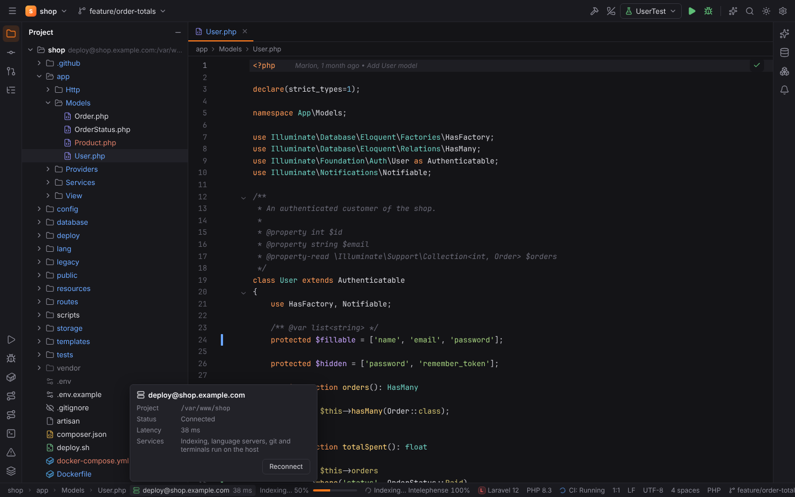

When the connection drops, Forge reconnects automatically with a backoff from 1 to 30 seconds
and re-attaches the project ("Reconnecting…", with the next attempt). Host key and
authentication errors stop the retries. **Reconnect to Remote Host** (Find Action) retries now.

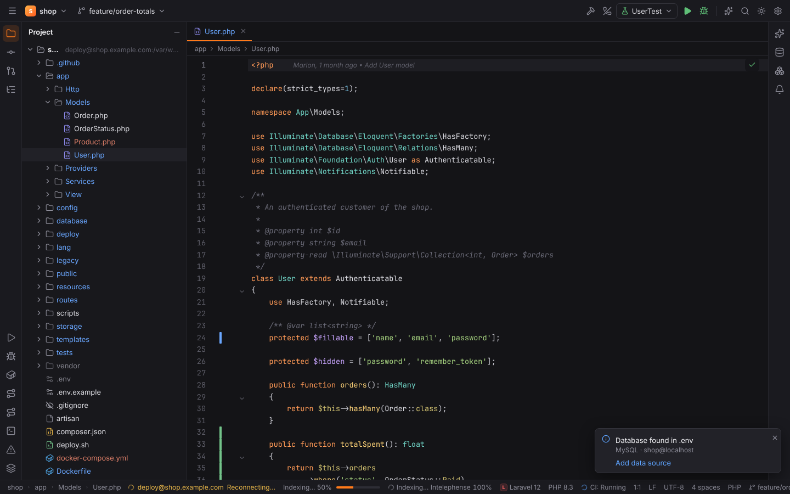

## Saved configurations

Settings | Tools | **SSH Configurations** lists, adds, edits and removes saved configurations.
They are stored in `ssh.toml` in Forge's config folder; secrets stay in the keychain. **Parse
config file `~/.ssh/config`** (on by default) resolves `Host` aliases, jump hosts and proxy
commands from your OpenSSH config. The same configurations connect SFTP deployment servers and
SSH terminal sessions, see [Remote Host and SSH sessions](remote-host-and-ssh.md).

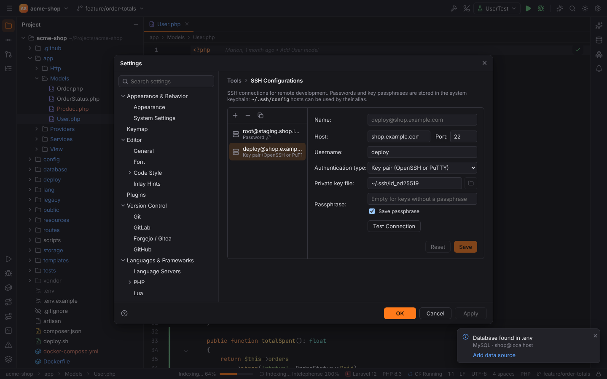

## Troubleshooting

See [Troubleshooting: remote agent upload](../troubleshooting.md#remote-agent-upload).
