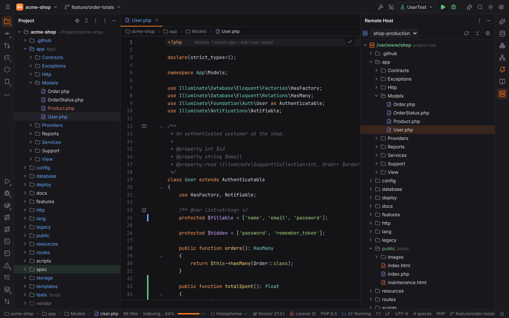
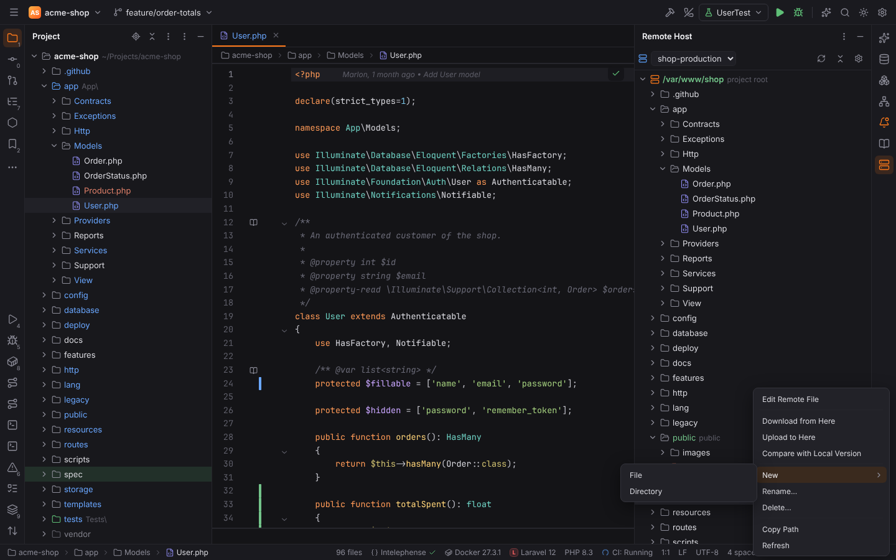
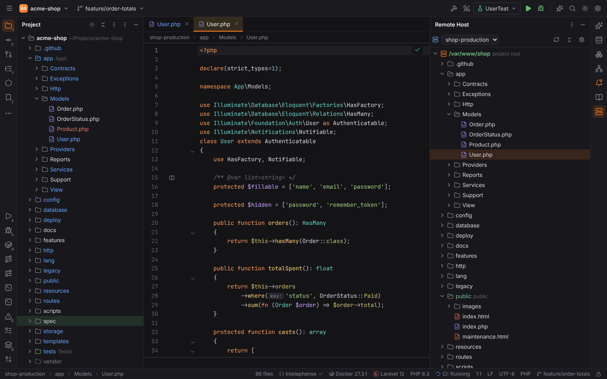
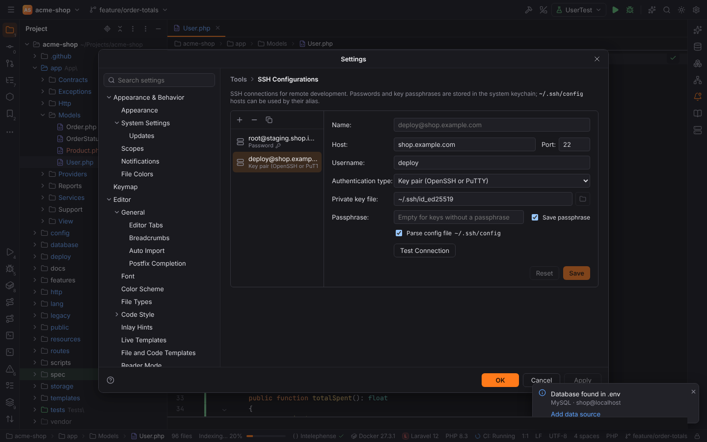
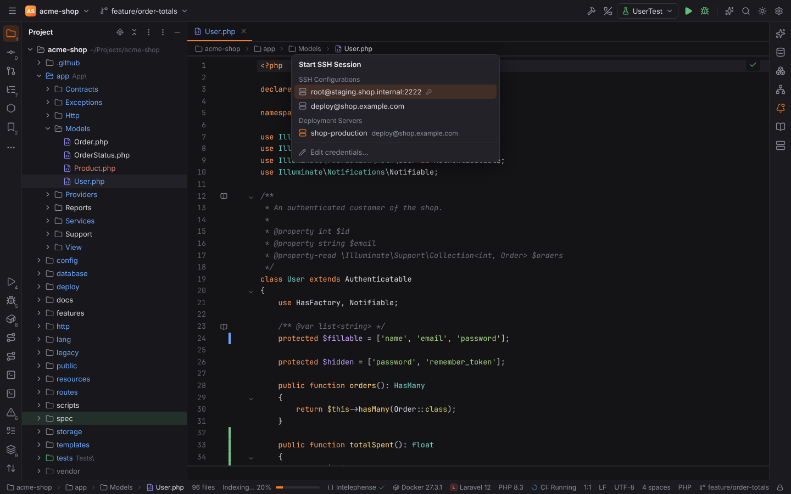
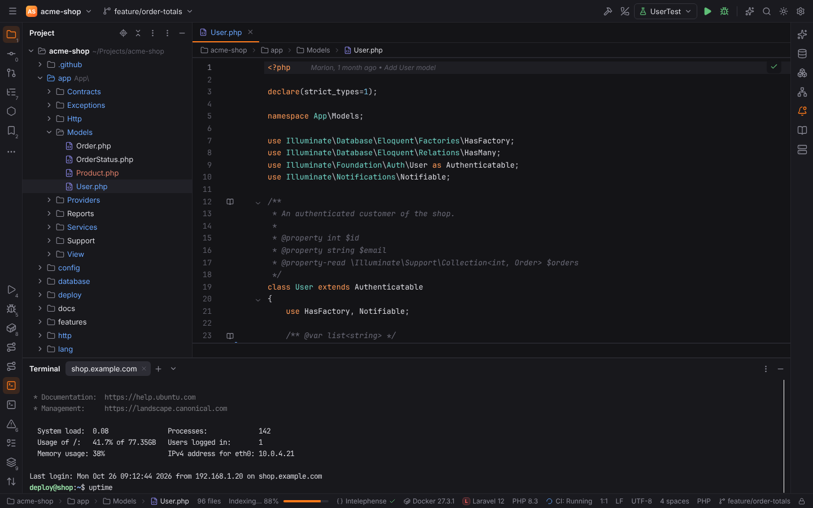
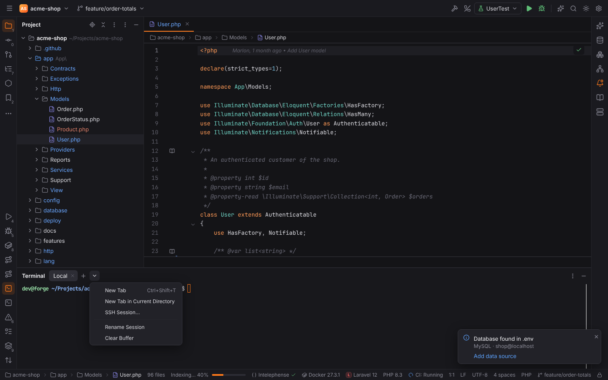

# Remote Host and SSH sessions

Like PHPStorm, Forge lets you look at and change the files of a
[deployment server](deployment.md) without leaving the IDE, and open a shell on any host you
have an SSH configuration for, also in projects that live on this machine.

## Remote Host tool window

**Tools | Deployment | Browse Remote Host** opens the **Remote Host** tool window (right
stripe) on the project's default server; without a default server Forge asks which one. The
selector at the top switches to another server of the project; **Refresh** reads the selected
folder again (with the folders open below it), **Collapse All** closes the tree and the gear
opens the server settings. Find Action has **Remote Host** (`ActivateRemoteHostToolWindow`)
to show the window; it has no default shortcut, bind one in Settings | Keymap.

The tree starts at the server's root path (`/var/www/shop`; the login folder when the root path
is empty) and loads each folder when you expand it. It works for every server type: SFTP,
FTP/FTPS and local or mounted folders.

- Folders that are the deployment path of a [mapping](deployment.md#mappings-tab) are
  **green**, with the project folder they belong to next to them ("project root", "public").
- Paths excluded on the deployment side (Excluded Paths tab) are dimmed.
- Hover a file or folder to see the project path it is mapped to.

Double-click a folder to expand it, a file to edit it.

### Context menu

| Entry | What it does |
| --- | --- |
| Edit Remote File | Downloads the file into a temporary copy and opens it in the editor. Saving (`Ctrl+S`, automatic saves) uploads it back, see below. |
| Download from Here | Downloads the file or folder into the project path it is mapped to, like Download from… (the transfer appears in the File Transfer tool window). |
| Upload to Here | Uploads the project file or folder mapped to this path, like Upload to…. |
| Compare with Local Version | Opens the diff of the server file and the project file it is mapped to. |
| New › File / Directory | Creates an empty file (opened with Edit Remote File) or a folder in the selected folder. |
| Rename… | Renames the file or folder on the server. |
| Delete… | Deletes the file, or the folder with everything in it, after a confirmation. The root folder is never deleted. |
| Copy Path | Copies the absolute path on the server. |
| Refresh | Reads the folder again. |

Download from Here, Upload to Here and Compare with Local Version need a mapping that covers
the path; the entries are disabled otherwise. They follow the
[Deployment options](deployment.md#options) (excluded names, overwrite rules, timestamps) and
ask before overwriting newer files, like every transfer.

### Edit Remote File

The editor tab shows the server and the path in the breadcrumbs. The temporary copy lives in
Forge's cache folder (`<cache dir>/forge/remote-edit/<server>/…`), never in the project, and
is removed when you close the tab. Each save uploads the text, but first checks the server copy:
when someone else changed (or deleted) the file since you opened it, Forge asks before it
overwrites their version (**Overwrite** / **Upload**, or **Cancel** to keep your changes
unsaved).

## SSH configurations

Settings | Tools | **SSH Configurations** keeps the SSH connections of
[remote development](remote-development.md#saved-configurations), SFTP deployment servers and
SSH sessions in one list: **+** adds, **−** removes and the copy button duplicates a
configuration.

| Field | Notes |
| --- | --- |
| Host, Port | A host name, an address or a `Host` alias of `~/.ssh/config`; port 22 by default |
| Username | The account on the host |
| Authentication type | **Password**, **Key pair (OpenSSH or PuTTY)** with the private key file and its passphrase, or **OpenSSH config and authentication agent** (keys of the running ssh-agent, the `IdentityFile`s of `~/.ssh/config` and the default keys in `~/.ssh`) |
| Save password / Save passphrase | Stores the secret in the OS keychain (service `forge-ssh`); off: Forge asks every time |
| Parse config file `~/.ssh/config` | On (the default): the host may be a `Host` alias, and the host name, port, user, identity files, `ProxyJump` and `ProxyCommand` come from `~/.ssh/config`. Off: the host is taken literally. |

**Test Connection** connects with the values in the form, including a password you have not
saved yet. An unknown host key is shown with its fingerprint; trusting it adds it to
`~/.ssh/known_hosts`.

## SSH sessions

**Tools | Start SSH Session…** (`RunSshConsole`, no default shortcut) and **SSH Session…** in
the Terminal's new-tab dropdown (the arrow next to **+**) open a chooser:

- **SSH Configurations**: your saved configurations.
- **Deployment Servers**: the project's SFTP servers, connected with their SSH configuration.
- **Edit credentials…**: host, port, user name and authentication typed in; Forge saves them as
  an SSH configuration (an existing one for the same account is updated) and connects.

The session opens as a new tab of the [Terminal](terminal.md) tool window, named after the
host (`shop.example.com`, `shop.example.com (2)`). It is a real pseudo terminal on the SSH
channel (`xterm-256color`), so `htop`, `vim` or `php artisan tinker` work and the window size
follows the tool window. Typing `exit` closes the tab; other exit codes stay visible.
Configurations that do not save their password or passphrase ask for it first, and an unknown
host key is asked about like in Test Connection.

## Safe Mode

Browsing a server, Edit Remote File and the transfers only copy files and never run project
code, so they work in an untrusted project opened in [Safe Mode](project-trust.md).

An SSH session logs you in on a host with your credentials. Your own SSH configurations
connect right away. A deployment server, however, comes from the project's
`.forge/deployment.toml`: in Safe Mode Forge asks before it starts a session to it ("The
deployment server … is defined in the files of this untrusted project. Connect … over SSH with
your credentials?"), so an untrusted project cannot choose a host for you. The backend refuses
the session without that confirmation. Trusted projects never ask.

> **Note:** Download from Here, Upload to Here and Compare with Local Version need a project on
> this machine, like every [Deployment](deployment.md) transfer. In a
> [remote project](remote-development.md) the project files and the terminal already are on
> the host.
