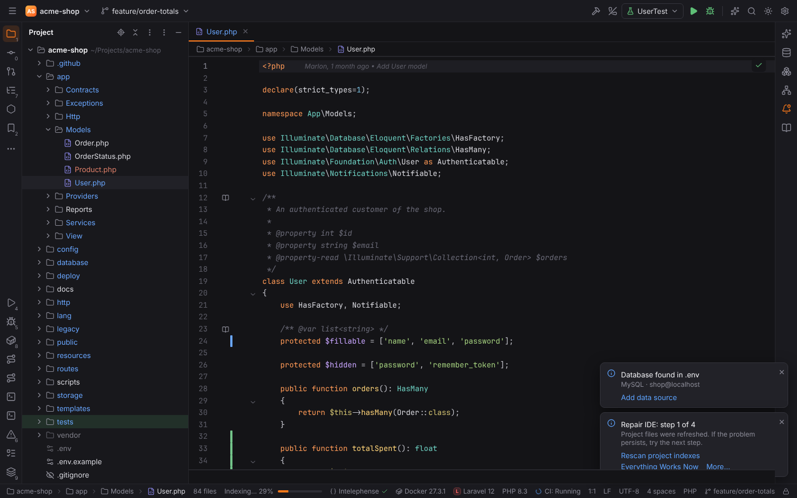
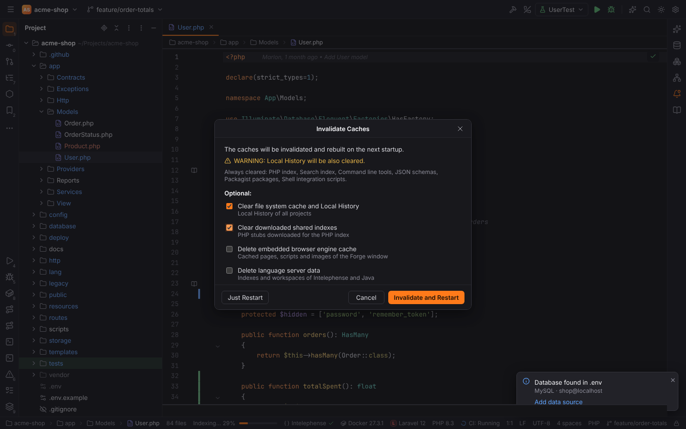
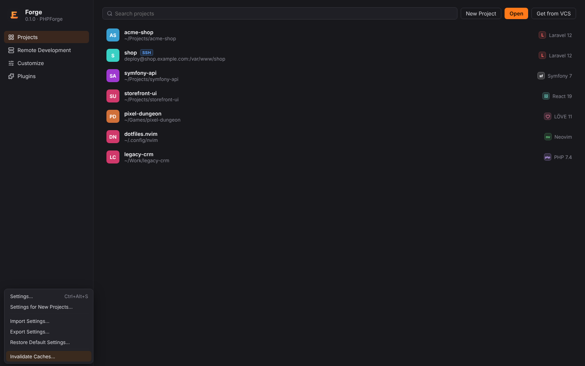

# Invalidate Caches and Repair IDE

When search results, completion or the Project view no longer match the files on disk, Forge
offers the same tools as PHPStorm, from the gentlest to the most thorough.

## Reload All from Disk

File | **Reload All from Disk** (`Ctrl+Alt+Y`, macOS `Cmd+Alt+Y`) re-reads the open files that
changed on disk and refreshes the Project view and the Git status. Forge does this on its own
when you switch back to its window (Settings | Appearance & Behavior | System Settings |
Synchronize external changes).

## Repair IDE

File | **Repair IDE** runs PHPStorm's repair steps one after another. After each step a balloon
says what was done and offers the next step:

1. **Refresh project files**: as Reload All from Disk, for every folder the Project view shows.
2. **Rescan project indexes**: brings the search index in line with the disk and rescans the
   PHP index (and the Lua index in Lua projects).
3. **Reopen project**: closes the project and opens it again (editor tabs are closed).
4. **Invalidate caches and restart**: opens the [Invalidate Caches](#invalidate-caches) dialog.

In the balloon, the first link runs the next step, **Everything Works Now** ends the repair, and
**More…** lets you pick any of the remaining steps.

## Invalidate Caches

File | **Invalidate Caches…** clears Forge's indexes and caches. The files are deleted on the
next start, before Forge opens any of them, so nothing is locked; the caches are rebuilt
afterwards.

Always cleared: the PHP index, the search index, the command line tools cache, downloaded JSON
schemas, the Packagist cache and the terminal's shell integration scripts.

Optional:

| Option | What is deleted |
| --- | --- |
| Clear file system cache and Local History | the [Local History](local-history.md) of all projects |
| Clear downloaded shared indexes | the PHP stubs downloaded for the PHP index (downloaded again when needed) |
| Delete embedded browser engine cache | the cache of the webview that draws Forge's window |
| Delete language server data | Intelephense's storage and the Java language server's workspaces |

**Invalidate and Restart** schedules the cleanup and restarts Forge; **Just Restart** only
restarts; **Cancel** does nothing.

> **Note:** installed language servers, Node.js runtimes, settings, bookmarks, changelists and
> shelved changes are no caches and are never deleted. Where each cache lives is listed in
> [File locations](../reference/file-locations.md#caches--cache-dirforge).

In browser mode (`pnpm dev`) the dialog works, but nothing is deleted and Forge does not
restart.

## On the Welcome screen

The gear at the bottom of the Welcome screen offers Settings, Settings for New Projects,
Import / Export Settings, Restore Default Settings and Invalidate Caches, so you can repair
Forge without opening a project.

