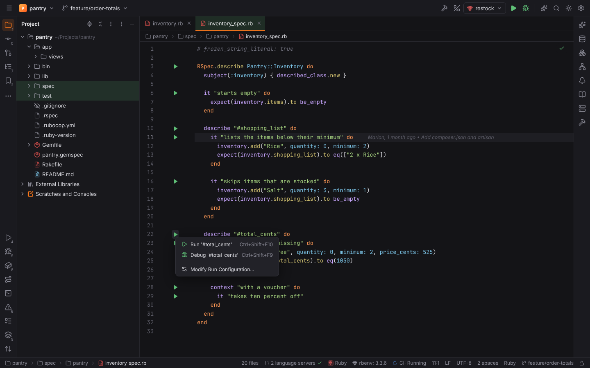
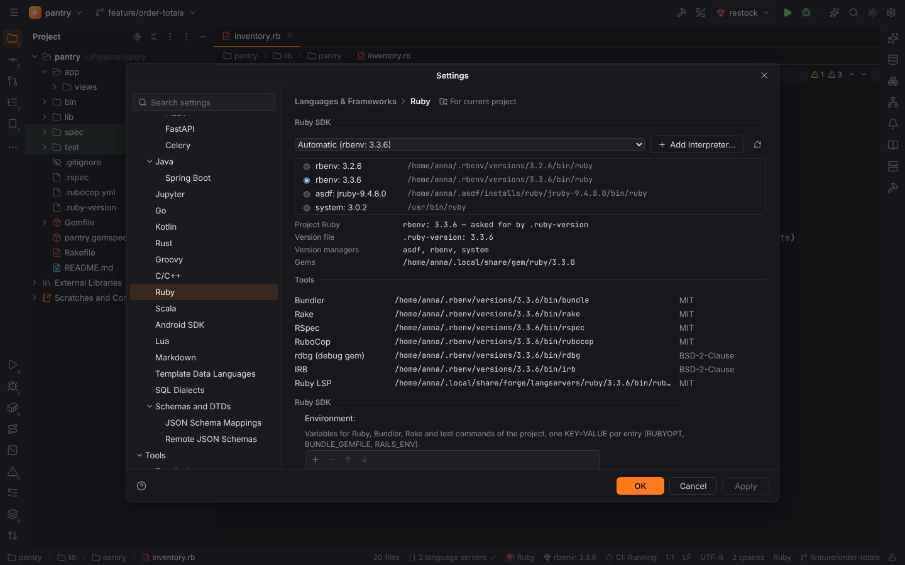
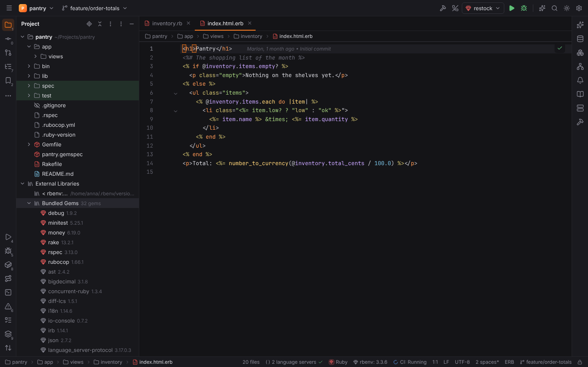
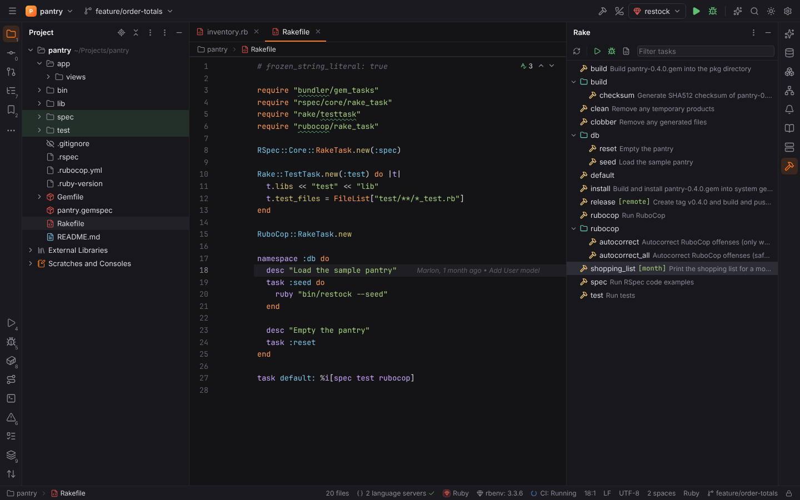
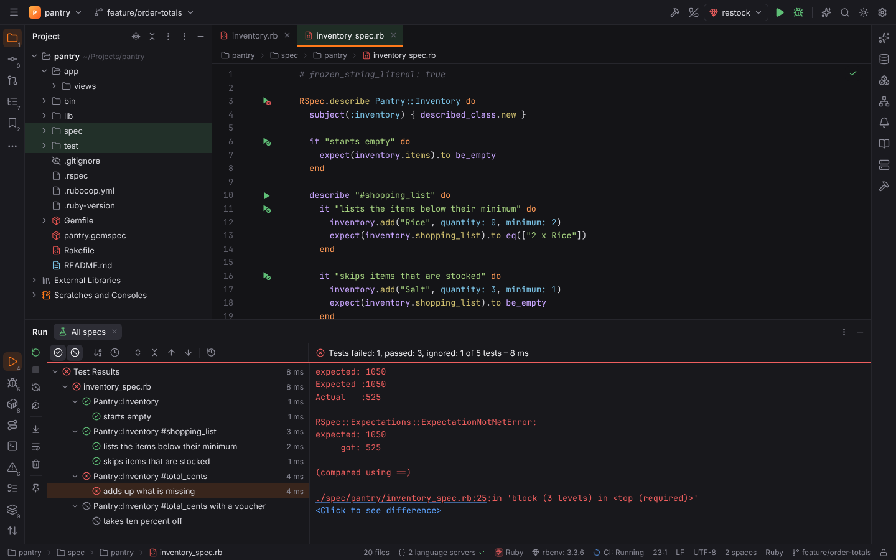
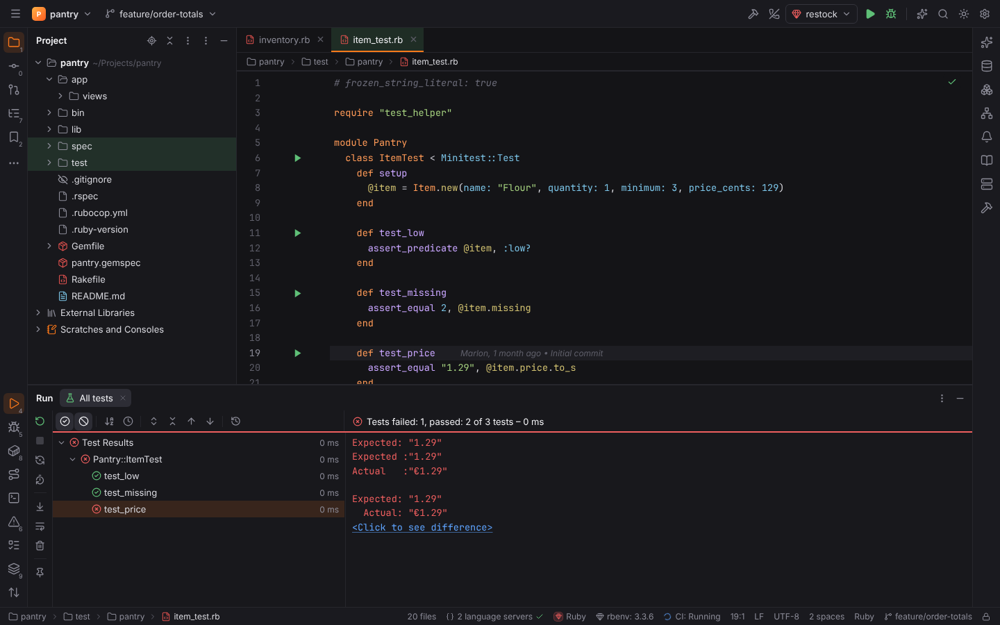
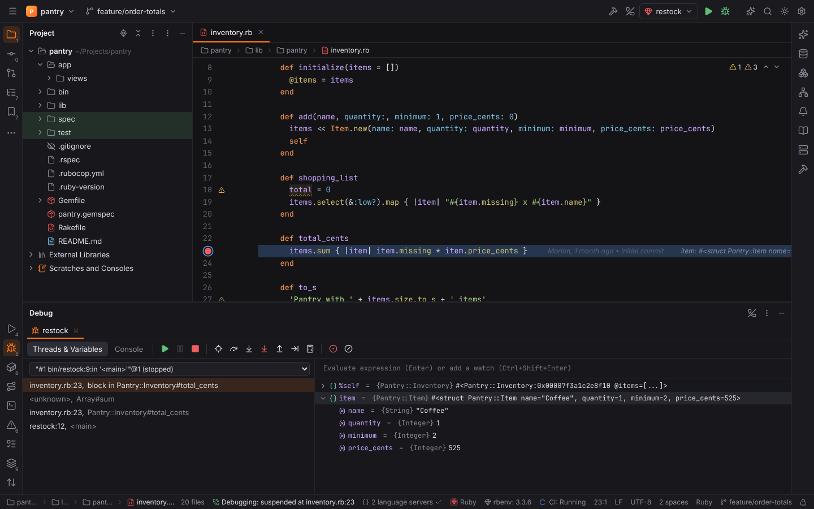
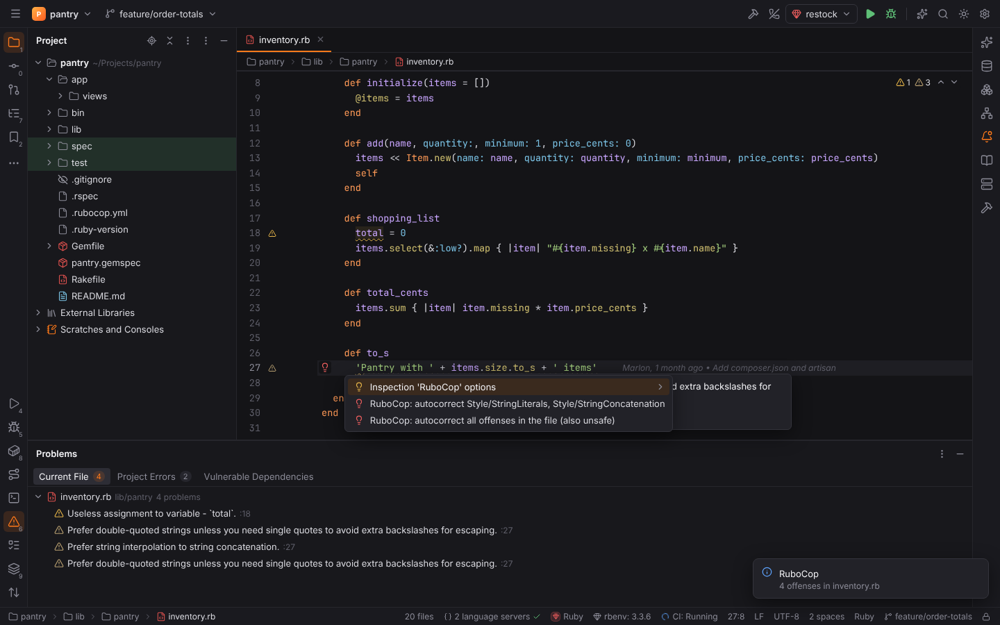

# RubyForge (Ruby)

**RubyForge** brings RubyMine's Ruby support to Forge. Its plugin **Ruby** (`forge.ruby`)
is active in [Ruby projects](../getting-started/project-detection.md): a `Gemfile`, a
`Rakefile`, a `.ruby-version`, a `*.gemspec`, a `.rb` file in the root, or two or more
`.rb` / `.rake` files in a folder. [Rails support](rails.md) (routes, navigation, generators,
the Rails console and server, data sources, I18n, Stimulus and Turbo) is a separate plugin that
builds on this one.

- Ruby files (`.rb`, `.rake`, `.gemspec`, `.ru`, `.jbuilder`, `Gemfile`, `Rakefile`,
  `Guardfile`, `Capfile`, `.irbrc`, scripts with a `ruby` shebang) get Ruby highlighting;
  `Gemfile.lock` is its own file type.
- Completion, navigation, hover, rename and diagnostics come from **Ruby LSP** (Shopify, MIT),
  which runs like every other [language server](language-servers.md) with the project's Ruby.
- Everything else is computed in Rust (`packs/rubyforge/*`): interpreters, the bundle, Rake
  tasks, test discovery and results, command lines and RuboCop's reports.

## Ruby SDK

**Settings | Languages & Frameworks | Ruby** lists the interpreters Forge found and the one
the project uses.

- Forge finds Rubies of **rbenv** (`$RBENV_ROOT` or `~/.rbenv/versions`), **rvm**
  (`~/.rvm/rubies`, `/usr/local/rvm/rubies`, with the Ruby's gem sets), **chruby**
  (`~/.rubies`, `/opt/rubies`), **asdf** (`~/.asdf/installs/ruby`), **mise**
  (`~/.local/share/mise/installs/ruby`), frum and rv, **Homebrew** (`/opt/homebrew/opt/ruby`),
  **RubyInstaller** (`C:\Ruby*`) and the system Ruby on the `PATH`. Version manager shims are
  skipped: the Ruby behind them is listed by its manager. Forge only reads the folders; Rubies
  outside a manager are asked for their version (`ruby -e 'print RUBY_VERSION'`).
- **Automatic** (the default) uses the version the project asks for in `.ruby-version`,
  `.tool-versions`, `mise.toml` or the Gemfile's `ruby "3.3.6"` / `ruby file:
  ".ruby-version"` line (`3.3` matches the newest installed 3.3.x), else the version
  manager's global version (`~/.rbenv/version`, `~/.tool-versions`), else the newest Ruby.
  The page says which file asked, and a balloon tells you when that version is not installed.
- Choose an interpreter in the list for the project, or **Add Interpreter…** for any other
  `ruby` executable (it is checked before it is added).
- **Tools** shows the gem executables Forge uses (Bundler, Rake, RSpec, RuboCop, rdbg, IRB,
  Ruby LSP); missing RuboCop, the debug gem and Ruby LSP have an **Install** button.
- **Environment** adds variables to every Ruby, Bundler, Rake and test command. Commands run
  with the interpreter's `bin` folder first on the `PATH` (and rvm's `GEM_HOME` /
  `GEM_PATH`), so `gem`, `bundle` and gem executables belong to the chosen Ruby.

The interpreter appears in the status bar (`rbenv: 3.3.6`); clicking it opens the page.

## Bundler and gems

In projects with a `Gemfile`, Ruby scripts, Rake, RSpec, Minitest, RuboCop and IRB run
through `bundle exec` (**Run commands with bundle exec**, on by default; Ruby and Rake
configurations can turn it off for themselves).

- The `Gemfile` and `Gemfile.lock` are read without running Bundler: declared gems with their
  requirements and groups (`group :test do`, `group:` options), platforms, `path:` / `git:`
  sources, and the locked versions with their dependencies. Gems pulled in by others get the
  groups of the gems that need them.
- **External Libraries** in the Project view lists the project's Ruby SDK and the **Bundled
  Gems** with their locked versions; gems of the Gemfile come first, the others are dimmed.
  Opening a Gemfile gem shows its line in the `Gemfile`.
- When gems of the Gemfile are missing from `Gemfile.lock`, a balloon offers **bundle
  install**. **Tools | Bundler: Install / Update** and **Show Outdated Gems** run Bundler in
  the Run tool window. Saving the Gemfile or the lock file reads the bundle again.

## Rake

The **Rake** tool window (right side) lists the project's tasks by namespace with their
arguments and descriptions. Double-click (or **Run**) runs a task as a temporary Rake
configuration, **Debug** runs it under the debugger, **Jump to Source** opens its definition.

- Tasks come from `rake --tasks --all` and their places from `rake --where`. That loads the
  Rakefile, so it runs only in [trusted projects](project-trust.md); in Safe Mode (or with
  **Load tasks with rake --tasks** off) Forge reads the `Rakefile`, `rakelib/*.rake` and
  `lib/tasks/**/*.rake` instead: `desc`, `task`, `namespace`, and the tasks of
  `Bundler::GemHelper`, `RSpec::Core::RakeTask`, `Rake::TestTask`, `Minitest::TestTask` and
  `RuboCop::RakeTask`.
- **Run Rake Task…** (Tools) asks for a task, e.g. `release[origin]`.

## Run configurations

- **Ruby** runs a script with interpreter options and arguments (`bundle exec ruby -w
  bin/report.rb --month 2026-10`). A ▶ in the gutter of scripts (a `ruby` shebang or `if
  __FILE__ == $0`) runs or debugs them.
- **Rake** runs a task with arguments (`rake release[origin]`) and Rake options.
- **RSpec** and **Minitest** run tests (below).

## RSpec and Minitest

Spec files (`*_spec.rb`) get ▶ icons on `describe` / `context` / `feature` groups and on
`it` / `specify` / `example` / `scenario`; test files (`*_test.rb`, `test_*.rb`) on test
classes, `def test_*` methods, ActiveSupport `test "…" do` blocks and Minitest::Spec
`describe` / `it` blocks. After a run the icons show the results.

- **RSpec** runs `rspec <file>:<line>` for a group or example, a file, a folder, everything,
  or the examples whose description matches (`--example`), with `--format progress --format
  json --out <report>`. Forge reads the JSON report into the test tree: files, example groups,
  examples, pending examples, the failure message with its backtrace, `expected: … got: …`
  values for **Click to see difference**, and errors outside of examples (a spec that does
  not load).
- **Minitest** runs `ruby -Ilib -Itest <file> -v [-n <filter>]` (a class: `-n
  "/^Shop::CartTest#/"`, a method: `-n Shop::CartTest#test_total`), or loads every test file
  of a folder. Forge reads Minitest's verbose output: one suite per test class, failures,
  errors and skips with their messages, `Expected:` / `Actual:` values, the location and the
  test's own output.
- **Rerun Failed Tests** runs the failed examples (`--example`) or methods (`-n
  "/^(test_a|test_b)$/"`) of the files that failed.

## Debugging

Debug (`Shift+F9`) on a Ruby, Rake, RSpec or Minitest configuration runs it under **rdbg**,
the debugger of the `debug` gem (BSD-2-Clause, Ruby's default debugger): the command starts
in the Run tool window as `rdbg --open --host 127.0.0.1 --port <port> --command -- <command>`,
waits for the debugger, and Forge attaches to it. Breakpoints (also conditional), stepping,
the stack, local and global variables and the debug console work as in the other
[debuggers](debugging.md); the program's output stays in the Run console and test runs still
fill the test tree.

- rdbg comes from `bundle exec rdbg` when the bundle has the `debug` gem, else from the
  interpreter (or **rdbg executable**). Without it, Forge offers to install the gem with the
  interpreter's `gem` (with `--user-install` for system Rubies).
- **Run | Attach to DAP Server…** with the adapter *Ruby (rdbg)* connects to any `rdbg --open
  --port <port>` you started yourself, e.g. in a container.

## RuboCop

RuboCop checks open Ruby files after opening them, after a pause in typing and after saving
(**Check files with RuboCop**). Its offenses appear in the editor and the **Problems** tool
window with the cop name; conventions and refactorings are weak warnings, warnings and errors
keep their level, and the inspection profile can change the severity (inspection
*Ruby | External tools | RuboCop*).

- `Alt+Enter` on a correctable offense: **RuboCop: autocorrect** (safe corrections, `-a`) or
  **autocorrect all offenses in the file** (also unsafe ones, `-A`).
- **Reformat Code** (`Ctrl+Alt+L`) uses RuboCop's autocorrect (**Reformat Code with**: safe,
  all, Ruby LSP's formatter or nothing). The editor text goes to RuboCop on stdin with the
  file's path, so the project's `.rubocop.yml` and its exclusions apply; nothing is written.
- **Code | Inspect Code with RuboCop** checks the current file and shows the Problems tool
  window. RuboCop runs through `bundle exec` when the bundle has it.
- RuboCop loads the project's configuration and plugins, so it runs only in trusted projects.

## Ruby LSP

Ruby LSP runs with the project's Ruby and its bundle; its formatter follows **Ruby LSP
formatter**. Forge uses `ruby-lsp` of the interpreter's gems, the **ruby-lsp executable**
setting or the `PATH`. When it is missing, Forge offers **Install Ruby LSP**: it runs `gem
install ruby-lsp --install-dir <Forge's data folder>/langservers/ruby/<version>` with the
project interpreter's RubyGems (rubygems.org or your gem sources) — nothing is bundled with
Forge and your Ruby's gems stay untouched — and starts the server with that folder on
`GEM_PATH`. Ruby LSP sets up its own bundle in `.ruby-lsp/` of the project, so it does not
start in Safe Mode.

## ERB

`.erb` files (`*.html.erb`, `*.text.erb`, `*.js.erb`, `.rhtml`) are a template language with
a [template data language](file-types.md#template-data-languages): HTML by default, or the language of the inner
extension (`welcome.text.erb` is plain text, `config.js.erb` JavaScript). `<%= %>`, `<%== %>`,
`<% %>` (with `-%>`), and `<%# %>` comments are highlighted over it, with Ruby's keywords and
common view helpers.

## IRB console

**Tools | Run IRB Console** opens a Terminal tab with `bundle exec irb -I lib` (or the
interpreter's `irb`). IRB reads the project's `.irbrc` and Bundler its Gemfile, so the console
is refused in Safe Mode.

## New projects

**File | New Project** has two Ruby generators: **Ruby Gem** runs `bundle gem` (Minitest,
RSpec or test-unit, RuboCop, an executable), with **Ruby Project** — a Gemfile, Rakefile,
`lib/`, `bin/`, Minitest tests and `.rubocop.yml` — as the offline fallback.

## Settings

| Setting | Default | Meaning |
| --- | --- | --- |
| Ruby interpreter | automatic | the project's Ruby (path or name) |
| Environment | — | `KEY=VALUE` variables of Ruby commands |
| Run commands with bundle exec | on | Bundler projects run gems through `bundle exec` |
| bundle executable | — | another `bundle` |
| Load tasks with rake --tasks | on | ask Rake (trusted projects) or read the Rakefile |
| Reformat Code with | RuboCop (safe) | RuboCop `-a`, RuboCop `-A`, Ruby LSP or nothing |
| Check files with RuboCop | on | on-the-fly and on-save RuboCop checks |
| rubocop executable, Additional options | — | another RuboCop, extra options (`--only Style`) |
| ruby-lsp executable, Ruby LSP formatter | —, automatic | Ruby LSP's executable and formatter |
| rdbg executable | — | another rdbg |

All keys are in the [settings reference](../reference/settings.md#languages--frameworks--ruby).
