# Run/Debug configurations

A **run configuration** describes how to start something: a script, a test suite, a command.
Forge's configurations work like PHPStorm's.

## Run widget

The run widget in the main toolbar shows the selected configuration with **Run** (▶) and
**Debug** (🐞) buttons. Its dropdown lists all configurations and has **Edit
Configurations…**; without configurations it reads **Add Configuration…**.

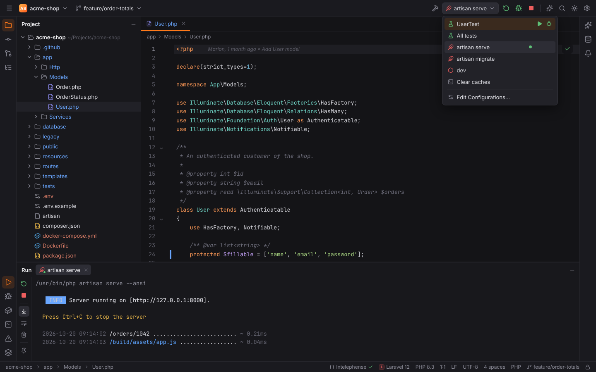

| Action | Windows/Linux | macOS |
| --- | --- | --- |
| Run the selected configuration | `Shift+F10` | `Ctrl+R` |
| Debug the selected configuration | `Shift+F9` | `Ctrl+D` |
| Run… (choose a configuration) | `Alt+Shift+F10` | `Ctrl+Alt+R` |
| Debug… (choose a configuration) | `Alt+Shift+F9` | `Ctrl+Alt+D` |
| Run Context Configuration (the test, script or Lua chunk at the caret) | `Ctrl+Shift+F10` | `Ctrl+Shift+R` |
| Debug Context Configuration | `Ctrl+Shift+F9` | `Ctrl+Shift+D` |
| Stop | `Ctrl+F2` | `Cmd+F2` |
| Rerun | `Ctrl+F5` | `Cmd+R` |
| Edit Configurations… | Find Action | |
| [Run Anything](#run-anything) | `Double Ctrl` | `Double Ctrl` |

In the **Run…** chooser, `Enter` runs and `Shift+Enter` (or holding `Shift`) debugs; it also
offers **Run Shell Command…** and **Edit Configuration…**.

## Run Anything

Press `Ctrl` twice (Tools | Run Anything…) to run almost anything from one popup:

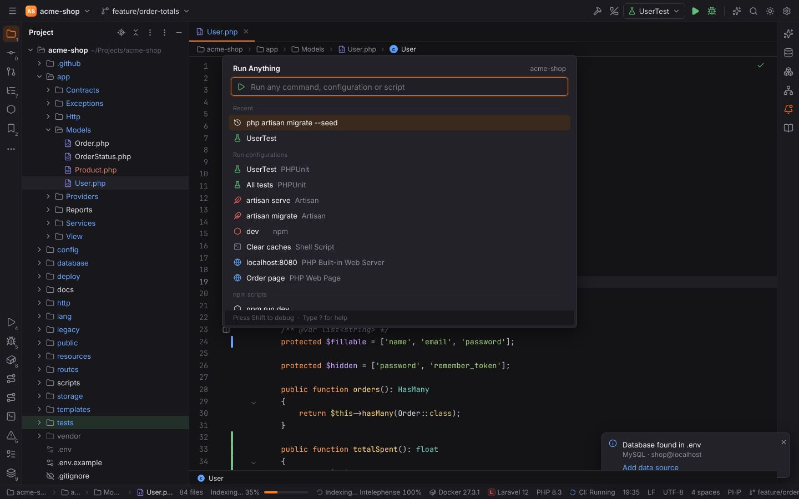

- **Recent**: what you ran from Run Anything in this project (kept outside the project, in
  Forge's state directory).
- **Run configurations**: run (or debug) a saved or temporary configuration by name.
- **npm scripts** of every `package.json` with the detected package manager (`pnpm run dev`),
  **Composer scripts** of `composer.json` (`composer test`).
- **PHP files**: type `php ` and part of a file name (`php User`).
- **Composer**, **Artisan** and **Symfony console commands** of
  [Command Line Tool Support](command-line-tools.md) (Symfony projects without it use the
  Symfony index);
  other plugins add their commands with `registerRunAnythingProvider`.
- **Commands**: anything else you type runs as a command in the project directory, in the Run
  tool window. When no suggestion starts with what you typed, the command itself is the first
  entry.

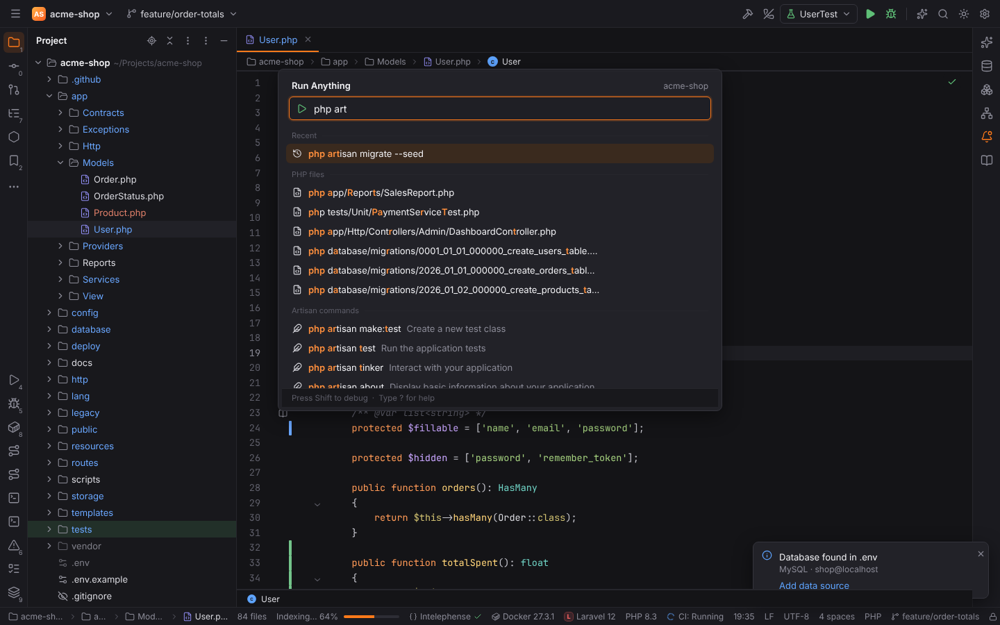

`Enter` runs the selected entry. Hold **Shift** to switch to **Debug Anything**: `Shift+Enter`
debugs it (Xdebug for PHP, `--inspect` for npm). Type `?` for help on what can be typed; picking
a help entry fills in its prefix.

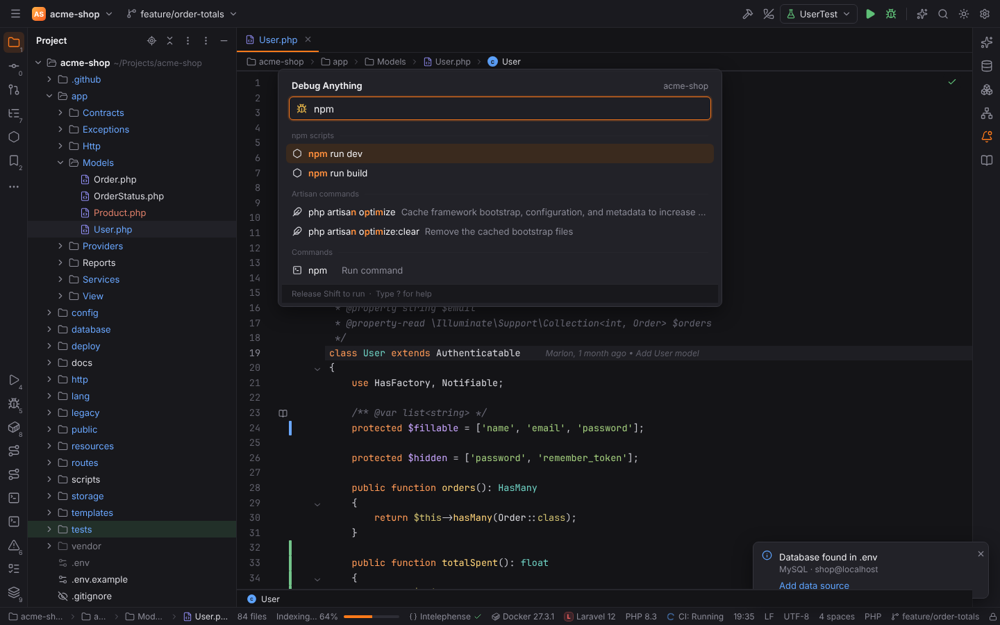

Typed commands become [temporary configurations](#temporary-configurations) of the matching
type, so they run like configurations:

| You type | Runs as |
| --- | --- |
| `php [options] script.php [args]` | PHP Script through the project's [CLI interpreter](php.md#cli-interpreters) (Docker, SSH, WSL included) |
| `php artisan <command>` | Artisan |
| `composer <command>` | Composer command (`composer` with `php.composer.executable`) |
| `npm`, `pnpm`, `yarn`, `bun` `run <script> [-- args]` or any other command | npm (`npm install lodash`, `yarn add x`) |
| anything else | Shell Script (`/bin/sh -c "<command>"`, `cmd.exe /C` on Windows) in the project directory |

## Run/Debug Configurations dialog

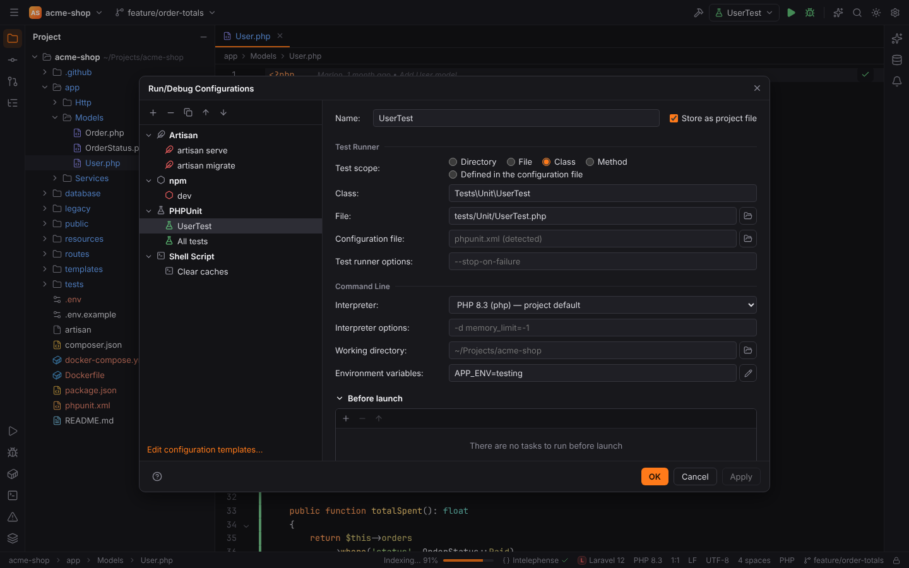

- **+** (`Alt+Insert`) adds a configuration from a type; copy, remove and reorder with the
  toolbar. **Edit configuration templates…** sets the defaults for new configurations of a
  type.
- Common fields: **Name**, **Store as project file**, the type's own fields, **Interpreter**
  and **Interpreter options** (PHP and Lua types), **Arguments**, **Working directory**
  (default: the project root), **Environment variables** and [Before launch](#before-launch)
  tasks.
- The **Command Line** preview shows exactly what will run.

### Configuration types

| Type | Fields | Runs | Debug |
| --- | --- | --- | --- |
| PHP Script | File | `<php> <options> <file> <arguments>` | Xdebug |
| PHP Built-in Web Server | Host (`localhost`), Port (`8080`), Document root, Use router script, Open in browser after launch | `<php> <options> -S host:port -t <document root> [router]`, then opens `http://host:port/` | Xdebug for every request |
| PHP Web Page | Server (Settings \| PHP \| Servers), Start URL | opens the page in the browser | adds `XDEBUG_SESSION_START=FORGE` |
| PHP HTTP Request | Server (optional), URL, Request method, Headers, Request body | sends the request, the response appears in the Run tool window | adds the `XDEBUG_SESSION` cookie |
| PHPUnit | Test scope: Directory, File, Class, Method or "Defined in the configuration file"; Configuration file (`phpunit.xml` detected); Test runner options | `phpunit --teamcity …` (from `vendor/bin`, or as set in [Settings \| PHP \| Test Frameworks](test-frameworks.md#settings--php--test-frameworks)) | Xdebug |
| Pest, Codeception, Behat, PHPSpec | see [PHP test frameworks](test-frameworks.md#run-configurations) | `pest --teamcity …`, `codecept run …`, `behat …`, `phpspec run …` | Xdebug |
| Artisan | Command (`migrate --seed`) | `<php> artisan <command>` | Xdebug |
| Composer Script | Script | `composer run <script>` with `php.composer.executable` | Xdebug |
| npm | package.json, Command (`run`, `install`, …), Scripts, Package manager | `npm`/`pnpm`/`yarn`/`bun` | sets `NODE_OPTIONS=--inspect` |
| Shell Script | Execute: Script file or Script text; Script path / text | the shell | — |
| Lua Script | File | `<lua> <options> <file> <arguments>`, LÖVE games as `love <dir>` | — |
| Compound | Configurations, Allow multiple instances | starts every configuration, each in its own Run tab | debugs every member |

The PHP interpreter defaults to the project's CLI interpreter (`php.interpreter`, Settings |
Languages & Frameworks | PHP), the Lua interpreter to `lua.interpreter`. The **Interpreter**
field of PHP Script, PHPUnit and Artisan configurations lists the project default, every
[CLI interpreter](php.md#cli-interpreters) and **Custom…** (a path to a local `php`):

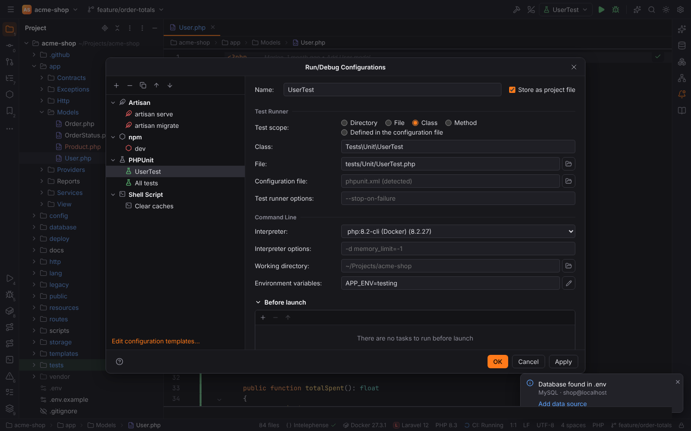

A Docker, Docker Compose, SSH or WSL interpreter wraps the command line: `docker run --rm …`,
`docker compose run/exec …`, `ssh user@host …` or `wsl.exe -d … --exec php …`, with paths in
the arguments and the working directory mapped into the container or host, the environment
variables passed along (`-e NAME=value`, `env NAME=value`) and the interpreter's
configuration options as `-d name=value`. Paths in the output (stack traces, PHPUnit
failures) are mapped back to project files, so they stay clickable in the Run console.
Composer Script and Composer command configurations run `composer` through an interpreter
when their Interpreter field names one; otherwise they use `php.composer.executable` locally.

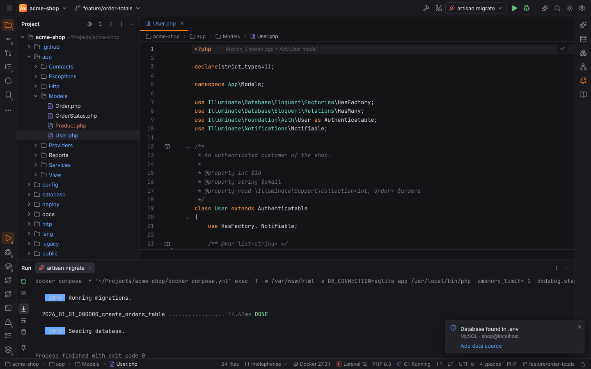

Debugging (`Shift+F9`) through an interpreter works the same way: Xdebug connects to
`host.docker.internal` from containers (`docker run` adds
`--add-host=host.docker.internal:host-gateway`; Compose services on Linux need an
`extra_hosts: ["host.docker.internal:host-gateway"]` entry), SSH runs forward the debug port
back with `ssh -R 9003:127.0.0.1:9003`, and the run sets `PHP_IDE_CONFIG=serverName=<interpreter>`
so breakpoints use the interpreter's path mappings.

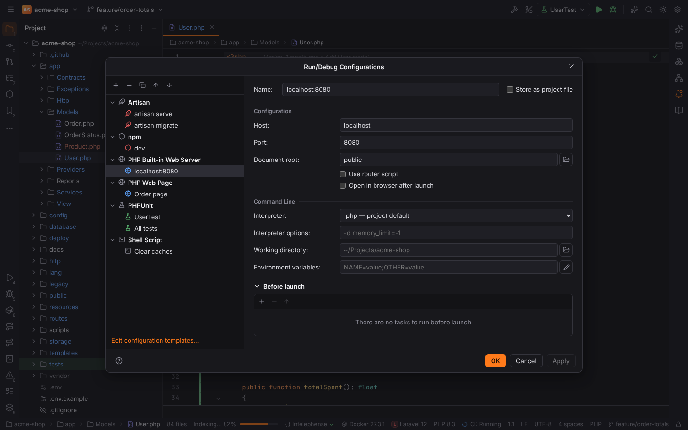

The built-in web server runs through the configuration's interpreter too: Docker and Compose
interpreters publish the port (`-p 8080:8080`, the server binds `0.0.0.0` inside the
container), SSH interpreters forward it (`ssh -L 8080:127.0.0.1:8080`), so the page opens on
`localhost` either way.

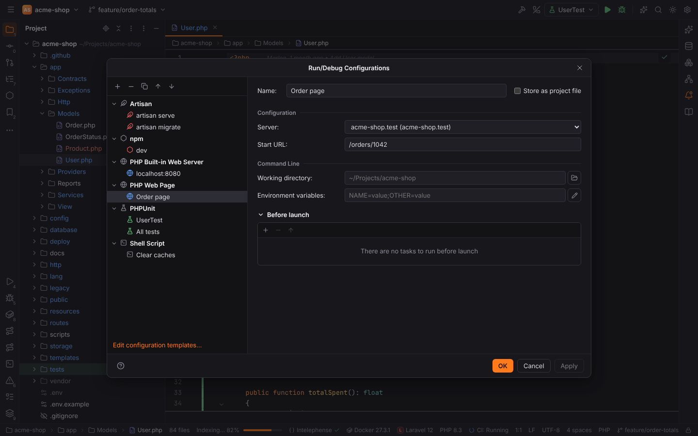

> **Note:** the type "PHP Remote Debug" is declared by the Xdebug plugin but not available yet.
> To debug requests started elsewhere, use
> [Start Listening for PHP Debug Connections](debugging.md#listening-for-connections).

### Compound configurations

A **Compound** configuration starts several configurations together, for example the Laravel
server and the Vite dev server. Add the configurations with **+** and order them with the
arrows; a compound may contain other compounds.

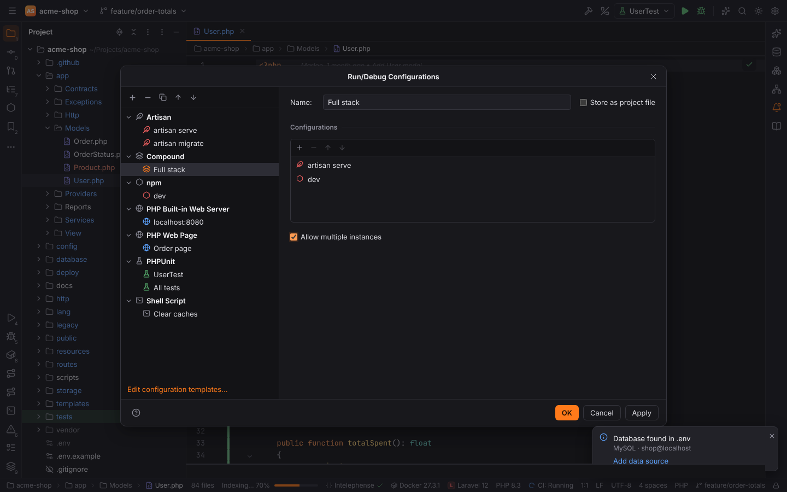

- **Run** starts every member (after its own Before launch tasks), each in its own tab of the
  Run tool window. **Debug** debugs each member that can be debugged.
- **Stop** (`Ctrl+F2` or the toolbar's ■ while the compound is selected) stops all members.
- Without **Allow multiple instances**, running the compound again restarts members that still
  run; with it, new instances start next to them.
- Missing members and cycles are reported before anything starts.

### Before launch

Every configuration (except compounds) can run tasks before it starts. They run one after
another in the listed order; when a task fails (exit code other than 0, a missing
configuration or tool), the launch stops and a balloon says which task failed.

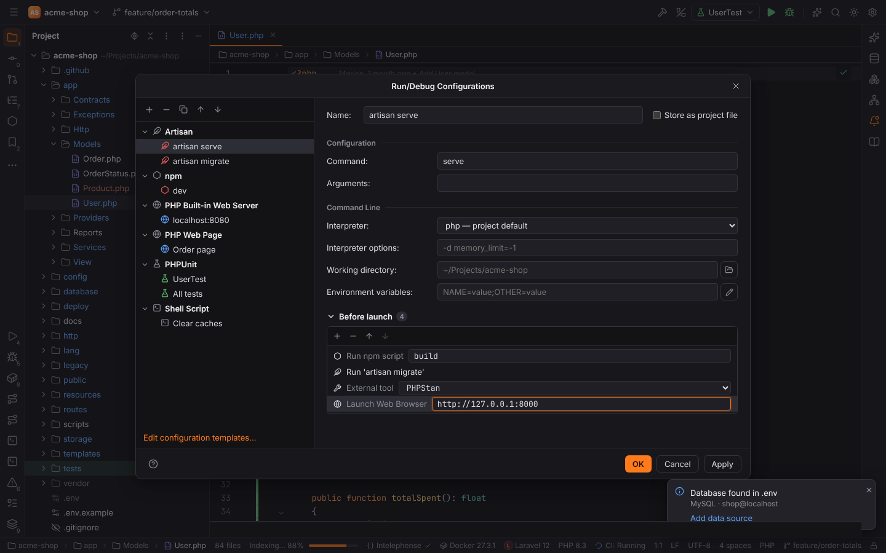

| Task (**+** menu) | Value | What it does |
| --- | --- | --- |
| Run External tool | a tool of [External Tools](#external-tools) | runs the tool and waits for it |
| Run Another Configuration | a configuration | runs it (with its own Before launch tasks) and waits for it; a compound runs each member |
| Launch Web Browser | a URL | opens the URL |
| Run npm script | a script name | `<package manager> run <script>` in the configuration's working directory |
| Run Composer script | a script or command | `composer <script>` |
| Run Artisan command | a command (Laravel projects) | `php artisan <command>` through the configuration's interpreter |
| Run Shell Command… | a command line | runs it with the shell |

Each task runs in its own tab of the Run tool window. Reorder tasks with **↑** / **↓**.

### Where configurations are stored

| | File |
| --- | --- |
| Shared ("Store as project file") | `<project>/.forge/runConfigurations.toml` — commit it to share with your team |
| Local configurations, the selected one, templates | `<project>/.forge/runConfigurations.local.toml` |

## Temporary configurations

Gutter ▶ icons create temporary configurations: tests of PHPUnit, Pest, Codeception, Behat and
PHPSpec ([PHP test frameworks](test-frameworks.md#gutter-icons)), `package.json` scripts, Lua
main chunks, scratch files and HTTP requests. A double-click in the npm tool window and
commands run from [Run Anything](#run-anything) do the same.

## External Tools

**Settings | Tools | External Tools** lists programs you start from Forge with arguments
that come from the current file, caret or selection, such as linters, formatters or deploy
scripts. Tools are kept in your user settings (`tools.externalTools`), so they exist in every
project.

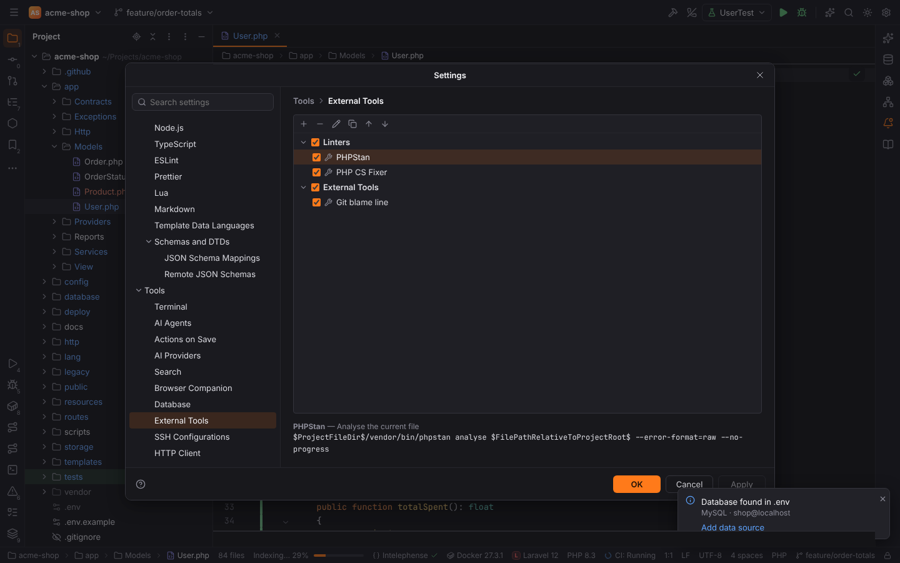

The toolbar adds (**+**), removes, edits (or double-click), copies and moves tools; the check
boxes of tools and groups hide them from menus and the keymap without deleting them.

**Create Tool / Edit Tool**:

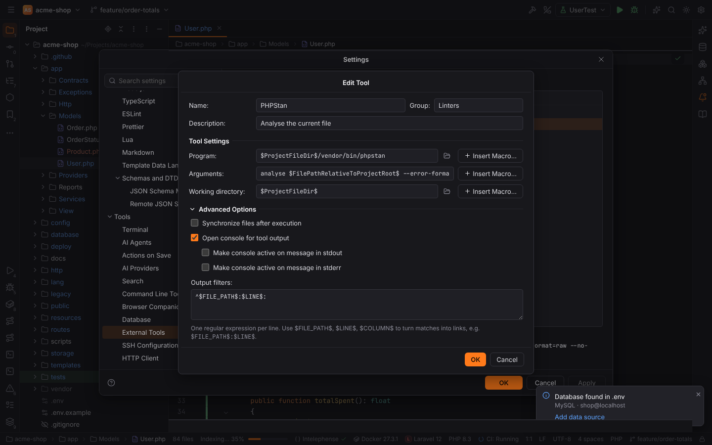

- **Name**, **Group** (the submenu it appears in; default "External Tools") and
  **Description**.
- **Program**, **Arguments** and **Working directory** (default `$ProjectFileDir$`). Each can
  contain macros; **Insert Macro…** lists them with a preview of their value for the current
  editor:

  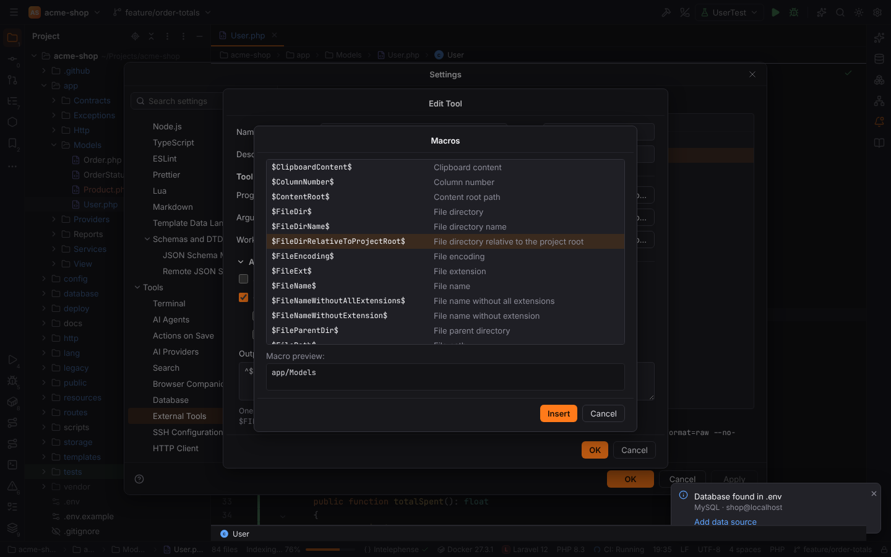

  | Macro | Value |
  | --- | --- |
  | `$FilePath$`, `$FileDir$`, `$FileName$`, `$FileNameWithoutExtension$`, `$FileNameWithoutAllExtensions$`, `$FileExt$`, `$FileDirName$`, `$FileParentDir$` | the file in the editor, or the file the Project view menu was opened on |
  | `$FilePathRelativeToProjectRoot$`, `$FileDirRelativeToProjectRoot$`, `$FileRelativePath$`, `$FileRelativeDir$` | the same, relative to the project |
  | `$ProjectFileDir$`, `$ContentRoot$`, `$ProjectName$` | the project |
  | `$LineNumber$`, `$ColumnNumber$`, `$SelectedText$`, `$SelectionStartLine$`, `$SelectionEndLine$`, `$SelectionStartColumn$`, `$SelectionEndColumn$` | caret and selection (1-based) |
  | `$ClipboardContent$` | the clipboard text |
  | `$Prompt$` | asks for a value when the tool runs (once per occurrence) |
  | `$PhpExecutable$` | the project's PHP interpreter |
  | `$FileEncoding$`, `$OSName$`, `$UserHome$` | file encoding, operating system, home directory |

  Arguments are split like a shell command line before the macros are expanded, so a path with
  spaces stays one argument. A macro without a value here (`$FilePath$` with no file open) is
  replaced by nothing and reported in a balloon.
- **Advanced Options**: **Synchronize files after execution** (refreshes the Project view),
  **Open console for tool output** (without it the tool runs in the background), **Make console
  active on message in stdout / stderr** (the console appears with the first such message) and
  **Output filters**.
- **Output filters** turn tool output into links: one regular expression per line with
  `$FILE_PATH$`, `$LINE$` and `$COLUMN$`, e.g. `$FILE_PATH$:$LINE$` or
  `^$FILE_PATH$:$LINE$:` for PHPStan's raw format. Everything else is a regular expression
  (escape `(` as `\(`). Invalid filters are reported when you click OK.

  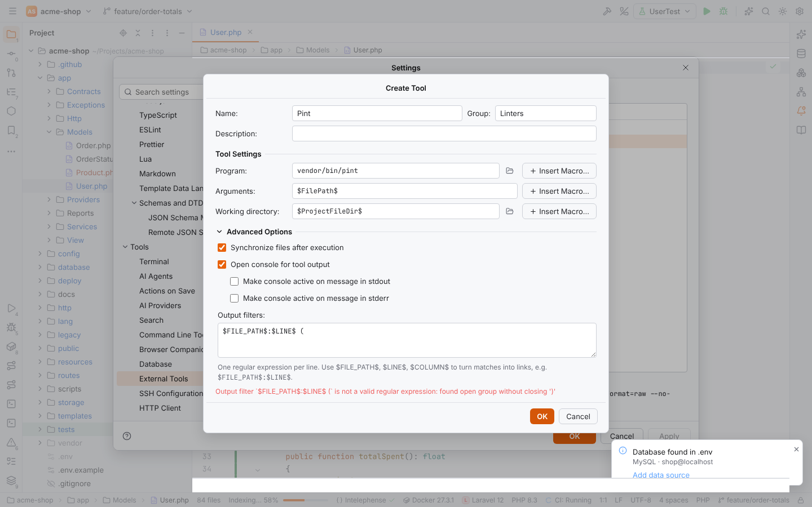

Run a tool from:

- **Tools | External Tools**, 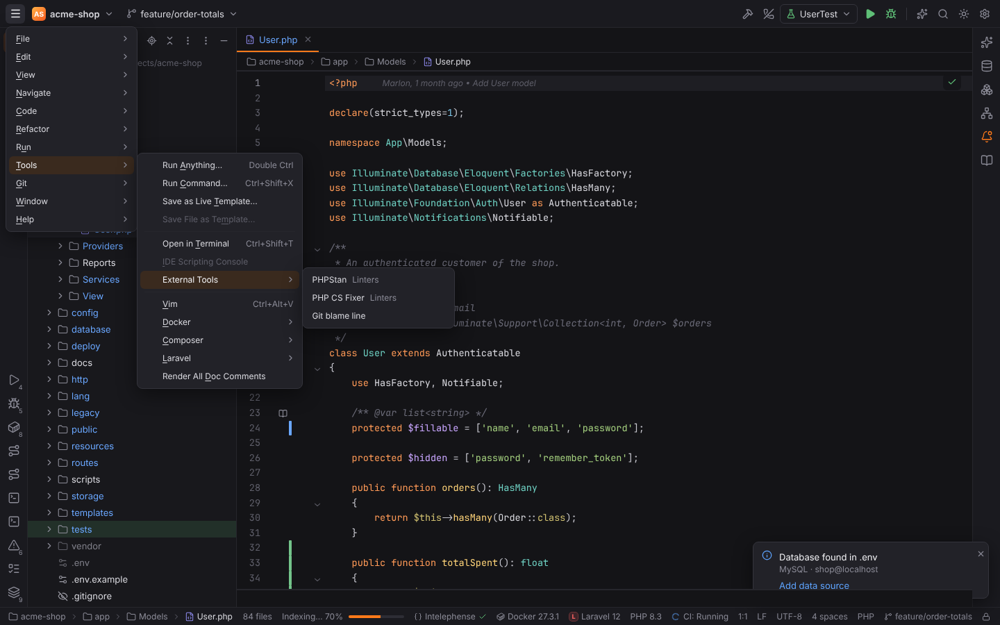
- the editor's context menu (a submenu per group) and the Project view's context menu (the
  macros then use the clicked file), 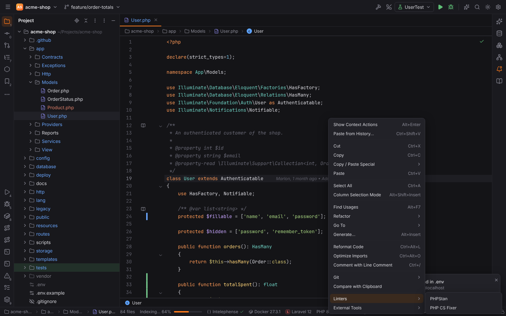
- a shortcut: each tool is the action `Tool_<group>_<name>` in Settings | Keymap and Find
  Action,
- a [Before launch](#before-launch) task.

The output appears in the Run tool window, with the output filters' matches as links; tools run
on the machine that hosts the project (remote projects included).

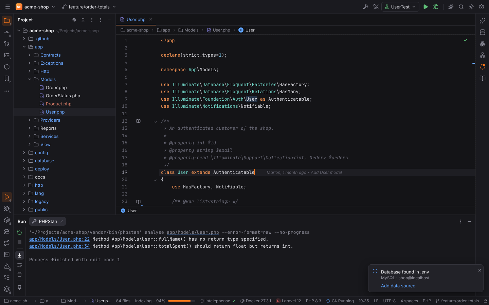

## Run tool window

The **Run** tool window (`Alt+4`) has one tab per run. Tabs can be pinned and closed (`Ctrl+Shift+F4`).

- Output is shown with ANSI colors; `\r` progress lines update in place.
- File references (`app/User.php:42`, stack traces) and URLs are clickable.
- Toolbar: **Rerun**, **Stop**, **Soft-Wrap**, **Scroll to the End**, **Clear All**.
- Typing sends input to the process (stdin).
- Stop sends SIGTERM to the process group, then SIGKILL after 2 seconds (`taskkill /T` on
  Windows).

Settings | Editor | General | Console: **Use soft wraps in console** (`run.console.softWrap`)
and **Override console cycle buffer size (KB)** (`run.console.cycleBufferKb`, 1024): a console
keeps the newest output up to that size and drops the oldest lines.

## Analyze Stack Trace

**Code | Analyze Stack Trace or Thread Dump…** (`AnalyzeStacktraceOnError`, no default
shortcut) opens a dialog to paste a stack trace from a log file, a bug report, an error page or
a server. When the clipboard holds a trace, the dialog starts with it.

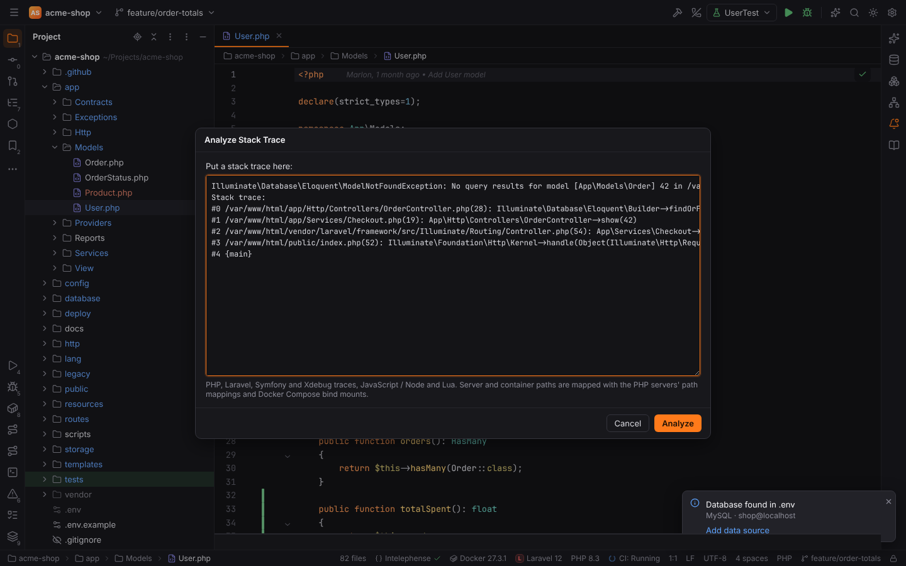

**Analyze** opens it in a **Stack Trace** tab of the Run tool window. Every frame that names a
project file is a link to its line; the exception message is red, frames in libraries
(`vendor/`, `node_modules/`) and files outside the project are dimmed. **Rerun** opens the
dialog again with the same text.

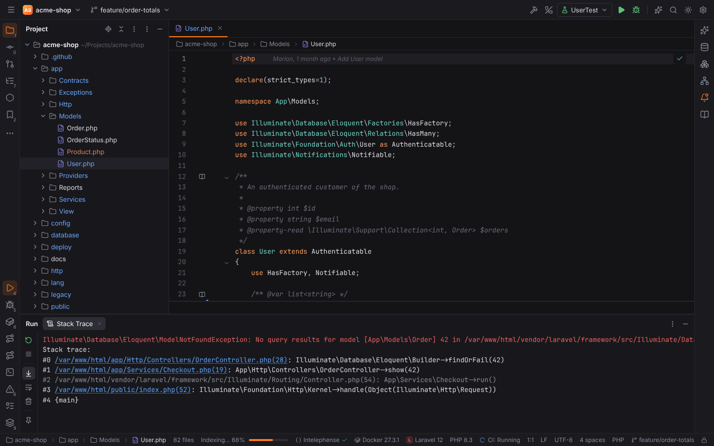

Recognized formats:

| Language | Frames |
| --- | --- |
| PHP | `#0 /var/www/app/User.php(12): …`, `… in /path/File.php:42`, `… on line 7`, Laravel and Symfony exception traces and logs, Xdebug's `0.0012 402456 1. {main}() /path/index.php:0` |
| JavaScript / Node | `at fn (/app/src/cart.ts:10:5)`, `at /app/src/x.js:3:1`, `file:///…`, `webpack:///./src/…` |
| Lua | `main.lua:12: attempt to …`, `lib/util.lua:4: in function 'load'` |
| Others | any `path:line[:column]` or `path(line)` |

A trace copied from a JSON log as one line with escaped line breaks (`\n#1 …`) is split into
lines first.

Paths of a server or container are mapped into the project:

1. the path mappings of the PHP servers (Settings | PHP | Servers,
   [Xdebug debugging](debugging.md)),
2. the bind mounts of the project's Docker Compose file (`./:/var/www/html`),
3. the project root,
4. otherwise the longest trailing part of the path that exists in the project
   (`/srv/app/releases/42/app/Models/Order.php` → `app/Models/Order.php`).

Files are looked up through the project's backend, so this works in
[remote projects](remote-development.md) too. Detecting traces copied to the clipboard outside
Forge automatically is not supported.

## Test results

Test runners that speak TeamCity service messages (PHPUnit with `--teamcity`, Pest, Jest) or
write JUnit reports (Codeception, Behat, PHPSpec) show a **Test Results** tree next to the
console:

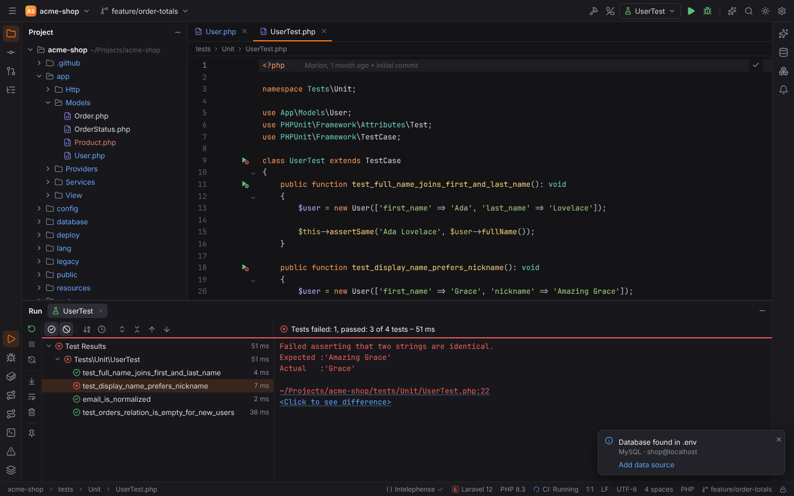

- Pass/fail/ignored per test with durations; **Show Passed**, **Show Ignored**, **Sort
  Alphabetically**, **Sort by Duration**, **Expand/Collapse All**.
- **Previous/Next Failed Test** and **Rerun Failed Tests**.
- **Toggle Auto-Test** reruns the tests after files are saved, and **Test History** reopens the
  last test runs of the project, see [PHP test frameworks](test-frameworks.md#test-history).
- A failed assertion shows a **Comparison Failure** with Expected and Actual.
- Double-click a test to open it.

## Debugging

**Debug** on a PHP configuration (PHP Script, PHPUnit, Artisan, Composer, PHP Built-in Web
Server) starts Forge's Xdebug listener and runs the process with the Xdebug environment
(`XDEBUG_MODE=debug`, `XDEBUG_SESSION`, `XDEBUG_CONFIG`). **Debug** on PHP Web Page, PHP HTTP
Request and requests of `.http` files starts listening and adds the Xdebug trigger to the
request. See [Xdebug debugging](debugging.md#debugging-web-pages-and-http-requests).

> **Note:** Run/Debug configurations work in [remote projects](remote-development.md): the
> process runs on the remote host.
