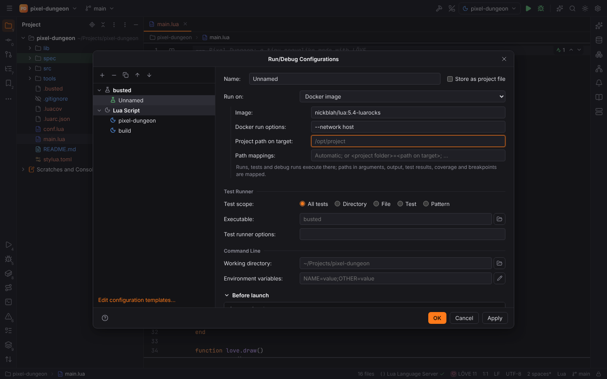

# Run targets (Run on)

Like IntelliJ's run targets, every run configuration can **run on** another machine: the
configuration's runs, test runs, coverage runs and debug runs then execute there, while Forge
keeps the project, the test tree, the console links and the debugger local.

## Choosing a target

**Run | Edit Configurations…** → the configuration → **Run on**:

| Target | Fields | Runs as |
| --- | --- | --- |
| Local machine | — | the program itself |
| Docker image | Image, Docker run options, Project path on target (default `/opt/project`) | `docker run --rm -i -v <project>:<path> -w <dir> -e K=V <options> <image> <program> …` |
| Docker Compose service | Compose files, Service, Lifecycle (*Always start a new container* / *Connect to existing container*) | `docker compose -f … run --rm -T …` or `exec -T …` |
| SSH | Host, Port, User name, Private key file, Project path on target | `ssh -o BatchMode=yes … user@host "cd <dir> && env K=V <program> …"` |
| WSL | Distribution, User name | `wsl.exe -d <distribution> --cd <dir> --exec env K=V <program> …` |
| Dev Container | Container, User name, Project path in the container | `docker exec -i -u <user> -w <dir> -e K=V <container> <program> …` |

The configuration's **Working directory** and **Environment variables** apply on the target;
the target's own environment is added to every run. The Docker CLI is `docker.cliPath`
(Settings | Build, Execution, Deployment | Docker). The run configuration stores the target in
`runOn`, so a shared configuration (`.forge/runConfigurations.toml`) carries it for the team.

PHP configurations whose **CLI interpreter** is itself a Docker, Compose, SSH or WSL
interpreter run through that interpreter ([PHP](php.md#cli-interpreters)); the run target
applies to PHP configurations with a local interpreter and to every other configuration type.

## Path mappings

Forge maps paths both ways:

- the project folder and the working directory, and absolute project paths in the arguments,
  become paths on the target;
- paths in the output, test locations and coverage reports become project files again, so
  console links, the test tree's navigation and the [coverage](coverage.md) marks work;
- debuggers get the same pairs for breakpoints.

Automatic mappings: a Docker image mounts the project at its project path, a Compose service
uses the bind mounts of its `volumes`, WSL sees `C:\work\shop` as `/mnt/c/work/shop`, SSH hosts
and Dev Containers use their project path. **Path mappings** (`<project folder>=<path on
target>; …`) add your own; yours win for the same folder.

## Debugging on a target

Debug runs make the debugger's port reachable:

- debuggers that connect back to the IDE (Xdebug) reach it as `host.docker.internal` in
  containers (`--add-host=host.docker.internal:host-gateway`) and through a reverse tunnel
  (`ssh -R`) over SSH; PHP runs also get `PHP_IDE_CONFIG=serverName=<target>` and a debugger
  server with the target's path mappings;
- debuggers the IDE connects to (debug adapters listening in the program) get their port
  published (`-p`) or forwarded (`ssh -L`).

## Safe Mode

Runs on a target run the project's code like local runs: in [Safe Mode](project-trust.md)
they are refused until the project is trusted.
