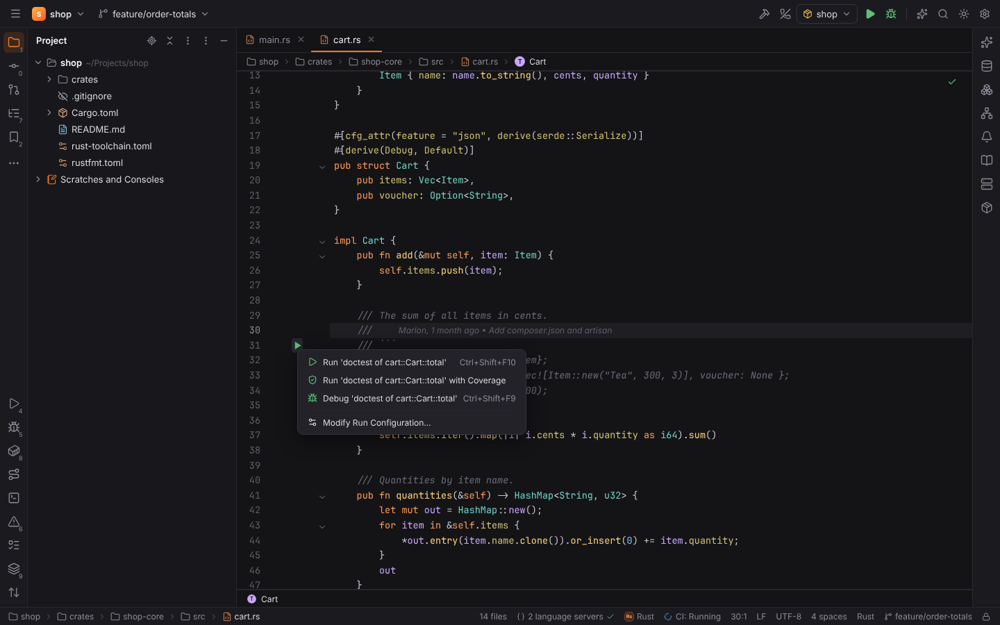
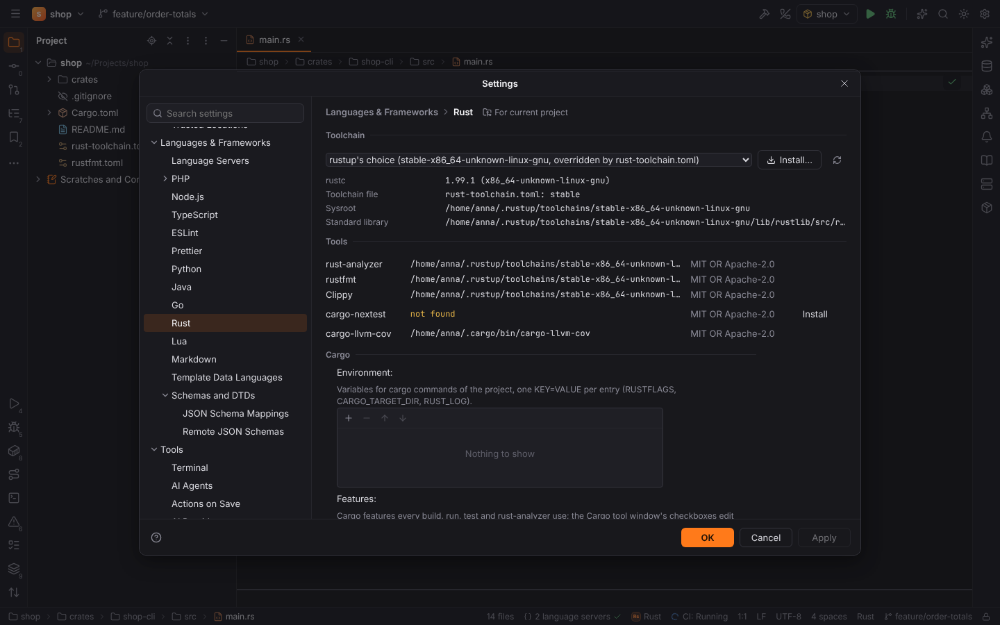
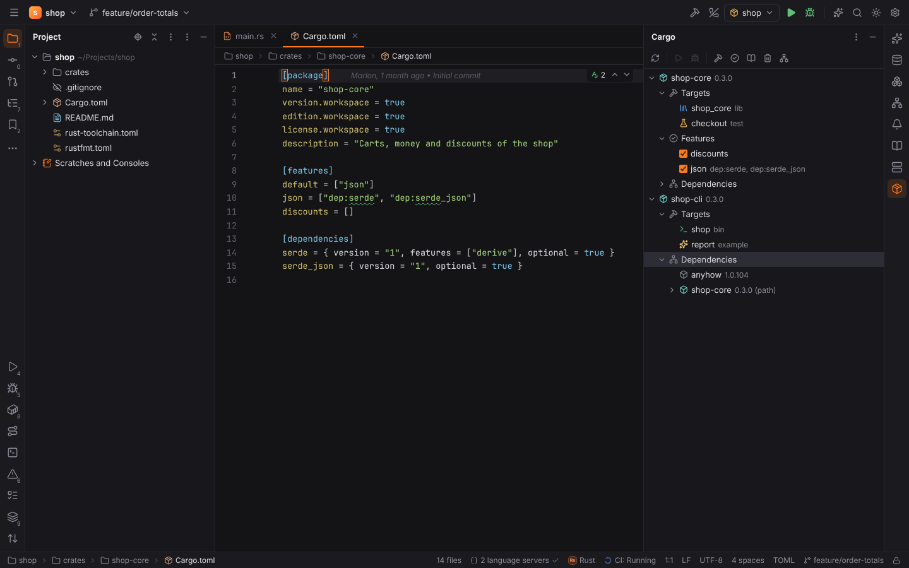
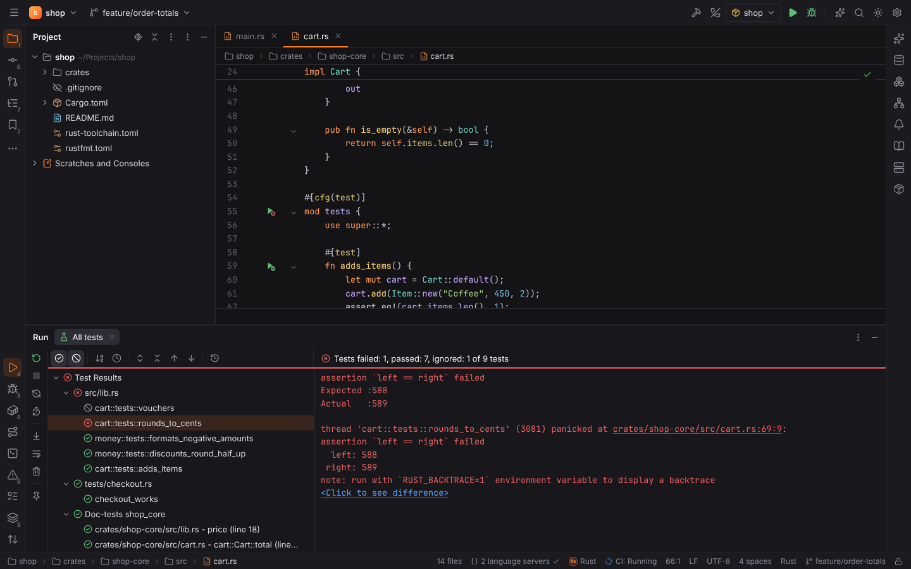
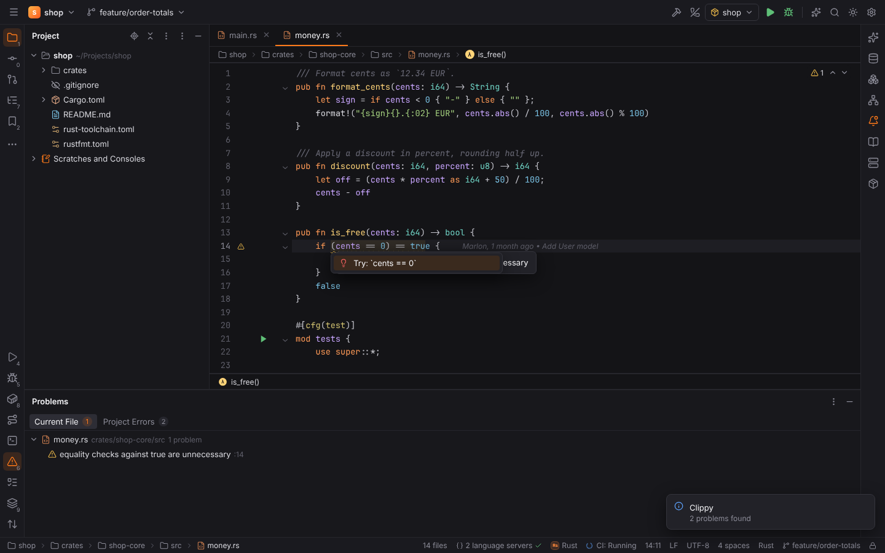
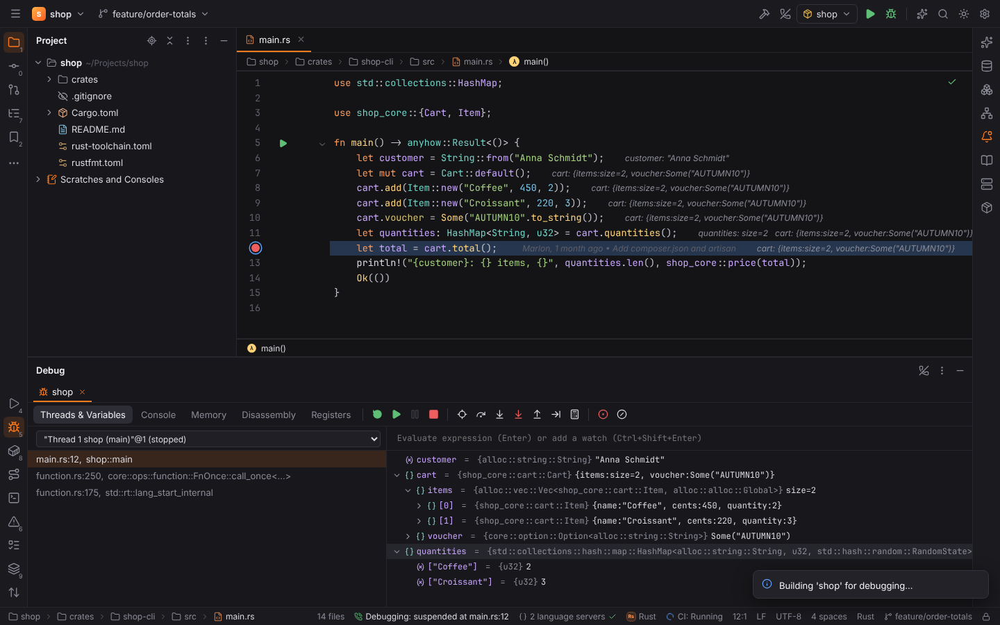

# RustForge (Rust)

**RustForge** brings RustRover's Rust support to Forge. Its plugin **Rust** (`forge.rust`)
is active in [Rust projects](../getting-started/project-detection.md): a `Cargo.toml`, a
`.rs` file in the root, or two or more `.rs` files in a folder.

- Highlighting of `.rs` files comes from CodeMirror's Rust grammar. Completion, navigation,
  hover, rename and diagnostics come from **rust-analyzer** (MIT OR Apache-2.0), which runs
  like every other [language server](language-servers.md).
- Everything else is computed in Rust (`packs/rustforge/*`): toolchains, `cargo metadata`,
  test discovery, command lines, Clippy messages and the debugger setup.

## Toolchains

**Settings | Languages & Frameworks | Rust** shows the project's toolchain, the tools Forge
uses and the Rust settings.

- **Toolchain**: *rustup's choice* uses the toolchain rustup picks for the project folder
  (`rustup show active-toolchain`). The page says why: the rustup default, a
  `rust-toolchain.toml` / `rust-toolchain` file, a directory override or `RUSTUP_TOOLCHAIN`.
  Choosing an installed toolchain runs every cargo, rustc, rustfmt and Clippy command of the
  project with `cargo +<toolchain>`.
- Toolchains are read from `rustup toolchain list -v`. Without rustup, a `rustc` on the
  `PATH` (a distribution package or an official installer) is listed as a standalone
  toolchain.
- The page also shows `rustc -vV`, the project's toolchain file, the **sysroot** and the
  **standard library sources** (`<sysroot>/lib/rustlib/src/rust/library`, the `rust-src`
  component) that rust-analyzer and the debugger use for `std`.
- **Install…** installs a toolchain with `rustup toolchain install <name> --profile minimal
  --component clippy,rustfmt,rust-src`. **Install** next to a missing component (rustfmt,
  Clippy, rust-src, rust-analyzer) runs `rustup component add`. Both run in the Run tool
  window, and only after you agree.
- Forge never changes your toolchains while it only looks: every rustup and cargo command it
  runs on its own gets `RUSTUP_AUTO_INSTALL=0`, so a `rust-toolchain.toml` does not trigger
  an install behind your back.

## Cargo tool window

The **Cargo** tool window (right side) shows the workspace as `cargo metadata` reports it.

- **Members** with their **Targets**: lib, bin, test, bench, example, build script and proc
  macro. Double-click runs a binary or example (`cargo run`) or the tests of a target.
- **Features** with checkboxes. They edit **Settings | Rust | Cargo**: the features, *Use all
  features* and *Do not use the default features*. Every build, run and test and
  rust-analyzer use them. In a workspace with several members, features are stored as
  `<package>/<feature>`.
- **Dependencies**: the dependency tree of each member, like `cargo tree`. Packages that
  appeared before are marked `(*)` and not expanded again.
- Toolbar: **Reload Cargo Project**, **Run** and **Debug** the selected target, **Build**,
  **Check**, **Documentation**, **Clean** and **Update** (`cargo update`) for the selected
  package, or for the workspace when nothing is selected.

`cargo metadata` runs only in trusted projects (a project's `.cargo/config.toml` can name
programs). Its result is cached in Forge's cache folder (`<cache>/forge/rust/`) and is read
again when a `Cargo.toml` or `Cargo.lock` changes, or when you click Reload.

## Run configurations

| Type | Options | Command |
| --- | --- | --- |
| **Cargo** | Command (`run`, `build --release`, `test --doc`, `clippy -- -W clippy::pedantic` or any other), package, target (`bin:shop`, `example:report`), features, profile, target triple, toolchain | `cargo [+toolchain] <command> -p … --bin … --features … -- <program arguments>` |
| **Cargo Test** | Scope (all, package, target, test, filter), package, target (`lib`, `test:checkout`, `doc` for doctests), test name and *Exact name*, tests or benchmarks, test runner, features, profile, target triple, toolchain, cargo options | `cargo test --no-fail-fast … -- <filter> --exact`, `cargo bench`, `cargo nextest run` or `cargo llvm-cov` |

Both types have the usual environment variables, working directory and
[Run on](run-debug.md) targets. Your own options in the command win over the form: a
`--release` in the command is not repeated by the profile.

- **▶ on `fn main`** of binaries and examples offers *Run*, *Debug* and *Modify Run
  Configuration…* with a temporary Cargo configuration (`cargo run -p shop-cli --bin shop`).
- **▶ on tests**: `#[test]`, `#[tokio::test]`, `#[async_std::test]` and other
  `#[<runtime>::test]` attributes, `#[bench]` (nightly), test modules (`mod tests`), and
  **doctests** — fenced code blocks in `///` and `//!` comments whose info string is Rust
  (empty, `rust`, `no_run`, `should_panic`, `compile_fail`, `edition2021`, …; not `ignore`,
  `text` or another language). Doctests run with `cargo test --doc -- "<file> - <item> (line
  N)" --exact`.

## Tests

Test runs fill the shared [test tree](testing.md), with a suite per test binary (`src/lib.rs`,
`tests/checkout.rs`, `Doc-tests shop_core`).

- **Output format**: on a nightly toolchain Forge asks libtest for JSON (`-Z unstable-options
  --format json --report-time`). On stable it reads libtest's plain output, so test
  durations are not shown. **Settings | Rust | Tests | Test results** can force either.
- **cargo-nextest** (Settings | Rust | Tests | Test runner, or per configuration) runs tests
  with `cargo nextest run --message-format libtest-json`. Doctests and benchmarks always run
  with cargo test, because nextest does not run them.
- Failures show the panic message and location. `assert_eq!` values open in **Click to see
  difference** (left as expected, right as actual).
- Test locations map back to files through the workspace's modules, so a test opens at its
  function and the gutter icons show the last result.
- **Rerun Failed Tests** runs the failed tests by their exact names
  (`-- --exact a::b c::d`).
- **Run with Coverage** uses **cargo-llvm-cov** (`cargo llvm-cov --lcov --output-path …`) and
  shows the LCOV report in the [Coverage tool window](coverage.md). Forge offers to install
  cargo-llvm-cov and cargo-nextest with `cargo install --locked` from Settings | Rust.

## Clippy and rustfmt

- **Run Clippy** (Find Action, or *Run Clippy on save* in Settings | Rust | External Linter)
  runs `cargo clippy --all-targets --message-format=json` for the file's package. Problems
  appear in the editor and the Problems tool window. Clippy's suggestions are quick fixes
  under **Alt+Enter**, so *Try: `cents == 0`* replaces the code it marks. Clippy builds the
  code, so it runs only in trusted projects.

- **Reformat Code** (`Ctrl+Alt+L`) and *Reformat code* on save use **rustfmt** with the
  package's edition and the nearest `rustfmt.toml` / `.rustfmt.toml`, like `cargo fmt`.
  **Settings | Rust | Rustfmt | Reformat Code with** can switch to rust-analyzer's formatting
  or turn formatting off.

## rust-analyzer

Forge starts rust-analyzer from the active toolchain (`rustup component add rust-analyzer`).
Without it, Forge uses its own download, then a rust-analyzer on the `PATH`; you can also
set **rust-analyzer executable**. When rust-analyzer is missing, a balloon offers *Install
with rustup*. Without rustup, it offers *Download…*: Forge downloads a pinned release
from [rust-lang/rust-analyzer's GitHub releases](https://github.com/rust-lang/rust-analyzer/releases),
checks it against the SHA-256 digest GitHub publishes for the asset, and keeps it in
`<data dir>/forge/langservers/rust-analyzer`.

Settings | Rust | rust-analyzer configures it:

- **Check on save** with **Clippy** or **cargo check**,
- the Cargo **features** of the tool window,
- a **target triple** (`wasm32-unknown-unknown`),
- **Expand procedural macros** and **Run build scripts**.

rust-analyzer runs the project's build scripts and proc macros, so
[Safe Mode](project-trust.md) does not start it.

## Debugging

**Debug** on a Cargo or Cargo Test configuration, or on a ▶ icon, first builds it with
`--message-format=json` (`cargo build`, or `cargo test --no-run` for tests). It then starts
the executable cargo reports under the built-in **LLDB** (`lldb-dap`) or **GDB**
(`gdb -i dap`) adapter of the [debugger](debugging.md). *Settings | Rust | Debugger*
chooses the debugger; *auto* uses LLDB when lldb-dap is installed.

- **Rust type renderers**: Forge loads rustc's own pretty printers from the toolchain's
  sysroot (`lib/rustlib/etc`), the same ones `rust-lldb` and `rust-gdb` load. For LLDB,
  `lldb_lookup.py` and `lldb_commands` go in as `initCommands`. For GDB, the `rust-gdb`
  adapter adds the folder to the auto-load safe path and sources
  `gdb_load_rust_pretty_printers.py`. `Vec`, `String`, `&str`, `Option`, `Result`,
  `HashMap`, `Rc` and friends then show as values with their elements.
- With `rust-src` installed, `/rustc/<commit>` paths map to the toolchain's sources, so
  stepping into `std` opens real files.
- Tests are debugged one test binary at a time, with `--nocapture --test-threads=1`. Doctests
  are compiled by rustdoc and cannot be debugged.
- The Memory, Disassembly and Registers views, watchpoints and core dumps work as for any
  native program.

## Settings

All keys are listed in the [settings reference](../reference/settings.md) under
*Languages & Frameworks | Rust*.
