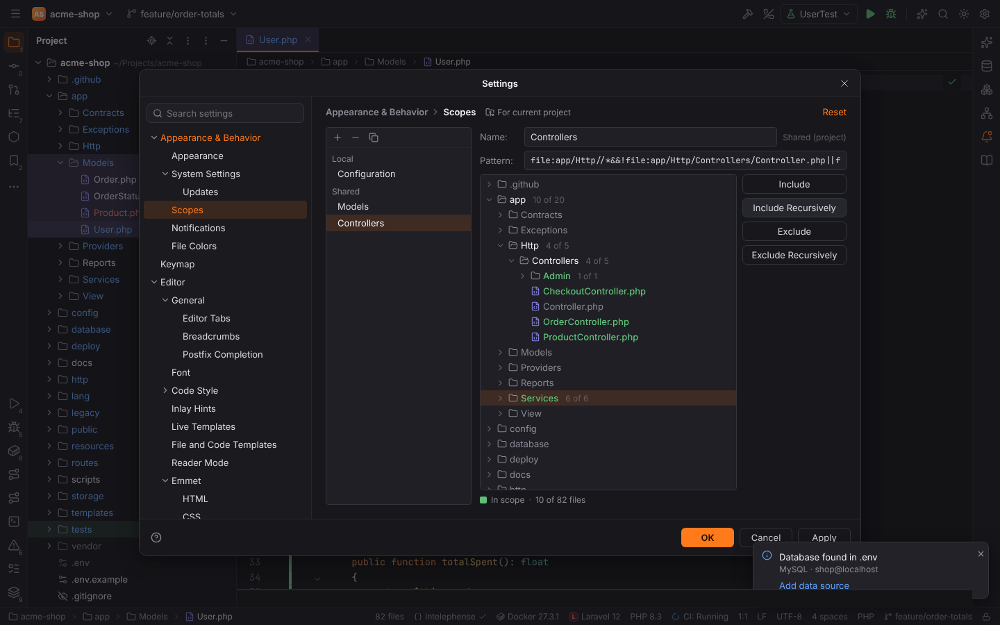
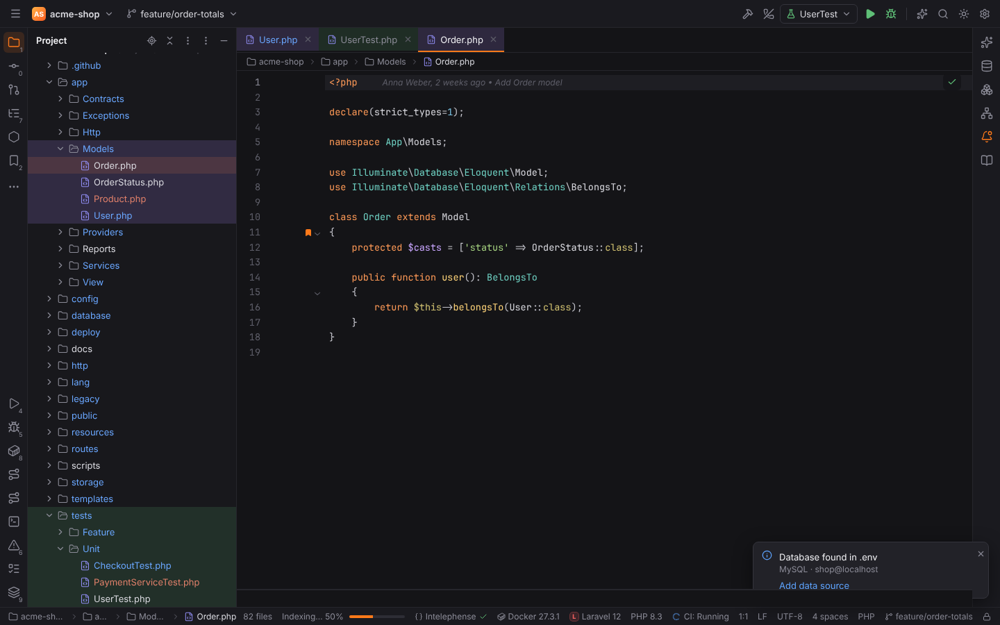
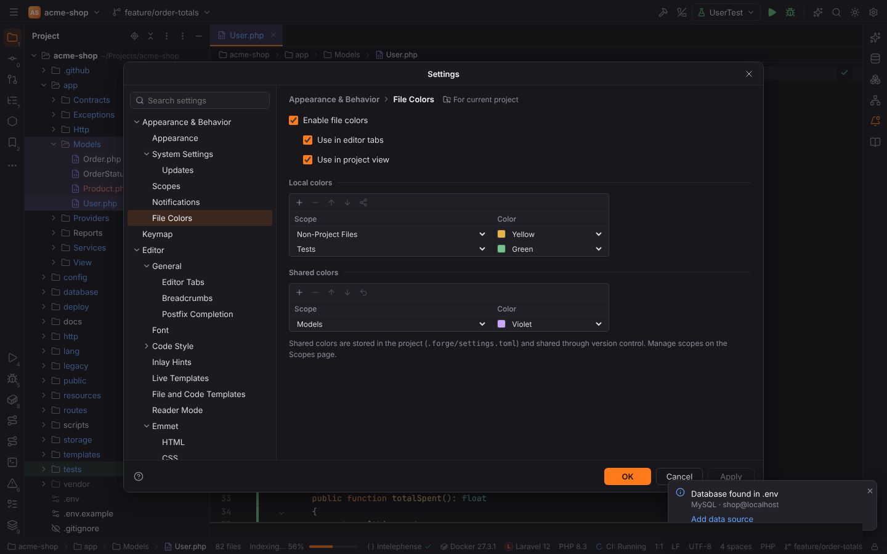
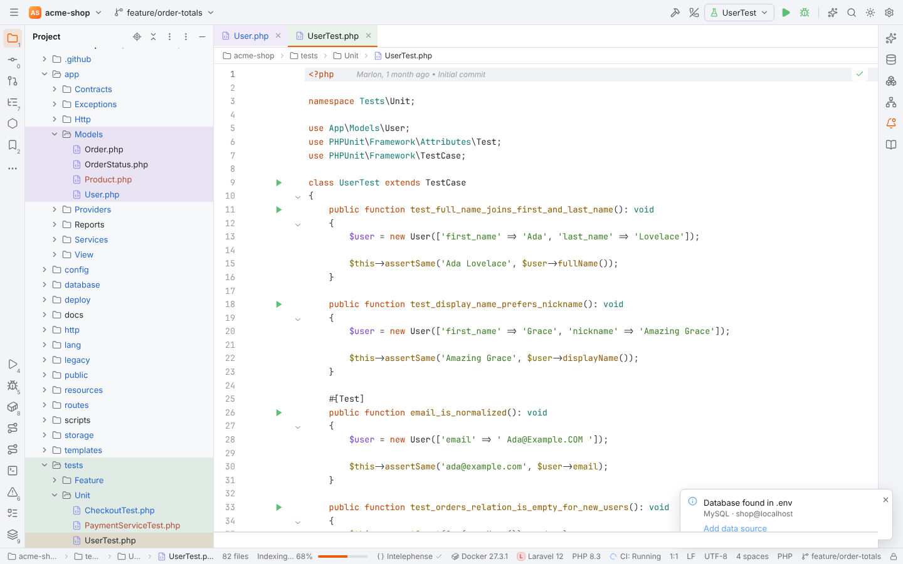

# Scopes and file colors

A **scope** is a named set of files. Forge uses scopes like PHPStorm: in Find in Files and
Replace in Files, in the Find Usages dialog, in Structural Search and Replace and for file
colors. Scopes are written in PHPStorm's scope language, so patterns you know from PHPStorm
work unchanged.

## Predefined scopes

| Scope | Contains |
| --- | --- |
| All Places | every project file, libraries (`vendor/`, `node_modules/`) included |
| Project Files | the project's files without libraries |
| Project Production Files | project files that are not tests |
| Project Test Files | test files: below a test folder of `composer.json`'s `autoload-dev`, below a `tests`, `test`, `spec` or `__tests__` folder, or named like a test (`UserTest.php`, `cart.test.ts`, `cart.spec.js`, `util_spec.lua`) |
| Open Files | the files open in editor tabs |
| Changed Files | files with uncommitted changes |
| Current File | the file of the active editor |

The file colors also know **Non-Project Files** (library files from language servers and other
files outside the project) and **Tests** (the same as Project Test Files).

## Settings | Appearance & Behavior | Scopes

The page lists your scopes on the left, grouped like PHPStorm:

- **Local** scopes are stored in your user settings (`scopes.local`) and are not shared.
- **Shared** scopes are stored in the project (`scopes.shared` in `.forge/settings.toml`), so
  your team gets them through version control.

**+** adds a Local or Shared scope, **−** removes it, **Copy** duplicates it. On the right you
edit the **Name** and the **Pattern**; a pattern that does not parse is underlined and the
message says where the problem is. Below, the project tree shows which files the pattern
contains: files in the scope are green, folders show how many of their files are in it
(`4 of 5`). Select a file or folder and use the buttons to change the pattern:

| Button | Adds |
| --- | --- |
| Include | `file:app/Http/*` for a folder (its files), `file:app/User.php` for a file |
| Include Recursively | `file:app/Http//*` (the folder with everything below it) |
| Exclude | `&&!file:app/Http/*` |
| Exclude Recursively | `&&!file:app/Http//*` |

Including something you excluded before removes the exclusion; excluding an alternative you
included removes that alternative.

### Scope language

| Pattern | Meaning |
| --- | --- |
| `file:app//*` | every file below `app` |
| `file:app/*` | the files directly in `app` |
| `file:app//*.php` | PHP files below `app` |
| `file:*.php` | PHP files in every folder (a pattern without `/` matches the file name) |
| `file:/*` | the files in the project root |
| `src:*..*` | production files (no tests, no libraries); `src:app//*` limits them to `app` |
| `test:*..*` | test files |
| `lib:*..*` | library files (`vendor/`, `node_modules/`); `lib:vendor/laravel//*` |
| `file[module]:app//*` | the module name is accepted and ignored (a Forge project is one module) |
| `a&&b`, `a\|\|b`, `!a`, `(a\|\|b)&&c` | and, or, not, grouping; `!` binds tightest, then `&&`, then `\|\|` |

`*` matches within one file or folder name, `?` one character and `//` any number of folders.
Examples: `file:app//*&&!file:app/Legacy//*`, `file:*.js&&!file:*.min.*`,
`file:resources/views//*.blade.php||file:resources/js//*`.

## Using scopes

- **Find in Files** (`Ctrl+Shift+F`): the **Scope** tab next to In Project, Directory, Open
  Files and Changed Files offers every predefined and named scope; **…** opens the Scopes page.
  See [Find in Files](search-everywhere.md#find-in-files).
- **Find tool window and Replace in Files** (`Ctrl+Shift+R`): the scope chooser in the toolbar
  limits the search and the replacement.
- **Find Usages dialog** (`Ctrl+Alt+Shift+F7`): the Scope list ends with your named scopes and
  Project Production / Test Files. The Custom scope's pattern accepts the scope language as
  well as the older file globs (`app/**/*.php; !app/Legacy/**`). See
  [Find Usages settings](editor.md#find-usages-settings).
- **Structural Search and Replace**: the dialog's Scope chooser. See
  [Structural Search and Replace](structural-search.md).

Scopes are evaluated by the backend, so searches in [remote projects](remote-development.md)
use them on the host.

## Settings | Appearance & Behavior | File Colors

File colors tint the background of editor tabs and Project view rows by scope, like PHPStorm.

| Option | Default | Setting |
| --- | --- | --- |
| Enable file colors | on | `fileColors.enabled` |
| Use in editor tabs | on | `fileColors.useInEditorTabs` |
| Use in project view | on | `fileColors.useInProjectView` |

The **Local colors** table (`fileColors.local`, user settings) starts with PHPStorm's rows
**Non-Project Files** (Yellow) and **Tests** (Green); **Shared colors** (`fileColors.shared`)
live in the project. Each row is a scope and a color of the theme's palette: Blue, Green,
Orange, Rose, Violet, Yellow or Gray. The first row whose scope contains a file wins, local rows
before shared ones; **Move Up** / **Move Down** change the order and **Share** / **Unshare**
move a row between the tables. Folders get a color when the scope contains the whole folder
(for example `file:tests//*`, or a test folder for Tests).

The colors come from the theme (`--file-color-*` in `theme.css`), so they suit both the dark
and the light theme:

