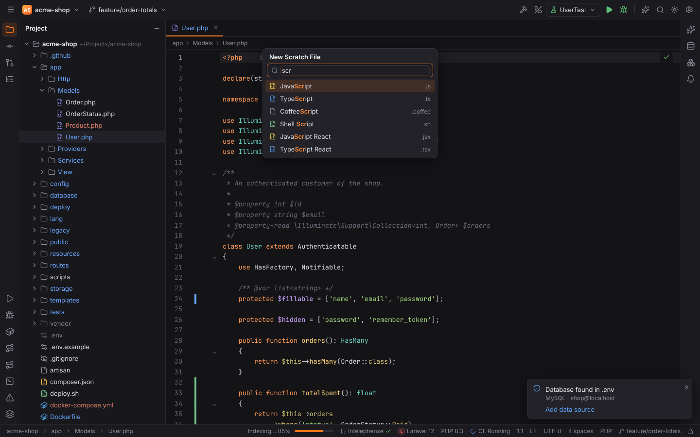
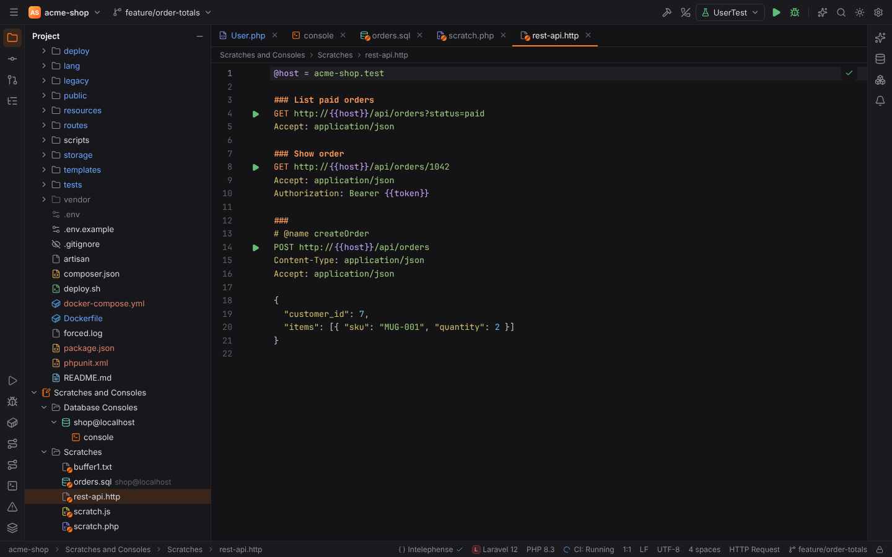
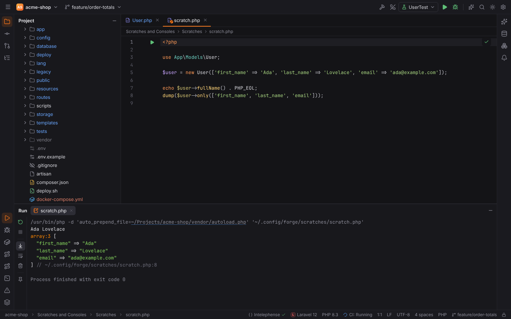
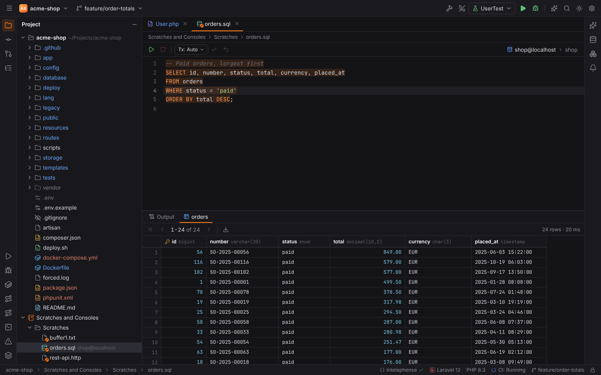
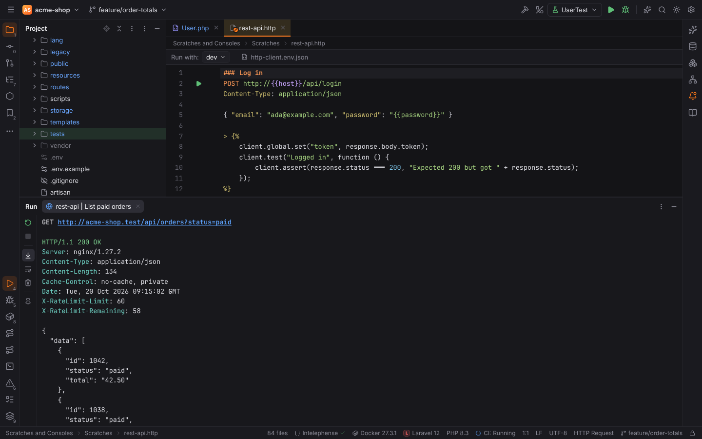
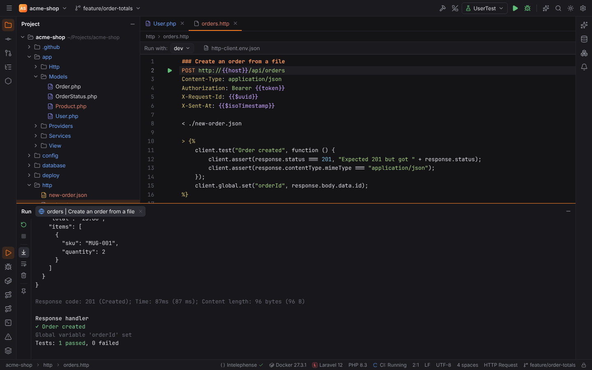
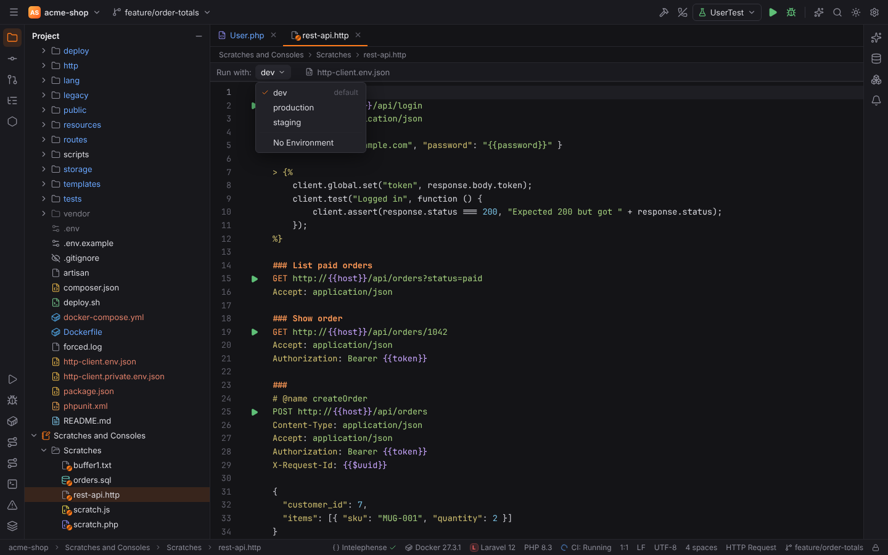
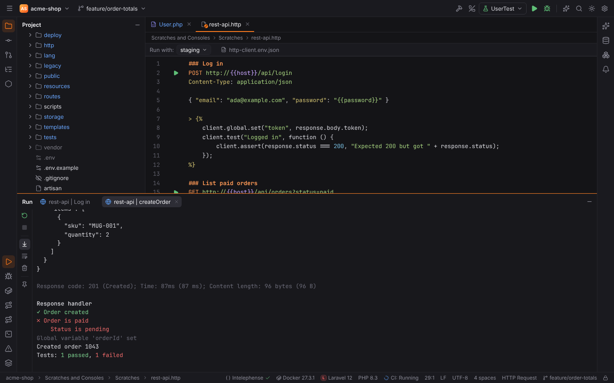
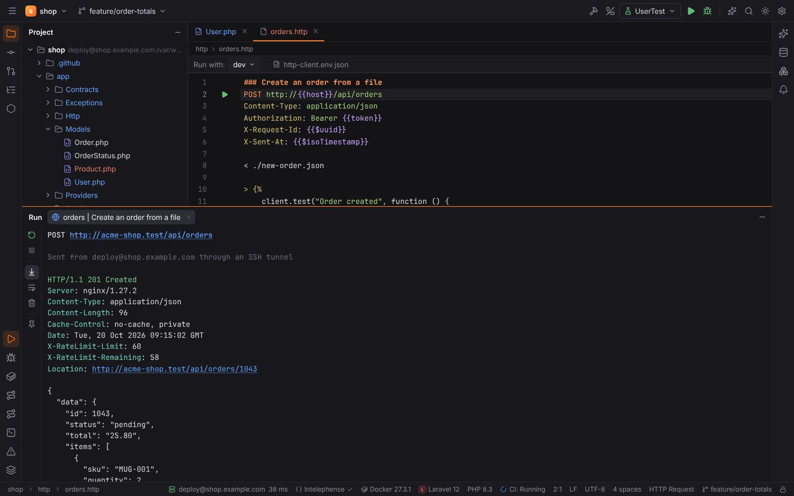

# Scratches, consoles and HTTP client

**Scratch files** are throw-away files for experiments, like PHPStorm's "Scratches and
Consoles". They are **global**: they do not belong to a project and are kept in Forge's config
folder (`<config dir>/forge/scratches/`), so they are available in every project.

## Creating scratches

| Action | Windows/Linux | macOS |
| --- | --- | --- |
| New Scratch File… | `Ctrl+Alt+Shift+Insert` | `Cmd+Shift+N` |
| New Scratch Buffer | Find Action | Find Action |

**New Scratch File** asks for the language: type to filter (fuzzy), recently used languages
come first. Every file type with an extension is available.



New scratches are numbered `scratch.php`, `scratch_1.php`, …; HTTP scratches start as
`rest-api.http`. **Scratch buffers** are plain text files `buffer1.txt` … `buffer5.txt`; after
five, the oldest is reused.

## Scratches and Consoles in the Project view

The bottom of the Project tool window has a **Scratches and Consoles** node with **Scratches**
and **Database Consoles**. A scratch's context menu has **Rename…**, **Delete** and, for SQL
scratches, **Attach Data Source…**.



## Running scratches

Scratches with a runner get a ▶ icon in the gutter; `Ctrl+Shift+F10` runs the current one.
The output appears in the Run tool window.

| Language | Runs with |
| --- | --- |
| PHP | `php.interpreter`, with `-d auto_prepend_file=<project>/vendor/autoload.php` when the open project has an autoloader, so your classes are available |
| JavaScript | `node` |
| TypeScript | `node --experimental-strip-types` (Node 22.6+) |
| Python | `python3` (`python` on Windows) |
| Shell (`.sh`, `.bash`) | `sh` |
| Lua | `lua` |



Other languages show "Scratches of this language have no runner."

## SQL scratches

A `.sql` scratch can be attached to a data source (**Attach Data Source…**); it then opens as a
query console of that data source with execution, results and transactions. See
[Database tools](database.md).



## HTTP client (`.http` files)

`.http` files hold one or more requests in PHPStorm's HTTP Client format. They work as
scratches (New Scratch File → HTTP Request) and as files in your project. Each request gets a ▶
icon in the gutter; click it and choose **Run** to send the request (`Ctrl+Shift+F10` sends
the request at the caret). The response (status, headers, body) appears
in the Run tool window, followed by the report of its response handler. Project `.http` files
run as an `http-request` run configuration.

The ▶ menu also offers **Debug '…' with Xdebug**: it starts
listening for Xdebug and sends the request with the cookie `XDEBUG_SESSION=FORGE`, so the PHP
application stops at your breakpoints (see
[Debugging](debugging.md#debugging-web-pages-and-http-requests)).



### Syntax

```http
@host = localhost:8000

### List users
GET http://{{host}}/api/users?page=1
Accept: application/json

###
# @name createUser
POST http://{{host}}/api/users
Content-Type: application/json
Authorization: Bearer {{token}}
X-Request-Id: {{$uuid}}

{ "name": "Ada", "age": {{$random.integer(18, 99)}} }

> 

### Body from a file
POST http://{{host}}/api/import
Content-Type: application/json

< ./import.json

### Long query strings can continue on indented lines
GET https://{{host}}/search
    ?q=forge
    &limit=10
```

- `###` separates requests; text after it names the request. `# @name x` also names one.
- A request is a request line `METHOD URL [HTTP/version]` (the method defaults to `GET`;
  `http://` is added when the URL has no scheme), optional indented `?`/`&` lines continuing the
  query string, headers, a blank line and the body.
- `@name = value` defines a file variable; `{{name}}` uses it in the URL, headers and body.
  Variables may refer to other variables. Unknown variables are left as they are.
- **Body files**: a body line `< ./file.json` inserts the file as it is, `<@ ./file.json` also
  substitutes variables in it. Paths are relative to the `.http` file.
- Comments start with `#` or `//`.



### Dynamic variables

| Variable | Value |
| --- | --- |
| `{{$uuid}}`, `{{$random.uuid}}` | a random UUID |
| `{{$timestamp}}` | Unix time in seconds |
| `{{$isoTimestamp}}` | the current time in ISO 8601 |
| `{{$randomInt}}` | a random integer 0–1000 |
| `{{$random.integer(from, to)}}` | a random integer in the range |

### Environments

Put environment files in the project root, as in PHPStorm:

```json
// http-client.env.json (commit it)
{
  "dev":  { "host": "localhost:8000" },
  "prod": { "host": "shop.example.com" }
}
```

```json
// http-client.private.env.json (keep it out of Git)
{
  "dev": { "token": "s3cret" }
}
```

Every `.http` editor has a toolbar with an **environment selector** listing the environments of
these files. The choice is stored per project in `httpClient.environment` (Settings | Tools |
**HTTP Client**): empty means `dev`, else the first environment; `$none` runs without an
environment. Private values win over public ones.



Variable precedence, lowest first: environment < `client.global` (set by handlers) < in-file
`@name = value`.

### Response handlers

A handler after a request, inline `> ` or in a file `> ./handler.js`, runs when the
response arrives. Forge implements a safe subset of PHPStorm's HTTP Client API without a
JavaScript engine:

- `client.global.set(name, value)`, `get`, `clear`, `clearAll`, `isEmpty` — globals live for
  the IDE session and can be used as `{{name}}` in later requests;
- `client.test(name, function () { … })`, `client.assert(condition, message?)`,
  `client.log(…)`;
- `response.status`, `response.body` (parsed JSON, else text) with `.a.b`, `["a"]`, `[0]`,
  `response.headers.valueOf(name)` / `valuesOf(name)`, `response.contentType.mimeType` /
  `charset`;
- `JSON.stringify` / `JSON.parse`, string and array helpers (`length`, `includes`,
  `startsWith`, `endsWith`, `indexOf`, `toLowerCase`, `toUpperCase`, `trim`);
- `var`/`let`/`const`, `if`/`else`, `return`, functions and arrow functions, literals,
  arithmetic, comparisons, `&&`, `||`, `??` and `?:`.

Loops and anything else stop the script with an error that names the unsupported construct.
Test results and log lines are printed after the response.



> **Note:** response references (`<> file`) are skipped.

### Remote projects

In a [remote project](remote-development.md) environment files and `< file` bodies are read on
the host, and requests are sent **from the host**: Forge forwards a local port through the
project's SSH connection (`direct-tcpip`) to the URL's host and port as the remote host sees
them, so `http://localhost:8000` reaches the server running there. The URL's host stays the
`Host` header and the TLS server name; redirects are not followed. The console says
"Sent from user@host through an SSH tunnel".

Settings | Tools | HTTP Client | **Send requests from** (`httpClient.sendFrom`, per project):
**Remote host** (default) or **This machine**.


