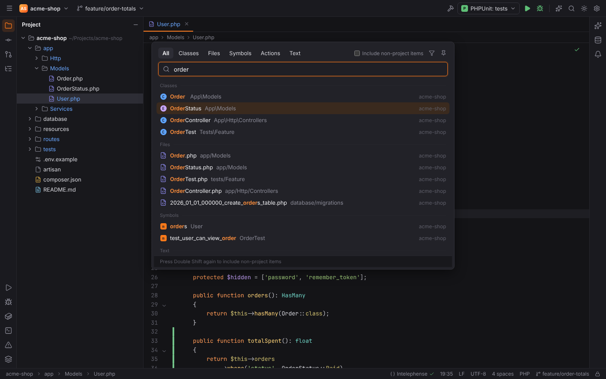
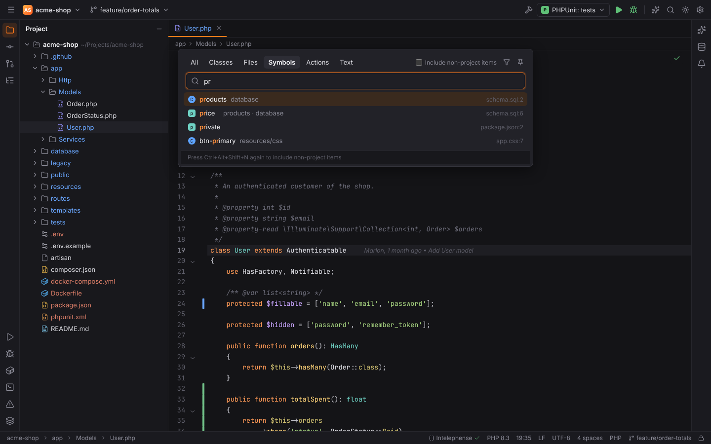
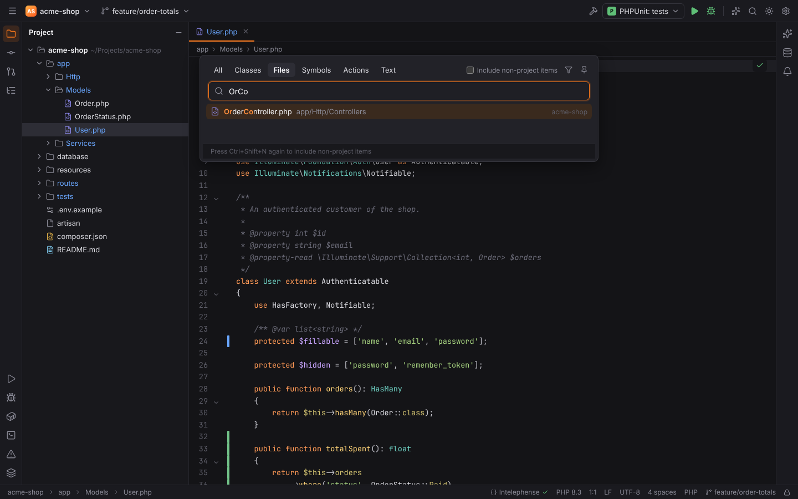
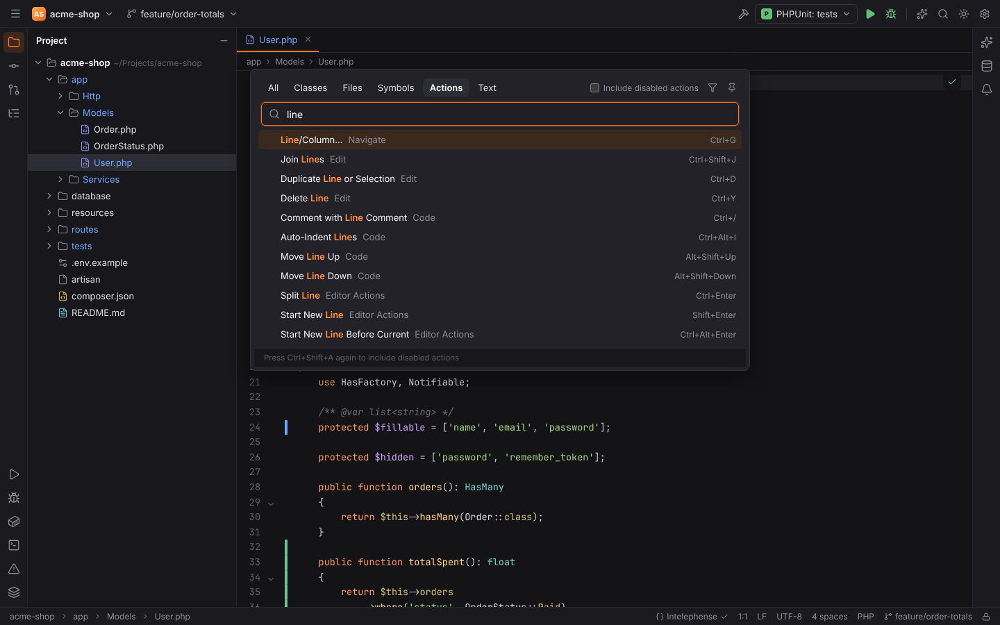
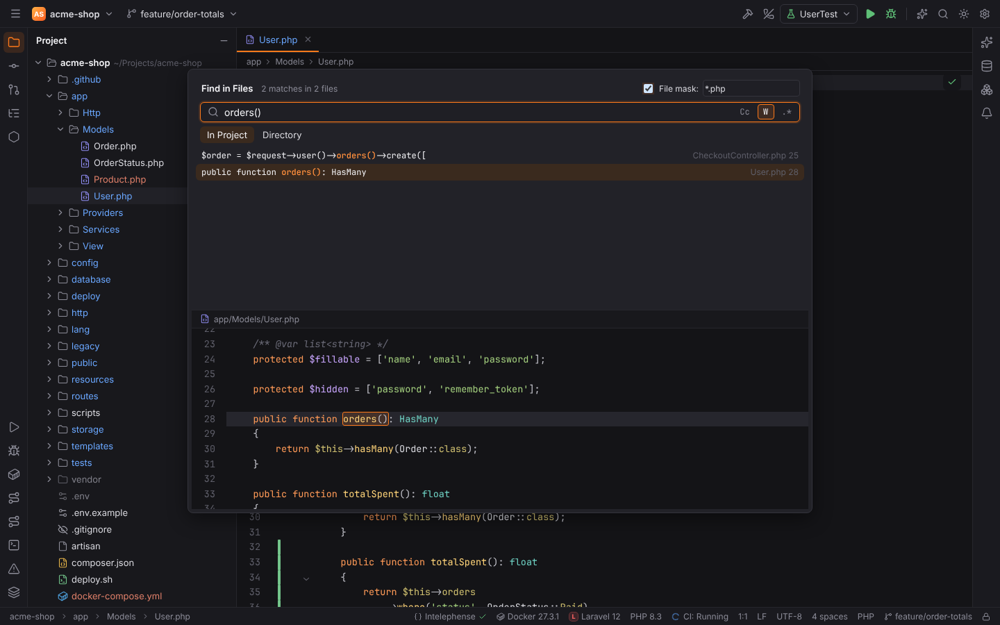
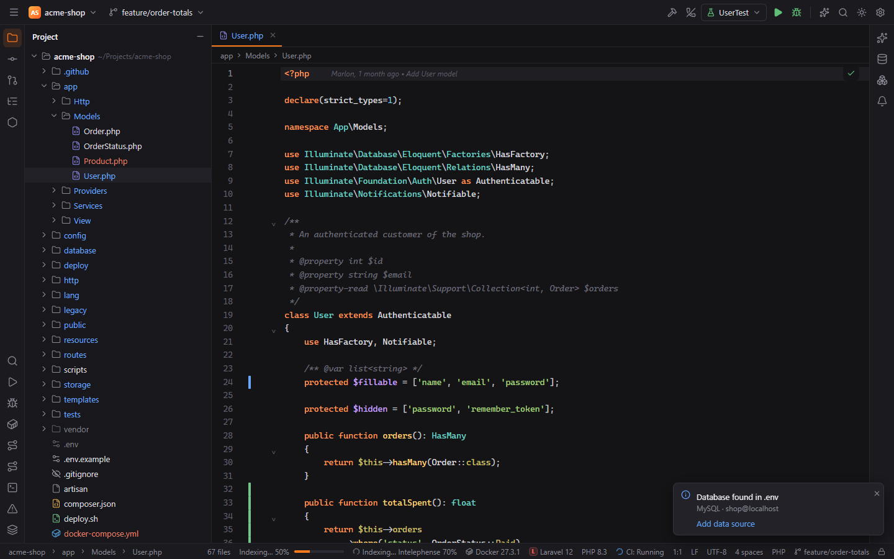
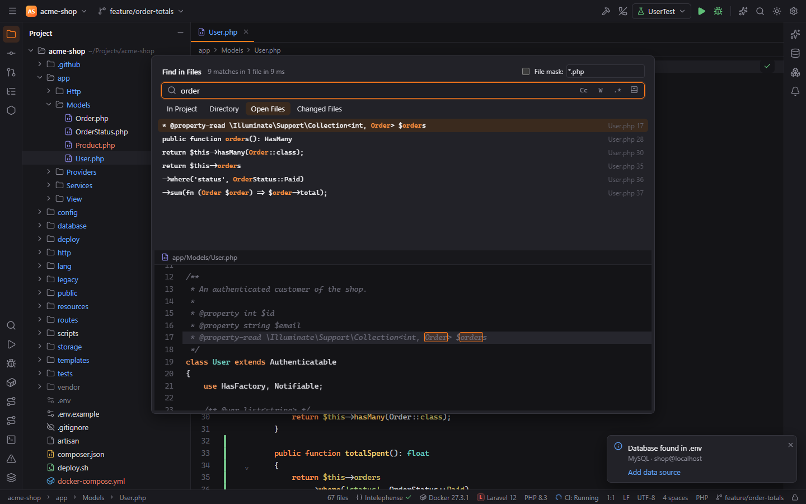
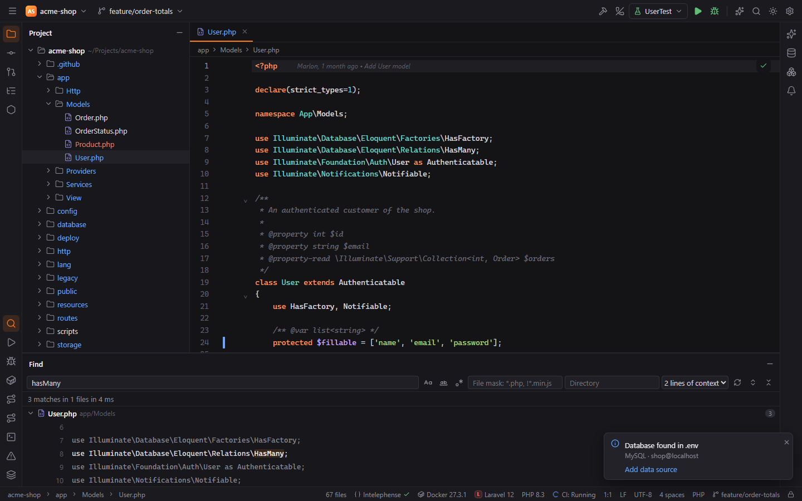
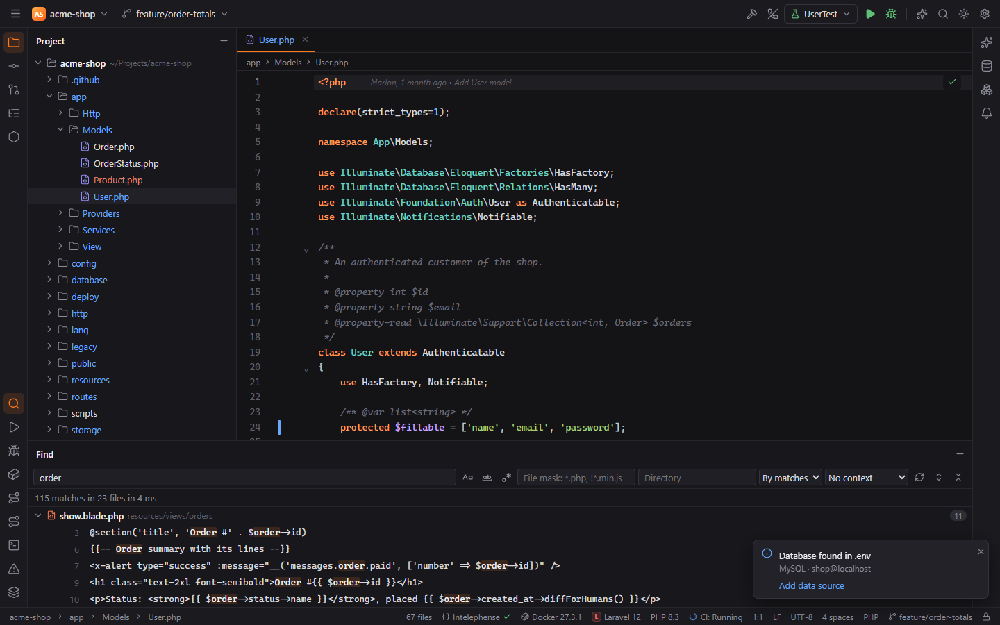

# Search Everywhere and Find Action

## Search Everywhere

Press `Shift` twice (**Double Shift**), or click the magnifier in the main toolbar.

The popup has tabs; `Tab` / `Shift+Tab` switch between them:

| Tab | Opens directly with | Finds | Source |
| --- | --- | --- | --- |
| All | `Double Shift` | the best few results of every tab | — |
| Classes | **Go to Class** `Ctrl+N` (macOS `Cmd+O`) | classes, interfaces, traits, enums, Lua classes | PHP index, LuaForge index, language servers (`workspace/symbol`) |
| Files | **Go to File** `Ctrl+Shift+N` (macOS `Cmd+Shift+O`) | project files; without a query, recent files | Forge's file search (respects `.gitignore`) |
| Symbols | **Go to Symbol** `Ctrl+Alt+Shift+N` (macOS `Cmd+Alt+O`) | functions, methods, constants, properties | PHP index, LuaForge index, language servers |
| Actions | **Find Action** `Ctrl+Shift+A` (macOS `Cmd+Shift+A`) | every IDE action and command | the keymap and registered commands |
| Text | — | lines of text in project files | Find in Files (`forge-find`) |

- `Up`/`Down`, `PageUp`/`PageDown` move the selection, `Enter` opens it, `Escape` closes.
- In the All tab, a "more" row under a group switches to that group's tab.
- Pressing a tab's shortcut again while the popup is open toggles the checkbox in the header:
  **Include non-project items** (most tabs) or **Include disabled actions** (Actions).

Results from language servers appear once a server for that language runs, so the Symbols
tab also finds TypeScript, Python, Go or Rust symbols in a polyglot project.

### Fuzzy matching

Matching works like PHPStorm's:

- Characters of the query must appear in order, case-insensitively.
- Matches at word starts, after separators (`/ _ - . : $` and spaces) and on **camel humps**
  score higher, so `OrCo` finds `OrderController` first and `usrctl` finds `UserController`.
- For files you can type part of the path: `models/user` finds `app/Models/User.php`.
- For classes, symbols and actions a word must start where a hump or separator starts
  ("strict" matching), which keeps the lists short.

To match only text that contains what you typed, turn off **Settings > Tools > Search > Fuzzy
matching** (`search.everywhere.fuzzy`). Files, Classes and Symbols in Search Everywhere and Go to
File then find `OrderCon` in `OrderController` but no longer `orco`. PHP and Lua classes from their
own language index and the Actions tab keep fuzzy matching.

Ranking happens in Rust (`forge-fuzzy`), so the same rules apply in every list with a
speed search: Recent Files, the New Scratch File popup, choosers.

## Find Action

**Find Action** (`Ctrl+Shift+A`, macOS `Cmd+Shift+A`) is the Actions tab on its own. Type an
action's name, for example "reformat", "commit", "new scratch" or "close project".

- Each row shows the action, its menu group (e.g. "Code | Folding") and its shortcut.
- You can also type the action id (`ReformatCode`), which ranks below title matches.
- Actions Forge has not implemented yet are dimmed and listed last; running one shows
  "*Action* is not available yet". Turn on **Include disabled actions** to see them while
  searching.

Find Action is the fastest way to reach commands that have no shortcut and no menu yet, for
example **Close Project**, **Detect Project Type**, **Reindex PHP Files**, **Show Git Log**,
**Fetch** or **New SSH Connection…**.

## Recent Files

See [Workbench: Recent Files and Switcher](workbench.md#recent-files-and-switcher).

## Find in Files

**Find in Files** (`Ctrl+Shift+F`, macOS `Cmd+Shift+F`, also Edit | Find | Find in Files… and
the Project view's context menu) searches the text of every project file.

The status bar shows the size of the search index ("272,700 files", or "Indexing" while it builds or refreshes). Hover it for how many files are searched by content, how many binary or oversized files are listed by name only, and when the index was last updated.

- Type the text; results update as you type, one row per matching line with the file name and
  line number. The header counts matches and files.
- Options next to the field: **Cc** match case, **W** whole words, **.\*** regular expression.
- **Scope** tabs under the field: **In Project**, **Directory** (a project-relative folder), **Open Files** (the editor tabs) and **Changed Files** (files git reports as modified, added or untracked). The open and changed lists are taken when the search runs; the Find window keeps the list it was opened with.

- In the Find window, the list next to the directory field adds **lines of context** (1 to 5) above and below each match. Context lines are dimmed, shown once even when two matches share them, and a click opens the file there.

- In the Find window, the first list next to the directory field orders the files: **By path** (which also groups them by folder), **By matches** (most matching lines first) or **By modified** (newest first; only for the project's own files, a remote project keeps the path order).

- **File mask**: tick it and enter patterns such as `*.php` or `*.php, !*Test.php`
  (`!` excludes).
- Scope: **In Project** or **Directory** (a folder of the project; empty means the project
  root).
- `Up`/`Down` select a row; the preview below shows the file around the match. `Enter` opens
  the file at the match, `Escape` closes.

Ignored files (`.gitignore`), binary files and very large files are skipped. In remote projects
the search runs on the host.

The **Text** tab of Search Everywhere uses the same search (from two characters on).

> **Note:** Replace in Files (`Ctrl+Shift+R`) and the Find tool window ("Open in Find Tool
> Window") are not available yet.
