# Services

The plugin **Docker and Kubernetes** (`forge.services`) fills the **Services** tool window
(`Alt+8`, macOS `Cmd+8`). It talks to the Docker Engine API directly (Unix socket, Windows
named pipe or TCP with TLS) and to the Kubernetes API with your kubeconfig. The docker CLI is
only used for `docker compose`, image builds and interactive terminals; `kubectl` only for pod
terminals.

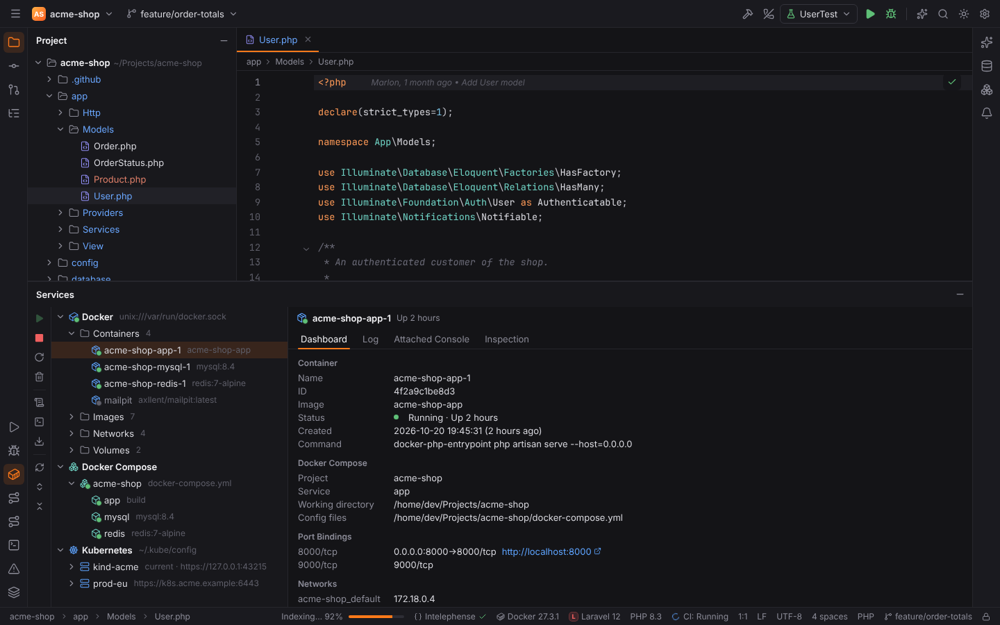

The tree has three roots:

| Root | Children |
| --- | --- |
| **Docker** | Containers, Images, Networks, Volumes |
| **Docker Compose** | compose projects found in the project root and one folder below, with their services and containers |
| **Kubernetes** | contexts → namespaces → Pods, Deployments, Services; the node says where the contexts come from (`~/.kube/config`, or `from host deploy@shop.example.com` in a remote project) |

Spring Boot run configurations add a **Spring Boot** root with their running and not started
applications, see [Spring Boot and Jakarta EE](spring.md#run-dashboard).

The status bar shows the Docker connection ("Docker 27.3.1", "Docker: connecting…",
"Docker: not connected"). Forge follows Docker's event stream, so the tree updates by itself,
and retries the connection every 10 seconds.

## Details pane

Selecting a node shows its details on the right, in tabs:

| Tab | Content |
| --- | --- |
| Dashboard | status, image, ports, mounts, networks, environment, labels; tables for compose and Kubernetes objects |
| Log | the log, following new lines; starts with the last `docker.logs.tail` lines (500) |
| Attached Console | output of compose Up/Down, builds and pulls |
| Inspection | the raw JSON (`docker inspect`) |

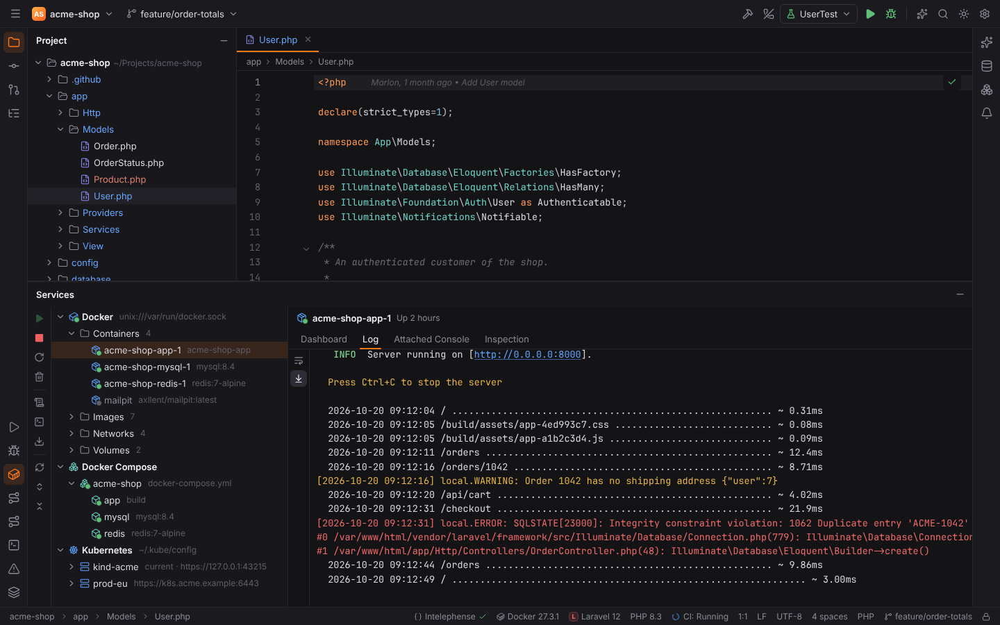

## Actions

The toolbar and the context menu offer what applies to the selected node:

| Node | Actions |
| --- | --- |
| Docker (not connected) | Connect, Refresh |
| Running container | Stop, Restart, Delete, Show Log, Exec (open a terminal in the container), Pull Image |
| Stopped container | Start, Delete, Show Log, Pull Image |
| Image | Pull, Delete |
| Images group | Pull Image…, Refresh |
| Volume, network | Delete |
| Compose project | Up (Run all services), Stop, Restart, Down (`docker compose down`), Show Log |
| Compose service | Up, Stop, Restart, Down, Show Log, Exec |
| Pod | Delete, Show Log, Exec (`kubectl exec`), Forward Ports… |
| Deployment | Restart Rollout, Show Log (all pods and containers) |

**Exec** opens a terminal tab in the Terminal tool window running `docker exec -it` (or
`kubectl exec -it`) with bash when the container has it, else sh. Containers started with a
TTY also offer an attached console (`docker attach`).

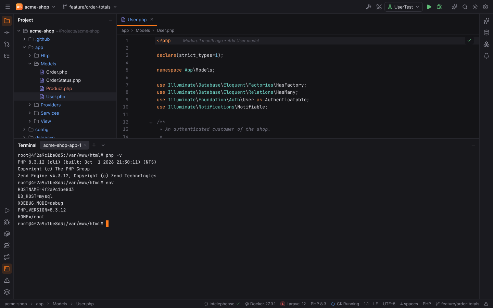

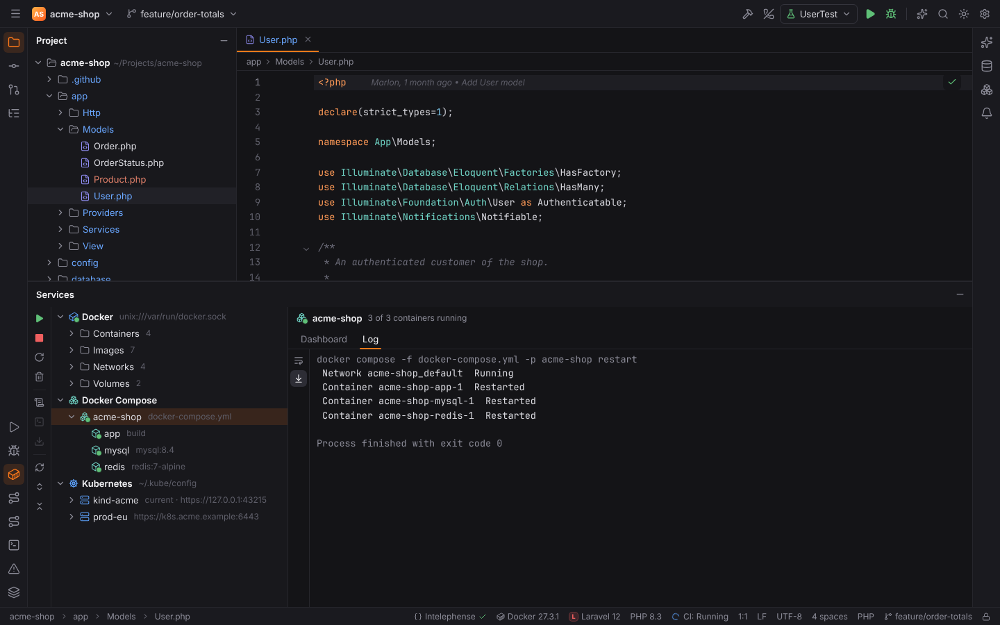

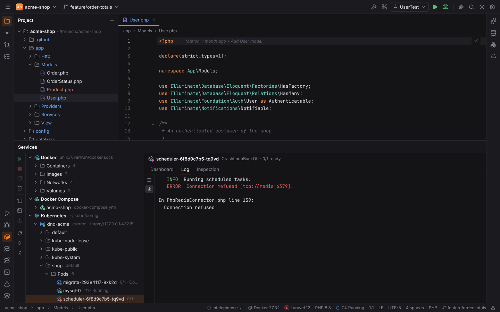

## Kubernetes contexts and namespaces

Above the tree, the **Context** and **Namespace** selectors pick the context to work with:
it becomes the current context in the tree (`current · <server>`), its namespace is loaded
and expanded, and manifests are applied there. The namespace list shows the context's
namespaces once they are listed. Next to the selectors Forge shows where the contexts come
from. The pick lasts for the session; the defaults are the settings below.

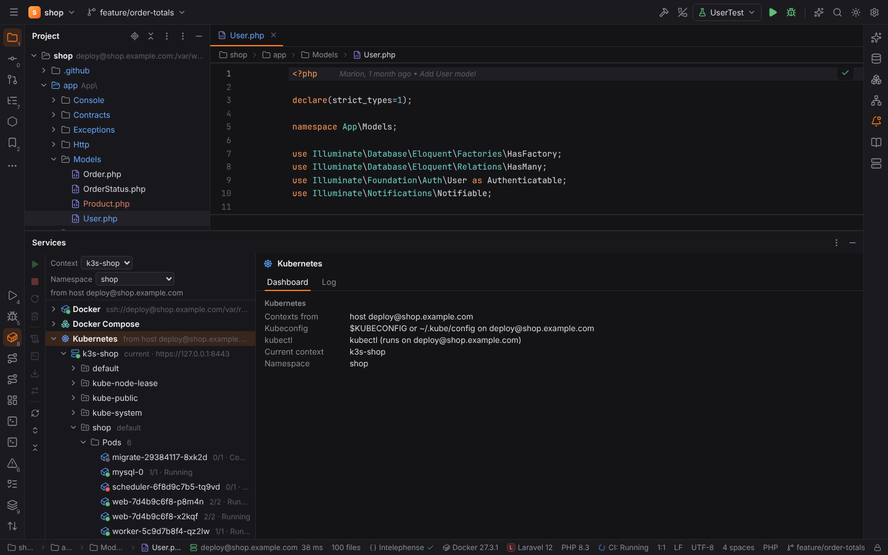

## Applying manifests

A YAML file with Kubernetes objects (`apiVersion` and `kind`, several documents separated by
`---`) gets a ▶ in the gutter on its first object:

| Menu item | Runs |
| --- | --- |
| Apply to '<context>' | `kubectl --context <context> [-n <namespace>] apply -f <file>` |
| Delete from '<context>' | `kubectl --context <context> [-n <namespace>] delete -f <file>` |

`-n` is the selected namespace and is only passed when no object of the file names its own
namespace. The output appears in the **Log** tab of the Kubernetes node. Applying and
deleting manifests runs the project's files against a cluster, so it is refused in Safe Mode
(see [Project trust and Safe Mode](project-trust.md)); so are Exec terminals and the Attached
Console of pods. Reading the cluster (the tree, logs, Inspection, port forwards) works in
Safe Mode.

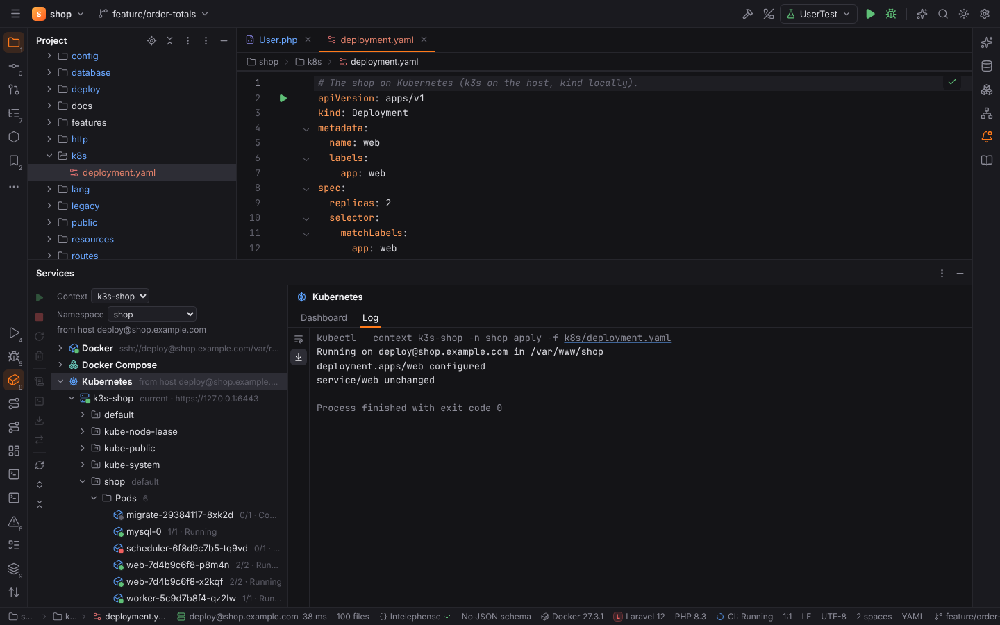

The editor also checks manifests against the schema of their Kubernetes object, with
completion and documentation for every key (see
[JSON Schema](json-schema.md#kubernetes-manifests)).

## Kubernetes pods and deployments

- **Container picker**: a pod with several containers (including init containers) shows a
  container selector on its details. Log, Exec and the Attached Console use the picked container;
  the default is the one named by the `kubectl.kubernetes.io/default-container` annotation, else
  the first container. The Dashboard lists the containers' declared ports.
- **Deployment logs** follow every container of every pod that matches the deployment's
  selector, each line prefixed like `kubectl logs --prefix` (`[pod/<pod>/<container>]`).

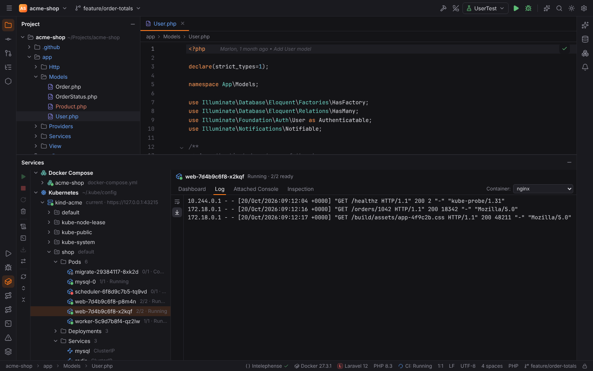

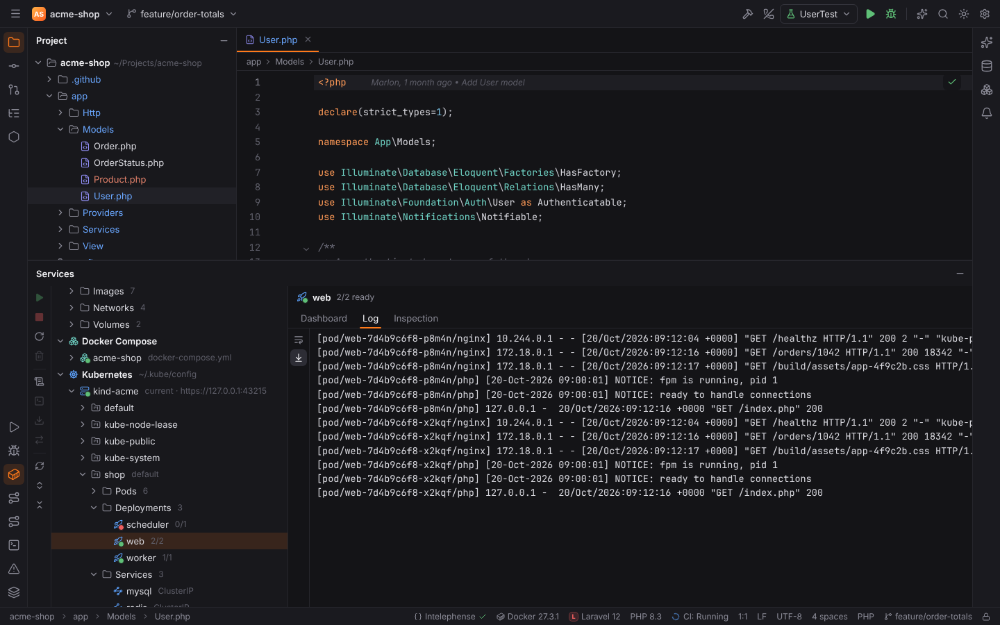

### Port forwarding

**Forward Ports…** on a pod opens a dialog: enter `local:pod` pairs separated by commas, for
example `8080:80, 9000, :5432` (a single port forwards the same port; `:80` picks a free local
port). The pod's declared container ports are offered.

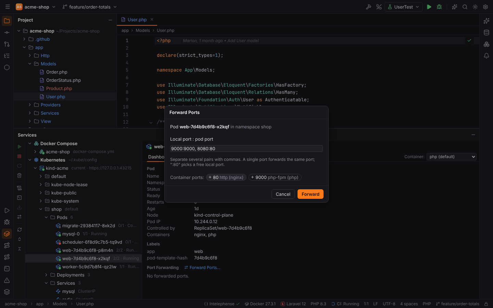

Forge listens on `127.0.0.1:<local>` and opens one connection to the pod per accepted
connection (the Kubernetes port-forward API over WebSocket, no `kubectl` needed). Active
forwards appear in the tree (`⇄ 8080→80`) and on the pod and Kubernetes details, under **Port
Forwarding**, each with **Stop Port Forwarding**.

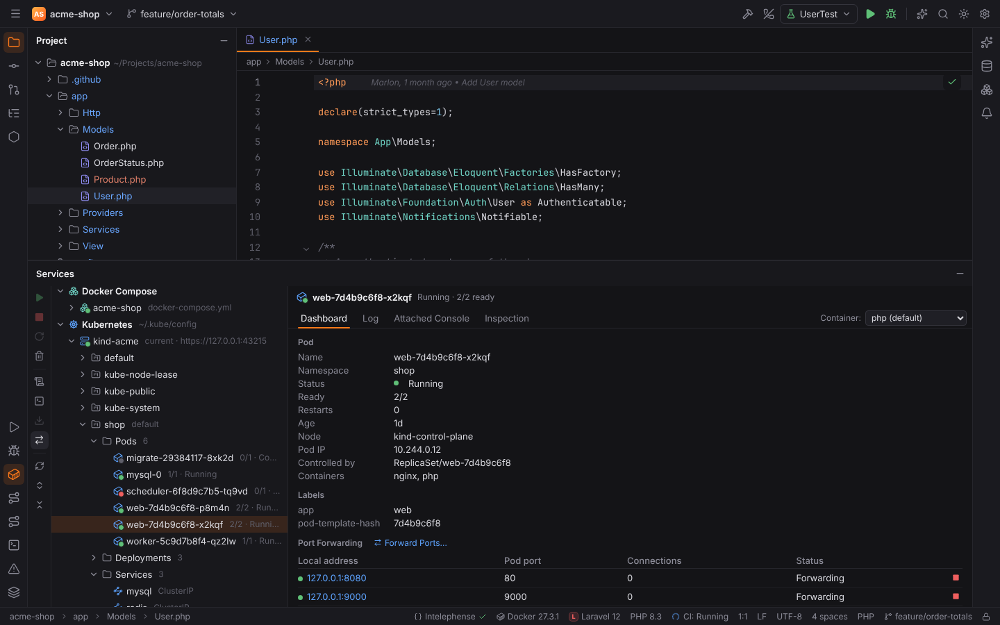

## Compose files and Dockerfiles in the editor

- `compose.yaml` / `docker-compose.yml` get a ▶ in the gutter on `services:` (**Run all
  services**) and on each service (`docker compose up` for that service).
- A `Dockerfile` gets a ▶ on its first `FROM`: **Run on 'Docker'** builds the image and runs a
  container; output appears in Attached Console.

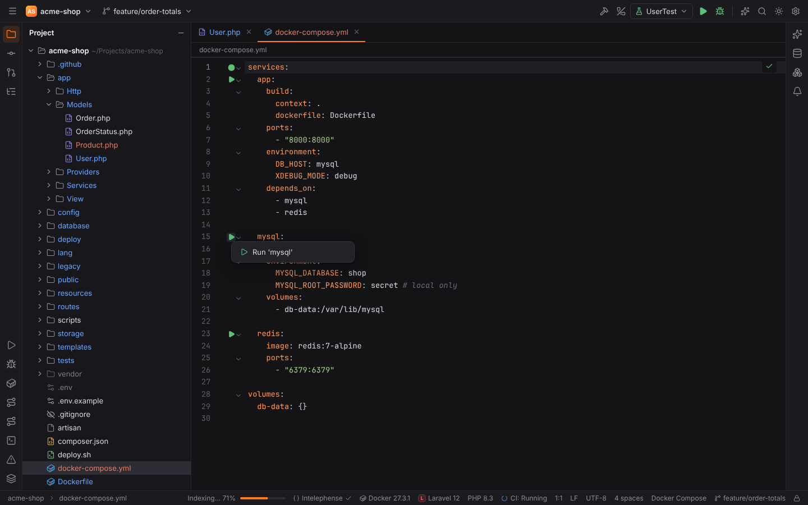

Compose files support profiles, env files, `${VAR}` interpolation from the project's `.env`
and override files.

## Pulling images and registries

**Pull Image…** (Find Action **Docker.PullImage**, or the Images group) asks for
`repository[:tag]`, e.g. `redis:7-alpine`, and shows the progress.

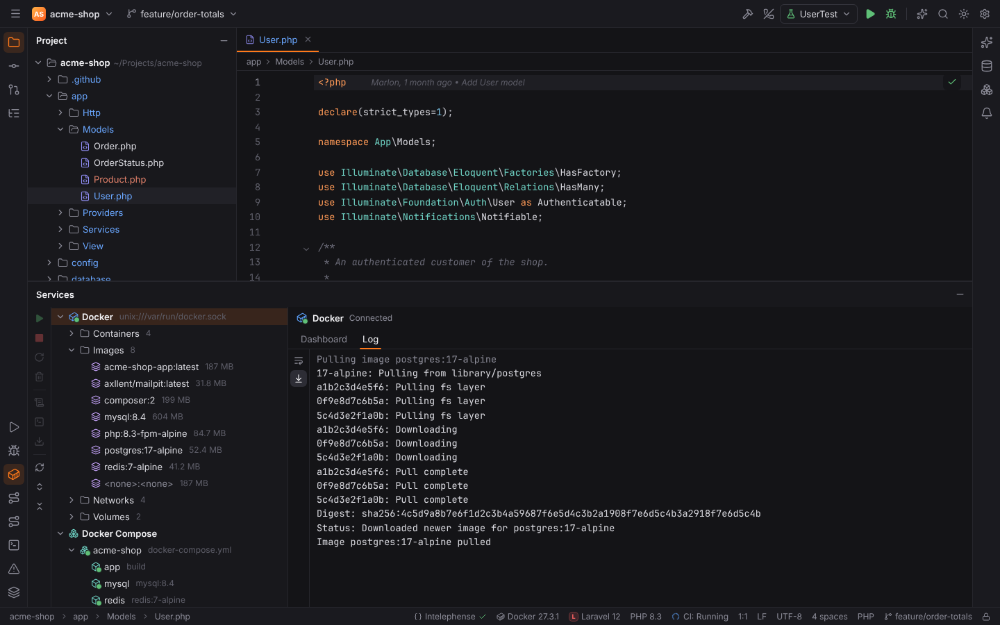

Private registries: Settings | Build, Execution, Deployment | Docker | **Docker Registry**.
Add the registry (`docker.io`, `ghcr.io`, …), user name and password or access token. The
password goes to the OS keychain (service `forge-containers`); the setting
`docker.registries` only keeps `server<TAB>user`. Without accounts, public images are pulled
anonymously.

## Settings

### Build, Execution, Deployment | Docker

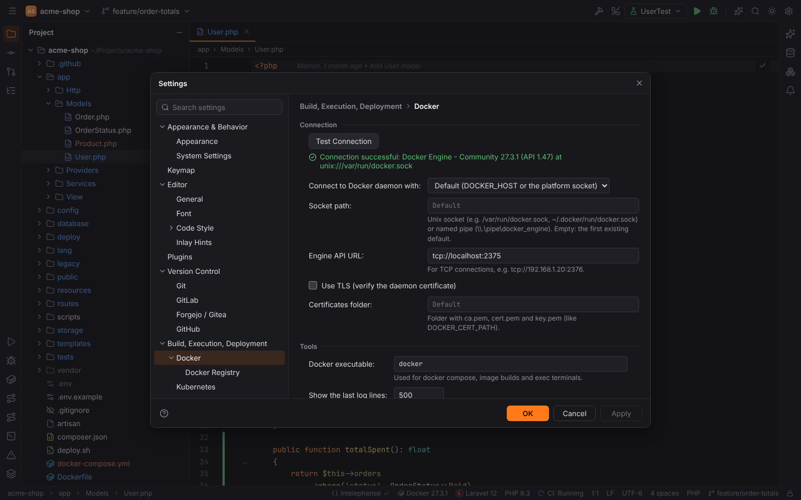

| Option | Setting | Default |
| --- | --- | --- |
| Connect to Docker daemon with (`auto`, `unix`, `pipe`, `tcp`, `ssh`, `context`) | `docker.connection` | `auto` |
| SSH host: `ssh://user@host[:port]` or a `Host` alias of `~/.ssh/config` | `docker.ssh.url` | empty |
| Docker socket on the host (empty: `/var/run/docker.sock`) | `docker.ssh.socketPath` | empty |
| In remote projects, connect to Docker on the remote host | `docker.remoteProjectHost` | on |
| Docker context (`docker context ls`) | `docker.context` | empty |
| Socket path (Unix socket or named pipe; empty: the first existing default) | `docker.socketPath` | empty |
| Engine API URL (TCP) | `docker.tcp.url` | `tcp://localhost:2375` |
| Use TLS (verify the daemon certificate) | `docker.tcp.tls` | off |
| Certificates folder (`ca.pem`, `cert.pem`, `key.pem`) | `docker.tcp.certPath` | empty |
| Docker executable (compose, builds, exec) | `docker.cliPath` | `docker` |
| Show the last log lines | `docker.logs.tail` | 500 |

With `auto`, Forge uses `DOCKER_HOST` when set (also `ssh://` hosts), else the current Docker
context (`DOCKER_CONTEXT` or `currentContext` in `~/.docker/config.json`), else the platform
default socket (`/var/run/docker.sock`, Docker Desktop's `~/.docker/run/docker.sock`, rootless
`$XDG_RUNTIME_DIR/docker.sock` or Podman's socket; `\\.\pipe\docker_engine` on Windows).
**Test Connection** checks the settings.

**Docker over SSH** (`ssh`): Forge connects with its own SSH client (keys from ssh-agent and
`~/.ssh`, `~/.ssh/config` aliases) and talks to the remote Docker socket through the SSH
connection; nothing is installed on the host. The host key must already be in `known_hosts`;
unknown keys are refused with their fingerprint. Compose, builds and terminals use the docker
CLI, which reaches `ssh://` hosts itself.

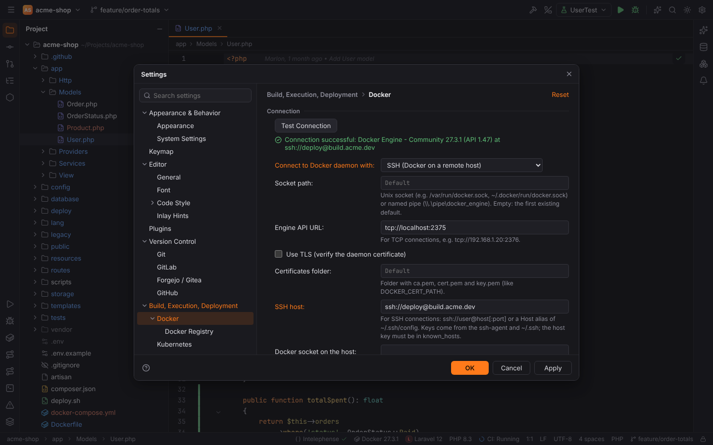

**Docker contexts** (`context`): the page lists the contexts of the Docker CLI
(`~/.docker/contexts`) with **Use**; Forge then connects to that context's endpoint.

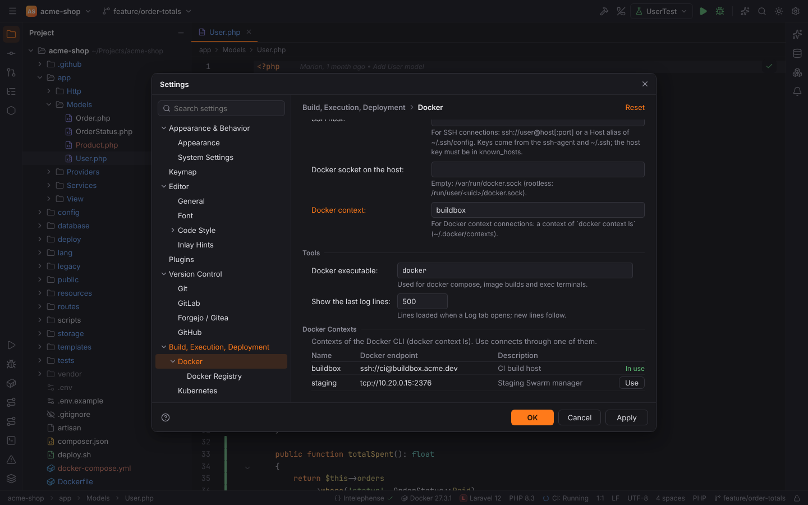

### Build, Execution, Deployment | Kubernetes

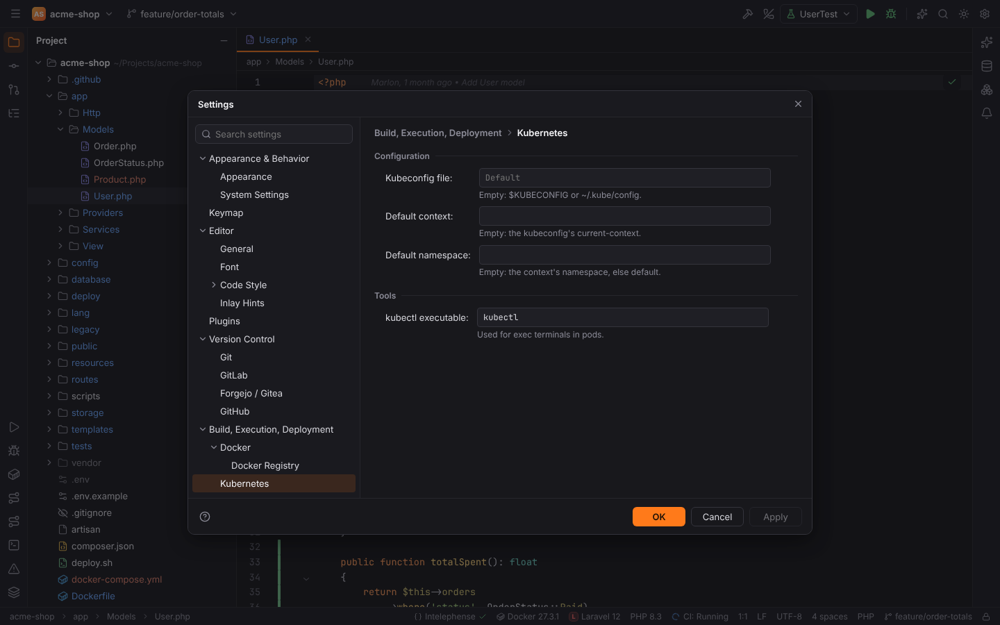

| Option | Setting | Default |
| --- | --- | --- |
| Kubeconfig file (empty: `$KUBECONFIG` or `~/.kube/config`) | `kubernetes.kubeconfig` | empty |
| Default context (empty: the kubeconfig's current-context) | `kubernetes.defaultContext` | empty |
| Default namespace (empty: the context's namespace, else `default`) | `kubernetes.defaultNamespace` | empty |
| kubectl executable (this machine: exec terminals, applying manifests) | `kubernetes.kubectlPath` | `kubectl` |
| In remote projects, use Kubernetes of the project host | `kubernetes.remoteProjectHost` | on |
| kubectl from the project host: `user@host` and the kubectl path there | `kubernetes.hostKubectlPaths` | empty (kubectl from the host's `PATH`) |

Kubernetes authentication supports CA certificates, bearer tokens, client certificates, basic
auth and exec credential plugins (as used by EKS, GKE and AKS).

**kubectl from the Project Host** lists a kubectl per remote host, e.g.
`deploy@shop.example.com` → `/usr/local/bin/kubectl` or `k3s kubectl`. The host of the open
remote project is filled in when you add an entry. Hosts without an entry run `kubectl` from
their `PATH`.

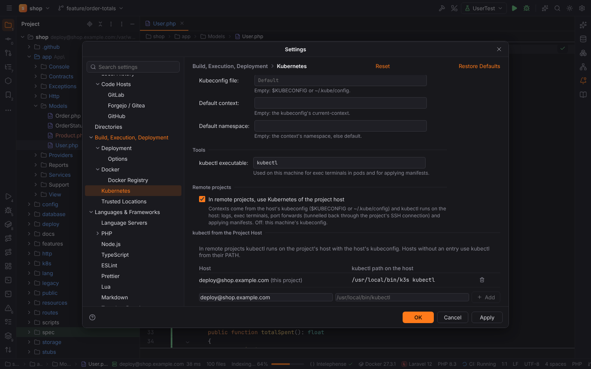

> **Note:** port forwarding is available for Kubernetes pods, not for Docker containers.

## Remote projects

In a [remote project](remote-development.md) the project's compose files (with `.env` and
override files) are read on the host, and the compose ▶ actions and **Run on 'Docker'** of a
Dockerfile run `docker compose` / `docker build` **on the host**; the console starts with
"Running on user@host in /path".

With **In remote projects, connect to Docker on the remote host** (`docker.remoteProjectHost`,
on) the Docker node shows the host's daemon (`ssh://user@host/var/run/docker.sock`), reached
through the project's own SSH connection: no second login and nothing to set up. Exec terminals
and Attached Console then run `docker` on the host. Turn it off to use the connection configured
above; compose still runs on the host then (against the host's own daemon), while exec terminals
run on this machine.

### Kubernetes in remote projects

With **In remote projects, use Kubernetes of the project host**
(`kubernetes.remoteProjectHost`, on) Kubernetes runs where the project is, like PHPStorm's
remote development: clusters next to the host (a k3s on `127.0.0.1:6443`, a private network,
credential plugins installed there) work without copying anything to this machine.

| | In a remote project |
| --- | --- |
| Contexts | from the host's kubeconfig (`$KUBECONFIG` or `~/.kube/config` on the host), read with `kubectl config view`; the Kubernetes node says `from host deploy@shop.example.com` |
| Namespaces, pods, deployments, services, Inspection | `kubectl get … -o json` on the host |
| Logs | `kubectl logs -f` on the host |
| Exec, Attached Console | a terminal on the host running its kubectl |
| Delete pod, Restart Rollout | `kubectl delete pod`, `kubectl rollout restart` on the host |
| Forward Ports | `kubectl port-forward` on the host (on its `127.0.0.1`); every connection to `127.0.0.1:<local port>` here is tunnelled to it through the project's SSH connection. The forward shows "Forwarding via deploy@shop.example.com". |
| Apply / Delete manifests | `kubectl apply -f` / `delete -f` on the host, in the project folder |

kubectl must be installed on the host; its path is set per host under **kubectl from the
Project Host**. Turn the option off to use this machine's kubeconfig and API access in remote
projects too. Local projects always use this machine's kubeconfig.

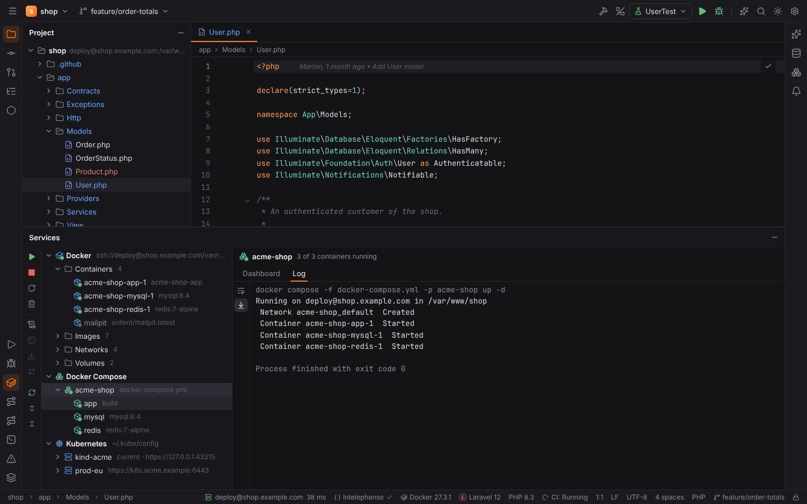
