# Settings and themes

## The Settings dialog

**Settings** (`Ctrl+Alt+S`, macOS `Cmd+,`, or the gear in the main toolbar) opens the Settings
dialog, with the same tree as PHPStorm:

- **Appearance & Behavior**: Appearance, System Settings
- **Keymap**
- **Editor**: General, Font, Code Style (PHP), Inlay Hints
- **Plugins**
- **Version Control**: Git, GitLab, Forgejo / Gitea, GitHub
- **Languages & Frameworks**: Language Servers, PHP (Composer, Debug, Servers, Laravel,
  Symfony, Doctrine), Node.js, TypeScript, Lua, Template Data Languages
- **Tools**: Terminal, Database, AI Agents, AI Providers, Browser Companion, SSH Configurations
- **Build, Execution, Deployment**: Docker (Docker Registry), Kubernetes

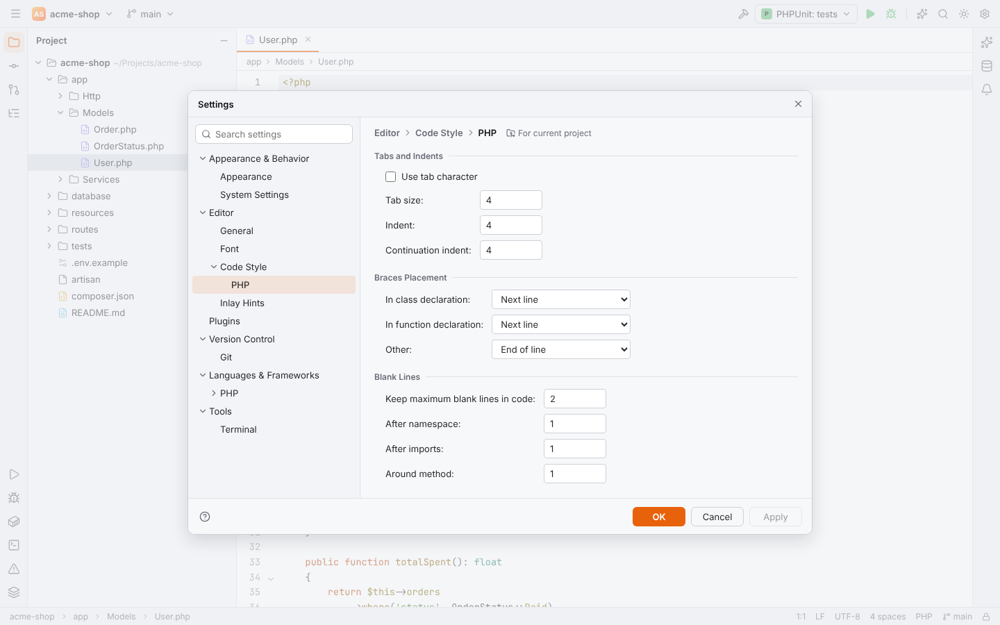

- **Search settings** at the top filters the tree and highlights matching options on every
  page, also by keywords ("theme", "autosave", "interpreter").
- **OK** applies and closes, **Apply** applies and keeps the dialog open, **Cancel** discards.
- Invalid values (out of range, wrong type) are flagged right away and not saved.
- In the desktop app the dialog is its own window; its size and position are remembered.

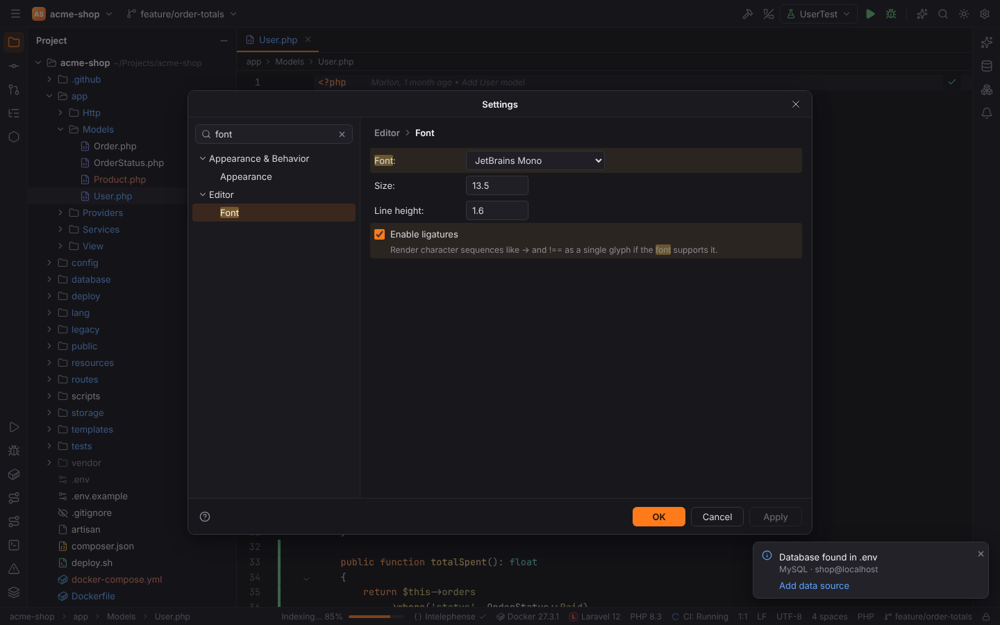

Every option, its key, type and default is listed in the
[settings reference](../reference/settings.md).

## User and project settings

Settings come in three layers; a later one wins:

1. built-in defaults (declared by the plugins),
2. **user** settings: `<config dir>/forge/settings.toml`,
3. **project** settings: `<project>/.forge/settings.toml`.

Pages with options that can be stored per project show **For current project** in the header;
those options are saved to the project's file, which you can commit to share them with your
team (for example the PHP language level or the Symfony environment).

### Settings files

The files are TOML with dotted keys as nested tables. You can edit them by hand; Forge picks up
changes on the next start:

```toml
# ~/.config/forge/settings.toml
[appearance]
theme = "light"
windowControls = "gnome"

[editor.font]
family = "Fira Code"
size = 14

[vcs.hosts]
refreshSeconds = 300
```

Some options have no page in the dialog and can only be set this way, such as
`vcs.hosts.statusBarPipeline` and `vcs.hosts.refreshSeconds`.

Secrets (API keys, tokens, passwords, licence keys) never go into these files; they are stored
in the operating system keychain.

## Themes

Settings | Appearance & Behavior | Appearance | **Theme** (`appearance.theme`):

| Theme | Value |
| --- | --- |
| Forge Ember (Dark) | `dark` (default) |
| Forge Anvil (Light) | `light` |
| Solarized Dark | `solarized-dark` |
| Solarized Light | `solarized-light` |

The sun/moon button in the main toolbar, **Theme: Toggle Dark/Light** and **Quick Switch
Scheme…** (`` Ctrl+` ``) toggle between dark and light.

| | |
| --- | --- |
|  | 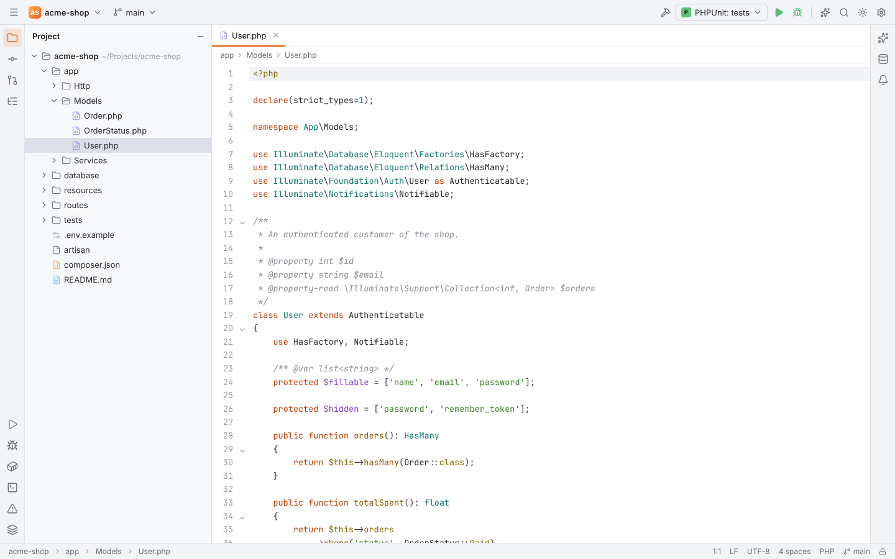 |

## Appearance options

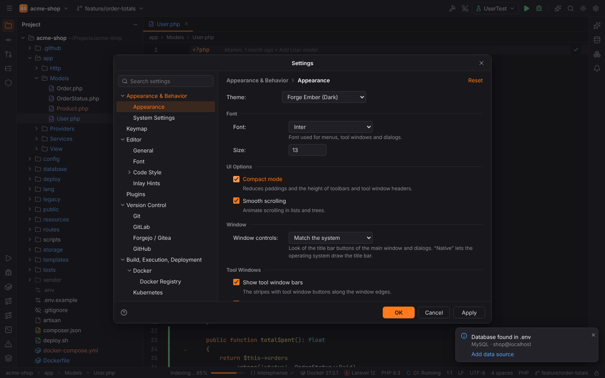

| Option | Setting | Default |
| --- | --- | --- |
| UI font (Inter, System default, Segoe UI, Roboto) | `appearance.uiFont.family` | Inter |
| UI font size (10–20) | `appearance.uiFont.size` | 13 |
| Compact mode | `appearance.compactMode` | off |
| Window controls | `appearance.windowControls` | Match the system |
| Show tool window bars | `appearance.showToolWindowBars` | on |
| Open files with single click (Project view) | `projectView.openFilesWithSingleClick` | on |

Editor fonts are under Settings | Editor | Font: JetBrains Mono (default), Fira Code, Cascadia
Code, Source Code Pro, Menlo, Consolas or the system monospace font, size (13.5), line height
(1.6) and ligatures.

### Window controls

Forge draws its own title bars. **Window controls** chooses how their buttons look:

| Value | Look |
| --- | --- |
| `auto` — Match the system | detected from the OS and desktop (`XDG_CURRENT_DESKTOP`, `DESKTOP_SESSION`, `KDE_FULL_SESSION`, …), including the button order of GNOME (`button-layout`) and KDE (`kwinrc`) |
| `windows` | Windows 11 buttons on the right |
| `macos` | traffic lights on the left |
| `gnome` | GNOME/Adwaita round buttons |
| `kde` | KDE Plasma (Breeze) buttons |
| `linux` | generic Linux buttons |
| `native` | the operating system draws the title bar (Forge's toolbar is then below it) |

| | | |
| --- | --- | --- |
| 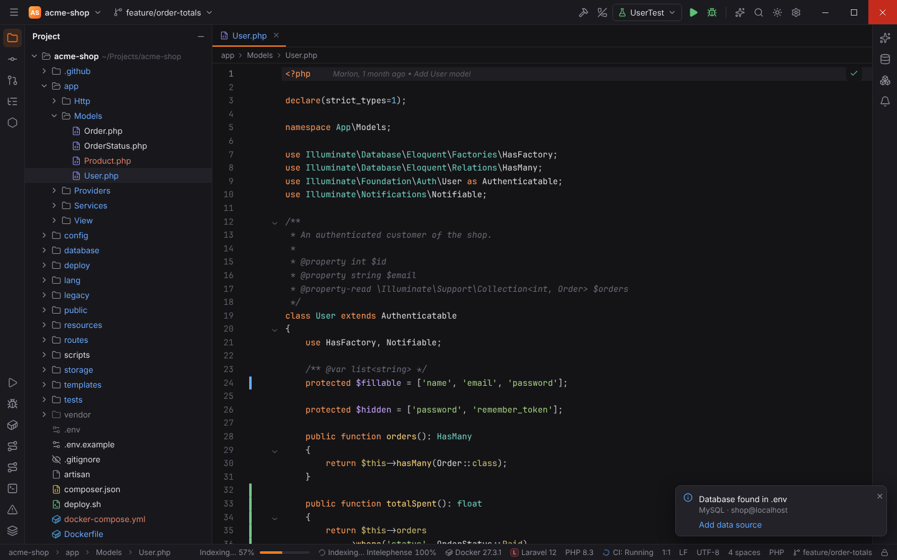 | 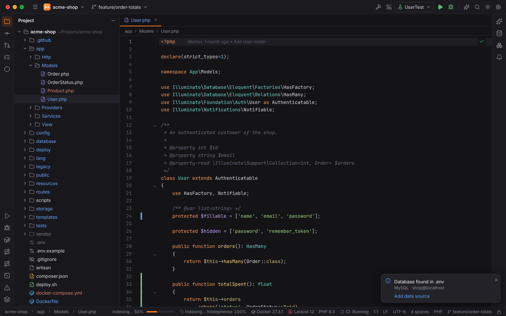 | 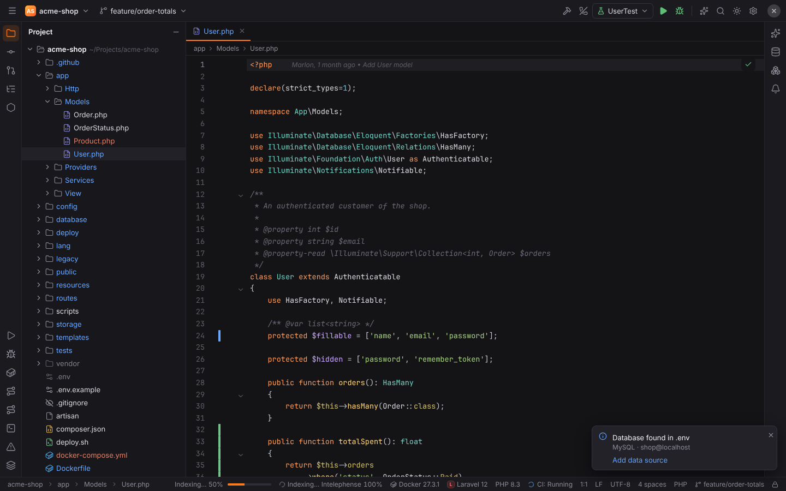 |
| 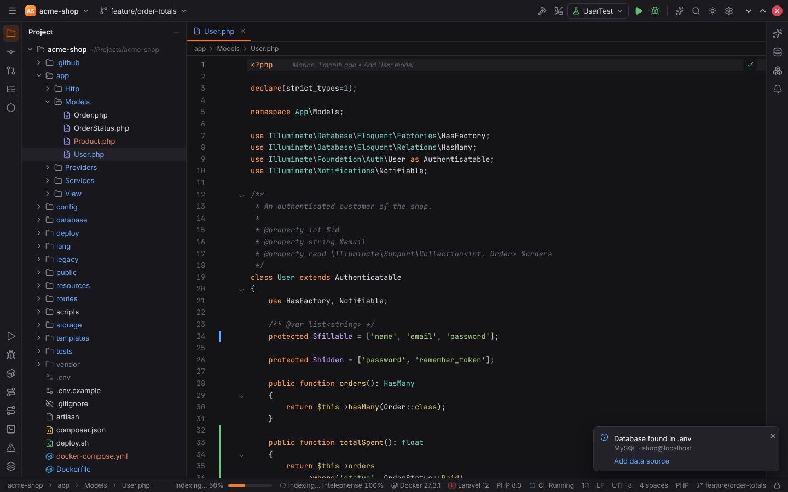 | 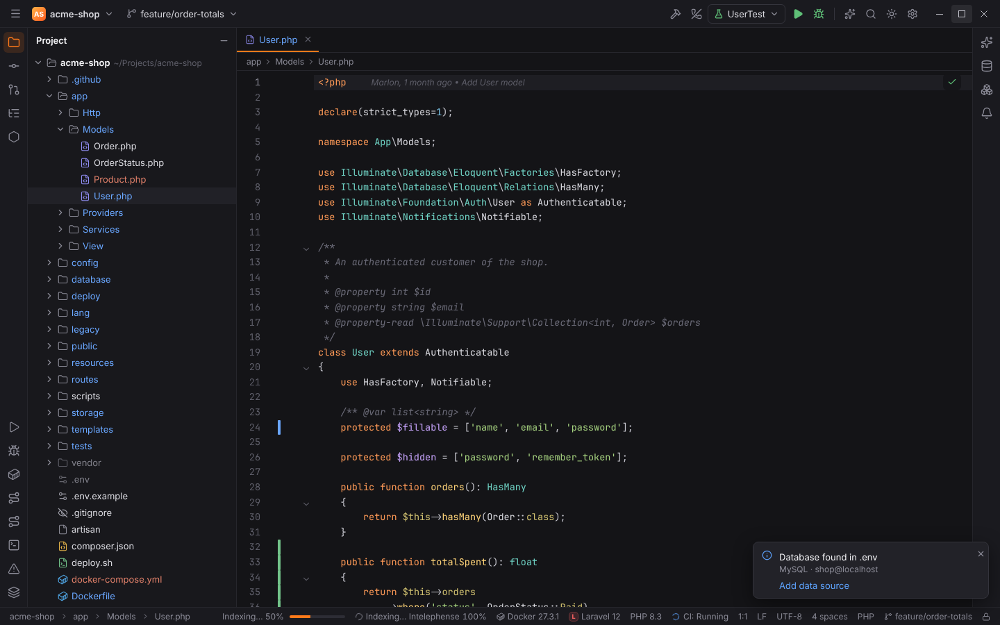 | 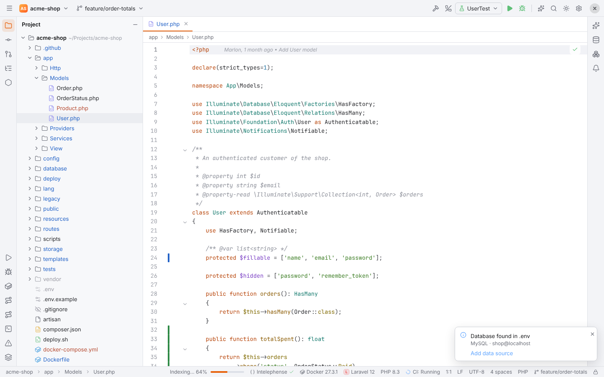 |

Large dialogs (Settings, Run/Debug Configurations, New Project, New SSH Connection, Data
Sources and Drivers) open as their own windows with the same style:

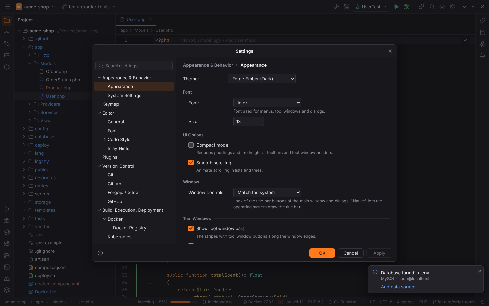

## Not applied yet

These options are shown in Settings but have no effect on this version: Show tool window
numbers, Smooth scrolling (Appearance), everything under System Settings except **Default
project directory** (reopen projects on startup, confirm exit, open project in, autosave,
synchronize external changes), caret blink period, remove trailing spaces on save, ensure line
break at end of file, Code Style, Inlay Hints, the Git page, the Composer page except the
composer path, console cycle buffer size, terminal audible bell and shell integration. The
[settings reference](../reference/settings.md) marks each of them.
