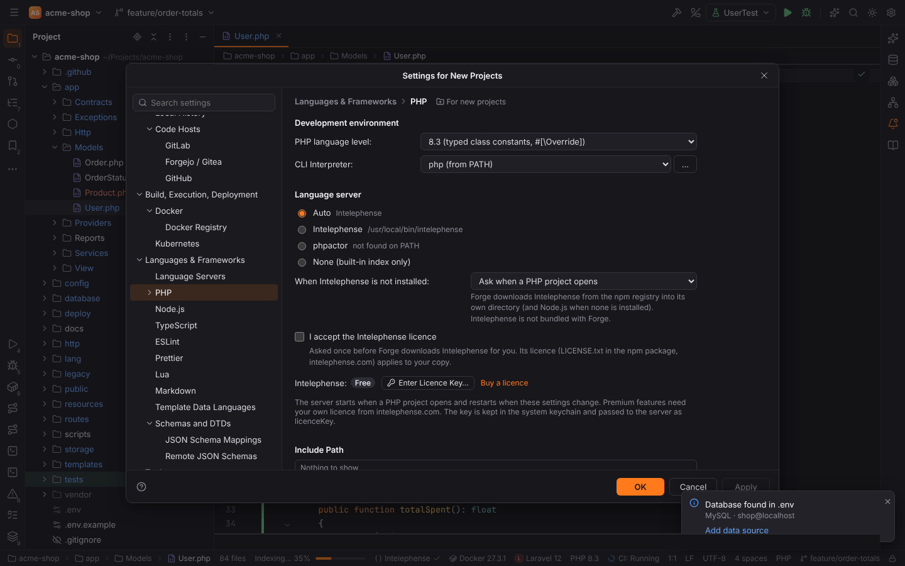
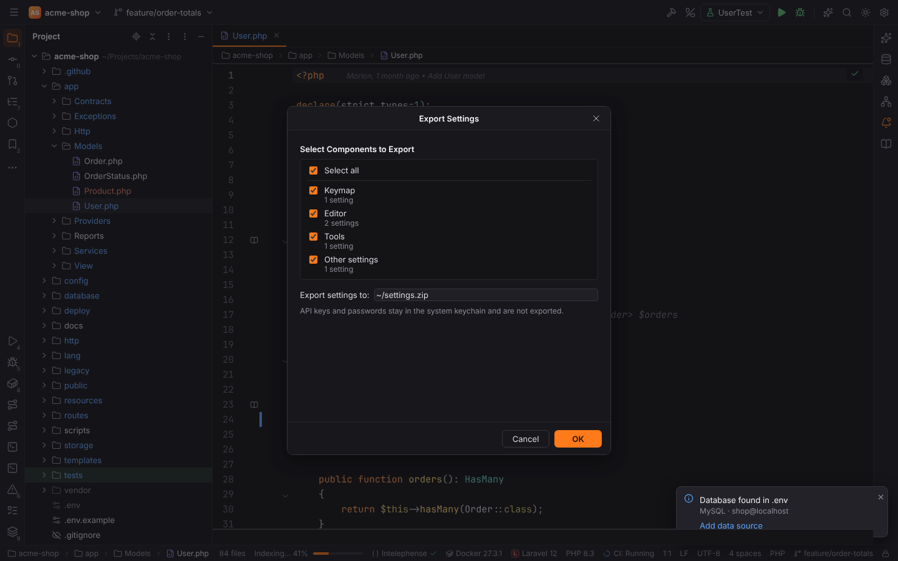
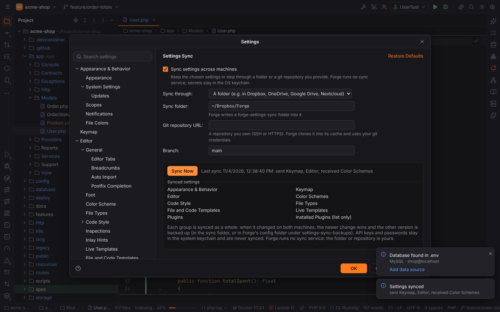
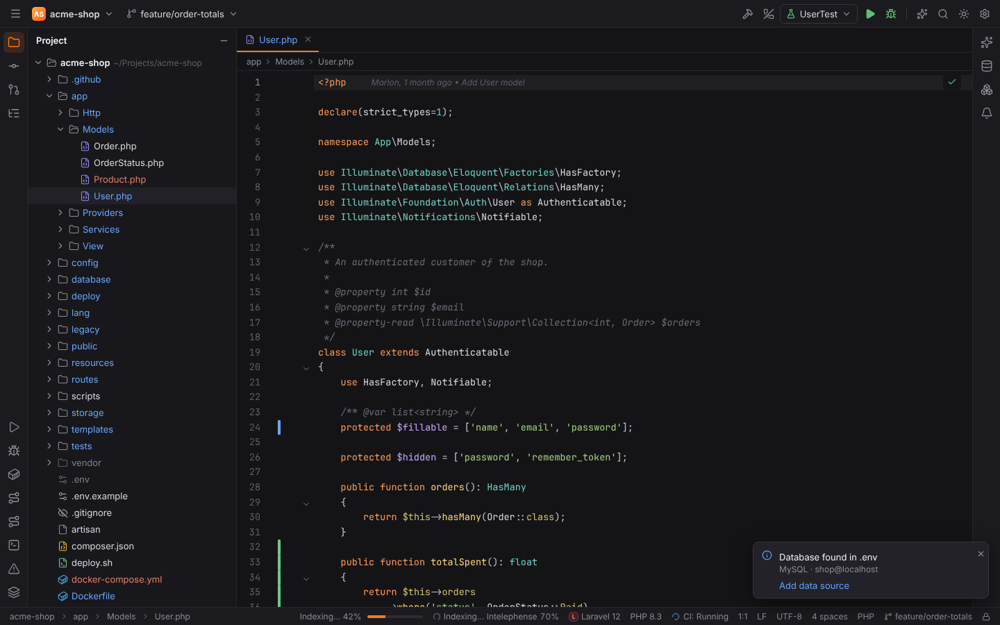
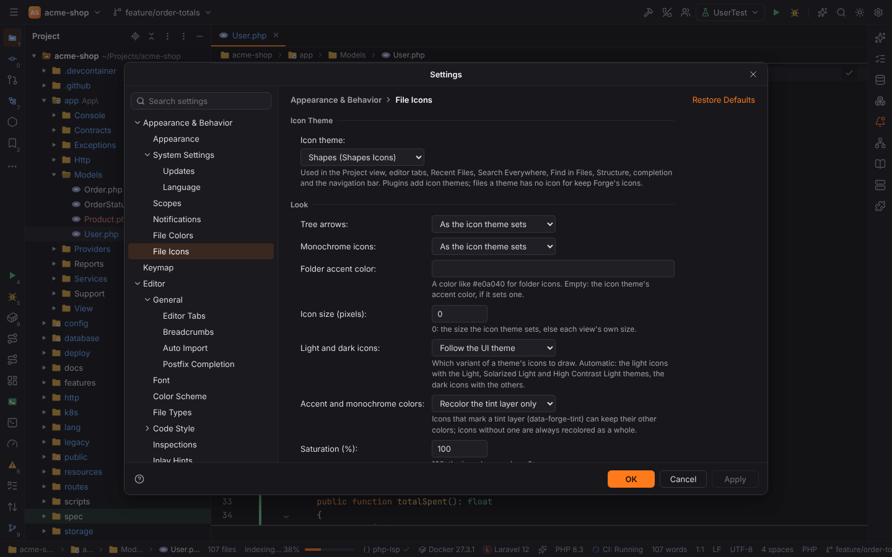
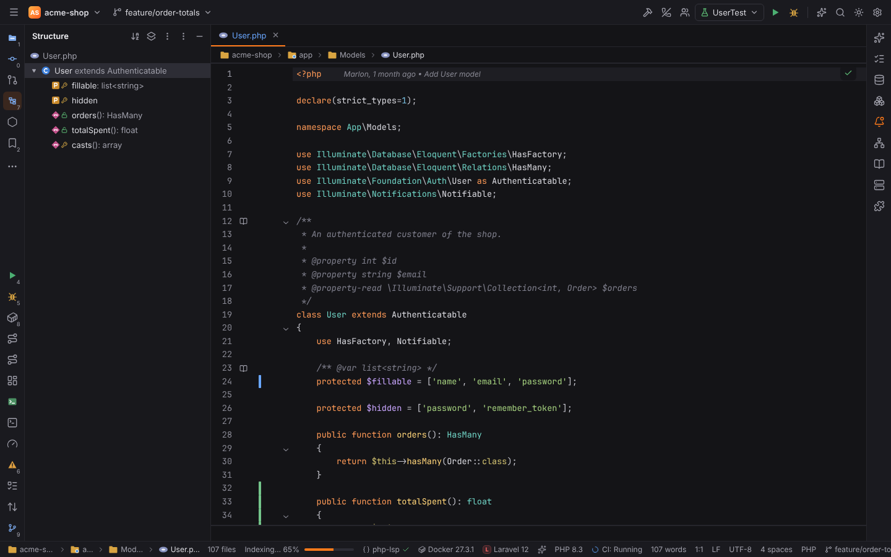
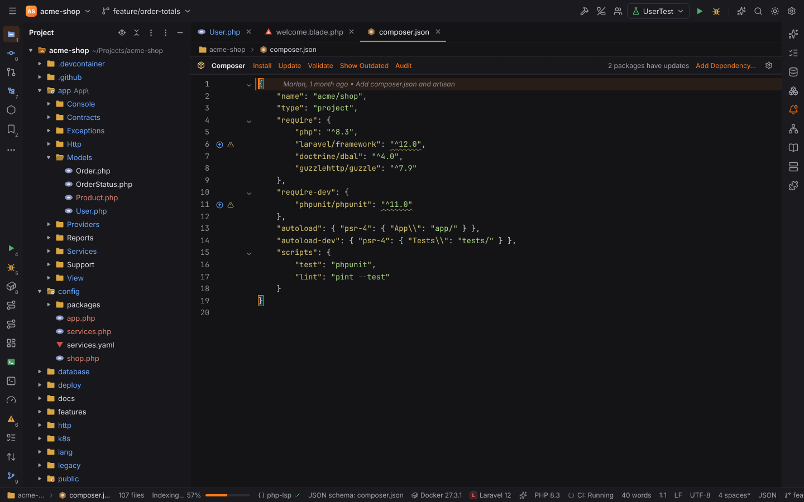
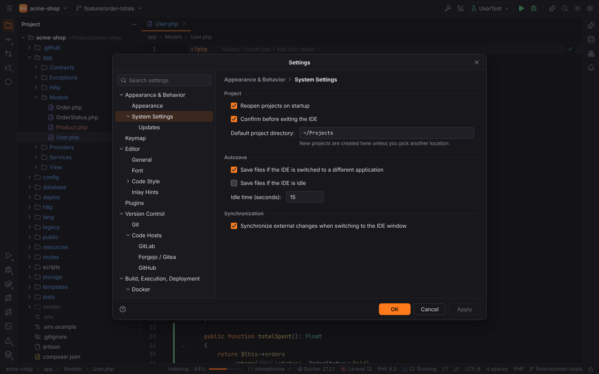

# Settings and themes

## The Settings dialog

**Settings** (`Ctrl+Alt+S`, macOS `Cmd+,`, or the gear in the main toolbar) opens the Settings
dialog, with the same tree as PHPStorm:

- **Appearance & Behavior**: Appearance, System Settings
- **Keymap**
- **Editor**: General, Font, Color Scheme, Code Style (schemes, General and one page per language), Inlay Hints
- **Plugins**
- **Version Control**: Git, GitLab, Forgejo / Gitea, GitHub
- **Languages & Frameworks**: Language Servers, PHP (Composer, Debug, Servers, Laravel,
  Symfony, Doctrine), Node.js, TypeScript, Lua, Template Data Languages
- **Tools**: Terminal, Database, AI Agents, AI Providers, Browser Companion, HTTP Client, SSH Configurations
- **Build, Execution, Deployment**: Docker (Docker Registry), Kubernetes


- **Search settings** at the top filters the tree and highlights matching options on every
  page, also by keywords ("theme", "autosave", "interpreter").
- **OK** applies and closes, **Apply** applies and keeps the dialog open, **Cancel** discards.
- Invalid values (out of range, wrong type) are flagged right away and not saved.
- **Reset** (top right) throws away the unapplied changes of the page; **Restore Defaults**
  sets every option of the page to its default (Apply or OK stores it).
- In the desktop app the dialog is its own window; its size and position are remembered.


Every option, its key, type and default is listed in the
[settings reference](../reference/settings.md).

## User and project settings

Settings come in four layers; a later one wins:

1. built-in defaults (declared by the plugins),
2. **user** settings: `<config dir>/forge/settings.toml`,
3. **Settings for New Projects** (project-level options only):
   `<config dir>/forge/new-project-settings.toml`,
4. **project** settings: `<project>/.forge/settings.toml`.

Pages with options that can be stored per project show **For current project** in the header;
those options are saved to the project's file, which you can commit to share them with your
team (for example the PHP language level or the Symfony environment). A value that equals
what the layers below give is not stored again, so the project keeps following them.

### Settings for New Projects

File | New Projects Setup | **Settings for New Projects…** opens the Settings dialog for the
defaults of project-level options. The pages with such options show **For new projects**;
their values apply to every project that has no value of its own: the projects you create or
open next, and open projects that never changed the option. Application options (theme, fonts,
keymap, …) are the same everywhere and are edited as usual. On the Welcome screen, without an
open project, the Settings dialog edits these defaults as well.



## Export and Import Settings

File | Manage IDE Settings | **Export Settings…** writes your settings to a settings archive
(a `.zip` file). Choose the groups to export: Appearance & Behavior, Keymap, Editor, Color
Schemes, Code Style (every language's code style settings), File Types, File and Code Templates,
Live Templates, Version Control, Languages & Frameworks, Tools, Plugins (enabled and disabled
plugins), Other settings, and the files Settings for New Projects, AI Providers, Data Sources,
SSH Configurations and Installed Plugins (the list of installed third-party plugins, not the
plugins themselves). Only groups with changed settings are listed.



**Import Settings…** reads such an archive, lists the groups it holds and imports the chosen
ones: each imported group replaces your settings of that group. Forge then restarts. Plugins of
an imported plugin list that are not installed are named in Settings | Plugins | Marketplace.

> **Note:** API keys, tokens and passwords live in the system keychain and are never part of a
> settings archive.

## Settings Sync

**Settings Sync** keeps your settings in step between computers without a Forge account or
cloud service: you provide the place they are shared through. Open it with File | Manage IDE
Settings | **Settings Sync…** (or Settings | Settings Sync).



| Option | Meaning |
| --- | --- |
| Sync settings across machines | Sync on start and about 30 seconds after you change a setting |
| Sync through | **A folder**, for example in Dropbox, OneDrive, Google Drive, Nextcloud or a network share, or **a git repository** |
| Sync folder | Forge writes a `forge-settings-sync` folder into it |
| Git repository URL, Branch | A repository you own (SSH or HTTPS). Forge clones it into its cache folder and pushes with your git credentials |

**Sync Now** (also File | Manage IDE Settings | **Sync Settings Now**) syncs immediately and
reports what was sent and received.

The synced groups are the ones of Export Settings (by default Appearance, Keymap, Editor, Color
Schemes, Code Style, File Types, File and Code Templates, Live Templates, Plugins and the
Installed Plugins list). Each group is synced as a whole:

- changed only here → it is sent; changed only on the other computer → it is received;
- changed on both since the last sync → the **newer** change wins (last writer wins per
  group). The other version is not lost: a losing local version is saved in
  `<config dir>/forge/settings-sync-backups/<time>/`, a losing shared version in
  `forge-settings-sync/backups/<time>/` of the sync folder.

The Settings Sync options themselves (folder, repository) stay on each computer. API keys,
tokens and passwords live in the system keychain and are never synced. Received configuration
files (AI providers, data sources, SSH configurations) take effect after a restart.

## Restore Default Settings

File | Manage IDE Settings | **Restore Default Settings…** copies your configuration folder to
`<config dir>/forge-backup-<date>-<time>` and restarts Forge with the default settings (the
user settings, the Settings for New Projects and the dialog window sizes are reset).
Connections and accounts (AI providers, code hosts, data sources, SSH configurations), recent
projects and scratches are kept. To go back, copy the files from the backup folder.

### Settings files

The files are TOML with dotted keys as nested tables. You can edit them by hand; Forge picks up
changes on the next start:

```toml
# ~/.config/forge/settings.toml
[appearance]
theme = "light"
windowControls = "gnome"

[editor.font]
family = "Fira Code"
size = 14

[vcs.hosts]
refreshSeconds = 300
```

Some options have no page in the dialog and can only be set this way, such as
`vcs.hosts.statusBarPipeline` and `vcs.hosts.refreshSeconds`.

Secrets (API keys, tokens, passwords, licence keys) never go into these files; they are stored
in the operating system keychain.

## Themes

Settings | Appearance & Behavior | Appearance | **Theme** (`appearance.theme`):

| Theme | Value |
| --- | --- |
| Forge Ember (Dark) | `dark` (default) |
| Forge Anvil (Light) | `light` |
| Solarized Dark | `solarized-dark` |
| Solarized Light | `solarized-light` |
| High Contrast | `high-contrast` |
| High Contrast Light | `high-contrast-light` |

The sun/moon button in the main toolbar, **Theme: Toggle Dark/Light** and **Quick Switch
Scheme…** (`` Ctrl+` ``) toggle between dark and light.

The editor's colors follow the theme unless you choose a color scheme in Settings | Editor |
Color Scheme; see [Color schemes](color-schemes.md). The High Contrast themes meet WCAG AAA
contrast and draw borders and strong focus rings; see [Accessibility](accessibility.md).

| | |
| --- | --- |
|  |  |

## Appearance options


| Option | Setting | Default |
| --- | --- | --- |
| UI font (Inter, System default, Segoe UI, Roboto) | `appearance.uiFont.family` | Inter |
| UI font size (10–20) | `appearance.uiFont.size` | 13 |
| Compact mode | `appearance.compactMode` | off |
| Main menu (Hamburger menu, Merged with main toolbar, Show in separate toolbar) — see [Main menu](workbench.md#main-menu) | `appearance.mainMenu` | Hamburger menu |
| Window controls | `appearance.windowControls` | Match the system |
| Show tool window bars | `appearance.showToolWindowBars` | on |
| Open files with single click (Project view) | `projectView.openFilesWithSingleClick` | on |
| Always select opened file (Project view) | `projectView.autoscrollFromSource` | off |
| Autoscroll to source / from source (Structure view) | `structureView.autoscrollToSource`, `structureView.autoscrollFromSource` | on |

Editor fonts are under Settings | Editor | Font: JetBrains Mono (default), Fira Code, Cascadia
Code, Source Code Pro, Menlo, Consolas or the system monospace font, size (13.5), line height
(1.6) and ligatures.

## File icons

Settings | Appearance & Behavior | **File Icons** picks the icon theme of the Project view,
editor tabs, Recent Files, Search Everywhere, Find in Files, the Structure tool window, code
completion and the navigation bar. Themes that include them also replace the symbol icons
(classes, methods, properties, … in Structure, completion, Go to Class / Symbol, breadcrumbs
and the navigation bar), the tool window stripe buttons, the Run / Debug / Stop buttons, run
configuration icons and the VCS status of files in the Commit tool window. Icon themes come
from plugins (for example an Atom Material Icons plugin from the Marketplace); "Forge
(built-in)" keeps Forge's own icons, and anything a theme has no icon for keeps them too.



| Option | Setting | Default |
| --- | --- | --- |
| Icon theme | `fileIcons.theme` | Forge (built-in) |
| Tree arrows (as the theme sets, chevrons, triangles, plus and minus, arrows, none) | `fileIcons.treeArrows` | as the theme sets |
| Monochrome icons (as the theme sets, on, off) | `fileIcons.monochrome` | as the theme sets |
| Folder accent color (`#rrggbb`; empty: the theme's) | `fileIcons.accentColor` | empty |
| Icon size in pixels (0: the theme's or the view's) | `fileIcons.size` | 0 |
| Light and dark icons (follow the UI theme, always dark, always light) | `fileIcons.variant` | follow the UI theme |
| Accent and monochrome colors (recolor the tint layer only, recolor the whole icon) | `fileIcons.tintMode` | the tint layer only |
| Saturation in percent (0: gray) | `fileIcons.saturation` | 100 |
| Opacity in percent (10 to 100) | `fileIcons.opacity` | 100 |
| Hollow folders: folders that hold open files (as the theme sets, on, off) | `fileIcons.hollowFolders` | as the theme sets |
| Folder colors: folder name or glob → color | `fileIcons.folderColors` | none |
| Custom associations: file name, extension, pattern, regular expression or folder name → an icon of the active theme | `fileIcons.associations` | none |

- **Light and dark icons.** A theme can ship light variants of its icons. With "Follow the
  UI theme" they are used with the Light, Solarized Light and High Contrast Light themes;
  the dark themes, High Contrast included, use the dark icons. Switching the UI theme
  switches the icons at once.
- **Tint layer.** The accent color, a folder color and monochrome recolor only the part of an
  icon that the theme marks as its tint layer, so two-tone folders keep their badge. Icons
  without such a layer are recolored as a whole, as is every icon with "Recolor the whole
  icon".
- **Hollow folders.** With the option on, folders that hold a file open in the editor get the
  theme's hollow folder icon; Forge's own icons show a folder with a dot.
- **Folder colors.** A row matches a folder by name or glob (`vendor`, `*-cache`) or by a path
  relative to the project root when it contains a `/` (`app/Http/*`; a leading `/` matches
  only at the root). The first matching row wins, before the accent color. Folder colors
  also color Forge's own folder icons.
- **Root folder.** Themes can give the project root in the Project view an icon of its own.



Custom associations come before the theme's own rules, so `Makefile` or `*.stub` can get the
icon you want. Associations that name an icon the theme does not have, and folder colors that
are not colors, are listed under the theme picker and ignored.



### Window controls

Forge draws its own title bars. **Window controls** chooses how their buttons look:

| Value | Look |
| --- | --- |
| `auto` — Match the system | detected from the OS and desktop (`XDG_CURRENT_DESKTOP`, `DESKTOP_SESSION`, `KDE_FULL_SESSION`, …), including the button order of GNOME (`button-layout`) and KDE (`kwinrc`) |
| `windows` | Windows 11 buttons on the right |
| `macos` | traffic lights on the left |
| `gnome` | GNOME/Adwaita round buttons |
| `kde` | KDE Plasma (Breeze) buttons |
| `linux` | generic Linux buttons |
| `native` | the operating system draws the title bar (Forge's toolbar is then below it) |

| | | |
| --- | --- | --- |
|  |  |  |
|  |  |  |

Large dialogs (Settings, Run/Debug Configurations, New Project, New SSH Connection, Data
Sources and Drivers) open as their own windows with the same style:


## System Settings



Settings | Appearance & Behavior | System Settings:

| Option | Setting | What it does |
| --- | --- | --- |
| Reopen projects on startup | `system.reopenLastProject` | Forge starts with the last local project |
| Confirm before exiting the IDE | `system.confirmExit` | closing the main window (or File \| Exit) asks "Are you sure you want to exit Forge?"; **Do not ask me again** turns it off. Open files are saved on exit. |
| Default project directory | `system.defaultProjectDirectory` | where New Project creates projects |
| Save files if the IDE is switched to a different application | `system.autosave.onFrameDeactivation` | saves all modified files when Forge loses the focus |
| Save files if the IDE is idle, idle time | `system.autosave.onIdle`, `system.autosave.idleSeconds` | saves after that many seconds without typing or clicking |
| Synchronize external changes when switching to the IDE window | `system.syncExternalChanges` | re-reads open files changed on disk and refreshes the Project view and Git status |

Every option in the Settings dialog applies; the [settings reference](../reference/settings.md)
lists them all.
